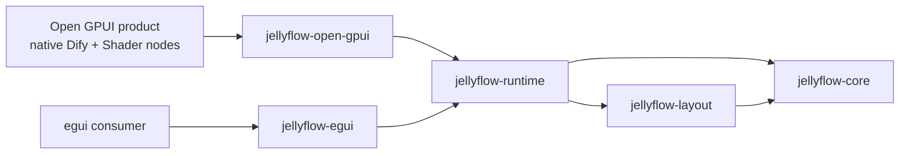
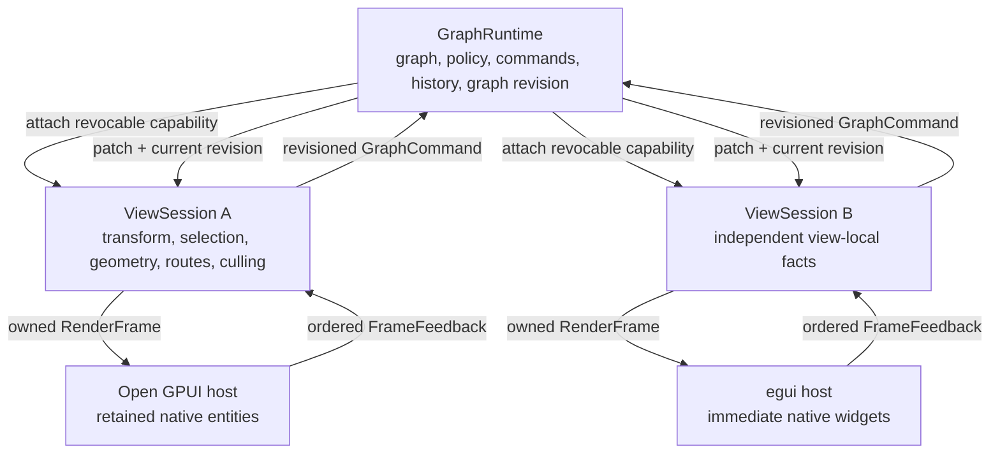
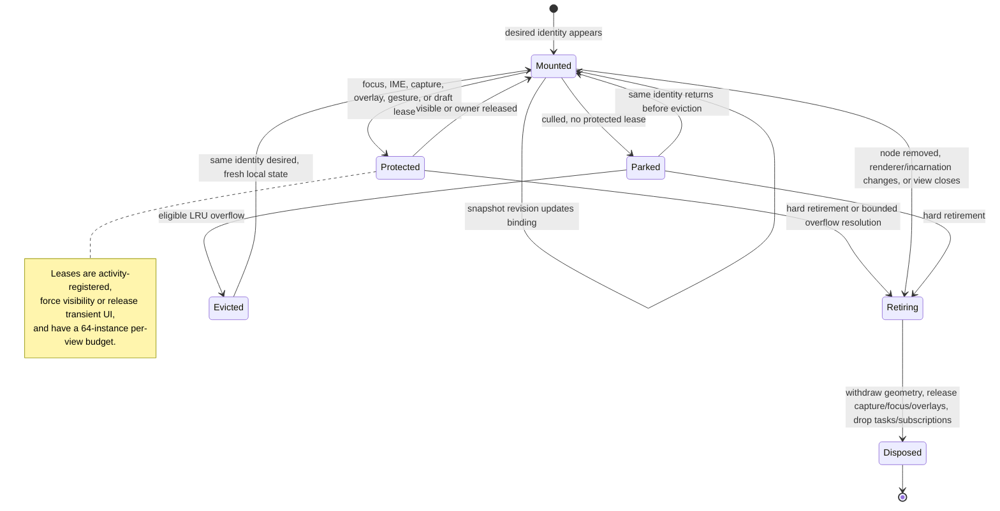
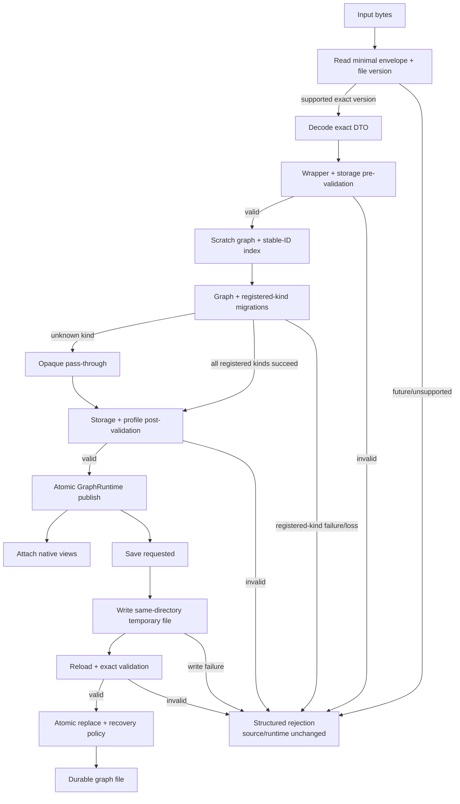
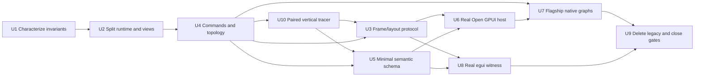

# Headless Native Node Host Fearless Refactor - Plan

## Goal Capsule

| Field | Decision |
| --- | --- |
| Objective | Replace Jellyflow's cross-framework node UI DSL with a renderer-neutral graph/view protocol and framework-native node hosts, making Open GPUI the first-class authoring path while proving the seam with a real egui adapter. |
| User-visible problem | Jellyflow can describe many node surfaces today, but Open GPUI authors cannot compose arbitrary native controls and retained state as naturally as Dify, Unity Shader Graph, or Unreal Blueprint authors expect. The current descriptor, projection, manual-fit, and evidence layers duplicate a widget toolkit without owning a real framework lifecycle. |
| Architecture stance | Headless means one graph document, transaction engine, connection policy, and interaction kernel can drive multiple native adapters. It does not mean one node widget tree renders in every framework. |
| Execution profile | Fearless, breaking refactor across `jellyflow-core`, `jellyflow-runtime`, both adapters, examples, templates, tests, and documentation. Temporary migration scaffolding may exist between units, but no deprecated DSL lane or compatibility facade may remain at completion. |
| Authority hierarchy | The Product Contract and acceptance examples govern behavior. Key Technical Decisions govern architecture. Implementation Units govern sequencing. Research paths are evidence, not an alternative specification. |
| Stop conditions | Stop and surface a blocker only if current V2 persisted graph facts cannot survive supported node-kind migration without silent loss, Open GPUI 0.2.0 lacks a required lifecycle primitive verified in its source, or the Open GPUI and egui tracers prove the proposed protocol cannot represent both frameworks without framework types. Released V1 is an explicit structured-rejection boundary, not a migration blocker. Do not stop for public Rust API breakage or deletable legacy code. |
| Tail ownership | Execute through the implementation units in dependency order, keep each landing slice reviewable, and obtain user confirmation before Conventional Commit creation. Do not use this plan as a progress log. |

---

## Product Contract

### Summary

Jellyflow will expose a small, owned-data protocol between a shared graph runtime and each UI view. A view asks for a revisioned frame, lays out ordinary framework-native components, and submits graph intents plus measured node and real-port geometry after the framework render stack has released its borrows.

`jellyflow-open-gpui` will become a real Open GPUI adapter. It will own a retained node registry, component lifecycle, measurement collection, graph-semantic wrappers, and native input arbitration. Application code will build node internals from ordinary Open GPUI controls and retain application-specific state and services outside the headless runtime.

The existing slots, controls, repeatables, actions, menus, inspectors, blackboards, chrome, layout budgets, portable projections, JSON binding planners, and capability evidence matrix will be deleted. A reduced semantic node-kind catalog will keep creation metadata, migrations, default data, real port declarations, typing and connection facts, `renderer_key`, and small presentation hints.

### Problem Frame

DOM-based xyflow obtains arbitrary node UI from React or Svelte component trees and feeds measured DOM geometry back to a shared graph engine. Jellyflow's self-drawn/native environment has no DOM measurement or event propagation layer to borrow. The current response was to encode UI vocabulary inside runtime schemas, then reproduce projection, binding, fit, evidence, and host glue for every adapter.

That direction produces a broad public interface with little depth. `NodeGraphStore` also mixes authoritative graph state with one view's transform, selection, geometry, and caches, while `jellyflow-open-gpui` does not depend on Open GPUI and leaves the real host in `examples/canvas-jellyflow`. Supporting Dify- and Shader Graph-class nodes requires moving the boundary to graph facts and feedback, then letting each framework do native UI work.

### Actors

- A1. Graph end user: edits a workflow or typed visual program through responsive native controls, ports, connections, search, undo, pan, zoom, and overlays.
- A2. Open GPUI node author: registers retained native views, composes normal Open GPUI controls, and attaches graph meaning only where a port or canvas interaction requires it.
- A3. Adapter author: consumes owned render frames, reports complete geometry, and translates native events without implementing a Jellyflow widget vocabulary.
- A4. Application integrator: owns domain commands, catalogs, asynchronous resources, product panels, and execution services while delegating graph invariants and history to Jellyflow.

### Requirements

#### Headless runtime and view protocol

- R1. Keep `jellyflow-core`, `jellyflow-layout`, and `jellyflow-runtime` free of Open GPUI, egui, windowing, focus, IME, popup, and framework widget types.
- R2. Split the authoritative graph, document revision, policies, transactions, subscriptions, and undo/redo history from per-view transform, selection, gestures, geometry, routing, culling, and spatial caches; keep persisted editor-state seeds separate from graph documents and live framework state.
- R3. Let one graph runtime attach multiple independent view sessions and publish every committed graph change to all live sessions without sharing view-local geometry or interaction state; runtime lifetime governs session capabilities and session close is terminal and idempotent.
- R4. Expose an owned, immutable render frame whose opaque token binds graph, view, transform, adapter environment, node incarnation, renderer, and layout-request revisions, while giving unmeasured nodes provisional admission bounds so first layout cannot deadlock behind culling.
- R5. Atomically consume one replay-protected, host-ordered feedback log before layout validation; closed, foreign, or replayed submissions have zero side effects, and geometry made stale by accepted operations must never revive retired hit targets.
- R6. Validate node layout candidates independently, stage the valid subset, then publish all accepted node bounds and complete real-port coverage under one view layout revision while rejecting wrong-view, foreign-port, duplicate, incomplete, non-finite, or revision-mismatched candidates.
- R7. Distinguish hard retirement from culling using runtime-assigned `(ViewId, NodeId, RendererKey, NodeIncarnation)` identity so renderer replacement, node deletion/re-add, document replacement, and view closure withdraw geometry and dispose state while ordinary culling may park a bounded retained instance.

#### Graph semantics and persistence

- R8. Treat graph `Port` records with stable `PortId`s as the only valid edge endpoints; adapter-local visual handles without a real port must never enter routing, hit testing, or transactions.
- R9. Provide an expected-revision graph command for atomic node topology edits addressed by stable item and port identities, updating payload, real ports, port order, incident-edge policy, layout invalidation, and one undo boundary without automatic conflict merge or retry.
- R10. Keep connection candidate filtering, final validation, replacement/reconnect behavior, type policy, capacity policy, and structured rejection reasons authoritative in the headless runtime.
- R11. Preserve stable graph, node, port, edge, group, symbol, sticky-note, and binding facts within the supported V2 envelope across exact loading, atomic saving, node-kind migration, unknown-node round trips, undo, and redo without silent loss; reject V1 and future envelopes before typed payload decode. Any failure classified before atomic replacement leaves the target bytes unchanged. An indeterminate replacement reports `CommitOutcomeUnknown` with a staged recovery path when available, while a completed replacement whose parent-directory durability cannot be confirmed reports `CommitDurabilityUnknown`; both require inspection or reload/validation recovery and must never be treated as safely retryable.
- R12. Decode and validate a supported V2 document into scratch state, migrate registered node kinds atomically, validate the canonical result again, and only then publish a runtime or attach a view; native mount, render, layout, and paint paths consume canonical snapshots only.

#### Native adapter authoring

- R13. Make `jellyflow-open-gpui` depend on published Open GPUI 0.2.0 APIs and own the reusable native registry, scene host, retained binding, component reconciliation, measurement bridge, input arbitration, and unknown-renderer fallback without assuming `open-gpui-canvas` provides native node-widget slots.
- R14. Make retained `Entity<V: Render>` registration the primary Open GPUI authoring path, with type erasure to `AnyView` hidden inside the registry and no `AnyElement` or `RenderOnce` public fast path in the first release.
- R15. Limit shared native helpers to graph-semantic composition primitives such as `PortHandle`, `NodeInteractionGuard`, host chrome, and measured root/port wrappers; node layout, controls, theme, focus, IME, scroll, and popovers remain ordinary Open GPUI.
- R16. Keep application/domain commands and asynchronous services out of the shared frame protocol; registry closures may capture application entities and command sinks that produce revisioned graph commands or application effects.
- R17. Seal each host-scoped renderer registry before attaching a view, reject duplicate keys as configuration errors, and render an adapter-local diagnostic fallback for unknown kinds, missing keys, or mount failures while preserving opaque data and policy-controlled real ports.
- R18. Rebuild a minimal but real egui protocol-witness adapter against the same view protocol without a cross-framework renderer trait, proving retained and immediate-mode lifecycles, while keeping Open GPUI as the sole product-tier adapter in this refactor.

#### Flagship experience and cleanup

- R19. Ship Open GPUI-native Dify-style workflow fixtures with editable text/select controls, menus, scrollable content, status, and dynamic condition branches whose output ports are real topology.
- R20. Ship Open GPUI-native Shader Graph/Blueprint fixtures with typed ports, inline disconnected values, create-from-wire search, occupied-input reconnect, profile-specific cycle/type rejection, dynamic pins, and a native blackboard view over graph symbols.
- R21. Retain ERD and mind-map behavioral regression fixtures without requiring the same product depth as workflow and shader families.
- R22. Remove `docs/adr/**` and all active links to that registry when this plan is adopted. Delete the runtime UI DSL, widget-free Open GPUI planners, shaped-data proof crate, legacy capability matrix, manual fit/binding glue, and remaining stale documentation only after both real adapters and flagship fixtures use the replacement path.

#### Adoption and native interaction

- R26. Publish `jellyflow-open-gpui` as a supported public adapter, include it in package/release validation, and prove a workspace-external consumer can build a retained custom node with native controls, application-owned state, and dynamic real ports using only released public APIs.
- R27. Define an adapter-local native interaction and accessibility baseline for desktop mouse and keyboard: deterministic control/port/node/canvas/overlay ownership, draft-conflict recovery, connection-search cancellation/failure recovery, culling-safe focus behavior, keyboard traversal, and framework-exposed semantic roles/names/state. Touch and pen input remain deferred.

#### Scale and resource bounds

- R23. Materialize each frame from the visible set, overscan, and explicit routing dependencies without deep-copying unchanged node payloads; the default stress contract is 10,000 nodes, about 100 visible nodes, and four attached views.
- R24. Propagate a single-node graph or layout change in `O(view_count + affected_facts)` work: authoritative command construction reads only affected facts and never falls back to a full-graph diff; unrelated node bindings receive no update, spatial indexes update incrementally, and route invalidation touches only incident edges.
- R25. Make native layout feedback converge without refresh loops and bound adapter-local retention: a static layout settles within two feedback cycles, equivalent or epsilon-only feedback remains quiescent, and lifecycle churn returns entities and framework resources to a measured baseline. A view may protect at most 64 distinct native-instance owners in addition to its 256 eligible parked entries; multiple activity leases on one instance share one owner slot, and overflow externalizes a draft record or cancels/releases a transient owner before the retained entity can be reclaimed.

### Key Flows

- F1. Frame and layout: a view session produces an owned frame bound to the adapter environment epoch, provisional bounds admit unmeasured nodes, the adapter reconciles native components, the framework completes layout/prepaint, and one deferred feedback submission publishes only still-current geometry.
- F2. Native control edit: an Open GPUI control owns focus and input, dispatches an application or graph command, and does not accidentally begin node drag or viewport pan. The adapter resolves input ownership in the declared control/overlay, port, node-chrome, then canvas order and preserves capture only through explicit release or cancellation.
- F3. Dynamic topology: a node author requests an add/remove/reorder action, the application maps it to one revisioned graph command, the runtime commits payload/ports/edges/history atomically, and the next frame exposes the new real ports.
- F4. Typed connection and search: dragging from a port uses the runtime compatibility engine to filter native search results, and final connection or reconnect runs the same policy before committing one undo item. Empty results, query errors, escape/outside cancellation, stale candidates, and rejected commits leave graph facts unchanged; reconnect retains its old edge until the replacement command commits.
- F5. Lifecycle and fallback: a stable parked node identity retains component-local state only while it remains cached; eviction remounts fresh, while hard retirement or terminal view closure withdraws geometry, pointer capture, focus, overlays, subscriptions, and tasks before a late callback can mutate the current view.
- F6. Multi-view and load: a canonical graph opens and migrates once, multiple views attach with independent geometry, and graph commands fan out while each adapter measures and renders its own native layout.

### Acceptance Examples

- AE1. Given two views attached to one runtime, when they use different zoom, selection, theme, and node measurements, then they observe the same graph revision while their geometry, routes, focus, hover, and culling remain isolated.
- AE2. Given a feedback submission contains host-ordered intents and graph commands, when it is accepted, replayed, or arrives after another command changes the frame's topology, then the first submission preserves event order and produces one receipt per operation while replay or stale layout publishes no old hit target and repeats no command.
- AE3. Given one node layout omits a real port or reports another node's port, when feedback is submitted, then that node's entire bounds-and-ports commit is rejected while previously accepted geometry is not partially mixed with the new revision.
- AE4. Given a Dify condition node with two branches, when the user adds, reorders, and removes a branch, then unchanged branches retain `PortId`s, removed ports apply their declared edge policy, and one undo restores payload, order, ports, and edges exactly.
- AE5. Given a shader input already has an edge, when the user connects a compatible replacement, then replacement is one atomic command and one undo item; an incompatible type, direction, capacity, profile cycle, or stale revision returns a structured reason and changes nothing.
- AE6. Given a focused text input, open select menu, scroll area, or popup inside a node, when the user types, clicks, drags, or scrolls there, then the native control works and the canvas does not start node drag, port drag, or pan.
- AE7. Given a retained node is culled and returns with the same identity before bounded-cache eviction, then its permitted local state is retained; focused, composing, captured, overlay, or dirty-draft owners are force-included or retired through their registered lease rather than becoming invisible focus traps. After eligible LRU eviction it mounts fresh, and after renderer/incarnation change or terminal view closure old focus, pointer capture, overlays, tasks, subscriptions, and geometry cannot survive.
- AE8. Given a graph contains an unknown node kind or missing renderer, when either adapter renders it, then opaque data and all real ports remain intact, the fallback is diagnosable, and saving the graph does not erase unknown facts.
- AE9. Given current V2 graph fixtures, when they are opened, migrated by node kind, saved, and reopened, then stable IDs, payloads, ports, edges, policies, positions, sizes, symbols, groups, notes, and bindings remain equivalent and migration is idempotent; given a released Jellyflow 0.3 V1 fixture containing node and edge focusability, loading rejects before typed payload decode with structured `UnsupportedEnvelopeVersion` and leaves the source unchanged.
- AE10. Given the same tracer graph and semantic commands, when Open GPUI and egui run their native adapters, then both pass the protocol conformance suite despite different component lifecycle and geometry values.
- AE11. Given the completed public surface, when dependency and symbol checks run, then core/runtime contain no UI framework dependency and no slots/controls/repeatables/actions/menu/inspector/blackboard-view/chrome/layout-budget portable DSL remains.
- AE12. Given a wire is dropped on empty shader canvas space, when native search opens, then candidates come from the same headless compatibility query used by final connection validation and selecting a candidate creates the node and edge atomically; no result, query error, stale candidate, escape/outside cancellation, or rejected commit returns focus and leaves the graph and any occupied-input edge unchanged.
- AE13. Given a new, unsized, or unknown-renderer node has no native measurement, when the first frame is culled and rendered, then persisted size, kind default size, or a protocol fallback admits it for measurement while all real port hit targets remain unavailable until complete feedback arrives.
- AE14. Given a focused dirty native control receives undo, redo, or another view's update to the same field, when snapshots reconcile, then clean controls update directly while dirty/composing drafts surface a revision conflict and cannot overwrite the newer graph implicitly. The user may accept the current value, discard the draft, or finish composition and explicitly reapply it against the latest revision; retirement never silently commits a conflicted draft.
- AE15. Given theme metrics, locale, font resolution, DPI, density, or component-local content changes geometry without a graph mutation, when the adapter advances its view environment or node layout epoch, then old feedback and port hits become stale only in that view and fresh layout converges without revision churn.
- AE16. Given two views concurrently add, reorder, or remove dynamic branches, when the stale topology command loses the revision race, then it changes no graph fact or history, returns the current revision and affected footprint, and the application must refresh and re-plan by stable item identity.
- AE17. Given an application exports and later restores editor state, when a view attaches to the current graph, then only versioned transform and explicitly supported editor facts are restored and sanitized; geometry, routes, gestures, focus, IME, drafts, culling caches, and theme never enter `GraphFile`.
- AE18. Given a future-version file with sentinel fields, a structurally corrupt supported file, a known-kind migration failure, or an injected save/replace failure, when load or save runs, then load/migration and a definitely pre-replace save failure leave source/runtime/revision/history unchanged. An indeterminate replacement returns `CommitOutcomeUnknown` and preserves staged recovery bytes when available; a completed replacement followed by parent-directory open or sync failure returns `CommitDurabilityUnknown`. Recovery inspects or reloads and validates one complete file without claiming which target bytes survived or allowing a blind retry.
- AE19. Given 10,000 nodes, about 100 visible nodes, and four views, when one node payload changes after warm-up, then each session receives one bounded patch, the other 9,999 native bindings receive zero update/notify calls, and no frame deep-copies invisible payloads.
- AE20. Given a 10,000-node chain, when one node measurement changes, then only that view's spatial entry and incident routes update; after at most two feedback cycles, 120 equal or epsilon-only samples cause zero layout-revision bumps, route recomputations, index rebuilds, or extra refresh requests.
- AE21. Given a 10,000-node pan sweep and 1,000 mount/retire cycles, when queues drain, then strong native instances never exceed mounted plus the default 256 eligible parked entries and 64 distinct protected native instances per view. Multiple activity leases on one instance consume one protected-owner slot. Protected overflow follows the documented draft-externalization or transient-cancellation path, and entity/task/subscription/overlay/focus/capture/geometry counts return to baseline.

### Success Criteria

- Open GPUI node authors can build the flagship nodes with normal framework controls and only the small graph-semantic wrappers documented by the adapter.
- Open GPUI exercises the product-tier native lifecycle/input contract, while egui exercises the same `GraphRuntime`/`ViewSession` ordering, geometry, receipt, and isolation facts as a narrow immediate-mode witness.
- The workflow and shader families pass structured interaction, topology, geometry, undo, and real-window smoke gates; screenshots remain supporting evidence only.
- The root workspace, nested Open GPUI example workspace, external adapter consumer, and dependency-boundary gates are green.
- The default scale, incremental invalidation, convergence, parked-cache, and lifecycle resource budgets in R23-R25 pass using deterministic counters; wall-clock benchmarks remain trend evidence rather than correctness gates.
- Legacy UI DSL definitions, projections, proof-only capability claims, and dead migration scaffolding are absent from the final tree.

### Scope Boundaries

In scope:

- Breaking public Rust API and schema-builder changes across `jellyflow-core`, `jellyflow-runtime`, `jellyflow-open-gpui`, `jellyflow-egui`, and the `jellyflow` facade.
- Graph/runtime corrections required for multi-view ownership, revision ordering, atomic topology, structured connection outcomes, and graph-document safety.
- A real Open GPUI 0.2.0 adapter and a minimal real egui adapter.
- Native workflow, shader/blueprint, ERD, and mind-map fixtures at the depth stated in R19-R21.
- Deleting superseded code, crates, templates, tests, and architecture claims.

Deferred until demonstrated demand:

- A separate portable form/node-UI crate for server-driven or untrusted UI.
- A third production adapter, a standalone adapter-kit crate, public retention policy knobs, a `RenderOnce` convenience lane, GPUI paint caching, and runtime-loadable renderer plugins.
- Subgraph asset loading and interface propagation beyond ensuring the generic topology and migration contracts do not prevent it.

Out of scope:

- Workflow execution, model/provider calls, shader compilation or preview evaluation, and full Dify/Unity/Unreal feature parity.
- A cross-framework widget trait, shared native widget crate, DOM emulation layer, or runtime UI command DSL.
- Touch and pen gesture parity, beyond the desktop mouse/keyboard baseline in R27.
- Network synchronization, collaborative editing, database persistence, sandboxed plugin ABI, or a new threading model.

### Sources

- `docs/research/2026-07-11-headless-custom-node-ui-architecture.md` records the xyflow, Dify, Unreal, egui, Open GPUI, and design-it-twice evidence behind the boundary.
- `crates/jellyflow-runtime/src/runtime/store/mod.rs:69` shows the current graph/view/history ownership collision.
- `crates/jellyflow-runtime/src/runtime/measurement.rs:120` shows the current store-global, DSL-shaped measurement payload.
- `crates/jellyflow-runtime/src/schema/types.rs:1912` shows the current semantic and UI concerns combined in `NodeSchema`.
- `crates/jellyflow-open-gpui/Cargo.toml:17` shows that the current adapter has no Open GPUI dependency.
- `examples/canvas-jellyflow/src/node_component_kit.rs` and `examples/canvas-jellyflow/src/measurement_bridge.rs` contain the real host mechanics that belong in the adapter.
- The prior ADR registry documented both the renderer-neutral graph/runtime principle and the portable UI direction this plan supersedes. The registry is intentionally removed so the new protocol contracts, migration tests, and this plan are the only active authority.
- Open GPUI 0.2.0 source establishes `Entity<V> -> AnyView`, request-layout/prepaint/paint ordering, `measured_element`, `Window::defer`, native event propagation, pointer capture, focus, and deferred overlays.
- Unity Shader Graph 17.6 official documentation and `Unity-Technologies/Graphics@a7e4c051` establish stable typed slots, atomic topology/undo, native search/blackboard UI, and migration-before-view behavior.

---

## Planning Contract

### Key Technical Decisions

- KTD1. Promise portable graph semantics, not portable node widget trees. A product targeting two frameworks shares graph/domain crates and writes one native renderer package per framework.
- KTD2. Replace `NodeGraphStore` with an authoritative `GraphRuntime` plus explicit `ViewSession`s. The runtime owns the graph, policy, history, revision, and revocable session capabilities; each session owns all view-local facts. Runtime lifetime governs sessions. The close handshake accepts at most one host-supplied final command-only log, validates and receipts it without accepting layout, then atomically enters an idempotent terminal generation where `frame` and `submit` return `Closed`; the session never reaches into adapter-owned queues. A temporary private bridge may keep intermediate units green, but the old public store-shaped ownership is not a final compatibility surface.
- KTD3. Make `frame -> native layout -> submit` the stable adapter seam. Do not introduce `UiBackend`, a framework-associated `NodeRenderer`, or a global renderer registry.
- KTD4. Represent `FrameFeedback` as one monotonically ordered `FeedbackOp` log, not intent/command buckets. Submission first validates session generation, token ownership, and replay status, then atomically consumes the submission before processing operations in host event order with individual receipts. Successful topology, incarnation, or transform changes make that frame's layout stale; selection-only operations do not. Rejected, foreign, closed, or replayed submissions have zero side effects.
- KTD5. Accept adapter measurements through a frame-created collector that hides identity, coordinate conversion, expected-port coverage, finite geometry checks, epsilon comparison, and stale arbitration. Validate each complete node candidate independently, stage the valid subset, then publish that subset once under a single view layout revision so subscribers never observe a half-batch. An invalid node may retain stale/provisional visual bounds for continuity, but all of its port hit targets are withdrawn until a complete candidate succeeds.
- KTD6. Report framework view-space logical-pixel bounds to the collector and convert them with the token's transform revision, view-scoped `AdapterEnvironmentEpoch`, and node-local layout generation. Environment changes that affect geometry invalidate only that view. Unmeasured nodes receive provisional bounds in persisted-size, node-kind default-size, then protocol-fallback order; real port hit targets remain `Unavailable` until complete measurement. Routing anchors, outward normals, visual bounds, and hit bounds remain distinct facts.
- KTD7. Use runtime-assigned `(ViewId, NodeId, RendererKey, NodeIncarnation)` as native instance identity. Incarnation changes on first insertion, delete/re-add, and document replacement; renderer replacement changes identity through `RendererKey`. Culling is soft absence with inactive hit targets and a deterministic per-view LRU whose initial default is 256 eligible parked instances. Focus, IME, capture, overlay, active gesture, or dirty-draft activity protects at most 64 distinct native instances per view; multiple leases owned by the same instance only increase its activity count and do not consume another protected-owner slot. Protected-owner overflow externalizes a draft record or cancels/releases a transient owner before its retained entity can be reclaimed. A protected focus owner is force-included in the visible set, transient overlays close when their anchor parks, and pointer capture survives only until release or cancellation. Deletion, replacement, reincarnation, and view closure are hard retirement with immediate withdrawal through the activity registry.
- KTD8. Keep `GraphTransaction` as the private reversible mutation/history kernel and make revisioned `GraphCommand` the only runtime-external graph write entry. Authoritative committed transactions derive verified before/after values rather than trusting caller-provided inverse state or a full-graph diff. Application handlers read an owned revisioned snapshot, map an application-local domain intent to a constrained generic `GraphCommand` or `TopologyEdit`, and receive runtime-owned validation, history, conflict, and receipt outcomes. A conflict consumes no ID and returns current revision, latest node snapshot, and affected footprint; adapters never auto-merge or retry it.
- KTD9. Use the same headless connection planner for search filtering and final commit. Shader-cycle rejection belongs in the shader profile, not in a global rule that would prohibit workflow loop semantics.
- KTD10. Replace the UI-heavy `NodeSchema` with a separately named, versioned semantic node-kind definition and registry containing kind/version/aliases, palette metadata, `renderer_key`, default size hint, default data, real port declarations, typing/connection facts, and minimal port presentation hints. Old serialized `NodeSchema` descriptors are handled by an explicit lossless migrator where possible or a dedicated unsupported-legacy-schema error, never by serde ignoring deleted fields.
- KTD11. Target published `open-gpui = 0.2.0` without `repo-ref` path dependencies. Core/runtime stay framework-free, while `jellyflow-open-gpui` may depend directly on the framework it adapts. `open-gpui-canvas` is optional drawing/data support, not the owner of native node-widget slots or scene ordering.
- KTD12. Register generic retained `Entity<V: Render>` factories and erase them to `AnyView` inside `jellyflow-open-gpui`. Seal the host-scoped registry before view attachment; a duplicate key invalidates that key with a diagnostic fallback rather than first/last-wins, and runtime replacement is deferred. Do not expose `AnyElement`, `RenderOnce`, or `AnyView::cached` as the initial authoring or optimization path.
- KTD13. Keep native focus, IME, scrolling, accessibility, popup layering, pointer capture, tasks, subscriptions, and form drafts in the Open GPUI host and node entities. Each retained node owns an adapter-local activity registry for focus, capture, overlay, task, subscription, and draft leases; hard retirement revokes that registry before entity release. Child-to-host sinks use weak ownership and every late callback validates instance/request generation. Retained controls track base revision plus draft state: clean snapshots update directly, self-command acknowledgement advances the base, and external or undo changes to a dirty/composing field create an explicit conflict. The user may accept current data, discard the draft, or finish composition and explicitly reapply it against the latest revision; no path auto-commits or silently loses a conflict.
- KTD14. Treat graph-file envelope version, `Graph::graph_version`, and node `kind_version` as three independent axes. `GraphFile` writes the exact V2 DTO; released Jellyflow 0.3 V1 documents are intentionally unsupported because removed focusability fields have no current graph representation, so minimal-envelope dispatch returns structured `UnsupportedEnvelopeVersion` before typed payload decode and no V1 API alias is retained. Supported V2 loading performs wrapper/storage pre-validation, migrates a scratch graph by node kind, performs storage/profile post-validation, and atomically publishes only the complete result. Unknown kinds pass through opaquely; any registered-kind migration failure rejects the whole scratch result. Saving writes a same-directory temporary file, reloads and validates it, then atomically replaces the target. Definitely pre-replace failures preserve the target; indeterminate replacement returns `CommitOutcomeUnknown` with recoverable staged bytes when possible, while post-replace parent-directory durability failure returns `CommitDurabilityUnknown`. Neither unknown state promises the old bytes remain or permits blind retry. Deleting serialized `NodeSchema` UI descriptors is an intentional schema-format break and never a reason to rewrite a valid graph document silently.
- KTD15. First run a private paired Open GPUI retained-mode and egui immediate-mode vertical tracer after `GraphRuntime` and `GraphCommand` exist but before public frame/feedback/catalog stabilization. It must render native text/select/button controls, mutate a real dynamic port, collect native geometry, submit one ordered feedback log, and demonstrate stale-layout withdrawal. Freeze the public protocol only after this tracer records the lifecycle facts both frameworks actually require. Keep conformance helpers in runtime until two implementations reveal a deep reusable adapter-kit module.
- KTD16. Supersede the portable UI claims through this implementation plan and the shipped protocol contracts; do not create another ADR for the refactor. Remove `docs/adr/**` at plan adoption rather than deferring it to U9, and remove every active-document link to the registry at the same time; git history remains the historical record. U9 audits that boundary and deletes the remaining old-DSL decision records, DSL, and proof machinery rather than deprecating any of them indefinitely.
- KTD17. Treat algorithmic counters as release gates at the R23-R25 default scale: frames materialize only visible/overscan/routing facts, one-node changes touch only affected bindings/index entries/incident routes, static layout converges within two feedback cycles, parked instances are bounded, and 1,000 lifecycle cycles return resources to baseline. Keep wall-clock Criterion measurements as trend signals so CI correctness does not depend on noisy timing.
- KTD18. Let `jellyflow-open-gpui` own the scene host that places retained native node views by graph record and orders node, edge, chrome, overlay, and input layers. Framework/canvas helpers may paint primitives or supply spatial data, but they never become a required cross-framework node-widget abstraction.
- KTD19. Define native interaction locally, not in the runtime protocol. Overlay and active capture outrank controls; controls and scroll regions outrank port drags; explicit `PortHandle` drags outrank node chrome; node chrome outranks canvas pan/selection. Escape cancels the current owner and restores the prior graph state; cancellation, stale candidates, and rejected commands do not mutate topology. Desktop keyboard traversal, focus restoration, and framework-exposed roles/names/state are release evidence, while touch and pen remain deferred.
- KTD20. Open GPUI is the product-tier adapter. egui is a real but narrow protocol witness: it proves frame/feedback order, complete port geometry, stale withdrawal, command receipts, and multi-view isolation with native egui response geometry and ID state. It does not block release on retained-cache parity, Open GPUI activity-lease behavior, 1,000-entity teardown, or Dify/Shader product parity.
- KTD21. A first-class adapter must be externally adoptable. Publish `jellyflow-open-gpui` with the workspace release set and retain a workspace-external consumer smoke case that uses only released public APIs; the example remains the flagship product proof, not the only supported integration path.

### High-Level Technical Design

The diagrams state the required ownership and lifecycle relationships; Rust type and method names remain implementation choices.



The compile-time dependency graph above is one-way. The runtime data flow below is bidirectional through owned values and does not imply reverse crate dependencies.



```mermaid
sequenceDiagram
    participant R as GraphRuntime
    participant V as ViewSession
    participant H as Native Host
    participant N as Native Node
    participant F as Framework Layout

    H->>V: frame(adapter environment epoch)
    V->>R: observe current document revision
    V-->>H: owned RenderFrame + opaque one-shot token
    H->>N: reconcile identity and update binding
    N->>F: render ordinary native controls and PortHandles
    F-->>H: prepaint node/port bounds into frame collector
    N-->>H: append monotonically ordered FeedbackOps
    H->>H: leave render/update borrow stack and defer once
    H->>V: submit FrameFeedback
    V->>V: validate session/token/replay and consume once
    loop each FeedbackOp in host event order
        V->>V: apply view intent or dispatch command
        V->>R: revisioned GraphCommand when requested
        R-->>V: per-operation receipt + patch
    end
    V->>V: mark layout stale after topology/incarnation/transform change
    V->>V: validate each node candidate into staging
    V->>V: publish valid subset once; update index/routes incrementally
    V-->>H: operation/node receipts + next-frame decision
```





### Target Module Shape

| Module | Owns | Hides from callers |
| --- | --- | --- |
| `jellyflow-core::ops` | Stable graph operations, reversible transactions, history primitives | Cascades, inversion, normalization, stable ordering |
| `jellyflow-runtime::graph_runtime` | Authoritative graph, revisions, profiles, command dispatch, history, subscriptions | Verified transaction construction, apply pipeline, patch fan-out, conflict handling |
| `jellyflow-runtime::view_session` | View state, terminal lifecycle, gestures, culling, geometry, routes, spatial queries | Freshness, coordinate transforms, incremental invalidation, close/drain cleanup |
| `jellyflow-runtime::adapter_protocol` | Owned snapshots, environment-bound frame tickets, ordered `FeedbackOp`s, layout collectors and receipts | Replay protection, revision composition, complete-port validation, stale arbitration |
| `jellyflow-open-gpui` | Native registry, record-ordered scene host, retained cache, bindings, activity ledger, graph-semantic elements, overlays, deferred feedback | GPUI entity/type erasure, weak ownership, event phases, prepaint collection |
| `jellyflow-egui` | Immediate-mode protocol witness and response/layout collection | egui IDs, response geometry, per-frame widget mechanics |

### Protocol Invariants

| Concern | Invariant |
| --- | --- |
| Session lifecycle | Runtime lifetime governs every session capability. The host may supply one final command-only log to the close handshake; the session validates and receipts it, rejects layout, advances a terminal generation, and makes repeated close or later `frame`/`submit` calls return `Closed` with zero side effects. |
| Snapshot ownership | Retained components receive owned or `Arc`-backed data and never borrow runtime/store state across frames. |
| Frame materialization | A frame contains only visible nodes, overscan, and explicit routing dependencies; unchanged payloads are shared rather than deep-copied per view or frame. |
| Port identity | Snapshot ports come from concrete graph `Port` records; dynamic UI rows cannot fabricate endpoints. |
| Coverage | Every real port in a node snapshot has exactly one `Rendered`, `Hidden`, `Culled`, or `Unavailable` layout outcome. Omission is an error. |
| Bootstrap geometry | An unmeasured node is admitted with persisted, kind-default, or protocol-fallback bounds in that order; its ports remain unavailable for hit testing until complete native measurement succeeds. |
| Submission | Session/token/replay validation and one-shot consumption happen before any operation. A rejected, foreign, closed, or replayed submission changes neither graph nor view state. |
| Operation order | Intents and commands remain in one host-ordered log. They are never regrouped by type; each operation receives an explicit receipt. |
| Publication | Every candidate is validated independently, the valid subset is staged, and one layout revision publishes the subset; edge routing never observes a half-batch or a new node rect with old handles. |
| Freshness | Wrong view, retired instance, stale frame/transform/environment/local-layout generation cannot mutate geometry or hit targets. Topology, incarnation, or transform changes stale old layout; selection-only changes do not. |
| Commands | Runtime-external mutation uses expected-revision commands. Rejection/conflict consumes no IDs and changes no graph/history; one accepted user intent creates one authoritative history boundary. |
| Draft reconciliation | Clean native controls accept snapshots; dirty/composing controls preserve their draft but enter explicit conflict on an external update. The user accepts current data, discards, or explicitly reapplies against the latest revision after composition; no conflict auto-commits or silently disappears on retirement. |
| Incremental invalidation | One changed node updates only affected bindings, spatial entries, and incident routes in each relevant view; another view's layout-only facts remain untouched. |
| Lifecycle | Hard retirement withdraws graph-relevant geometry before final strong-reference release. Parked state is retained only until eligible bounded-cache eviction; activity-registered owners protect at most 64 distinct native instances per view, force visibility or externalize/release on overflow, and remain observable for leak diagnostics. Multiple leases on one instance share that owner's slot. |
| Persistence | Exact version dispatch, pre/post validation, scratch migration, and atomic publication/save prevent future fields, corrupt graphs, or partial migrations from mutating the live runtime. Definitely pre-replace failure leaves the target unchanged; indeterminate replacement returns `CommitOutcomeUnknown`, while completed replacement with unconfirmed parent-directory durability returns `CommitDurabilityUnknown`. Both mandate recovery validation or inspection. |
| Framework ownership | Event propagation, focus, IME, accessibility, popups, and component-local async state never enter the shared DSL or protocol. |

### Native Interaction Contract

| Situation | Adapter-local rule | Required evidence |
| --- | --- | --- |
| Pointer ownership | Active overlay or capture wins first; then focused control/scroll region, explicit `PortHandle`, node chrome, and canvas pan/selection. A child control never falls through to node drag. | Text, select, button, scroll, port drag, node drag, pan, capture, cancellation, and modifier tests cover the precedence table. |
| Wire search and reconnect | An occupied input keeps its old edge until the replacement command commits. Empty results, query failure, stale candidates, outside click, and Escape cancel without graph mutation and return focus to the source interaction. | Structured tests cover create-from-wire and reconnect success, cancel, error, stale, and rejection paths. |
| Draft conflict | External change while dirty or composing enters `DraftConflict`; the user accepts current data, discards local text, or explicitly reapplies it against the latest revision after composition ends. | Tests cover undo, second-view edit, IME completion, retry rejection, focus retention, and hard retirement. |
| Culling and overlays | A focus/IME/draft owner is force-included while leased; a captured pointer remains only through release/cancel; transient overlays close when their anchor parks unless they own focus and force inclusion. | Tests prove no invisible focus trap, orphan overlay, stale capture, or unbounded protected retention. |
| Keyboard and semantics | Desktop Tab/Shift+Tab traversal, menu/search Escape, focus restoration, and native roles/names/state for nodes, ports, conflicts, and errors are release evidence wherever Open GPUI exposes the capability. | Framework tests or explicit capability-gap assertions prove the baseline rather than silently omitting it. |

### API Disposition

| Current surface | Final disposition |
| --- | --- |
| Graph `Node`/`Port`/`Edge`, stable IDs, history | Preserve and deepen where atomic topology or diagnostics require it. |
| `GraphTransaction` | Retain only as a private `jellyflow-core` history/migration kernel; remove it from runtime-external mutation APIs in favor of revisioned `GraphCommand`. |
| `NodeGraphStore` owning graph and one view | Replace with `GraphRuntime` plus explicit `ViewSession`; remove the public compatibility facade. |
| `NodeMeasurement`, measured slots/anchors/density, adapter-supplied revisions | Replace with view-scoped, frame-created layout collectors over node bounds and complete real-port coverage. |
| `NodeSchema` slots, controls, repeatables, actions, menus, inspectors, blackboards, chrome, layout budgets | Delete; retain only semantic node-kind creation and migration facts in a smaller type. |
| `jellyflow-open-gpui` planners, JSON binding, portable projections, evidence matrix | Delete and rebuild the crate as a real Open GPUI-native adapter. |
| Example-local host lifecycle and measurement bridge | Move reusable host mechanics into `jellyflow-open-gpui`; keep product node views in the example. |
| `jellyflow-proof` shaped-data second adapter | Delete after egui proves the real protocol. |
| `templates/headless-adapter` broad internal API sample | Replace with a small native-adapter protocol template and conformance fixture. |

### System-Wide Impact

| Surface | Impact and required control |
| --- | --- |
| Public Rust API | Breaking rename/removal is expected. Rewrite `jellyflow` re-exports and public-surface tests rather than carrying deprecated aliases. |
| Persisted graph data | Dispatch graph-file envelope, graph model, and node-kind versions independently. Reject non-V2 envelopes before typed payload decode; for V2 use an exact DTO, pre/post validation, whole-scratch node-kind migration, unknown-kind pass-through, and atomic reload-validated replacement. Before replacement the last valid file is untouched; after replacement, a durability failure enters explicit reload recovery rather than promising rollback. |
| Editor and gesture state | Keep a separately versioned, application-owned editor-state seed/export for transform and explicitly supported facts. Sanitize on attach; never persist geometry, routes, gestures, focus/IME, drafts, caches, or theme in `GraphFile`. |
| Feedback ordering | Treat each submission as a replay-protected ordered log. The host transfers its pre-close pending commands in the one final command-only close log, then the session terminally rejects all late feedback rather than depending on a deferred callback to run. |
| Geometry and routing | Store geometry per view, incarnation, environment epoch, and local layout generation. Disable stale hit targets immediately, stage valid subsets, and update indexes/routes incrementally even when a prior visual bound remains temporarily paintable. |
| Frame and notification scale | Share immutable payloads, materialize only visible/overscan/routing records, and expose deterministic counters for frame records, clones, binding notifications, spatial updates, route recomputations, layout revisions, and refresh requests. |
| Open GPUI dependency | Add framework dependencies only to the adapter and nested example. Root CI must compile the real adapter across supported platforms without local `repo-ref` paths. |
| Resource lifetime | A default 256-entry per-view eligible parked LRU, a fixed 64-instance protected-owner budget, activity registration, draft externalization or transient cancellation on overflow, weak command sinks, cancellable tasks/subscriptions, explicit pointer release, and 1,000-cycle baseline checks prevent leaks and stale callbacks. |
| Product examples | Workflow and shader become native acceptance fixtures. ERD/mind-map remain regression fixtures and may use simpler native renderers or the diagnostic fallback. |
| Documentation | The plan and shipped protocol contracts supersede portable UI claims; README, adapter guides, testing docs, and the template teach the frame/layout/intent seam and native authoring. |

### Sequencing and Dependency Shape



The `docs/adr/**` registry and its active-document links are the plan-adoption deletion exception in R22/KTD16 and are already removed before implementation units begin. Characterization and replacement paths precede every other DSL/proof/documentation deletion. U10 is a private, disposable proof gate: it informs U3/U5 but adds no public compatibility surface. U6 and U8 may proceed in parallel after their shared protocol/schema dependencies are green. The protocol remains explicitly experimental until both adapters pass U8.

### Risks and Mitigations

| Risk | Mitigation |
| --- | --- |
| A protocol accidentally encodes retained-mode assumptions | Keep framework types out, run the egui witness before public stabilization, and revise the protocol rather than adding adapter-specific flags. |
| Open GPUI render/prepaint callbacks re-enter an entity borrow | Collect synchronously, schedule at most one `Window::defer`, and submit only after the framework stack releases its leases. |
| Feedback replay or type-bucketing repeats/reorders edits | Consume a validated submission once and preserve one monotonic `FeedbackOp` order with receipts before considering any layout candidate. |
| Late measurement or async work revives removed ports | Bind all feedback to view, frame, renderer, incarnation, and request generation; hard retirement withdraws targets before disposal. |
| Culling either loses input state or leaks entities forever | Use the deterministic 256-entry eligible LRU plus a 64-instance protected-owner budget, force visibility for focused owners, close or cancel transient owners, and externalize overflow drafts before releasing entities; durable state belongs in graph or application data. |
| First-frame culling prevents first measurement | Always provide provisional admission bounds and disable ports until complete native measurement replaces them atomically. |
| DSL removal or future DTOs silently damage graph documents | Use three-axis version dispatch, a current V2 golden fixture, structured pre-decode rejection for released V1 and future envelopes, explicit legacy `NodeSchema` rejection/migration, and serde policies that cannot drop unknown persisted facts silently. |
| Migration or save failure publishes a partial graph | Migrate only scratch state, reject the entire result on known-kind failure, pre/post validate, and replace files only after same-directory temporary output reloads successfully. Treat an indeterminate replacement as `CommitOutcomeUnknown` with staged recovery bytes when possible, and a post-replace directory-sync failure as `CommitDurabilityUnknown`; neither proves that the old file survived. |
| Dynamic topology produces partial or mis-targeted state | Make revisioned commands the only external write path, address stable items rather than indexes, consume no IDs on conflict, and form one verified reversible transaction with explicit incident-edge policy. |
| Dirty retained controls overwrite undo or another view | Track base revision/draft/composition, surface conflicts explicitly, and require a newly planned expected-revision command instead of automatic retry. |
| Owned frames, subscriptions, indexes, or routes scale with the whole graph | Gate visible-only frame materialization, zero unrelated binding notifications, incremental spatial/route work, feedback convergence, parked bounds, and lifecycle baselines with deterministic counters. |
| Screenshot or native-window flakes hide correctness | Make structured protocol, geometry, lifecycle, and interaction tests hard gates; keep screenshots as supporting review artifacts. |
| Flagship scope grows into execution engines | Use local fixture services and graph edits only; backend workflow execution, model calls, and shader compilation remain out of scope. |

---

## Implementation Units

### U1. Characterize Durable Graph and Document Invariants

- **Goal:** Lock the graph facts and runtime behavior that the refactor must preserve and put no-loss guards around the current document format before production ownership changes.
- **Requirements:** R1, R8, R10-R12, R22; F6; AE8-AE9, AE18.
- **Dependencies:** None.
- **Files:** `crates/jellyflow-core/src/ops/tests/**`, `crates/jellyflow-runtime/src/io/files/graph.rs`, `crates/jellyflow-runtime/src/io/tests/graph_file.rs`, `crates/jellyflow-runtime/src/io/tests/atomic_save.rs`, `crates/jellyflow-runtime/src/io/tests/fixtures/**`, `crates/jellyflow-runtime/src/schema/tests/fixtures/**`, `crates/jellyflow-runtime/src/schema/tests/migration.rs`, `crates/jellyflow-runtime/src/runtime/tests/store/**`, `crates/jellyflow-runtime/tests/public_surface.rs`.
- **Approach:** Add a current V2 graph-document fixture, a released Jellyflow 0.3 V1 focusability fixture, and a legacy serialized-schema fixture plus characterization coverage for transaction normalization, inverse history, unknown node data, stable port order, connection rejection, and geometry withdrawal. Before model changes, make the current loader reject V1 and future envelopes with structured version errors before typed decode, call storage validation for V2, and make current-format saving use reload-validated same-directory replacement. The implementation plan and resulting protocol contracts supersede the obsolete portable UI choice without rewriting rejected historical documents.
- **Test scenarios:**
  1. Load, save, and reopen representative V2 workflow, shader, ERD, mind-map, unknown-kind, groups/symbols/notes, and bindings documents with equivalent stable facts.
  2. Load a released Jellyflow 0.3 V1 focusability fixture and a future-version envelope containing sentinel fields, and assert structured `UnsupportedEnvelopeVersion` rejection occurs before the current DTO can discard or rewrite them; the source bytes and live runtime remain unchanged.
  3. Reject dangling edges, wrong port owners, duplicate port order, invalid graph versions, and other storage corruption before runtime publication.
  4. Inject serialization, temporary-write, reload-validation, and definitely pre-replace failures and assert the old target remains unchanged; inject an indeterminate replacement and assert `CommitOutcomeUnknown` preserves staged recovery bytes when possible; inject post-replace parent-directory open/sync failure and assert `CommitDurabilityUnknown`, reload validation, no partial file, and documented recovery rather than an impossible old-byte guarantee.
  5. Apply invalid transactions and profile rejections and assert graph revision, lookups, history, and serialized document remain unchanged; delete/restore ports and nodes and assert undo/redo preserves IDs and order.
  6. Capture old serialized `NodeSchema` JSON as a golden breaking-surface fixture so U5 must migrate only proven semantic facts or reject it explicitly.
  7. Mark geometry dirty or remove a port and assert stale endpoints stop participating in connection targeting.
- **Verification:** Existing behavior plus the new version/storage/atomic-save gates are green before ownership or schema replacement, and the shipped runtime/adapter contracts state the new authority and compatibility boundaries.

### U2. Separate GraphRuntime from ViewSession Ownership

- **Goal:** Establish one authoritative document runtime with multiple explicit, independently disposable view sessions.
- **Requirements:** R2-R3, R7, R24; F5-F6; AE1, AE7, AE17, AE19.
- **Dependencies:** U1.
- **Files:** `crates/jellyflow-runtime/src/runtime/store/**`, `crates/jellyflow-runtime/src/runtime/graph_runtime/**`, `crates/jellyflow-runtime/src/runtime/view_session/**`, `crates/jellyflow-runtime/src/io/files/view_session_seed.rs`, `crates/jellyflow-runtime/src/io/view_state/**`, `crates/jellyflow-runtime/src/runtime/lookups/**`, `crates/jellyflow-runtime/src/runtime/query/**`, `crates/jellyflow-runtime/src/runtime/rendering/**`, `crates/jellyflow-runtime/src/runtime/tests/view_session/ownership.rs`, `crates/jellyflow-runtime/src/runtime/tests/view_session/multi_view.rs`, `crates/jellyflow-runtime/src/runtime/tests/view_session/lifecycle.rs`, `crates/jellyflow-runtime/src/runtime/tests/view_session/fanout.rs`, `crates/jellyflow-runtime/src/io/tests/editor_state_file.rs`, `crates/jellyflow-runtime/src/io/tests/view_session_seed_file.rs`.
- **Approach:** Move graph, revision, history, profile, middleware, document subscriptions, and runtime-assigned node incarnations behind `GraphRuntime`. Move transform, selection, gestures, layout facts, routes, culling, spatial caches, and terminal generation into `ViewSession`. Runtime-issued capabilities make ownership and shutdown explicit; `close` performs a command-only drain, retires view facts, and then remains terminal. Fan out compact patches once per session and invalidate affected facts rather than recomputing every selector. Keep versioned editor-state seed/export application-owned and any old-store bridge private and temporary.
- **Test scenarios:**
  1. Attach two sessions with different transform, selection, and geometry and assert mutations in one view never alter the other's view facts.
  2. Commit one internal runtime test mutation in a 10,000-node graph with four sessions and assert one compact patch per session, zero unrelated-fact recomputation, and shared authoritative history; U4 later replaces the test seam with the public `GraphCommand` path.
  3. Close a session with a host-supplied final command-only log and assert it is validated and receipted once before the session becomes terminal; layout in that close request is rejected, and repeated close or later `frame`/`submit` returns `Closed` with zero side effects.
  4. Drop the runtime before a session or close during active drag/connect/reconnect and assert the capability is revoked, all view resources retire, and no late callback can reconstruct a session.
  5. Insert, delete/re-add, and replace a document containing the same `NodeId` and assert runtime-assigned incarnation advances exactly at the hard-retirement boundaries.
  6. Export and restore editor state against a changed graph and assert only versioned transform/supported facts survive sanitization; graph documents never gain live view facts.
  7. Delete a selected/measured node and assert each session independently retires only its affected selection, gesture, geometry, route, and cache entries.
- **Verification:** Multi-view, capability-lifecycle, editor-state, and fan-out counters prove one authoritative graph with independent bounded view work.

### U3. Introduce Revisioned Frames and Atomic Layout Feedback

- **Goal:** Replace mutable node-level measurement reporting with an owned frame/feedback protocol and strict view-scoped geometry lifecycle.
- **Requirements:** R4-R7, R23-R25; F1, F5; AE2-AE3, AE7, AE13, AE15, AE19-AE20.
- **Dependencies:** U2, U4, U10. U4 establishes the revisioned command/receipt contract; U10 records the two native lifecycle facts that U3 must encode before ordered feedback becomes public.
- **Files:** `crates/jellyflow-runtime/src/runtime/adapter_protocol/**`, `crates/jellyflow-runtime/src/runtime/measurement.rs`, `crates/jellyflow-runtime/src/runtime/lookups/types/node.rs`, `crates/jellyflow-runtime/src/runtime/geometry/endpoints/**`, `crates/jellyflow-runtime/src/runtime/geometry/hit_test.rs`, `crates/jellyflow-runtime/src/runtime/query/layout_facts.rs`, `crates/jellyflow-runtime/src/runtime/query/spatial.rs`, `crates/jellyflow-runtime/src/runtime/rendering/**`, `crates/jellyflow-runtime/src/runtime/tests/view_session/protocol.rs`, `crates/jellyflow-runtime/src/runtime/tests/view_session/feedback_ordering.rs`, `crates/jellyflow-runtime/src/runtime/tests/view_session/geometry_publication.rs`, `crates/jellyflow-runtime/src/runtime/tests/view_session/performance_contract.rs`.
- **Approach:** Derive the public protocol from U10's paired lifecycle evidence. Produce shared owned snapshots only for visible/overscan/routing-dependent concrete nodes and ports. Create opaque one-shot frame tokens and collectors bound to session, graph, transform, renderer/incarnation, adapter environment, and local layout generations, preloaded with expected `PortId`s. Use provisional admission bounds until complete measurements exist. Treat feedback as one ordered operation log, validate each node candidate independently, stage the valid subset, and publish once. Update spatial entries and incident routes incrementally, return operation/node receipts, and treat stale work as a normal refresh path without revision churn.
- **Test scenarios:**
  1. Submit wrong-view, retired-incarnation, stale/future-frame, stale-transform/environment, closed, foreign-token, and replayed feedback containing graph commands and assert neither commands nor geometry execute twice or partially.
  2. Interleave selection, transform, accepted/rejected graph commands, and layout operations and assert exact host order and receipts; topology/incarnation/transform success stales layout while selection-only success does not.
  3. Frame a new, unsized, or unknown-renderer node and assert persisted, kind-default, then protocol-fallback bounds admit it while every real port remains unavailable until complete feedback.
  4. Submit missing, duplicate, foreign, hidden, culled, unavailable, non-finite, and valid complete coverage for two nodes where one candidate is invalid; assert independent receipts, valid-subset staging, one publication revision, and no observable half-batch.
  5. Advance DPI/font/locale/metric-theme environment epoch in view A or a node-local layout generation and assert only the matching measurements stale; paint-only theme or view B remains unchanged.
  6. In a 10,000-node chain, update one node's measurement and assert one spatial entry plus only incident routes recompute; another view and epsilon-equivalent samples do zero work.
  7. With about 100 visible nodes, assert frame records and payload clone counters cover only visibility, overscan, and explicit routing dependencies rather than all 10,000 nodes.
  8. Mount or change one static tracer, converge within two feedback cycles, then submit 120 equal/epsilon samples and assert zero revision bumps, index rebuilds, route recomputations, or extra refresh requests.
- **Verification:** Framework-free protocol tests and deterministic materialization/invalidation/convergence counters replace the old adapter-supplied measurement-revision contract.

### U4. Add Revisioned Graph Commands and Atomic Dynamic Topology

- **Goal:** Give native product controls a generic, reversible command path for payload and topology changes without a UI action DSL.
- **Requirements:** R8-R10, R16, R19-R20, R24; F2-F4; AE2, AE4-AE5, AE12, AE16.
- **Dependencies:** U2. U4 completes the `GraphRuntime` revisioned command/receipt contract before U10/U3 consume it; U3 then owns frame-staleness integration.
- **Files:** `crates/jellyflow-core/src/ops/mutation/**`, `crates/jellyflow-core/src/ops/transaction/**`, `crates/jellyflow-core/src/ops/history/**`, `crates/jellyflow-runtime/src/runtime/commands/**`, `crates/jellyflow-runtime/src/runtime/connection/**`, `crates/jellyflow-runtime/src/rules/connection/**`, `crates/jellyflow-runtime/src/runtime/create_node.rs`, `crates/jellyflow-runtime/src/runtime/tests/dynamic_topology.rs`, `crates/jellyflow-runtime/src/runtime/tests/connection.rs`, `crates/jellyflow-runtime/tests/public_surface.rs`.
- **Approach:** Keep low-level `GraphTransaction` operations private to the core/history/migration kernel and expose revision-checked command outcomes with applied, no-op, rejected, and conflict states as the runtime's only external write path. Application handlers read an owned revisioned snapshot and map a domain-local intent to constrained generic `GraphCommand`/`TopologyEdit` values; the runtime alone validates, commits, writes history, and returns receipts. Construct authoritative operation logs directly from verified current facts addressed by affected stable IDs; dynamic topology must not clone or diff the full graph. Add a topology editor addressed by stable branch/item and `PortId` identities that stages payload, additions/removals/reorder, incident-edge behavior, profile validation, and layout invalidation into one transaction. Return current revision, latest snapshot, and affected footprint on conflict without consuming IDs or auto-retrying. Use the connection planner for both candidate queries and commits.
- **Test scenarios:**
  1. Add, remove, and reorder dynamic branches while retaining unchanged `PortId`s and producing one history entry.
  2. Remove a connected port under each supported incident-edge policy and assert the transaction either cascades, rejects, or replaces exactly as declared.
  3. Undo and redo topology edits and assert payload, port order, types, edges, stable IDs, graph revision, and layout invalidation restore together.
  4. Replace an occupied single-capacity input and assert old-edge removal plus new-edge creation is one command and one undo item.
  5. Reject type, direction, capacity, same-node, profile-cycle, and expected-revision failures with structured diagnostics and zero mutation.
  6. Race add/reorder/remove from two sessions by stable item identity and assert the loser returns current revision/latest snapshot/affected footprint with zero mutation, history, or ID consumption; refresh and explicit re-plan is required.
  7. Form committed operations from actual before/after state and assert `undo == before` and `redo == after`; application handlers plan constrained commands from owned snapshots, while public compile tests prove adapter/application code cannot bypass commands with raw transaction dispatch.
  8. Apply a dynamic-topology command to a 10,000-node graph and assert the authoritative operation builder reads only affected facts, records zero full-graph diff fallbacks, and does not visit unrelated nodes, ports, or edges.
- **Verification:** Core transaction/history, runtime command/connection, conflict, complexity-counter, and public-surface tests prove adapters cannot bypass revision checks, fabricate inverses, create partial topology, or hide an `O(n)` graph diff behind an incremental notification path.

### U10. Prove the Protocol with Paired Native Vertical Tracers

- **Goal:** Falsify retained-mode and immediate-mode assumptions before public frame, feedback, or semantic-catalog names are frozen.
- **Requirements:** R4-R10, R13-R18; F1-F4; AE2, AE6, AE10, AE13, AE15.
- **Dependencies:** U2, U4.
- **Files:** `crates/jellyflow-runtime/src/runtime/tests/vertical_tracer/**`, `crates/jellyflow-open-gpui/tests/vertical_tracer.rs`, `crates/jellyflow-egui/tests/vertical_tracer.rs`, `examples/canvas-jellyflow/src/vertical_tracer.rs`, `crates/jellyflow-egui/examples/vertical_tracer.rs`.
- **Approach:** Build one private, disposable Open GPUI tracer and one private egui tracer over the new `GraphRuntime` command boundary. Each renders one node using native text, select, and button controls plus a dynamic real port; it collects post-layout geometry, submits one host-ordered command/measurement cycle, and proves stale geometry withdrawal after a topology change. The tracers may use test-only scaffolding, but may not add a public renderer trait, compatibility API, or portable widget abstraction. Record the smallest common owned-data requirements, then let U3/U5 encode only those facts.
- **Test scenarios:**
  1. Render native text, select, and button controls in both frameworks and assert control input never begins a node/canvas gesture.
  2. Add one dynamic real port through `GraphCommand`, collect native root/port geometry, and assert a stale pre-command sample cannot revive the old endpoint.
  3. Drive retain/update/park semantics in Open GPUI and immediate redraw/response-rect semantics in egui through the same graph outcome without requiring matching widget trees or pixel geometry.
  4. Compare the two tracer observations and fail if a proposed shared field would carry framework object identity, borrow state, callback closure, or widget-tree structure.
- **Verification:** Both tracer tests run against real framework APIs and leave a concise evidence table that makes U3/U5's public protocol decisions mechanically reviewable; no tracer-only public surface remains after U6/U8 supersede it.

### U5. Replace the UI Schema with a Minimal Semantic Node Catalog

- **Goal:** Establish the small semantic schema and graph-document compatibility gate that both native adapters consume before the legacy DSL is removed.
- **Requirements:** R10-R12, R17, R22; F4, F6; AE8-AE9, AE11-AE12, AE18.
- **Dependencies:** U4, U10. Freeze the public catalog only after the paired tracer shows the minimal facts two native lifecycles consume.
- **Files:** `crates/jellyflow-runtime/src/schema/types.rs`, `crates/jellyflow-runtime/src/schema/node_kind/**`, `crates/jellyflow-runtime/src/schema/registry/**`, `crates/jellyflow-runtime/src/schema/migration/**`, `crates/jellyflow-runtime/src/schema/kit/**`, `crates/jellyflow-runtime/src/io/files/graph.rs`, `crates/jellyflow-runtime/src/io/tests/graph_file.rs`, `crates/jellyflow-runtime/src/io/tests/fixtures/**`, `crates/jellyflow-runtime/src/schema/tests/**`, `crates/jellyflow-runtime/tests/public_surface.rs`.
- **Approach:** Split the exact V2 graph persistence DTO from a separately named/versioned in-memory semantic node catalog. Dispatch graph-file envelope, graph model, and node-kind versions independently. Reject the released V1 envelope before typed payload decode rather than migrating removed focusability fields. Run V2 wrapper/storage validation before scratch node-kind migration and storage/profile validation afterward; expose a migration outcome that cannot publish a partial known-kind result. Unknown kinds pass through opaquely. Migrate built-in kinds to semantic facts only and freeze the old DSL against new uses. Keep a temporary private legacy descriptor reader only for explicitly lossless conversion or dedicated rejection until U7/U8 migrate consumers; never expose dual public authoring or let serde ignore removed UI fields.
- **Test scenarios:**
  1. Instantiate every built-in kind with default data, real ports, types, capacity, renderer key, and deterministic port order but no UI descriptor projection.
  2. Resolve aliases and run per-kind migrations in scratch state before attaching a view; repeat migration and assert idempotence.
  3. Load an unknown kind and assert data, ports, edges, IDs, and unsupported-schema diagnostics survive deterministic save/reopen.
  4. Mix successful migrations with one registered kind that lacks a migrator, errors, targets a newer version, or reports loss and assert the entire scratch graph is unpublishable while the original runtime/history/file remain unchanged.
  5. Reject released V1 and future envelope/model versions before typed payload decode, and reject future versions of registered kinds and legacy serialized `NodeSchema` UI fields with precise errors unless a dedicated migrator proves semantic equivalence; unregistered V2 kinds retain arbitrary opaque versioned data, and sentinel fields must not disappear through decode/save.
  6. Run pre-validation against corrupt references and post-validation against migration-produced profile/storage violations and assert neither reaches a view.
  7. Query create-from-wire candidates from semantic port compatibility without consulting adapter controls or layouts.
- **Verification:** New public-surface, exact-version DTO, whole-migration, and golden-fixture tests expose a documented semantic catalog input and migration boundary that either adapter can integrate against; actual Open GPUI and egui consumption is proved by U6 and U8 before final DSL deletion.

### U6. Rebuild jellyflow-open-gpui as a Real Native Adapter

- **Goal:** Move reusable Open GPUI lifecycle, registry, measurement, and interaction mechanics into the adapter crate and prove them with a vertical tracer.
- **Requirements:** R13-R17, R23-R27; F1-F2, F5; AE2-AE3, AE6-AE8, AE13-AE15, AE19-AE21.
- **Dependencies:** U3, U5.
- **Files:** `crates/jellyflow-open-gpui/Cargo.toml`, `crates/jellyflow-open-gpui/src/lib.rs`, `crates/jellyflow-open-gpui/src/host.rs`, `crates/jellyflow-open-gpui/src/host/{connection.rs,diagnostics.rs,frame_feedback.rs,lifecycle.rs,node_lifecycle.rs,retained_mount_store.rs,scene_gesture.rs,scene_render.rs}`, `crates/jellyflow-open-gpui/src/{activity.rs,binding.rs,command_journal.rs,connection_controller.rs,interaction.rs,port_handle.rs,registry.rs,semantic_zoom.rs}`, `crates/jellyflow-open-gpui/tests/{accessibility.rs,binding_reconciliation.rs,draft_externalization.rs,draft_reconciliation.rs,frame_materialization_budget.rs,host_lifecycle.rs,interactions.rs,measurement_feedback.rs,mount_capability.rs,native_draft_input.rs,native_registry.rs,overlay_ownership.rs,resource_bounds.rs}`.
- **Approach:** Add exact published Open GPUI dependencies. Build and seal a host-scoped generic registry that erases retained node entities internally and treats duplicate keys as configuration failures. Own a record-ordered scene host that composes retained node views with edges, chrome, overlays, and input layers; do not rely on `open-gpui-canvas` to provide native node-widget slots. Reconcile a deterministic bounded cache keyed by full runtime identity, selectively update `Entity<NodeBinding>` values, collect root/port bounds during prepaint, and submit one ordered log through `Window::defer`. Advance adapter environment epochs for geometry-affecting DPI/font/locale/theme changes. Register every focus, capture, overlay, task, subscription, and draft lease in an activity ledger before allowing it to protect an instance. Enforce the 64 protected-native-instance owner budget through force visibility, transient cancellation, or draft externalization; multiple leases on one instance share one owner slot. Implement the native interaction contract and revision-aware retained drafts. Do not enable `AnyView::cached`.
- **Test scenarios:**
  1. Register two different retained `Render` types and mount, update, park, restore before eviction, overflow the default 256-entry eligible LRU, and remount an evicted identity with fresh local state; activity leases are registered per instance and never silently retain an unbounded protected population.
  2. Update one node in a 10,000-node graph with about 100 visible and four views and assert the other 9,999 bindings and native entities receive zero update/notify/recreate calls.
  3. Bootstrap an unsized/fallback node, collect complete node and port measurements across prepaint, defer exactly one ordered feedback submission, and reject it without side effects when environment, local layout, topology, incarnation, or close makes it stale.
  4. Exercise the declared ownership order across text input, button, select/popup, scroll, explicit port drag, node chrome drag, canvas pan, out-of-bounds pointer capture, cancellation, modifier use, and explicit release without gesture cross-talk.
  5. Reconcile clean, self-acknowledged, focused dirty, and IME-composing fields against undo or another view's update; prove accept-current, discard, and explicit reapply-after-composition behavior prevents stale commits while caret/focus ownership remains native.
  6. Park a focused, composing, captured, overlay, or dirty node and assert force-visibility/closure policy prevents invisible focus or orphan UI; protect 65 distinct native instances and assert draft externalization or transient cancellation releases the overflowing retained entity deterministically, while multiple leases on one instance consume only one owner slot.
  7. Close with a final host command-only log, then run 1,000 mount/retire cycles across renderer replacement, reincarnation, document replacement, and view attach/close; after queues drain, activity-ledger resources, strong entities, weak upgrades, tasks, subscriptions, focus/IME, overlays, capture, and geometry return to baseline.
  8. Seal registries containing missing, duplicate, empty, and failing registrations and assert deterministic diagnostic fallback with real policy-controlled ports, never registration-order wins or runtime replacement.
  9. Hold a static layout for 120 equal/epsilon feedback frames after convergence and assert no extra binding notification, layout revision, index/route work, or refresh request.
  10. Exercise desktop Tab/Shift+Tab, menu/search Escape, focus restoration, and framework-exposed role/name/state reporting for nodes, ports, conflicts, and errors; assert an unsupported framework capability is surfaced as an explicit gap rather than silently skipped.
- **Verification:** The crate genuinely compiles against Open GPUI 0.2.0 and passes framework test-support lifecycle, input, measurement, draft-conflict, scale, convergence, bounded-retention, and 1,000-cycle resource tests without a local `repo-ref` dependency.

### U7. Migrate Dify and Shader/Blueprint Flagships to Native Open GPUI

- **Goal:** Prove the new authoring model with complex product nodes and remove example-local host glue in favor of the adapter API.
- **Requirements:** R9-R10, R19-R21, R27; F2-F5; AE4-AE8, AE12, AE14, AE16.
- **Dependencies:** U4, U6.
- **Files:** `examples/canvas-jellyflow/src/main.rs`, `examples/canvas-jellyflow/src/product_renderers.rs`, `examples/canvas-jellyflow/src/node_component_kit.rs`, `examples/canvas-jellyflow/src/measurement_bridge.rs`, `examples/canvas-jellyflow/src/product_gallery.rs`, `examples/canvas-jellyflow/src/nodes/**`, `examples/canvas-jellyflow/src/native_smoke.rs`, `examples/canvas-jellyflow/src/visual_regression.rs`, `examples/canvas-jellyflow/Cargo.toml`.
- **Approach:** Keep product views and fixture services in the example while replacing descriptor projection with ordinary retained Open GPUI entities. Build workflow LLM/condition nodes and typed shader nodes, then wire native blackboard, dropped-wire search, menus, controls, revision-aware drafts, dynamic topology, and structured diagnostics through U4/U6. Product handlers resolve domain commands and explicit conflicts; the adapter never regains an action DSL. Every model/option resource, search, blackboard, branch command, and diagnostic fallback declares loading, empty, error, retry, disabled, partial, and success behavior where applicable. Preserve atomic node-record scene ordering and measured geometry as the hard evidence source.
- **Test scenarios:**
  1. Edit workflow prompt/model fields, open menus, scroll content, and use node actions without starting canvas gestures.
  2. Add/reorder/remove Dify condition branches and verify stable item/port identities, real output ports, routing, edge policy, structured two-view conflict recovery, and exact undo/redo.
  3. Toggle shader inputs between inline defaults and connected state and verify typed compatibility and endpoint geometry.
  4. Replace an occupied input, reject invalid type/cycle/stale cases, and expose the structured reason in native feedback.
  5. Drop a wire on empty space, filter native search with the runtime compatibility query, and atomically create and connect the selected node; cover no result, query error, stale candidate, Escape/outside cancellation, rejected commit, original-edge retention, and focus return.
  6. Edit graph symbols through a native blackboard and verify the graph facts persist without resurrecting a blackboard UI descriptor.
  7. Edit a focused/composing prompt while undo or a second view changes the same field and assert accept-current, discard, and explicit reapply paths preserve user control without overwriting the newer graph.
  8. Drive loading, empty, error, retry, disabled, partial, and success states for model/options, search, blackboard, dynamic branch commands, and diagnostic fallback; assert key recovery paths are structured rather than screenshot-only.
  9. Pan, zoom, reconnect, cull, restore, and force eligible eviction or protected-owner overflow of complex nodes while routes remain attached to measured handles and durable state follows graph/application ownership.
  10. Run real-window smoke and supporting screenshots for workflow and shader; retain ERD/mind-map behavioral regressions at reduced depth.
- **Verification:** Structured product reports and native smoke prove Dify/Shader Graph-class authoring; screenshot output is nonblank supporting evidence rather than the correctness oracle.

### U8. Rebuild egui as the Second Real Adapter and Conformance Witness

- **Goal:** Validate the headless seam against an immediate-mode framework without making egui a second product-tier adapter.
- **Requirements:** R3-R10, R18, R21; F1, F3, F6; AE1-AE5, AE8-AE10, AE13, AE15.
- **Dependencies:** U3, U5. Implementation may proceed in parallel with U6/U7; cross-adapter convergence is integrated after U6 and must complete before U9.
- **Files:** `crates/jellyflow-egui/src/bridge.rs`, `crates/jellyflow-egui/src/renderer.rs`, `crates/jellyflow-egui/src/state.rs`, `crates/jellyflow-egui/src/handle_layout.rs`, `crates/jellyflow-egui/src/samples.rs`, `crates/jellyflow-egui/src/ui/**`, `crates/jellyflow-egui/examples/**`, `crates/jellyflow-runtime/src/runtime/conformance/**`, `crates/jellyflow-runtime/src/runtime/tests/adapter_conformance/**`, `crates/jellyflow-runtime/src/runtime/tests/conformance/**`.
- **Approach:** Replace direct `NodeGraphStore` and UI descriptor consumption with a small native egui witness that performs per-view frame consumption, environment epoch, provisional admission, response-rect collection, and ordered feedback. Run normalized protocol facts through shared verifiers while keeping egui IDs, response geometry, focus, and event responses adapter-local. Preserve existing egui regressions, but do not introduce retained caches, Open GPUI activity-lease emulation, or product-node parity merely to make the witness look symmetrical.
- **Test scenarios:**
  1. Render the same compact dynamic-port tracer through egui and Open GPUI and compare graph outcomes, not pixel geometry or widget trees.
  2. Give the same graph two view sessions with different measurements and assert routing/hit targets remain view-scoped.
  3. Run complete/incomplete/stale/foreign/replayed/closed layout cases, mixed ordered operations, environment changes, dynamic topology, and undo through both adapters' production entry points.
  4. Preserve egui text/widget state across normal frames and assert hard retirement removes the correct ID-keyed state and geometry without applying retained-cache policy from Open GPUI.
  5. Keep ERD and mind-map sample regressions plus the compact tracer proof without restoring the DSL or adding Dify/Shader product parity.
- **Verification:** egui passes ordering, complete geometry, stale withdrawal, command-receipt, and multi-view protocol conformance plus framework-specific response/layout tests, with no shared renderer trait or widget-associated type.

### U9. Delete Legacy Surfaces and Close Public, CI, and Documentation Gates

- **Goal:** Remove every superseded DSL/proof path and leave one coherent public architecture with reproducible gates and migration guidance.
- **Requirements:** R1, R11-R13, R18, R22-R27; all flows; AE9-AE11, AE17-AE21.
- **Dependencies:** U7, U8.
- **Files:** `crates/jellyflow-runtime/src/schema/**`, `crates/jellyflow-runtime/src/runtime/measurement.rs`, `crates/jellyflow-open-gpui/src/**`, `crates/jellyflow-proof/**`, `templates/headless-adapter/**`, `templates/native-adapter/**`, `crates/jellyflow/src/lib.rs`, `crates/jellyflow-runtime/tests/public_surface.rs`, `Cargo.toml`, `scripts/release-version.py`, `.github/workflows/ci.yml`, `.github/workflows/release-preflight.yml`, `.github/workflows/release-crates.yml`, `tools/check_external_consumer_smoke.py`, `README.md`, `crates/jellyflow-runtime/README.md`, `crates/jellyflow-open-gpui/README.md`, `crates/jellyflow-egui/README.md`, `docs/testing/node-ui-authoring-regression.md`, `docs/knowledge/engineering/decisions/**`, `docs/knowledge/engineering/index.md`, `CONTEXT.md`.
- **Approach:** Delete the frozen legacy descriptor module and old Open GPUI actions/authoring/controls/inspector/JSON binding/presets/projection/repeatable/evidence files. Remove `jellyflow-proof` from the workspace. The ADR registry was deleted at plan adoption; U9 audits active documentation for forbidden historical links and deletes only the remaining old-DSL decision records, avoiding a second architecture authority. Publish `jellyflow-open-gpui`, include it in package/preflight/release ordering, and make the external consumer smoke compile a retained custom node with application-owned state and dynamic real ports using released dependencies only. Replace the adapter template and capability claims with the small frame/layout/ordered-feedback contract and evidence derived from executed tests. Update re-exports, compile-dependency checks, graph-versus-editor persistence guidance, legacy schema migration/rejection notes, performance/resource budgets, examples, active documentation, and CI together.
- **Test scenarios:**
  1. Compile a workspace-external consumer against released semantic catalog, view protocol, Open GPUI registry, and native-adapter template APIs; register a retained custom node with native controls, application state, and dynamic real ports.
  2. Assert forbidden UI DSL type names and projection helpers are absent from runtime, adapters, examples, template, tests, and active docs.
  3. Assert `jellyflow-core` and `jellyflow-runtime` dependency trees remain free of UI frameworks while `jellyflow-open-gpui` and `jellyflow-egui` contain only their own framework dependencies.
  4. Run root and nested example gates from clean lockfiles on supported CI platforms, package `jellyflow-open-gpui`, and assert the real Open GPUI host cannot be skipped by a green root-only build.
  5. Read current V2 graph fixtures through the public facade, reject the Jellyflow 0.3 V1 focusability fixture before typed decode, and verify persistence documentation distinguishes supported V2 graph documents, editor-state files, V1 envelope incompatibility, and intentionally broken descriptor JSON/Rust APIs; future sentinel fixtures remain rejected without mutation.
  6. Run the default scale/convergence/lifecycle counters through CI entry points and verify the documented budgets match the shipped constants and conformance fixtures.
  7. Verify active documentation and its indexes contain no `docs/adr/**` links, no old-DSL decision record, and no portable-UI claim; archival plans, research, logs, and `docs/history/**` may retain historical references.
  8. Verify no temporary facade, dual registry, raw runtime transaction entry, abandoned experiment, detached task, fake capability claim, or dead example glue remains.
- **Verification:** Static boundaries, public-surface compilation, external consumer smoke, full test suites, docs, and dependency checks agree on the same final architecture.

---

## Verification Contract

### Focused Gates

| Scope | Required evidence |
| --- | --- |
| Core transactions and topology | `jellyflow-core` tests cover reversible port/edge cascades, stable order, normalization, and history. |
| Runtime document/view protocol | `jellyflow-runtime` tests cover capability lifecycle, multi-view isolation, ordered/replay-protected feedback, environment freshness, geometry batch atomicity, incremental indexes/routes, connection policy, dynamic topology, migration, and public surface. |
| Persistence integrity | Future-version sentinels, corrupt storage, mixed migration outcomes, unknown-kind round trips, legacy descriptor JSON, and injected write/replace failures prove exact dispatch, definitely pre-replace zero mutation, `CommitOutcomeUnknown` staged recovery, and post-replace `CommitDurabilityUnknown` recovery. |
| Open GPUI native adapter | `jellyflow-open-gpui` tests use Open GPUI test support for the scene host, sealed registries, retained lifecycle, input ownership, draft conflicts, pointer capture, focus/IME, overlays, prepaint measurement, deferred submit, bounded leases, accessibility baseline, and resource release. |
| egui protocol witness | `jellyflow-egui` tests use egui response geometry and ID state to prove ordered frame/feedback, complete ports, stale withdrawal, command receipts, and view isolation; it is not a retained-lifecycle or product-parity gate. |
| Scale and convergence | Deterministic counters at 10,000 nodes/about 100 visible/four views cover frame records and clones, binding notifications, spatial updates, incident-route recomputation, feedback convergence, refresh requests, parked instances, and 1,000-cycle resource baselines. |
| Product gallery | The nested example workspace runs structured workflow/shader/ERD/mind-map tests plus a real-window smoke; screenshot export remains supporting evidence and may keep its documented exclusion if still flaky. |
| Compatibility and boundaries | Golden graph fixtures, public-surface compilation, published external Open GPUI consumer/template smoke, forbidden dependency checks, and forbidden DSL-symbol checks pass. |

### Required Commands

```sh
cargo fmt --all --check
cargo check --workspace --locked
cargo nextest run --workspace --cargo-quiet
cargo clippy --workspace --all-targets -- -D warnings
python3 tools/check_no_fret_dependencies.py
python3 tools/check_external_consumer_smoke.py
git diff --check
```

The nested Open GPUI product workspace also requires:

```sh
cargo fmt --manifest-path examples/canvas-jellyflow/Cargo.toml --all -- --check
cargo check --manifest-path examples/canvas-jellyflow/Cargo.toml --workspace --locked
cargo nextest run --manifest-path examples/canvas-jellyflow/Cargo.toml -p open-gpui-canvas-jellyflow --no-fail-fast --status-level fail --final-status-level fail -E 'not test(gallery_screenshot::product_gallery_screenshot_exporter_writes_nonblank_pngs_or_skips)'
cargo clippy --manifest-path examples/canvas-jellyflow/Cargo.toml --workspace --all-targets -- -D warnings
```

Run the screenshot exporter and real-window interaction smoke separately when the platform provides a native renderer. Their artifacts support review but do not replace structured gates.

### Quantified Gates

| Contract | Release threshold |
| --- | --- |
| Frame scope | At 10,000 nodes with about 100 visible and four views, frame records include only visible nodes, configured overscan, and explicit routing dependencies; unchanged payload deep-clone count is zero. |
| Graph fan-out | One-node payload change emits one compact patch per live session and zero update/notify calls for each of the other 9,999 Open GPUI bindings. |
| Command construction | A dynamic-topology command at the default scale performs zero full-graph diff fallbacks and visits only the declared affected graph facts. |
| Layout fan-out | A single-node measurement updates one spatial entry in that view, recomputes only incident routes, and performs zero layout work in another view. |
| Convergence | Initial or materially changed static layout stabilizes within two deferred feedback cycles; the next 120 equal or epsilon-only samples cause zero layout-revision bumps, index rebuilds, route recomputations, or refresh requests. |
| Retention | Default eligible parked capacity is 256 and protected capacity is 64 distinct native instances per view; multiple activity leases on one instance share one owner slot, strong retained instances never exceed mounted plus both fixed budgets, and overflow externalizes drafts or cancels/releases transient owners. |
| Lifecycle release | After 1,000 mount/retire cycles and queue drain, entity strong references, weak upgrades, tasks, subscriptions, overlays, focus/IME, pointer capture, and geometry equal their pre-test baselines. |

These are deterministic correctness budgets. Criterion or platform wall-clock measurements may detect trends, but noisy elapsed-time thresholds do not replace the counters above.

### Boundary Assertions

- `cargo tree` and manifest inspection show no Open GPUI, egui, wgpu, winit, or platform dependency under `jellyflow-core`, `jellyflow-layout`, or `jellyflow-runtime`.
- Public API checks find the new runtime/view/protocol and native registry surfaces while finding no portable slots, controls, repeatables, UI actions, menus, inspectors, blackboard views, chrome, layout budgets, JSON binding, or projection APIs.
- Public compile tests prove `GraphCommand` is the only runtime-external graph mutation path; raw transactions remain a core/history/migration implementation detail.
- Every feedback submission is one-shot and ordered. Each accepted node layout includes complete real-port coverage, valid candidates publish in one batch revision, and hard retirement withdraws old geometry before future hit testing.
- Provisional nodes can mount on the first frame but expose no port hit target until complete measurement; adapter environment changes stale only the affected view.
- Updating one node does not remount or notify unrelated retained Open GPUI nodes, command construction avoids full-graph diff, spatial/route work is incremental, and activity-registered protected entities obey fixed lease and bounded-LRU policies.
- Search filtering and final typed connection validation return consistent outcomes for the same source and candidate.
- Loading dispatches graph-file, graph-model, and node-kind versions independently; V1 and future envelopes reject structurally before typed decode, while V2 migration tests prove current documents are deterministic/idempotent, unknown kinds round-trip opaquely, known-kind failure publishes nothing, and intentionally unsupported descriptor serialization is documented as a breaking API.
- Save-failure injection proves definitely pre-replace files remain unchanged, indeterminate replacement returns `CommitOutcomeUnknown` with staged recovery when available, and post-replace parent-directory durability uncertainty returns `CommitDurabilityUnknown` with reload recovery, while editor-state tests prove live geometry, focus, drafts, caches, and theme never enter `GraphFile`.
- Package/release checks and an external consumer prove `jellyflow-open-gpui` is publishable and usable without workspace, path, or private API dependencies.

### Review Gates

- Review core/runtime changes for toolkit leakage, graph/view ownership, one-shot ordering, command-only close drain, transaction authority, incremental invalidation, exact version dispatch, atomic file replacement, and unknown-data preservation.
- Review Open GPUI changes for scene ordering, registry determinism, strong-reference cycles, reentrant entity borrows, detached tasks, stale callbacks, activity-ledger registration, draft conflicts, input precedence, pointer capture cleanup, focus/IME cleanup, bounded leases, accessibility baseline, and overlay ordering.
- Review both adapters together before stabilizing public names; the egui witness must not promote framework-specific workarounds or product-parity requirements into the shared protocol.
- Review deletion mechanically after product gates pass; audit active documentation for the already-removed ADR registry and delete the old-DSL decision records rather than leaving a second authority. A compatibility shim survives only if the Product Contract names it, which this plan does not.

---

## Landing Strategy

- Land reviewable units in dependency order and keep characterization/migration gates ahead of destructive deletion.
- U10 must inform U3/U5 before public protocol/catalog names freeze. U6 and U8 may develop in parallel after U3/U5; Open GPUI is product-tier and egui remains a narrow protocol witness.
- Use Conventional Commits only after user confirmation. Do not bind `main` to a worktree or rewrite unrelated user changes.
- Treat U9 as a required product slice, not optional cleanup. The refactor is incomplete while the old DSL or fake proof path remains callable.

---

## Definition of Done

### Global Completion

- The Product Contract requirements and acceptance examples are satisfied with no launch-blocking question deferred to implementation.
- `GraphRuntime`, `ViewSession`, owned frames, deferred feedback, real-port geometry, and revisioned commands are the only supported adapter path.
- Session closure, feedback replay, environment invalidation, provisional geometry, retained draft conflict, hard retirement, input ownership, bounded protected-owner population, and eviction follow one documented deterministic contract.
- Open GPUI is the real product-tier native adapter; egui is the real narrow protocol witness; workflow and shader are flagship native proofs and ERD/mind-map regressions remain.
- Current V2 graph documents migrate by node kind and round-trip without silent fact loss; released V1 and future envelopes reject before lossy decode, known-kind failures publish nothing, unknown nodes remain recoverable, pre-replace save failures preserve the target, and post-replace uncertainty recovers through explicit validation.
- The R23-R25 quantified scale, incremental invalidation, convergence, retention, and lifecycle-release gates pass for Open GPUI plus framework-free runtime counters; egui passes its defined protocol-witness gate.
- Core/runtime remain framework-free, `jellyflow-open-gpui` is publishable and externally consumable, all required root and nested-workspace gates pass, and public documentation matches the shipped interfaces.
- Portable UI DSL, widget-free planners, shaped-data proof, dead compatibility facades, abandoned experiments, and unused migration scaffolding are removed from the final diff.
- No commits are created without the user's confirmation, and any created commits use Conventional Commit messages.

### Unit Completion

| Unit | Done when |
| --- | --- |
| U1 | Characterization fixtures, exact envelope/storage guards, and atomic-save failure tests are green before destructive refactoring. |
| U2 | Multiple revocable sessions share one authoritative graph/history, isolate view facts, close terminally, sanitize editor-state seeds, and fan out compact patches. |
| U3 | Visible-only frames and one-shot ordered feedback derive from U10's paired lifecycle facts, handle provisional/environment state, reject stale work, publish valid geometry once, and update indexes/routes incrementally without churn. |
| U4 | All external payload/port/edge/connect mutations use revisioned commands planned from owned snapshots, stable identities, explicit conflict receipts, authoritative inverses, exact one-step undo/redo, and zero full-graph diff fallbacks. |
| U10 | Real Open GPUI and egui tracers exercise native controls, dynamic real ports, geometry, one command/feedback cycle, and stale withdrawal before U3/U5 public names freeze. |
| U5 | The minimal semantic catalog exposes documented adapter inputs and migration boundaries; exact version axes and whole-scratch migrations are enforced, and legacy descriptor JSON cannot lose fields silently. U6 and U8 separately prove real adapter consumption. |
| U6 | The Open GPUI crate owns a real retained scene host and activity ledger, passes sealed-registry, input/arbitration, accessibility, draft, measurement, fallback, scale, convergence, fixed protected-owner capacity, and 1,000-cycle release tests. |
| U7 | Native Dify and Shader/Blueprint fixtures pass structured behavior, topology, geometry, undo, and real-window smoke gates. |
| U8 | egui passes ordered frame/feedback, complete geometry, stale withdrawal, command-receipt, and multi-view witness tests without shared widget abstractions or product-tier parity obligations. |
| U9 | Legacy DSL/proof/template surfaces are deleted; `jellyflow-open-gpui` is released and externally consumable; all public, persistence, performance, dependency, CI, documentation, and cleanup gates pass. |
