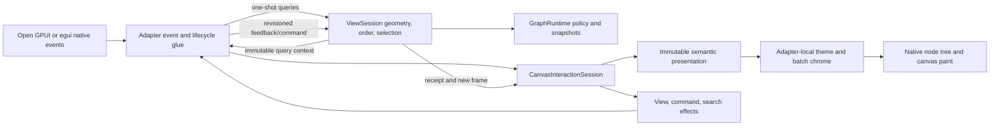
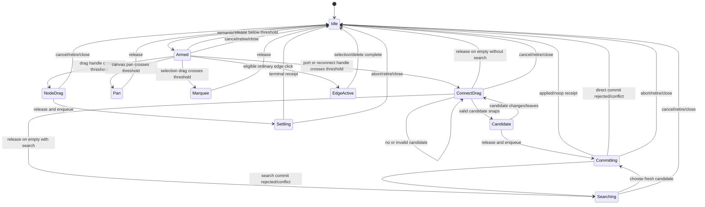
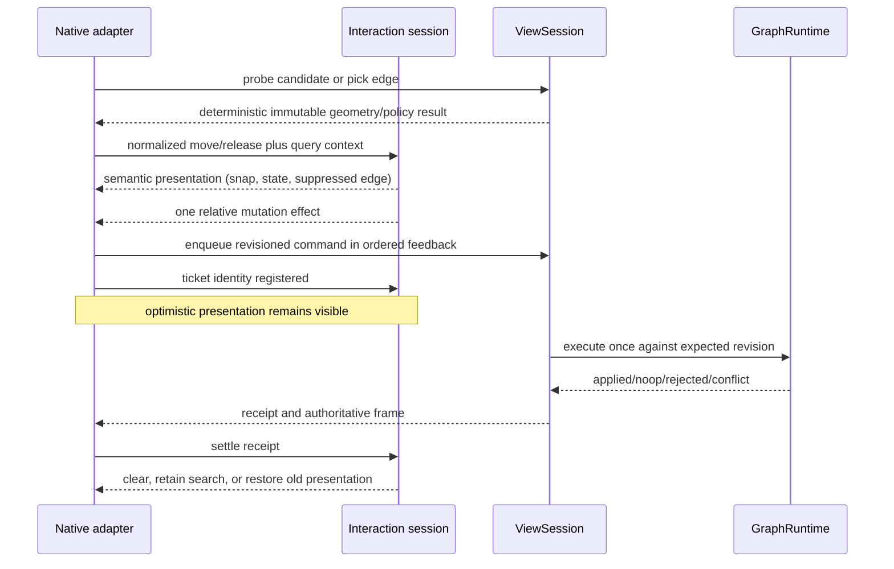
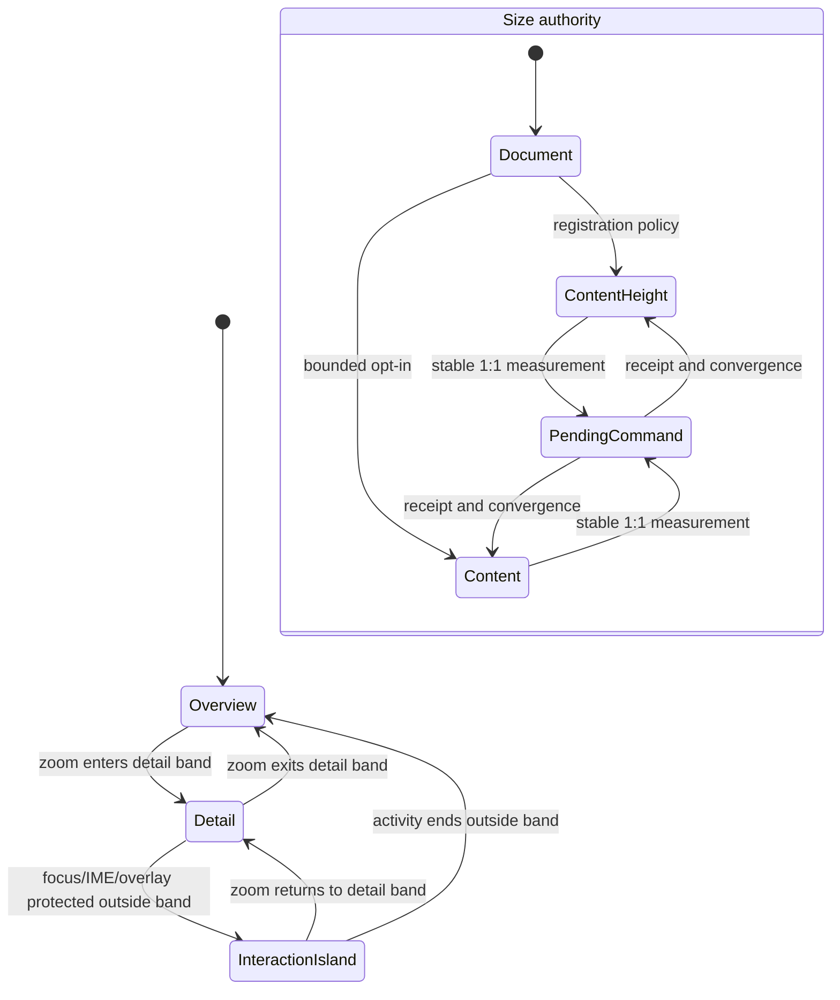
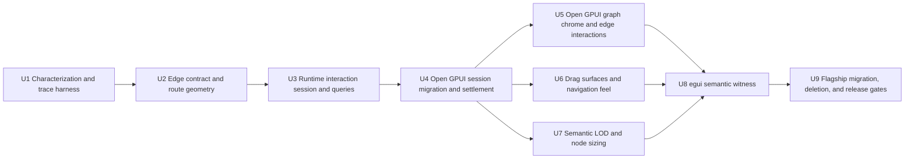

# Headless Canvas Interaction and Native Graph UX Fearless Refactor - Plan

## Goal Capsule

| Field | Decision |
| --- | --- |
| Objective | Turn Jellyflow's native-node host into a complete renderer-neutral canvas-interaction and native graph-chrome layer suitable for Dify-style workflows and Unity/Unreal-style shader graphs, while keeping Open GPUI-native node composition unrestricted. The flagship products are reference experiences and integration proofs, not complete Dify, Unity, or Unreal editor products. |
| User-visible problem | Nodes can contain real Open GPUI components, but ports and wires are hard to target, connection and reconnect settlement can visibly break, edges lack a complete interaction model, node content can accidentally drag the canvas, navigation lacks editor-grade affordances, and current zoom behavior scales the host box without being able to scale an arbitrary retained subtree consistently. |
| Architecture stance | Keep `GraphRuntime -> ViewSession -> AdapterFrame/Feedback -> native adapter`. Move normalized canvas interaction, geometry queries, and optimistic semantic presentation into a headless runtime session. Keep raw events, pointer capture, focus, IME, overlays, component lifecycle, theme resolution, and painting inside each adapter. |
| Execution profile | Fearless breaking refactor across core edge facts, runtime interaction and geometry, Open GPUI host/chrome/primitives, the egui witness, flagship examples, external-consumer tests, and documentation. Delete superseded APIs and modules instead of preserving compatibility aliases. |
| Authority hierarchy | This Product Contract governs behavior. Key Technical Decisions govern boundaries and tradeoffs. Implementation Units govern dependency order. The previous native-host plan remains authority for graph/view lifecycle and native component hosting unless this follow-up explicitly refines it. |
| Stop conditions | Stop only for evidence that the normalized interaction model cannot represent both retained and immediate adapters without framework types, or that an in-scope change would violate graph integrity or the existing command-only mutation boundary. Do not stop for public API breakage, fixture/schema updates, deletion of obsolete code, or lack of a DOM-style subtree transform in Open GPUI 0.2. |
| Tail ownership | Execute units in dependency order, keep the worktree free of abandoned experiments, run all required gates and native-window QA, review the final diff, and create precise Conventional Commits under the user's existing authorization. The plan is not a progress log. |

---

## Product Contract

### Summary

Jellyflow will expose a renderer-neutral `CanvasInteractionSession` over one `ViewSession`. Native
adapters will translate framework events into normalized press, move, release, cancel, tick, and
command-settlement inputs. The session will own mutually exclusive semantic gesture state,
continuous connection candidates, edge picking, relative node movement, viewport/navigation
intent, optimistic presentation, and command effects. It will never own framework event objects,
focus handles, IME state, widget trees, colors, or paint resources.

Open GPUI will become the product-grade realization of that contract. It will provide adapter-local
graph theme resolution, batchable wire and chrome painting, explicit node drag handles, optional
port/node primitives, and observable port/node interaction state. Arbitrary `Entity<V: Render>`
component trees remain the authoring model. No shared widget DSL or portable component schema will
be reintroduced.

Because Open GPUI 0.2 cannot apply one layout/paint/hitbox/focus-consistent transform to an
arbitrary retained subtree, Jellyflow will define honest semantic LOD behavior instead of
pretending to offer DOM-style continuous scaling. Document geometry remains canonical. Native
detail renders at its supported scale band, overview chrome represents the canonical footprint
outside that band, protected controls use a separate fixed-pixel interaction presentation, and
content-driven node sizing is a separate, revisioned policy with convergence guards.

### Problem Frame

The native-host refactor removed the portable node UI DSL and established the correct component
boundary. The remaining weakness is that editor behavior is split across Open GPUI-specific
controllers, scene gesture state, command tickets, geometry caches, and paint code. Some of that
state is renderer-neutral but currently named and owned as Open GPUI implementation detail.

The split produces invalid or visually discontinuous combinations. A connection can enter
`Committing` while its preview is no longer paintable. An edge route exposes interaction facts that
are always false. Runtime edge hit-testing exists but the product adapter has no edge input path.
The whole native node wrapper starts dragging unless every embedded control is manually guarded.
Selected edges are painted before ordinary edges. Orthogonal and SmoothStep names resolve to the
same sharp path. The host expands a node wrapper with zoom even though the native subtree stays in
fixed pixels.

xyflow and egui-snarl demonstrate the product behaviors to retain, not architectures to copy:
continuous candidate probing, generous invisible hit targets, wire/port visual continuity,
hover/selection/reconnect feedback, configurable gesture thresholds, adaptive routing, and one
coherent interaction state. Jellyflow must implement those behaviors through its owned
graph/view protocol rather than DOM selectors, mutable render-time graph access, or a shared
widget vocabulary.

### Actors

- A1. Graph end user: creates, connects, edits, navigates, selects, reconnects, and deletes graph
  content with predictable desktop mouse and keyboard behavior.
- A2. Open GPUI node author: composes arbitrary native controls and state, opts into semantic
  graph wrappers only for ports, drag surfaces, sizing, and graph interaction state.
- A3. Adapter author: maps native events and rendering to a shared semantic session without
  implementing Jellyflow's graph invariants or adopting Open GPUI-specific types.
- A4. Product integrator: chooses input/navigation profiles, graph theme tokens, node sizing and
  LOD policies, connection search, and domain-specific graph commands.

### Requirements

#### Headless interaction ownership

- R1. Preserve the existing graph/runtime/view/native-adapter boundary. `jellyflow-core`,
  `jellyflow-layout`, and `jellyflow-runtime` remain free of Open GPUI, egui, windowing, focus,
  IME, popup, cursor, color, and paint-resource types.
- R2. Provide one renderer-neutral interaction session per native canvas with an exclusive state
  machine for idle, press/armed, node drag, pan, marquee, connection drag, connection search,
  connection commit, edge interaction, cancellation, and settlement. Illegal simultaneous
  semantic gestures must be unrepresentable.
- R3. Accept normalized view-space input and expose immutable presentation plus semantic effects.
  Native adapters retain responsibility for dispatch ordering, pointer capture, focus, IME,
  overlay placement, scheduling, cursors, and framework lifecycle.
- R4. Use explicit view-space and canvas-space coordinate types. All user-facing thresholds,
  connection radii, edge hit widths, auto-pan bands, and visible chrome widths are specified in
  screen pixels and converted through the current `ViewportTransform` exactly once.
- R5. Express long-running node movement as relative semantic intent. Bind that intent to one fresh
  authoritative snapshot at release and submit exactly one revisioned command; never silently
  retry or merge a command after a conflict receipt.
- R6. Keep optimistic node and connection presentation until the corresponding receipt reaches a
  terminal applied, noop, rejected, conflict, cancelled, retired, or host-closed state. A pending
  commit must not produce a blank connection frame, duplicate edge, or old-path flash.

#### Ports, connections, and edges

- R7. Continuously probe connection targets during pointer movement. Return deterministic
  `none`, `invalid` with a structured reason, or `valid` with a real `PortId` and snapped route
  anchor. Final connection validation remains authoritative and uses the same policy facts.
- R8. Separate a port's visual marker, screen-space hit region, and route anchor. Default native
  graph chrome uses a 10-12 pixel marker, a 20-24 pixel minimum screen hit diameter, and a center
  anchor painted under the marker; node authors may explicitly choose boundary or custom anchors.
- R9. Expose explicit port states for idle, hovered, source, valid target, invalid target,
  connected, focused, and disabled. Custom native markers can read those states, while optional
  Open GPUI primitives provide a coherent default presentation. Invalid state includes the current
  structured rejection reason, a non-color-only visual treatment, and accessible state text; the
  reason updates or clears as the candidate changes, leaves, cancels, or settles.
- R10. Provide deterministic edge picking from current route geometry, effective interaction
  policy, edge draw order, and screen-space tolerance. The topmost nearest eligible edge wins;
  hidden or non-selectable edges cannot steal input.
- R11. Complete edge hover, selection, Delete, source/target reconnect, label, marker, renderer-key,
  style-token, and route-kind behavior or remove the corresponding public fact. Keep exactly one
  persisted interaction-width field and delete `EdgeViewDescriptor.hit_target_width`.
- R12. Render ordinary edges first and hovered/selected/active edges afterward. Keep edge painting
  batchable and culled; no retained entity or framework widget may be allocated per edge.
- R13. Implement distinct Straight, Bezier, Orthogonal, and rounded SmoothStep paths. Preview,
  committed route, hit testing, labels, markers, and reconnect handles use the same resolved path
  semantics. Curve flattening adapts to path curvature and screen tolerance.

#### Native node authoring and graph chrome

- R14. Make native node content a control-safe region by default. Only an explicit
  `OpenGpuiNodeDragHandle` (or an explicitly wrapped whole node) may arm node drag. Text inputs,
  selects, buttons, scroll areas, popovers, and overlays work without requiring a guard around
  every descendant.
- R15. Publish adapter-local node interaction state for selected, hovered, dragging, focused,
  disabled, LOD, and pending settlement. Draw selection/focus/drag chrome consistently even when
  the registered native component does not implement Jellyflow styling.
- R16. Provide an Open GPUI graph theme and small optional composition primitives for node chrome,
  port rows/markers, wires, reconnect handles, selection, grid, snap guides, and diagnostics.
  Theme resolution maps semantic kind/style tokens to native colors and metrics; core stores no
  RGB values and native node layout remains application-owned.

#### Navigation, zoom, and size

- R17. Support configurable desktop navigation profiles, separate click/drag thresholds, additive
  selection, selected-node raise-to-front, mouse and trackpad wheel behavior, auto-pan during node
  and connection drag, grid snap, alignment guides, fit-view, and Escape cancellation. Raw button
  and modifier mapping remains adapter-local.
- R18. Replace the hard-coded `zoom < 1` switch and `zoom.max(1)` wrapper sizing with an explicit
  adapter-local node scale policy. The default is hysteretic semantic LOD; fixed-pixel active
  controls use a separate interaction presentation. Jellyflow does not claim to continuously scale
  arbitrary third-party component subtrees.
- R19. Add explicit node size policies: document-authoritative by default, content-height with
  fixed document width for Dify-style nodes, and bounded intrinsic content sizing as opt-in.
  Measure native content at 1:1, convert to canvas size once, submit size through a revisioned graph
  command outside render, and use epsilon, stability, and one-pending-update guards to converge.
  Bound convergence attempts per content/environment epoch and detect alternating size cycles. On
  non-convergence, freeze the last applied size, publish a structured diagnostic, and suppress new
  size commands until the content or environment epoch changes.
- R20. Scope layout invalidation and same-frame feedback rejection to affected graph facts where
  transaction footprints permit it. `ViewSession` derives a conservative per-node/port/incident-
  edge `GeometryImpact` from the authoritative patch; only intersecting layout candidates become
  stale. Unrelated node geometry and port hit targets remain publishable instead of being rejected
  solely because the global graph revision advanced.

#### Multi-adapter proof and cleanup

- R21. Extend the egui adapter only far enough to replay canonical semantic traces and prove
  connection candidate, edge picking, node movement, cancellation, and receipt settlement. It is
  not required to match Open GPUI visual polish.
- R22. Preserve the 10,000-node/about-100-visible/four-view budgets and add a 10,000-edge chrome
  budget. Queries and presentation updates operate on spatial candidates and affected facts rather
  than scanning or cloning the full graph on every pointer move. Each view owns atomically updated
  node, port, and route/segment indexes plus bounded path-flattening caches; budget exhaustion is a
  structured incomplete result, never a silently incorrect candidate or edge. Incomplete queries
  carry a resumable cursor and remain pending across frames. Release may mutate the graph only after
  the query completes and final validation succeeds; cancellation or a defensive hard-limit exit
  produces an explicit `budget_exhausted` terminal result with no graph mutation.
- R23. Update the workflow and shader examples, public README, external consumer, native template,
  regression documentation, and real-window smoke. Delete old controllers, duplicate fields,
  obsolete helpers/tests, stale documentation, and unused APIs; add no compatibility aliases,
  ADR registry, Trellis artifacts, product gallery, or portable UI DSL.
- R24. Preserve the existing desktop accessibility baseline: semantic names and states for nodes,
  ports, edges, reconnect handles, and connection search; keyboard cancellation and Delete; focus
  restoration after search/settlement; and no invisible focused native control after LOD or
  retirement. The canvas is one focus entry; Tab/Shift-Tab traverse currently rendered actionable
  graph items in deterministic paint order, Enter/Space activates the focused action, and focus
  moves to the nearest surviving graph item or the canvas after deletion, LOD replacement, or
  search closure. Full spatial keyboard navigation is deferred.

### Key Flows

- F1. Native control versus node drag: pointer dispatch identifies port, explicit drag handle,
  native control/scroll/overlay, or canvas chrome. Controls retain input. A drag handle arms, crosses
  a configurable threshold, moves selected draggable nodes optimistically, then emits one relative
  mutation intent or cancels without graph mutation.
- F2. New connection: a real port arms a connection, pointer movement continuously probes nearest
  candidates and updates snapped preview/state, release on a valid candidate submits one command,
  release on empty space optionally enters create-from-wire search, and Escape/cancel/rejection
  restores a stable terminal presentation. Search explicitly represents loading, filtered-empty,
  source failure with retry, pending selection commit, applied/noop/rejected/conflict, Escape,
  outside dismissal, retirement, and host close. Every exit releases capture/activity, reconciles
  the preview, and either restores the prior focus or releases it for lifecycle termination.
- F3. Reconnect: an eligible endpoint handle fixes the opposite endpoint and suppresses the old
  edge only inside the optimistic presentation. Success preserves `EdgeId`; cancel, rejection, or
  conflict restores the old edge once without a blank, duplicate, or stale path.
- F4. Edge interaction: screen-space pointer movement picks the topmost eligible route, hover
  changes native chrome, click updates view selection and draw order, Delete submits an authoritative
  command, and endpoint handles start F3 only when policy allows that endpoint.
- F5. Canvas navigation: blank-canvas input begins marquee or pan according to the native profile;
  wheel/pinch updates the viewport around the pointer; node/connection drag near a viewport edge
  advances auto-pan while retaining the same canvas target; snapping and guides affect presentation
  and the final relative move.
- F6. Semantic LOD and native activity: zoom crosses separate enter/exit thresholds, inactive nodes
  switch between canonical overview and native detail without oscillation, active focus/IME/overlay
  ownership is moved to a fixed-pixel interaction presentation, and retired presentations release
  all activity and focus before disappearing.
- F7. Content-driven size: native content reaches a stable 1:1 measurement, the selected size policy
  derives a bounded canvas size, one revisioned command updates node geometry, runtime invalidates
  only affected geometry/routes, and equivalent feedback becomes quiescent. Repeating A-B size
  cycles terminate deterministically at the last applied size with a diagnostic until a new epoch.
- F8. Adapter conformance: Open GPUI and egui feed the same canonical semantic trace into independent
  sessions, execute framework-local capture/paint work, and observe the same semantic snapshots,
  command effects, rejection reasons, and terminal states.

### Acceptance Examples

- AE1. Given a 10-12 pixel port marker at zoom 0.5, 1.0, or 2.0, when the pointer enters its
  20-24 pixel screen hit region, then the same real port becomes the deterministic candidate and
  the preview snaps to its configured anchor without changing the marker's layout.
- AE2. Given a connection drag passes over compatible, incompatible, occupied, and empty targets,
  when pointer movement is replayed, then the candidate state changes continuously with structured
  reasons and final validation agrees with the latest valid candidate.
- AE3. Given a valid new connection is released and its command ticket remains pending for several
  frames, then exactly one continuous optimistic wire is visible until the authoritative edge
  replaces it; rejection or conflict restores the pre-gesture graph without an empty frame.
- AE4. Given an existing edge is reconnected from either endpoint, then success preserves its
  `EdgeId`; cancel, rejection, conflict, stale geometry, source retirement, or host close produces
  no duplicate, no blank frame, and no old-edge flash.
- AE5. Given overlapping edge hit regions, when the user points within the 18-20 pixel-wide
  interaction stroke, then the nearest edge in effective paint order is hovered/selected; the hit
  distance threshold is half the effective interaction width, selected chrome is painted after
  ordinary wires, and disabled interaction facts are respected.
- AE6. Given an edge is selected, when Delete or an allowed reconnect handle is activated, then one
  revisioned command and one undo boundary apply; a non-deletable or endpoint-restricted edge does
  not expose the forbidden action.
- AE7. Given a TextInput, Select, Button, scroll area, or popup inside a node, when the user types,
  clicks, drags, scrolls, or composes text, then the control works without arming node drag or canvas
  navigation. Only an explicit drag handle crossing its threshold moves the node.
- AE8. Given multiple selected nodes with locked/non-draggable peers, when a drag handle moves and
  releases, then only eligible nodes move by the same snapped canvas delta, remain visually stable
  through settlement, and a concurrent graph update yields a visible conflict rather than a retry.
- AE9. Given the pointer remains near a viewport edge during node or connection drag, when auto-pan
  ticks, then the viewport advances at the configured rate while the pointer's semantic target,
  preview, candidate, and final graph-space result remain continuous.
- AE10. Given the same endpoint geometry, Straight, Bezier, Orthogonal, and SmoothStep routes produce
  observably distinct paths; SmoothStep corners are rounded, Orthogonal corners are right angles,
  and preview/hit/label/marker geometry agrees with the committed path.
- AE11. Given a port uses the default center-under-marker anchor, then the wire terminates under the
  marker with no antialiasing gap; an explicit boundary/custom anchor changes routing without
  changing visual or hit bounds.
- AE12. Given zoom moves repeatedly around a LOD boundary, then hysteresis prevents presentation
  oscillation. At every presentation, canonical node footprint, port routes, hit targets, focus,
  IME, and overlays refer to one coherent geometry source.
- AE13. Given a content-height node adds/removes a condition row or wraps localized text, then at
  most one pending geometry command converges to a bounded size and the next 120 equivalent or
  epsilon-only measurements create no revision, layout, or route churn. Given measurements alternate
  indefinitely between A and B, bounded cycle detection freezes the last applied size, emits one
  diagnostic, and submits nothing more until the content/environment epoch changes.
- AE14. Given focus, IME, or an overlay must remain active outside the native detail band, then a
  fixed-pixel interaction presentation preserves that native activity while remaining graph-inert;
  canonical overview geometry remains the sole source for node, port, and route interaction.
- AE15. Given one command changes a node payload without affecting another node's layout, then valid
  feedback for the unrelated node remains publishable in that frame and its port targets do not
  disappear because of a global layout discard.
- AE16. Given one canonical trace includes press threshold, valid/invalid candidate, edge pick,
  cancel, command apply, command reject, and view close, then Open GPUI and egui produce equivalent
  semantic snapshots/effects despite different native events and component lifecycles.
- AE17. Given 10,000 edges and about 100 visible nodes, then frame materialization, spatial queries,
  hover updates, and batch painting allocate no entity per edge, deep-clone no unchanged graph
  payload, and visit only visible/spatial candidates plus affected routes.
- AE18. Given the final public surface, then no old Open GPUI connection controller, duplicate edge
  hit-width field, root-wide implicit node drag, hard-coded semantic zoom switch, portable UI DSL,
  ADR registry, Trellis artifact, stale gallery, or compatibility alias remains reachable.

### Success Criteria

| Area | Required outcome |
| --- | --- |
| Connection feel | Continuous candidate feedback, generous screen-space targets, snapping, auto-pan, and zero preview discontinuity through terminal settlement. |
| Edge feel | Hover, selection, Delete, reconnect, z-order, labels/markers, route-specific visuals, and deterministic wide hit testing work in the flagship Open GPUI product. |
| Node feel | Embedded native controls are safe by default; explicit headers/drag handles move nodes without release jumps; selected/focused/dragging state is visible independent of custom content. |
| Navigation | Mouse and trackpad profiles have separate thresholds and expected pan/zoom behavior; marquee, additive selection, snap, guides, fit-view, raise-to-front, and Escape are coherent. |
| Zoom and size | No false promise of arbitrary subtree scale; semantic LOD has hysteresis, active-control geometry stays coherent, and content sizing converges without revision loops. |
| Architecture | Runtime owns semantic interaction and spatial queries without framework types; adapters own native mechanics and visuals; no cross-framework UI DSL or renderer trait appears. |
| Performance | Existing view/culling budgets pass with 10,000-edge interaction and batch-paint coverage and no per-edge retained entity. |
| Adoption | Shader and workflow real-window smoke, external Open GPUI consumer, native adapter template, public-surface checks, and egui canonical trace all pass. |

### Scope Boundaries

In scope:

- Breaking changes to core edge presentation/interaction facts, runtime view/session APIs, native
  adapter APIs, examples, tests, fixtures, and documentation.
- Desktop mouse, trackpad, keyboard, accessibility, focus/IME-safe native control behavior, graph
  chrome, connection search handoff, and editor-grade interaction feedback.
- Deletion of obsolete code and test infrastructure once replacement behavior is proved.

Out of scope:

- A portable node widget DSL, shared renderer trait, DOM emulation, CSS selectors,
  `ResizeObserver` emulation, or generic layout engine for native node interiors.
- A promise to continuously scale arbitrary Open GPUI components. Open GPUI 0.2 lacks the required
  public subtree transform; the product contract uses semantic LOD and a graph-inert fixed-pixel
  interaction presentation.
- Touch/pen gesture parity, multiplayer collaboration, execution/debugger semantics, graph layout
  algorithms, rich wire animation, or product-specific inspector panels.
- Backward-compatible Rust aliases, deprecated lanes, schema migration solely to preserve this
  unreleased duplicate hit-width field, ADRs, Trellis, or resurrection of deleted gallery/examples.

### Sources

- `docs/plans/2026-07-12-001-refactor-headless-native-node-host-plan.md` - established graph/view
  ownership, command-only mutation, native component hosting, and Open GPUI/egui roles.
- `docs/research/2026-07-11-headless-custom-node-ui-architecture.md` - native-host architecture and
  rejection of a cross-framework widget DSL.
- `docs/research/2026-07-18-xyflow-custom-node-layout.md` - native layout ownership and measured port
  geometry mapping.
- xyflow, <https://github.com/xyflow/xyflow>, pinned at
  `dd308ab401d49518f73d1e91c43faf254ff5a4c9`:
  `repo-ref/xyflow/packages/system/src/xyhandle/XYHandle.ts` and
  `repo-ref/xyflow/packages/system/src/xyhandle/utils.ts` - continuous radius-based candidate search
  and validation.
- `repo-ref/xyflow/packages/react/src/components/Edges/BaseEdge.tsx` - wide invisible edge
  interaction path.
- `repo-ref/xyflow/packages/system/src/utils/edges/smoothstep-edge.ts` - direction-aware rounded
  SmoothStep routing.
- egui-snarl, <https://github.com/zakarumych/egui-snarl>, pinned at
  `de6140750fcb5d7ccfb74b507e7b88fa1aca14ad`:
  `repo-ref/egui-snarl/src/ui.rs`, `repo-ref/egui-snarl/src/ui/wire.rs`, and
  `repo-ref/egui-snarl/src/ui/pin.rs` - pin/wire visual continuity, hover emphasis, adaptive routing,
  and native interaction closure.
- Open GPUI 0.2.0 source `element.rs`, `view.rs`, `window.rs`, `scene.rs`, and `elements/svg.rs` - no
  public arbitrary-subtree transform that keeps layout, painting, hitboxes, focus/IME, and overlays
  consistent.

---

## Planning Contract

### Key Technical Decisions

#### KTD1. Refine the previous adapter-local interaction decision into a two-level boundary

`session-settled: user-directed core/runtime refactor; refinement of the previous native-host plan`

Raw framework event propagation, pointer capture, focus, IME, cursor APIs, overlay anchoring, and
component lifecycle stay adapter-local. Normalized graph-editor state and effects move to a
renderer-neutral `CanvasInteractionSession`. This refines, rather than reverses, the prior decision:
the runtime does not learn Open GPUI mechanics, but Open GPUI no longer owns reusable semantic
connection and scene state simply because it was the first product adapter.

Rejected alternatives:

- Keep all interaction in Open GPUI: leaves egui/future adapters to rediscover state, settlement,
  candidate, and edge-pick semantics and preserves the current multi-owner bugs.
- Put raw pointer/focus APIs in runtime: leaks toolkit and platform policy into the headless crates.
- Add a shared renderer trait: couples native lifecycles without improving semantic depth.

#### KTD2. One deep interaction session owns semantic state and optimistic presentation

The runtime supplies the session type, but each adapter owns exactly one instance bound to a
`ViewId` and view generation. The session is a pure state machine outside `ViewState`: it never
caches authoritative geometry, selection, viewport, graph revision, spatial indexes, or routes and
therefore cannot become a second `ViewSession` authority or re-enter a live `ViewState` borrow. Each
input consumes an immutable one-shot query/context result, updates one exclusive semantic state,
and exposes an immutable presentation snapshot.

The effect set is closed to graph/view mutation intent, data-only connection-search request,
interaction damage, and tick demand. Capture, cursor, focus, IME, overlay construction, native
notification, and scheduling are not semantic effects and remain adapter work. Connection, node
drag, edge interaction, pan, and marquee cannot maintain a second authoritative phase in host
fields.

#### KTD3. Fresh-at-release binding is not automatic conflict retry

`session-settled: preserve strict revision receipts from the native-host plan`

Relative drag intent may be applied to one fresh snapshot immediately before enqueueing the single
command. Connection commits use the latest candidate and one fresh expected revision. Once queued,
an applied/noop/rejected/conflict receipt is terminal for that attempt. The session may keep or
restore presentation, but it never replays or silently merges the mutation after conflict.

"Fresh" includes the adapter command journal prefix. If an older graph mutation is queued or in
flight when a gesture releases, the relative intent waits behind an explicit prefix barrier while
its optimistic presentation remains active. After every older ticket is terminal, the adapter
re-probes any geometry-sensitive target, binds the intent once to the now-authoritative snapshot,
and enqueues a new command. It never rewrites expected revisions inside an existing batch.

#### KTD4. Screen-space interaction metrics, strong coordinate types

Marker layout is native, graph geometry is canvas-space, and user tolerance is view-space. The
runtime query API receives view-space points and screen metrics, converts them through the current
view transform, and returns canvas anchors plus screen-distance ordering. This eliminates ad hoc
`CanvasPoint` use for window-local pixels and keeps feel stable at all zoom levels.

#### KTD5. Connection probe and edge pick are ViewSession queries

Candidate probing needs current per-view port geometry, graph policy, connection intent, and paint
order. Edge picking needs current route geometry, effective interaction policy, selection/order, and
screen tolerance. Both therefore belong beside `ViewSession` geometry/spatial indexes, not in core
or an adapter. The current node-only `ViewSpatialIndex` is insufficient: each view adds a
`PortSpatialIndex` and a conservative `RouteSpatialIndex` over route/segment bounds. Publication,
withdrawal, route upsert/remove, patch application, and view clear update their authoritative facts
and indexes atomically. Queries are pure with respect to graph mutation, bounded by configurable
candidate budgets, and deterministic for equal inputs.

#### KTD6. Keep one behavior width and make every retained edge fact real

Delete `EdgeViewDescriptor.hit_target_width`; retain `Edge.interaction_width` as the only persisted
behavior width. Resolve selectable/deletable/reconnectable from edge overrides and runtime policy.
Retain label, label anchor, markers, style token, renderer key, and route kind because the flagship
experience needs them, but wire them through runtime projection and Open GPUI batch chrome. Delete
any one still lacking a consumer at U9 rather than preserving a decorative API.

#### KTD7. Native theme and primitives are adapter APIs, not a portable DSL

`session-settled: user-approved removal of the cross-framework UI DSL`

Open GPUI owns `OpenGpuiGraphTheme` and optional node/port/wire primitives. Core retains only
semantic keys and behavior facts. A custom node remains an arbitrary `Entity<V: Render>` and may
ignore default primitives while still receiving host-level selection/focus chrome. Future adapters
define their own themes and widgets over the shared semantic snapshot.

#### KTD8. Explicit drag surfaces replace opt-out control guards

Default native content is interaction-safe. Removing the root-wide drag handler is a deliberate
breaking change. Node authors wrap a title bar, grip, or whole component in an explicit drag-handle
primitive. Existing control/scroll/overlay wrappers are reduced to the native capture/focus/overlay
semantics they uniquely provide; identical or redundant guard APIs are deleted.

#### KTD9. Use honest semantic LOD instead of fake arbitrary subtree scaling

Open GPUI 0.2 cannot scale an arbitrary retained component consistently across layout, paint,
hitboxes, focus/IME, and overlays. The default scale policy uses separate detail enter/exit
thresholds and a canonical overview outside its supported band. The overview remains the only graph-
interactive geometry for ports, routes, picking, connection, and node drag outside the band. Active
controls move to a fixed-pixel interaction presentation that may preserve focus, IME, and popups but
cannot publish node/port geometry, arm graph gestures, or expose a connectable overlay marker.
Component-managed scaling is explicit and carries full responsibility for native metrics. The
current `zoom.max(1)` host-box behavior is deleted.

#### KTD10. Node size authority is explicit and command-driven

Document size remains the default. `ContentHeight` covers Dify-style growing rows without making
width unstable. Fully intrinsic `Content` is bounded and opt-in. Measurements are taken at native
1:1 and never inferred from a zoomed wrapper. Epsilon, stable-sample, and pending-command guards
prevent feedback loops; size changes use existing revisioned geometry commands outside render.

#### KTD11. Routing is one semantic source for preview, paint, hit, and chrome

Orthogonal and SmoothStep become distinct algorithms. Resolved route facts include the semantic
path and presentation keys needed by adapters, while hover/selection remain view-local state rather
than cached path identity. Adaptive flattening derives both hit and label/marker placement from the
same path, preventing preview/committed disagreement.

#### KTD12. Batch paint and spatial candidates are non-negotiable scale constraints

No edge may become a retained Open GPUI entity. Pointer movement does not scan all edges or ports.
The runtime maintains view-local port and route/segment indexes plus cached conservative route
bounds and flattened paths keyed by edge identity, route revision, and screen-tolerance bucket.
Pan, hover, selection, and theme changes do not invalidate path geometry; route facts or tolerance-
bucket changes do. Flattening targets at most 0.75 screen-pixel error, caps recursive subdivision at
12 levels and 256 segments per path, and reports overflow instead of doing unbounded work.

Open GPUI consumes a visible-route query and builds reusable batch paint plans grouped by
style/layer. It does not iterate the full route map. Only affected bindings/chrome are notified when
hover, candidate, selection, or settlement state changes, and pointer-only frames reuse unchanged
paint plans.

#### KTD13. egui is a semantic witness, not a second product implementation

`session-settled: Open GPUI product adapter with future-framework support`

egui replays shared traces and verifies query/session outcomes using native event/response types.
It does not adopt Open GPUI theme primitives, retained lifecycle workarounds, or full Dify/Shader
Graph polish. A mismatch forces examination of shared semantics; product-only visual differences do
not.

#### KTD14. Delete rather than deprecate

`session-settled: user-directed fearless refactor with no compatibility requirement`

Old controller modules, duplicate fields, compatibility aliases, dead guards, stale fixtures,
unused edge facts, obsolete tests/docs, ADR references, Trellis remnants, and gallery remnants are
removed as their replacements land. No parallel legacy lane or migration facade survives the plan.

### High-Level Technical Design

The diagrams describe ownership and state flow, not exact Rust APIs.









### API and Module Disposition

| Current surface | Disposition | Replacement/consumer |
| --- | --- | --- |
| `jellyflow-open-gpui/src/connection_controller.rs` | Move semantics, rename, then delete file and all `OpenGpui*` aliases | `jellyflow-runtime/src/runtime/interaction/connection.rs` under `CanvasInteractionSession` |
| `host/scene_gesture.rs` semantic state | Move node/pan/marquee semantics; retain only Open GPUI event/capture translation | Runtime interaction modules plus thin host input glue |
| Root-wide node mouse-down drag | Delete | Explicit `OpenGpuiNodeDragHandle` wrapper |
| `OpenGpuiNodeInteractionGuard::control/scroll` duplication | Reduce or delete after explicit drag migration | Native control/scroll/overlay semantics only where framework behavior differs |
| `EdgeViewDescriptor.hit_target_width` | Delete without compatibility alias | `Edge.interaction_width` plus runtime default policy |
| Hard-coded false `EdgeInteractionFacts` | Delete fake construction | Effective edge facts resolved from graph policy and view selection |
| `semantic_zoom.rs` hard-coded threshold and wrapper scaling | Replace | Explicit semantic LOD policy, canonical overview, and graph-inert interaction presentation |
| Hard-coded wire colors/widths in `scene_render.rs` | Delete | `OpenGpuiGraphTheme` and batch paint plans |
| Unconsumed edge label/marker/style/renderer facts | Retain only when consumed | Runtime route/presentation projection and adapter-local painter registry |
| Monolithic `host_tests.rs` | Split without behavior loss | Focused interaction, edge, navigation, LOD, lifecycle, and fixture modules |

### Assumptions

- The 2026-07-12 native-host plan has landed sufficiently for this plan to build on
  `GraphRuntime`, `ViewSession`, native registry/binding, complete port geometry feedback, command
  tickets, activity leases, and the egui frame witness.
- The user's request to plan and immediately execute is treated as preselection of the execution
  handoff. Inferred implementation details remain subordinate to the Product Contract.
- Local pinned `repo-ref/xyflow` and `repo-ref/egui-snarl` are the authoritative prior-art sources
  for this work; no current external package behavior is required to plan it.
- Open GPUI is pinned to 0.2.0. Its source confirms there is no public arbitrary native-subtree
  transform with coherent layout, paint, hitbox, focus/IME, and overlay behavior.
- No `CONCEPTS.md` or `docs/solutions/` institutional learning corpus exists in the current tree;
  decisions are grounded in shipped code, tests, the prior plan, research notes, and pinned refs.
- Public Rust APIs and current fixtures may break. Persisted graph facts unrelated to the removed
  duplicate width remain protected by existing graph integrity and round-trip tests.

### Implementation Constraints

- Do not mutate graph state during native render/prepaint/paint. Commands remain revisioned and flow
  through the existing ordered feedback/journal boundary.
- Do not add framework types or paint values to core/runtime, and do not add a portable widget or
  style DSL.
- Do not implement silent command retry, automatic conflict merge, or mutable render-time graph
  access.
- Do not allocate one Entity/widget per edge or perform full-graph scans on pointer movement.
- Do not publish fixed-pixel interaction-island measurements as canonical scaled node/port
  geometry.
- Do not derive content-authoritative size from zoomed wrapper bounds.
- Preserve complete real-port geometry publication, node incarnation, view isolation, culling,
  retirement, activity lease, draft, and command journal contracts unless a unit explicitly
  replaces the mechanism with equal or stronger tests.
- Prefer deletion in the same unit that establishes replacement evidence. Temporary duplicate paths
  may exist only inside an unfinished unit and may not survive the final diff.

### Sequencing



U2 precedes public interaction names so duplicate edge facts disappear before new query contracts
stabilize. U4 owns the highest-risk state migration and must pass connection continuity tests before
visual polish begins. U5-U7 may proceed independently after U4. U8 must exercise the same public
runtime contract before U9 deletes remaining temporary or unused surfaces.

### System-Wide Impact

- **Graph model and persistence:** one duplicate edge field is removed; effective edge policy and
  presentation projection become complete. Golden V2 fixtures and public surface tests change.
- **Runtime view state:** each view gains authoritative port and route/segment indexes, pure query
  support, and per-fact geometry impact. The adapter-owned interaction session binds to view
  identity/generation but stores no duplicate view facts. Interaction remains ephemeral and never
  enters graph files or editor seeds.
- **Command lifecycle:** command construction remains strict and revisioned. The session adds
  optimistic presentation and receipt settlement but does not become a second mutation engine.
- **Open GPUI lifecycle:** bindings receive focused interaction-state notifications; host event and
  paint code becomes thinner; active LOD presentations must coordinate focus, overlays, activity
  leases, measurement, and retirement without strong-reference cycles.
- **egui:** gains only semantic trace/query glue. Its immediate native node lifecycle remains intact.
- **Examples and consumers:** all native nodes must opt into a drag surface and may adopt default
  port/chrome primitives. Workflow dynamic height and shader port/wire styles become product proof.
- **Accessibility:** edge and reconnect actions become discoverable; LOD transitions become another
  focus-retirement boundary that tests must cover.
- **Performance:** pointer-move query and chrome update paths become hot. Port/route index cells and
  entries, exact tests, cache hits/misses/subdivisions/overflows, geometry-impact acceptance,
  binding notifications, visible routes, paint-plan reuse, and style/layer batch counts require
  deterministic counters.

### Risks and Mitigations

| Risk | Impact | Mitigation |
| --- | --- | --- |
| Coordinate-space confusion | Hit targets, anchors, snap, and auto-pan drift at non-1 zoom | Strong view/canvas types, one transform boundary, zoom matrix tests at 0.5/1/2, and no raw f32 point interchange across modules |
| Interaction state duplication during migration | Two controllers can paint or settle contradictory states | Characterization traces first, one unit owns cutover, delete old controller/state in U4, and assert one active semantic state/ticket |
| Optimistic presentation outlives authority | Ghost wires/nodes after reject, retire, or close | Generation/ticket identity, terminal settlement matrix, host-close/retire tests, and authoritative frame reconciliation |
| Content-size feedback oscillation | Revision/layout loop and unstable ports | 1:1 measurement, bounded policies, epsilon/stable-sample guards, one pending command, and 120-frame quiescence tests |
| Fake native scaling survives | Focus, IME, overlays, and port geometry disagree | Delete wrapper scaling, explicit LOD states, isolate active native presentation, never publish its overlay geometry |
| Per-edge retained UI or full scans | Product polish destroys large-graph performance | Batch paint plans, spatial indexes, affected-state notifications, deterministic 10,000-edge counters |
| Interaction session duplicates view facts or re-enters a borrow | Busy errors and divergent selection/geometry truth | Adapter-owned pure session, one-shot query contexts, no `ViewState` storage, and borrow-reentrancy tests |
| Journal prefix makes a "fresh" release stale | Gestures conflict with commands already queued ahead of them | Explicit prefix barrier, target re-probe, one fresh bind after older terminal receipts, and no in-batch revision rewrite |
| Theme API grows into another DSL | Adapter boundary becomes broad and shallow | Keep theme/primitives Open GPUI-local, semantic tokens only in core, arbitrary native components remain primary |
| Breaking deletion misses a consumer | External consumer/template or docs silently rot | Symbol audits, public compile tests, external consumer smoke, template conformance, workspace-wide `rg` cleanup |

---

## Implementation Units

### U1. Freeze interaction behavior with canonical traces and focused test seams

- **Goal:** Establish executable evidence for current bugs and the target state transitions before
  moving ownership or deleting APIs.
- **Requirements:** R2-R7, R10, R14, R18-R24; F1-F8; AE1-AE8, AE12-AE18.
- **Dependencies:** None.
- **Files:** `crates/jellyflow-runtime/src/runtime/tests/**`,
  `crates/jellyflow-open-gpui/src/host_tests.rs`,
  `crates/jellyflow-open-gpui/src/host/tests/**` (new),
  `crates/jellyflow-egui/tests/**` (new), `examples/canvas-jellyflow/src/real_window_smoke.rs`.
- **Approach:**
  1. Define a renderer-neutral canonical trace fixture vocabulary for semantic target, press/move,
     threshold crossing, candidate, release, cancellation, receipt, retirement, and view close.
  2. Add failing characterization for the connection `Committing` preview gap, reconnect old-edge
     flash, release conflict, edge-pick absence, root-wide accidental node drag, and LOD geometry
     mismatch.
  3. Split the monolithic Open GPUI host test module by behavior while preserving all existing
     lifecycle, measurement, draft, command, and panic-recovery coverage.
  4. Add deterministic evidence counters needed by later scale tests without exposing test-only
     state as public product API.
- **Test Scenarios:**
  - A new connection and both reconnect endpoints remain continuously represented through pending,
    applied, rejected, conflict, cancel, retire, and close traces.
  - A native control press never enters node drag; a drag-handle trace does only after threshold.
  - Equal trace inputs have stable snapshots/effect ordering and no duplicate terminal transition.
  - Current hard-coded LOD behavior is captured as a regression to replace, not accepted as target.
- **Verification:** Focused runtime/Open GPUI trace suites compile and demonstrate each pre-refactor
  failure or missing capability; existing tests retain their assertions after the module split.

### U2. Simplify the edge contract and make route geometry truthful

- **Goal:** Remove fake/duplicate edge APIs and provide one consistent path source for paint, hit,
  label, marker, preview, and reconnect geometry.
- **Requirements:** R4, R8, R10-R13, R22-R23; F3-F4; AE5-AE6, AE10-AE11, AE17-AE18.
- **Dependencies:** U1.
- **Files:** `crates/jellyflow-core/src/core/model/edge.rs`,
  `crates/jellyflow-runtime/src/runtime/policy/edge.rs`,
  `crates/jellyflow-runtime/src/runtime/geometry/edge_route.rs`,
  `crates/jellyflow-runtime/src/runtime/geometry/hit_test.rs`,
  `crates/jellyflow-runtime/src/runtime/geometry/paths/**`,
  `crates/jellyflow-runtime/src/runtime/view_session/**`,
  `crates/jellyflow-runtime/src/io/files/graph/wire_v2.rs`,
  `crates/jellyflow-runtime/src/io/tests/fixtures/**`, and affected core/runtime public-surface tests.
- **Approach:**
  1. Delete `EdgeViewDescriptor.hit_target_width` and its builder/serde/test surface. Resolve one
     effective interaction width from `Edge.interaction_width` and runtime defaults.
  2. Resolve selectable, deletable, and endpoint-specific reconnect facts from graph overrides,
     policy, and view selection; remove the hard-coded all-false projection.
  3. Separate Orthogonal from SmoothStep. Implement direction-aware legs, same-side/mixed-side
     routing, minimum offsets, and true rounded SmoothStep corners.
  4. Add a view-local route/segment index maintained atomically with route upsert/remove/clear and
     patch application. Cache conservative bounds and flattened paths by edge, route revision, and
     tolerance bucket with the KTD12 error/depth/segment caps.
  5. Expose deterministic distance data needed for edge ordering rather than only a boolean contains
     result. Cache overflow produces a structured incomplete query rather than unbounded work or a
     silently wrong pick.
  6. Expose a budgeted, culled `ViewSession` visible-route query over the route/segment index. It
     reports a resumable incomplete result and never requires an adapter to scan the full route map.
  7. Carry label, marker, renderer, style, and route keys through route/presentation facts without
     caching adapter hover or color.
- **Test Scenarios:**
  - All endpoint direction combinations and short/reversed paths produce finite, distinct
    Orthogonal and SmoothStep geometry with expected corner kinds.
  - Hit tolerance stays constant in screen pixels at zoom 0.5, 1, and 2 and chooses the nearest path
    deterministically.
  - A long route crossing the pointer is found even when both endpoint nodes are outside the local
    node-query cells; route update/removal/clear leaves no stale segment-index entry.
  - Pan, hover, selection, and theme changes reuse flattened geometry; route/tolerance changes
    invalidate only the matching cache entry and enforce depth/segment overflow behavior.
  - Visible-route queries clip to the view, resume deterministically after candidate-budget
    exhaustion, and never omit an eligible visible route while reporting completion.
  - Edge override and policy combinations produce correct selectable/delete/reconnect endpoint
    facts; hidden edges have no route interaction.
  - V2 fixtures round-trip the retained facts. A fixture containing the removed
    `view.hit_target_width` field is rejected as an unknown field; there is no compatibility alias
    or migration path for the unreleased duplicate.
- **Verification:** Route snapshots, hit-distance tests, policy matrices, graph round trips, and
  public API checks pass; no `hit_target_width` symbol remains.

### U3. Add the renderer-neutral canvas interaction session and spatial queries

- **Goal:** Create the deep runtime module that owns semantic gestures, candidates, edge picks,
  optimistic presentation, relative intent, and terminal settlement.
- **Requirements:** R1-R7, R10, R17, R20-R22; F1-F5, F8; AE1-AE10, AE15-AE17.
- **Dependencies:** U2.
- **Files:** `crates/jellyflow-runtime/src/runtime/interaction/**` (new),
  `crates/jellyflow-runtime/src/runtime/mod.rs`,
  `crates/jellyflow-runtime/src/runtime/view_session/mod.rs`,
  `crates/jellyflow-runtime/src/runtime/view_session/geometry.rs`,
  `crates/jellyflow-runtime/src/runtime/view_session/order.rs`,
  `crates/jellyflow-runtime/src/runtime/view_session/protocol.rs`,
  `crates/jellyflow-runtime/src/runtime/adapter_protocol/coordinates.rs`,
  `crates/jellyflow-runtime/src/runtime/tests/view_session/**`, and runtime public-surface tests.
- **Approach:**
  1. Introduce strong normalized view/canvas inputs, interaction configuration, exclusive state,
     presentation snapshot, the closed semantic-effect set from KTD2, generation/ticket identity,
     and settle/cancel paths. The adapter owns the session; the session stores only view identity/
     generation and interaction-local facts.
  2. Migrate the pure connection lifecycle from the Open GPUI controller, removing framework naming
     and adding armed/candidate/commit continuity states.
  3. Add an atomically maintained view-local port index plus `ViewSession` connection-probe and edge-
     pick queries backed by complete port geometry, the route index from U2, spatial candidates,
     graph policy, and paint order. Expose resumable budget-exceeded/incomplete outcomes; the session
     remains pending across ticks and cannot produce a mutation effect until a completed result is
     finally validated.
  4. Add relative multi-node drag, pan, marquee, snap, guide, auto-pan, edge action, and fresh-at-
     release command intent planning without taking responsibility for native capture or scheduling.
  5. Emit bounded interaction damage and tick demand without deciding native notification, cursor,
     scheduling, capture, focus, overlay, or feedback-publication behavior.
  6. Derive conservative `GeometryImpact` from authoritative runtime patches and transaction
     footprints in `ViewSession`/adapter protocol so all adapters consume one invalidation truth.
- **Test Scenarios:**
  - Canonical traces cover every state transition, below-threshold click, valid/invalid candidate,
    search loading/list/empty/error/retry handoff, selection pending/apply/noop/reject/conflict,
    outside dismissal, Escape, retirement, and close.
  - Session input can perform required `ViewSession` queries before the transition without storing
    or re-borrowing `ViewState`; no nested-borrow `Busy` path exists.
  - Candidate selection is stable across overlapping ports, excludes fixed/source endpoints, returns
    policy rejection reasons, and converts screen radius correctly at multiple zooms.
  - Edge picking honors distance, draw order, hidden/selectable facts, and deterministic ID fallback.
  - Query budget exhaustion resumes across frames; release waits for completion, and cancel or hard
    exhaustion returns `budget_exhausted` without emitting a graph mutation.
  - Relative multi-node movement binds once to a fresh snapshot and emits one command; a later
    conflict is terminal and not replayed.
  - 10,000-edge/10,000-node counters cover index cells/entries, exact tests, candidate-budget
    outcomes, and index updates and prove spatial candidate work rather than full scans.
- **Verification:** Runtime unit, view-session integration, public API, performance-contract, and
  multi-view isolation tests pass with no native framework dependency in the crate graph.

### U4. Migrate Open GPUI input to the shared session and close settlement gaps

- **Goal:** Make Open GPUI a thin native event/lifecycle adapter over the shared session, with
  uninterrupted node and connection presentation.
- **Requirements:** R2-R9, R14, R20, R23-R24; F1-F3, F8; AE1-AE4, AE7-AE9, AE15-AE18.
- **Dependencies:** U3.
- **Files:** `crates/jellyflow-open-gpui/src/host.rs`,
  `crates/jellyflow-open-gpui/src/host/connection.rs`,
  `crates/jellyflow-open-gpui/src/host/scene_gesture.rs`,
  `crates/jellyflow-open-gpui/src/host/frame_feedback.rs`,
  `crates/jellyflow-open-gpui/src/interaction.rs`,
  `crates/jellyflow-open-gpui/src/command_journal.rs`,
  `crates/jellyflow-open-gpui/src/connection_controller.rs` (delete),
  `crates/jellyflow-open-gpui/src/lib.rs`, and focused host tests.
- **Approach:**
  1. Replace host-owned connection/scene semantic phases with one runtime session. Retain thin Open
     GPUI listeners for propagation order, pointer capture, focus, activity leases, overlay/search,
     frame ticks, and cursor updates.
  2. Keep committing previews and reconnect suppression until a matching terminal receipt. Reconcile
     authoritative frames without a zero-wire, double-wire, or old-edge intermediate state.
  3. Apply screen-space port targeting and continuous candidate updates on pointer move, notifying
     only affected port bindings and repainting only changed chrome.
  4. Bind relative node drag intent immediately before enqueue, preserve pending delta through
     settlement, and use the shared cancel/settle paths for Escape, error, retire, and host close.
  5. Add a command-journal prefix barrier: gesture commits wait behind older mutation tickets, then
     re-probe geometry-sensitive targets and bind once to the fresh snapshot before enqueue.
  6. Consume the runtime-derived `GeometryImpact` in `frame_feedback`. Accept unrelated node layout
     from the same frame while rejecting affected node/port/incident-edge candidates in original
     feedback order; Open GPUI must not derive a second impact model.
  7. Delete the old controller file, old exports/type names, redundant host state, and any transition
     tests superseded by canonical runtime traces plus adapter integration tests.
- **Test Scenarios:**
  - Real Open GPUI pointer dispatch crosses threshold, captures once, continuously changes candidate,
    and releases once. Every terminal path releases pointer capture and activity; apply, noop,
    reject, conflict, and cancel restore focus according to R24, while retire and host close release
    focus completely.
  - Connection search covers loading, candidates, filtered-empty, source failure/retry, pending
    selection commit, apply/noop/reject/conflict, Escape, outside dismissal, retire, and host close;
    every exit reconciles preview and focus exactly once.
  - Pending new connection and both reconnect directions remain visually continuous for multiple
    frames; success, rejection, conflict, queue failure, retire, and close match AE3-AE4.
  - Node drag remains stable through pending/apply/conflict and no command is submitted below
    threshold or after Escape.
  - Reentrant render/entity updates and late receipts cannot revive a retired generation.
  - A drag or connection released behind queued/in-flight mutations waits visibly, binds after the
    prefix settles, and follows applied/conflict/close ordering without revision rewrite or retry.
  - Payload, topology, node-size, and node-move patches invalidate only their conservative geometry
    impact; unrelated layout remains publishable and feedback order is preserved.
- **Verification:** Focused Open GPUI integration tests and canonical trace parity pass; `rg` finds no
  old controller/type/host phase; the existing command journal, draft, activity, and panic-recovery
  suites remain green.

### U5. Build Open GPUI graph chrome, theme, and complete edge interaction

- **Goal:** Deliver coherent ports and wires plus discoverable edge interaction without constraining
  arbitrary native node interiors.
- **Requirements:** R8-R16, R22-R24; F2-F4; AE1-AE6, AE10-AE11, AE17-AE18.
- **Dependencies:** U4.
- **Files:** `crates/jellyflow-open-gpui/src/theme.rs` (new),
  `crates/jellyflow-open-gpui/src/chrome/**` (new),
  `crates/jellyflow-open-gpui/src/port_handle.rs`,
  `crates/jellyflow-open-gpui/src/binding.rs`,
  `crates/jellyflow-open-gpui/src/registry.rs`,
  `crates/jellyflow-open-gpui/src/host/scene_render.rs`,
  `crates/jellyflow-open-gpui/src/accessibility.rs`,
  `crates/jellyflow-open-gpui/src/lib.rs`, and focused edge/port visual tests.
- **Approach:**
  1. Add adapter-local graph theme metrics/colors and semantic state resolution for node, port, edge,
     preview, candidate, selection, focus, grid, guide, diagnostic, marker, and label chrome.
  2. Change default port geometry to a theme-derived minimum screen hit diameter and center-under-
     marker route anchor; keep explicit boundary/custom anchor configuration.
  3. Expose immutable node/port interaction state through bindings and optional port-row/marker/node-
     chrome primitives. Invalid candidates expose structured reasons to default chrome and custom
     markers through both non-color-only visuals and accessible state text. Keep user components,
     layout, controls, and state ordinary Open GPUI.
  4. Replace hard-coded scene wire vectors and full route-map scans with runtime visible-route
     queries plus reusable culled batch paint plans grouped by layer/style. Paint ordinary, active,
     selected, preview, labels/markers, reconnect handles, nodes, and overlay chrome in an explicit
     order.
  5. Wire edge hover/click selection, Delete, endpoint-specific reconnect, accessibility actions,
     renderer-key painter lookup, label placement, markers, and style-token resolution.
  6. Build deterministic focus traversal over currently rendered actionable nodes, ports, edges, and
     reconnect handles, with canvas fallback and Enter/Space activation; do not add spatial keyboard
     navigation or framework-neutral focus types.
- **Test Scenarios:**
  - Default and custom ports publish independent visual/hit/anchor geometry; center-under-marker has
    no visible seam and hit size stays constant at zoom 0.5/1/2.
  - Port state transitions notify only source/old/new candidate bindings and custom marker state is
    observable without using default chrome.
  - Invalid direction, type, occupancy, and policy reasons update on candidate entry/switch/leave,
    clear on cancel/settlement, and remain perceivable without relying on color.
  - Overlapping ordinary/selected/hovered wires paint and pick in the same deterministic order.
  - Delete and each reconnect endpoint honor policy; labels/markers/style/renderer fallbacks paint
    or diagnose without allocating per-edge entities.
  - Accessibility nodes expose names, selected/disabled state, rejection text, and allowed edge
    actions only. Tab order follows deterministic paint order; activation and focus fallback work
    after deletion, LOD replacement, search closure, retirement, and host close.
  - A pointer-only hover/candidate frame reuses unchanged path and paint plans; counters cover visible
    candidates, paths built, plan reuse, style/layer batches, and retained edge entities.
- **Verification:** Open GPUI unit/visual evidence and host interaction tests pass; paint counters
  prove batch behavior and no per-edge Entity; no hard-coded graph wire colors/widths remain outside
  the default theme.

### U6. Make node dragging and canvas navigation editor-grade

- **Goal:** Replace accidental whole-node drag with explicit native drag surfaces and add coherent
  Dify/Blueprint navigation feel.
- **Requirements:** R4-R6, R14-R17, R22-R24; F1, F5; AE7-AE9, AE16-AE18.
- **Dependencies:** U4.
- **Files:** `crates/jellyflow-open-gpui/src/interaction.rs`,
  `crates/jellyflow-open-gpui/src/host/scene_render.rs`,
  `crates/jellyflow-open-gpui/src/host/scene_gesture.rs`,
  `crates/jellyflow-open-gpui/src/binding.rs`,
  `crates/jellyflow-runtime/src/runtime/interaction/navigation.rs`,
  `crates/jellyflow-runtime/src/runtime/view_session/order.rs`, and focused navigation tests.
- **Approach:**
  1. Remove root-wide node drag and add explicit node drag-handle composition. Allow wrapping the
     whole node deliberately but make controls safe by default.
  2. Define adapter-local Mouse, Trackpad, and Blueprint-style input profiles that map native
     buttons/modifiers/wheel phases into shared semantic inputs and configuration.
  3. Implement independent click/drag thresholds, additive selection, selected-node raise-to-front,
     pan/marquee cancellation, pointer-centered zoom, fit-view, cursor feedback, keyboard Escape,
     and activation of the currently focused graph action.
  4. Drive auto-pan ticks, grid snap, and alignment guides from shared interaction presentation while
     keeping timers and native drawing in Open GPUI.
  5. Reduce/delete control and scroll guards whose only purpose was compensating for implicit root
     drag; retain distinct native overlay/capture/focus helpers where required.
- **Test Scenarios:**
  - Native controls and blank body content never drag; explicit header/grip/whole-node handles obey
    threshold and selection rules.
  - Mouse, Trackpad, and Blueprint profiles map pan/zoom/marquee consistently and do not conflict
    with ports or overlays.
  - Auto-pan keeps a connection candidate and node drag continuous at every viewport edge; snap and
    guides use canvas results derived from screen input.
  - Multi-select drag filters locked peers, raises selected nodes deterministically, and preserves
    relative positions through settlement.
  - Keyboard entry, traversal, Enter/Space activation, Delete, Escape, and post-action focus fallback
    remain deterministic without intercepting text input or popup keyboard ownership.
- **Verification:** Focused navigation tests and native-window pointer/wheel/keyboard smoke pass;
  root node wrappers have no implicit drag listener and obsolete guard APIs are absent.

### U7. Replace fake zoom scaling and add convergent node size policies

- **Goal:** Make native component geometry truthful across zoom/LOD and support dynamic Dify-style
  node height without feedback loops.
- **Requirements:** R4, R15, R18-R20, R22-R24; F6-F7; AE12-AE15, AE17-AE18.
- **Dependencies:** U4.
- **Files:** `crates/jellyflow-open-gpui/src/semantic_zoom.rs`,
  `crates/jellyflow-open-gpui/src/scale_policy.rs` (new),
  `crates/jellyflow-open-gpui/src/size_policy.rs` (new),
  `crates/jellyflow-open-gpui/src/registry.rs`,
  `crates/jellyflow-open-gpui/src/binding.rs`,
  `crates/jellyflow-open-gpui/src/activity.rs`,
  `crates/jellyflow-open-gpui/src/host/scene_render.rs`,
  `crates/jellyflow-open-gpui/src/host/frame_feedback.rs`, and focused LOD/measurement tests.
- **Approach:**
  1. Replace the hard-coded threshold and wrapper-size scaling with registered scale policy,
     hysteretic presentation state, canonical overview geometry, and a graph-inert interaction
     presentation.
  2. Add the protected fixed-pixel interaction presentation for focus/IME/overlay ownership outside
     the detail band. Canonical overview remains the only graph-interactive node/port/route geometry;
     the interaction presentation cannot publish layout, arm node/connection gestures, or expose
     connectable overlay markers.
  3. Add document, content-height, and bounded content size policies at renderer registration. For
     each node instance/environment epoch retain only last stable size, stable sample count, one
     pending ticket, latest desired size, and a bounded convergence/cycle detector. Derive sizes from
     two stable 1:1 measurements; while a ticket is pending, coalesce only the latest desired size
     and emit no duplicate notification.
  4. Implement epsilon, stable-sample, one-pending-command, rejection, conflict, retirement, and
     environment-epoch handling. On non-convergence, freeze the last applied size, emit one
     structured diagnostic, and suppress further size commands until a new epoch. Use transaction
     footprints to avoid discarding unrelated layout.
  5. Keep arbitrary third-party controls fully supported at native 1:1 and document the explicit
     continuous-scaling limitation.
- **Test Scenarios:**
  - Repeated zoom around both thresholds produces no LOD oscillation; overview, detail, and active
    interaction presentations use coherent canonical routes and hit targets.
  - While an interaction presentation is visible, overview port/edge route and hit geometry remains
    unchanged and every overlay marker/drag surface is graph-inert.
  - Focus, IME composition, popup, activity lease, culling, and retirement across LOD leave no
    invisible focus trap or stale geometry.
  - Document size never changes from content; content-height changes only height within bounds;
    bounded content changes both axes only after stable samples.
  - Applied, rejected, conflict, and retired size commands clear pending state correctly; 120 equal
    samples produce zero commands, graph/layout revisions, spatial updates, route invalidations or
    recomputations, binding notifications, geometry snapshots, or edge paint-plan rebuilds.
  - Alternating A-B measurements hit a deterministic attempt/cycle bound, freeze the last applied
    size, emit one diagnostic, and remain quiescent until content or environment epoch changes.
- **Verification:** LOD, measurement, lifecycle, frame-feedback, multi-view, and convergence tests
  pass; no `zoom.max(1)` or equivalent fake native subtree scaling remains.

### U8. Prove the semantic boundary with the egui adapter

- **Goal:** Demonstrate that the new interaction contract is renderer-neutral without turning egui
  into a second product-tier UI.
- **Requirements:** R1-R7, R10, R17, R21-R23; F8; AE2-AE6, AE8-AE10, AE16-AE18.
- **Dependencies:** U5, U6, U7.
- **Files:** `crates/jellyflow-egui/src/native_host.rs`,
  `crates/jellyflow-egui/src/interaction.rs` (new),
  `crates/jellyflow-egui/src/lib.rs`, `crates/jellyflow-egui/tests/**` (new), and shared runtime trace
  fixtures.
- **Approach:**
  1. Map egui native responses/events to the same normalized session inputs while retaining egui IDs,
     immediate layout, and input ownership locally.
  2. Replay canonical connection, candidate, edge-pick, node-drag, cancel, receipt, retirement, and
     close traces and compare semantic snapshots/effects with Open GPUI expectations.
  3. Render only minimal native evidence for candidate/edge selection; do not import Open GPUI theme
     structs or product primitives and do not add a cross-framework renderer abstraction.
- **Test Scenarios:**
  - Equal traces produce equal semantic phases, candidates/reasons, command intent, optimistic
    suppression, and terminal outcome.
  - egui-specific capture loss, response retirement, and frame-local measurement map to cancel/close
    without leaking egui types into runtime.
  - Multiple independent egui/Open GPUI views over one runtime retain isolated selection, hover,
    interaction, geometry, and viewport state.
- **Verification:** egui unit/integration and shared conformance traces pass; dependency checks prove
  runtime remains framework-free and no Open GPUI visual API enters egui.

### U9. Migrate flagship products, delete superseded code, and close release gates

- **Goal:** Make the workflow and shader products demonstrate the completed experience, remove every
  obsolete surface, and leave a publishable, documented library.
- **Requirements:** R8-R24; F1-F8; AE1-AE18.
- **Dependencies:** U8.
- **Files:** `examples/canvas-jellyflow/src/nodes/**`,
  `examples/canvas-jellyflow/src/connection_search.rs`,
  `examples/canvas-jellyflow/src/real_window_smoke.rs`,
  `examples/canvas-jellyflow/tests/**`, `examples/canvas-jellyflow/README.md`,
  `templates/native-adapter/**`, `tools/fixtures/external-consumer/**`,
  `tools/check_external_consumer_smoke.py`, `tools/check_no_legacy_ui_surfaces.py`, `README.md`,
  `crates/jellyflow-open-gpui/README.md`, `crates/jellyflow-egui/README.md`,
  `docs/testing/node-ui-authoring-regression.md`, `CONTEXT.md`, manifests, public-surface tests, and
  every source/doc found by the deletion audit.
- **Approach:**
  1. Migrate all workflow/shader headers to explicit drag handles, default or custom state-aware port
     chrome, semantic edge style/type colors, content-height policy where appropriate, and coherent
     LOD behavior.
  2. Exercise valid/invalid connect, create-from-wire, occupied-input reconnect, edge selection/
     Delete/reconnect, search loading/empty/error/retry/settlement, keyboard traversal/activation,
     auto-pan, snap, embedded controls, dynamic topology, zoom/LOD, and size changes in structured
     and real-window smoke.
  3. Update the external consumer and native template to prove arbitrary Open GPUI controls plus
     graph primitives through public released APIs only.
  4. Run a consume-or-delete audit for every edge presentation field and every old host/guard/zoom
     helper. Delete compatibility aliases, dead tests, stale docs, obsolete examples/products, ADR
     references, Trellis remnants, and abandoned implementation attempts.
  5. Perform visual QA at desktop and a 960x640 compact window, compare port/wire continuity and
     editor hand feel against the pinned xyflow/egui-snarl behaviors, and keep screenshots as
     supporting evidence rather than replacing structured tests. Search, diagnostics, and active
     interaction presentations stay inside a 12-pixel viewport safe area; panel width clamps to the
     viewport and long content scrolls within a bounded height.
- **Test Scenarios:**
  - Shader and workflow windows complete every interaction flow without overlap, release jump,
    disappearing wire, stale edge, accidental control drag, or incoherent LOD geometry.
  - At 960x640, search loading/empty/error/retry and diagnostics remain visible and operable, no
    overlay crosses the safe area, and deterministic layout assertions match the screenshot.
  - Dynamic condition rows retain real `PortId`s, resize convergently, and update route/markers
    without a global feedback gap.
  - External consumer and template compile and run native controls, custom markers, explicit drag
    handle, theme override, size policy, and connection state using only public APIs.
  - Forbidden symbol/path checks find no legacy controller, duplicate hit width, portable DSL, ADR,
    Trellis, gallery, or compatibility surface.
- **Verification:** All workspace, nested example, template, external consumer, boundary, native-window,
  screenshot, documentation, review, and cleanup gates in the Verification Contract pass.

---

## Verification Contract

### Focused Gates

| Scope | Required evidence |
| --- | --- |
| Runtime interaction | Canonical state traces cover every press/threshold/drag/candidate/search loading/empty/error/retry/commit/cancel/settle/retire/close transition, resumable query exhaustion, and strict no-retry command behavior. |
| Geometry and routes | Screen-space port and edge tolerances pass at zoom 0.5/1/2; route algorithms are distinct; preview, paint, hit, label, marker, and reconnect geometry agree. |
| Open GPUI adapter | Native dispatch/capture/focus/IME/activity/overlay integration, explicit drag surfaces, port/node state, graph theme, edge actions, batch paint, LOD, size convergence, and cleanup pass under Open GPUI test support. |
| egui witness | The immediate adapter replays the same semantic traces and returns equivalent snapshots/effects without adopting Open GPUI visual APIs. |
| Flagship products | Workflow and shader structured tests plus real-window smoke cover embedded controls, dragging, valid/invalid connect, complete search lifecycle, reconnect, edge actions, keyboard focus/activation, auto-pan/snap, zoom/LOD, dynamic size, and 960x640 compact layout. |
| Scale | Existing 10,000-node/about-100-visible/four-view counters remain green; 10,000-edge query and batch-paint counters prove no full scans, payload clones, or per-edge entities. |
| Boundaries and cleanup | Core/runtime dependency checks, public surfaces, external consumer, template, forbidden legacy symbols, graph fixtures, docs, and deletion audit pass. |

### Required Commands

```sh
cargo fmt --all --check
cargo check --workspace --locked
cargo nextest run --workspace --cargo-quiet
cargo test --workspace --doc --locked
cargo clippy --workspace --all-targets -- -D warnings
python3 tools/check_no_fret_dependencies.py
python3 tools/check_no_legacy_ui_surfaces.py
python3 tools/check_external_consumer_smoke.py
git diff --check
```

The nested Open GPUI product workspace also requires:

```sh
cargo fmt --manifest-path examples/canvas-jellyflow/Cargo.toml --all -- --check
cargo check --manifest-path examples/canvas-jellyflow/Cargo.toml --workspace --locked
cargo nextest run --manifest-path examples/canvas-jellyflow/Cargo.toml -p open-gpui-canvas-jellyflow --no-fail-fast --status-level fail --final-status-level fail
cargo clippy --manifest-path examples/canvas-jellyflow/Cargo.toml --workspace --all-targets -- -D warnings
```

Run the two native-window product modes on a supported renderer:

```sh
cargo run --manifest-path examples/canvas-jellyflow/Cargo.toml -p open-gpui-canvas-jellyflow --locked --features real-window-smoke -- --smoke
cargo run --manifest-path examples/canvas-jellyflow/Cargo.toml -p open-gpui-canvas-jellyflow --locked --features real-window-smoke -- --workflow --smoke
```

Screenshots and pixel inspection at representative desktop and compact window sizes are supporting
visual evidence. They do not replace the structured interaction, geometry, and state-transition
gates.

### Quantified Gates

| Contract | Exit threshold |
| --- | --- |
| Port targeting | A default 10-12 pixel marker has a 20-24 pixel minimum screen hit diameter at zoom 0.5, 1, and 2; one deterministic candidate wins. |
| Edge targeting | Effective default interaction width is 18-20 screen pixels; topmost-nearest selection is deterministic at crossings. |
| Route flattening | Cached flattening targets no more than 0.75 screen-pixel error, 12 subdivision levels, and 256 segments per path; cache/overflow counters are deterministic and no pointer move performs unbounded subdivision. |
| Settlement continuity | Every new connection/reconnect pending frame contains exactly one intended wire presentation; success, reject, conflict, cancel, retire, and close contain no blank, duplicate, or old-path flash. |
| Journal ordering | A released gesture behind queued/in-flight graph mutations binds once only after all earlier tickets are terminal; no expected revision is rewritten inside an existing batch and no conflict is retried. |
| Drag threshold | Native controls produce zero node-drag transitions; an explicit handle produces zero movement below threshold and one relative mutation above it. |
| LOD stability | Repeated zoom jitter inside the hysteresis gap produces zero presentation switches; active focus/IME never publishes overlay geometry as canonical layout. |
| Size convergence | A material content change requires two stable 1:1 samples, produces at most one pending size command, and coalesces only the latest desired size; 120 equivalent/epsilon samples add zero commands, revisions, index/route work, binding notifications, geometry snapshots, or paint-plan rebuilds. An A-B cycle reaches the configured bound, freezes the last applied size, emits one diagnostic, and remains quiescent until a new epoch. |
| Frame scope | At 10,000 nodes/about 100 visible/four views, unchanged payload deep-clone count remains zero and only visible/overscan/routing dependencies materialize. |
| Geometry impact | Payload/topology/size/move patches reject only conservatively intersecting node/port/incident-edge feedback; counters record checked, accepted-unrelated, rejected-by-impact, index updates, and binding notifications. |
| Edge scale | Preserve the 4,096 visible paint-path budget and 16,384 defensive hard ceiling. In a spatially distributed 10,000-edge fixture with about 100 visible routes, a frame examines at most 256 route entries; pointer queries honor configured candidate budgets, resume incomplete results across frames, and block release mutation until completion. Defensive exhaustion returns `budget_exhausted` with no graph change. Batch paint allocates zero retained edge entities. |
| Compact layout | At 960x640, search, diagnostics, and active interaction presentations remain within a 12-pixel safe area; width clamps to the viewport and long content scrolls within bounded height. |
| Paint reuse | A pointer-only hover/candidate frame rebuilds no full route list or unchanged path plan; counters cover visible candidates, paths built, style/layer batches, plan reuse, and retained entities. |
| Lifecycle release | After existing 1,000-cycle mount/retire stress and queue drain, entities, tasks, subscriptions, activity, focus/IME, overlays, capture, interaction generations, and geometry return to baseline. |

### Review Gates

- Review core/runtime for framework leakage, coordinate conversions, state exclusivity, spatial query
  complexity, edge policy truthfulness, command-only mutation, strict conflict handling, footprint-
  scoped invalidation, multi-view isolation, and graph-file integrity.
- Review Open GPUI for propagation order, pointer capture cleanup, focus/IME and overlay ownership,
  activity leases, reentrant entity borrows, late receipts, LOD retirement, measurement convergence,
  batch paint ordering, accessibility, and strong-reference cycles.
- Review Open GPUI and egui together for semantic action/context parity while preserving distinct
  native mechanics and visual APIs.
- Review deletion mechanically after product gates pass. No compatibility shim, unused public fact,
  second interaction state, ADR/Trellis/gallery remnant, or abandoned experimental path may remain.

### Landing Strategy

- Land reviewable Conventional Commits in unit/dependency order under the user's existing commit
  authorization. Stage only files changed for this plan and never rewrite unrelated user work.
- Keep U1 characterization evidence ahead of destructive deletion. U4 is the state-ownership cutover
  and must be green before U5-U7 polish proceeds.
- Treat U8 and U9 as required architecture/product proof, not optional cleanup. The refactor is not
  complete while only Open GPUI can express the semantic flow or while examples still depend on
  superseded APIs.
- Do not bind `main` to a worktree and do not rewrite history.

---

## Definition of Done

### Global

- R1-R24 and AE1-AE18 are represented by shipped code and executable tests.
- One renderer-neutral interaction session owns semantic canvas state; Open GPUI and egui keep only
  native event/lifecycle/paint responsibilities.
- Port and edge targeting, connection/reconnect settlement, edge actions, explicit node dragging,
  navigation, semantic LOD, and content size policies work in the flagship native product.
- Core/runtime remain free of UI framework dependencies, color/paint types, and portable component
  vocabulary.
- All required commands, quantified gates, native-window smoke, supporting screenshot inspection,
  external consumer, template, public API, and review gates pass.
- Old controllers, duplicate facts, root-wide drag, fake zoom scaling, redundant guards, dead tests,
  stale docs/examples, compatibility aliases, ADR/Trellis/gallery remnants, and code from abandoned
  implementation attempts are deleted.
- The worktree contains only intentional plan implementation and documentation changes, split into
  precise Conventional Commits.

### Per Unit

| Unit | Done when |
| --- | --- |
| U1 | Canonical traces and focused Open GPUI test modules capture every target failure/state without losing existing lifecycle coverage. |
| U2 | One edge interaction width remains; effective policy facts and distinct routes drive consistent path/hit/presentation tests. |
| U3 | The shared interaction session, connection probe, edge pick, relative intent, settlement, auto-pan/snap semantics, and footprint handling pass runtime/multi-view/scale tests. |
| U4 | Open GPUI delegates semantic state to the shared session; old controller/state is deleted and connection/node presentation is continuous through every receipt. |
| U5 | Theme, batch chrome, state-aware ports, edge hover/select/Delete/reconnect, labels/markers/style/renderer, z-order, accessibility, and scale counters pass. |
| U6 | Native content is safe by default; explicit drag handles and all navigation profiles/thresholds/auto-pan/snap/guides/selection behaviors pass. |
| U7 | Explicit LOD and size policies replace fake scaling, active focus/IME geometry is coherent, and convergence/lifecycle tests pass. |
| U8 | egui replays the canonical semantic traces with equivalent outcomes and no shared visual/toolkit abstraction. |
| U9 | Workflow/shader products, real-window smoke, external consumer, native template, docs, public surface, deletion audit, full gates, final review, and commits are complete. |
