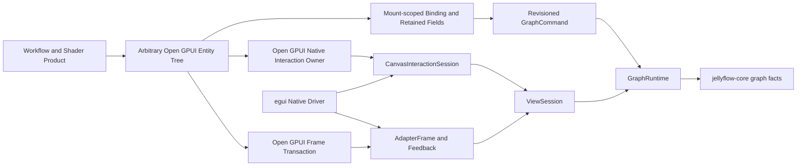
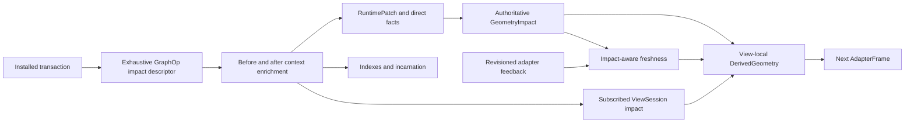
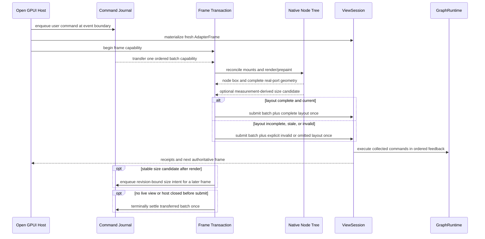
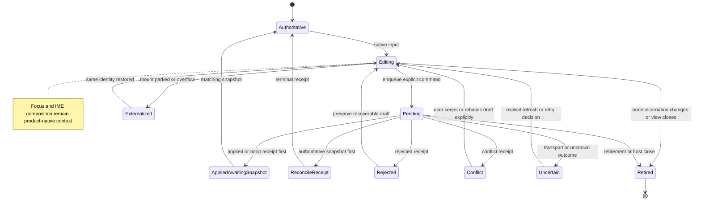
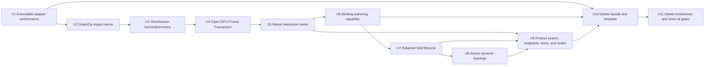

# Fearless Architecture Deepening and Native Graph UX - Plan

## Goal Capsule

| Field | Decision |
| --- | --- |
| Objective | Finish the architectural refactor required for Jellyflow to support Dify-style workflow nodes and Unity/Unreal-style shader graphs with unrestricted Open GPUI component composition, precise graph geometry, dependable editor interactions, and a credible path for independently authored future UI adapters. |
| User-visible problem | The product adapter can host native components, but its frame lifecycle, input ownership, authoring lifecycle, dynamic topology, endpoints, wires, search, and flagship node presentation still expose coordination seams. Some tests only prove names compile, while shallow facade, template, and historical blacklist surfaces make the architecture look more complete than it is. |
| Architecture stance | Preserve `GraphRuntime -> ViewSession -> AdapterFrame/Feedback -> native adapter`. Deepen the modules that own transaction impact, derived geometry, Open GPUI frame/input state, binding, and retained edits. Keep native widget trees, raw events, focus, IME, overlays, theme, and painting adapter-local. Do not add a portable UI DSL, renderer trait, or shared native-event dispatcher. |
| Execution profile | One dependency-ordered fearless refactor. Breaking public APIs, deleting crates and fixtures, rewriting tests, and removing obsolete CI/release paths are explicitly allowed. No compatibility facade, aliases, deprecation lane, ADR registry, Trellis artifacts, or legacy tombstone gate will be retained. |
| Authority hierarchy | This Product Contract governs behavior. Session-settled Key Technical Decisions govern boundaries. Implementation Units govern dependency order and deletion timing. The 2026-07-12 and 2026-07-18 plans remain authority for the native host and interaction contracts unless this plan explicitly deepens or deletes a shallow implementation surface. |
| Stop conditions | Stop only for evidence that an in-scope change violates graph integrity, makes the renderer-neutral seam framework-specific, or requires a product behavior choice not settled here. Do not stop for API breakage, broad mechanical migration, fixture churn, or deletion of obsolete products, examples, crates, scripts, tests, and documentation. |
| Tail ownership | Execute all active units, keep commits reviewable and Conventional, run focused gates after each unit and the full Verification Contract at the end, perform simplification and code review, and leave the branch clean. The plan file is an authority document, not a progress log. |

---

## Product Contract

### Summary

Jellyflow will retain a small headless graph/view protocol and let each UI framework build its own
native node authoring experience over that protocol. Open GPUI remains the product-grade adapter:
an author registers an ordinary `Entity<V: Render>`, composes any Open GPUI controls and child
entities, and opts into Jellyflow semantics only where graph behavior requires stable identity,
geometry, commands, activity, or gesture arbitration. egui remains a second real adapter and
semantic witness, not a second product implementation.

The work will deepen five ownership boundaries that currently leak coordination rules:

1. A shared executable conformance contract will compare semantic outcomes while each adapter
   retains its native event driver.
2. GraphRuntime will derive each committed transaction's runtime impact once, and ViewSession will
   publish all derived geometry through one atomic owner.
3. Open GPUI will coordinate retained frame feedback and raw input ownership through adapter-local
   deep modules rather than fields spread across the host.
4. Open GPUI node authors will use a narrower mount-scoped authoring capability and a retained field
   lifecycle instead of manually joining snapshots, handles, tickets, leases, and draft stores.
5. The flagship products will exercise atomic dynamic ports, keyboard-complete connection search,
   truthful endpoint geometry, coherent wires, and deliberate node layout before obsolete facade,
   template, and tombstone surfaces are deleted.

### Problem Frame

The previous refactors established the correct large-scale boundary and fixed several visible
regressions, including node drag release jumps, disappearing connections, label overlap, and
selection chrome escaping the node. The remaining risk is architectural: several successful paths
still rely on the caller knowing the correct order in which adjacent objects must be updated.

Graph operations are classified repeatedly for patch facts, indexes, node incarnation, and session
impact. View geometry updates are split between facts, spatial indexes, route state, snapshot
caches, revisions, and counters. Open GPUI stages measurement, frame feedback, command work,
capture, focus, cancellation, and lifecycle cleanup across multiple host coordinators. Node authors
repeat mount-scoped reads and retained draft settlement. These are not independent conveniences;
they are single invariants with shallow interfaces.

The distribution surface has the opposite problem. The top-level `jellyflow` crate is a re-export
facade without unique behavior. The native-adapter template is a framework-free runtime fixture,
not evidence that a third-party native adapter can be built. The legacy UI checker protects deleted
names and paths rather than current behavior. Keeping these surfaces imposes publication,
documentation, CI, and cognitive cost without hiding real complexity.

xyflow, Dify, Unreal, and egui-snarl provide behavior and ownership references, not code structure
to copy. xyflow gives the custom node complete ownership of its DOM subtree, then measures the
resulting node and handles. Dify layers product-specific dynamic ports and native controls on that
model. Unreal separates graph policy from Slate node/pin widgets and the panel's geometry/wire
ownership. egui-snarl proves that immediate-mode UI can expose native body/pin hooks, but its broad
mutable viewer contract is not Jellyflow's headless protocol.

### Actors

- A1. Graph end user: builds, edits, connects, reconnects, searches, navigates, and inspects complex
  workflow and shader graphs with predictable visual feedback and desktop interaction feel.
- A2. Open GPUI node author: composes arbitrary native controls and state, reads mount-scoped graph
  facts, wraps real ports, manages retained editable values, and emits explicit graph commands.
- A3. Adapter author: implements a framework-native frame, measurement, rendering, and event driver
  over the headless protocol without adopting Open GPUI-specific APIs or a Jellyflow widget DSL.
- A4. Product integrator: owns domain parsing, node layout, port labels, connection-search choices,
  dynamic topology intent, theme recipes, and product-level error text.
- A5. Maintainer/release operator: evolves graph semantics in one place, verifies real consumers,
  publishes only meaningful crates, and does not maintain compatibility or historical tombstones.

### Requirements

#### Headless boundary and adapter proof

- R1. Keep `jellyflow-core`, `jellyflow-layout`, and `jellyflow-runtime` free of Open GPUI, egui,
  windowing, native event, focus, IME, popup, theme, color, and paint-resource types.
- R2. Keep `GraphRuntime`, independent `ViewSession`s, revisioned `AdapterFrame`/feedback, and
  `CanvasInteractionSession` as the public renderer-neutral seam. Deepening their internals must not
  create a second graph, view, or interaction authority.
- R3. Do not introduce a shared widget/control DSL, portable node renderer, portable theme, raw-event
  interface, or shared async/sync adapter dispatcher. Native widget ownership stays in each adapter.
- R4. Preserve unrestricted Open GPUI node composition through ordinary `Entity<V: Render>` trees.
  Jellyflow wrappers are semantic capabilities for real ports, gestures, lifecycle, measurement,
  and graph commands; they are not a closed UI vocabulary.
- R5. Keep egui as a real second adapter that executes the same semantic scenarios through its own
  native driver. It need not reproduce Open GPUI lifecycle workarounds or product visuals.
- R6. Replace compile-only or name-only conformance tests with shared scenarios, normalized
  observations, and executable native event drivers for both adapters. The contract compares graph,
  session, geometry, receipt, and cleanup outcomes, not widget trees or pixels. Publish the pure
  scenarios and observation assertions behind a documented, non-default runtime test-support
  feature so an external adapter can run the same contract while keeping its native driver local.

#### Runtime impact and view geometry

- R7. Derive the runtime consequences of every `GraphOp` from one exhaustive private descriptor
  close to GraphRuntime. Direct facts, identity retirement/incarnation, index deltas, geometry
  invalidation, session impact, and symbol/binding propagation may require before/after context, but
  no consumer may maintain an independent incomplete variant classification.
- R8. Preserve incremental complexity. Runtime impact work is proportional to operations, affected
  facts, incident relationships, and subscribed views; it must not become a full-graph diff or scan.
- R9. Give one private ViewSession module ownership of node, port, route, and unresolved geometry,
  their spatial indexes, geometry snapshot cache, publication revision, and associated counters.
  Publication, withdrawal, translation, route replacement, patch/reset, and renderer replacement
  update those derived facts atomically.
- R10. Continue deriving `GeometryImpact` from the authoritative installed patch before deciding
  feedback freshness. Unrelated geometry remains publishable when the global graph revision moves;
  affected stale geometry is rejected with an observable reason.

#### Open GPUI retained lifecycle and authoring

- R11. Coordinate each materialized Open GPUI adapter frame through one adapter-local transaction
  that owns feedback collection, node/port coverage, staged measurements, one collected journal-
  batch capability, and exactly-once feedback submission or terminal settlement. The long-lived
  command journal remains the authority for user-triggered commands. Layout failure may reject or
  omit layout outcomes but must not discard a valid collected command batch. Measurement-derived
  size intents enter the journal only after the render boundary for a later frame.
- R12. Use one adapter-local native interaction owner for pointer capture, mutual exclusion, focus
  restoration, late-event suppression, pending semantic query drain, host close, retirement, and
  cancellation across ports, node drag, pan, marquee, connect, and reconnect. The headless session
  continues to own only normalized semantic state and effects.
- R13. Maintain one geometry invariant for the native node host: the document node box, content
  layout box, host chrome box, measured port anchors, and selection/focus outline refer to the same
  current node instance and frame. Selection must not create a second empty box, drag release must
  not move the node, and a connected wire must not disappear while feedback settles. Each native
  registration chooses document-authoritative size by default, content-height with fixed document
  width, or bounded intrinsic content size. Content-driven modes use stable 1:1 measurements,
  epsilon/stability and one-pending-intent guards, bounded oscillation detection, and a revision-
  bound size command after render; old authoritative geometry remains until the applied snapshot.
- R14. Replace the public snapshot/read/join ceremony with a narrower mount-scoped authoring
  capability that gives one coherent facts view, ordered real-port handles, and one revision-bound
  command planning/enqueue path. Product code still constructs domain `GraphCommand`s; foreign,
  retired, and stale capabilities fail explicitly; no automatic merge or retry is added.
- R15. Retain `RevisionedDraft` semantics, but add an Open GPUI-local retained field lifecycle that
  owns mechanical ticket settlement, receipt/snapshot ordering, activity lease, externalization,
  restoration, overflow, reincarnation, and close cleanup. Parsing, validation, focus, IME, domain
  command construction, and explicit conflict choice remain in the native component.
- R16. Every visible graph endpoint corresponds to a real graph `PortId` and uses a semantic port
  handle for measurement and interaction. Dynamic UI may not create decorative connectable dots.
  Product observers are optional; the host owns graph behavior without requiring no-op callbacks.

#### Dynamic topology and product experience

- R17. Dynamic branch/pin edits use a single revision-bound topology attempt that atomically
  updates node data, real ports, affected edges, and any required geometry invalidation. Stable
  logical branch identity survives reorder; rejected/conflicted attempts preserve the draft and
  authoritative graph without partial ports.
- R18. Connection search remains application-owned native UI, but not a second semantic interaction
  authority. `CanvasInteractionSession` owns request generation, semantic phase, ticket,
  cancellation, retirement, host close, and terminal outcome. Product state owns request-keyed
  provider attempts, candidates, filter, active row, focus restoration, and diagnostics. Their
  rendered projection exposes closed, loading, ready, filtered-empty, source-error, retrying,
  committing, stale-candidate, terminal, cancelled, retired, and host-closed states. Pointer and
  keyboard selection share stable candidate identity and deterministic transition rules.
- R19. Preview, committed wires, reconnect handles, markers, picking, and hit regions resolve
  endpoints through the same published visual/hit/route geometry priority. Fallback geometry is
  explicit and diagnostic; a painted marker, snapped preview, and committed route cannot disagree
  about the endpoint under normal complete publication.
- R20. Improve default Open GPUI endpoints and wires for graph-editor readability: restrained
  marker scale, generous invisible hit targets, clear direction and connection states, stable
  screen-space widths, coherent hover/selection/invalid treatments, smooth route joins, and no
  visual jump across 0.5/1/2 zoom. Visual recipes remain adapter/product-owned.
- R21. The shader and workflow flagships demonstrate deliberate node headers, content gutters,
  port rows, editable native controls, dynamic topology, selection chrome, and readable wires
  without content/label overlap. Nodes reserve their own port layout; the headless runtime does not
  solve native content collisions.

#### Distribution, deletion, and quality

- R22. Delete the shallow `jellyflow` facade crate and migrate adapters, examples, fixtures,
  documentation, release order, and consumers to direct `jellyflow-core`, `jellyflow-runtime`, and
  optional `jellyflow-layout` dependencies. Do not add a replacement prelude crate.
- R23. Delete `templates/native-adapter` after executable Open GPUI/egui conformance and an external
  direct-crate consumer prove the real seam. Replace it with a concise adapter-authoring guide that
  describes ownership and conformance obligations, not a fake framework-neutral implementation.
- R24. Delete the legacy UI tombstone checker, its tests, manifest substring assertions, and CI/doc
  invocations. Preserve structural headless dependency checks, graph integrity tests, external
  consumer smoke, native adapter conformance, and behavioral regression tests.
- R25. Update workspace metadata, lockfiles, release automation, CI, README, `CONTEXT.md`, testing
  documentation, crate READMEs, and source-trust expectations so no deleted crate, template, gate,
  command, symbol, or obsolete architecture claim remains.
- R26. Preserve the 10,000-node/about-100-visible/four-view budgets, local update complexity,
  bounded geometry/paint caches, static-layout convergence, mount/activity resource bounds,
  deterministic accessibility, and real-window shader/workflow smoke coverage.

### Key Flows

- F1. Cross-adapter semantic trace: a shared scenario describes normalized intent and expected
  observations; each adapter maps it to native events, advances frames and asynchronous work in its
  own lifecycle, and reports normalized graph/session/geometry/receipt/cleanup outcomes. A mismatch
  identifies a semantic contract issue without comparing widget structure.
- F2. Retained Open GPUI frame: the host opens one frame transaction from a fresh `AdapterFrame`,
  transfers one ordered batch capability from the long-lived command journal, reconciles mounted
  entities, performs native layout/prepaint, and records node and real-port outcomes. It submits the
  collected command batch plus the valid layout subset to `ViewSession` exactly once; invalid layout
  cannot swallow unrelated commands. Stable measurement-derived size intent enters the journal
  after render for a later frame. The next frame sees one coherent publication.
- F3. Native field edit: a mounted component obtains one authoring view, edits a retained draft,
  holds activity while focus/composition/settlement requires it, constructs an explicit domain
  command from the same facts revision, enqueues once, and reconciles either receipt-first or
  snapshot-first delivery. Conflict remains visible and user-resolvable; retirement cleans up.
- F4. Dynamic topology edit: the product creates stable branch/pin identity, derives real ports and
  data changes from one authoritative read, submits one topology attempt, keeps the draft and old
  ports during settlement, then switches to the new authoritative port set and invalidates layout
  after an applied snapshot. Rejection, conflict, undo, and redo never expose half a topology.
- F5. Connection and search: pointer input acquires one native interaction owner, published endpoint
  geometry drives preview and candidate probing, release either commits once or opens product
  search. Search handles async load, filtering, active row, keyboard/pointer choice, stale
  revalidation, retry, cancellation, focus restoration, and one atomic create/reconnect command.
- F6. Runtime transaction and geometry publication: GraphRuntime installs a command, derives one
  exhaustive impact result, updates indexes/incarnations/patch facts, fans out affected facts, and
  lets each ViewSession atomically withdraw, translate, recompute, or retain derived geometry before
  accepting feedback for the new frame.
- F7. External adoption and release: a consumer depends directly on the headless/runtime and chosen
  adapter crates, registers native nodes, executes conformance, and builds without the facade or
  template. CI and release automation validate only real crates, structural boundaries, and
  behavioral consumers.

### Acceptance Examples

- AE1. Given every canonical connect, reconnect, node-drag, cancel, retire, host-close, and terminal
  receipt trace, both native adapters execute the trace and produce the same normalized semantic
  outcome; changing a trace name alone cannot make the test pass.
- AE2. Given one `GraphOp` variant in execute, undo, and redo, the installed patch, direct facts,
  identity/incarnation changes, incremental indexes, `GeometryImpact`, and subscribed-session impact
  match a rebuilt authoritative result; adding a future variant fails an exhaustive test/compile
  boundary until its impact is declared.
- AE3. Given node/port publication, withdrawal, translation, route replacement, renderer
  replacement, or reset, facts, spatial indexes, unresolved routes, cached snapshot, revisions, and
  counters change atomically and no query returns a mixed generation.
- AE4. Given repeated Open GPUI layout/prepaint passes, incomplete port coverage, stale/foreign
  feedback, node retirement, or host close, one frame transaction submits or terminally settles its
  collected batch exactly once. Layout errors preserve last authoritative geometry and do not
  discard unrelated commands; no path double-submits or leaves a connected edge without authority.
- AE5. Given overlapping port/node/canvas listeners, late native events, focus transfer, overlay
  input, Escape, retirement, and close, exactly one native owner controls capture and cleanup while
  the renderer-neutral session has at most one semantic gesture/ticket.
- AE6. Given a mounted author reads facts and handles, a foreign or retired mount is rejected, an
  older facts revision produces a conflict rather than a rewritten command, and no normal authoring
  path requires cloning a root graph snapshot or zipping unrelated collections by convention.
- AE7. Given a string or numeric retained field, every ordering of snapshot and applied/noop/
  rejected/conflict/transport receipt converges to a documented state; overflow, externalization,
  reincarnation, and view close release subscriptions and activity without losing recoverable draft
  text.
- AE8. Given Condition branches or Blueprint pins are added, removed, or reordered, node data and
  real graph ports change atomically with stable identities; conflict and undo restore the prior
  topology and geometry without decorative or dangling connectable markers.
- AE9. Given connection search has results, no results, a source failure, a stale result, or a
  pending commit, keyboard and pointer input produce the same selection semantics, committing blocks
  duplicate submission, Escape/outside dismissal are deterministic, and focus returns correctly.
- AE10. Given the shader graph at 0.5, 1, and 2 zoom, endpoint markers remain readable with at least
  the configured invisible hit target, preview and committed routes share anchors, selection adds
  one in-bounds outline, labels do not overlap content, drag release does not jump, and connected
  wires remain visible.
- AE11. Given an external source consumer and isolated packaged headless, egui, and Open GPUI
  consumers, all compile and exercise the boundary they import using direct crates only; their
  exact dependency closures contain no unused layout or cross-framework packages, and the workspace
  contains no facade crate or native-adapter template.
- AE12. Given the final repository, no CI, release, README, context, testing doc, script test, or
  lockfile refers to the facade, native-adapter template, or legacy tombstone gate; the retained
  structural and behavioral gates all pass.

### In Scope

- Runtime internal impact derivation and ViewSession derived-geometry ownership.
- Executable cross-adapter semantic conformance using native test drivers.
- Open GPUI frame transaction, native interaction ownership, authoring Binding, retained fields,
  endpoint resolution, chrome, and focused public-surface cleanup.
- Product dynamic topology, connection search, shader/workflow node layout, endpoint/wire polish,
  accessibility, and real-window regression evidence.
- Breaking deletion of the facade crate, native-adapter template, legacy tombstone checker, shallow
  source-string assertions, obsolete exports, and all affected distribution/documentation paths.

### Out of Scope

- A portable node UI DSL, form schema, renderer trait, cross-framework theme, or shared widget kit.
- Feature parity between Open GPUI and egui, or an egui version of the flagship product UI.
- Full Dify, Unity, or Unreal editor product scope such as collaboration, asset compilation,
  subgraphs, undo history UI, minimap, deployment, or domain execution engines.
- Automatic graph command conflict merge/retry, mutable render-time graph access, or hidden topology
  repair.
- A general automatic native content/port collision solver; each native component owns its layout.
- Restoring ADR/Trellis infrastructure or preserving deleted architecture for historical reasons.

### Success Criteria

- The conformance suite executes real native paths in both adapters and no false-green name-only
  test remains.
- Every `GraphOp` has one impact declaration and every ViewSession geometry mutation passes through
  one atomic derived-state owner without degrading large-graph budgets.
- Open GPUI has one frame transaction and one native interaction owner; resource, lifecycle, frame,
  and interaction tests prove exactly-once cleanup and stable geometry.
- Flagship authors no longer repeat the root snapshot/read/handle/ticket/lease/store ceremony for
  normal fields, yet retain explicit domain command and conflict ownership.
- Dynamic ports are real and atomic; connection search is keyboard-complete; endpoints, wires,
  selection, dragging, and label/content layout pass focused and real-window regressions.
- The facade, template, and tombstone gate are absent, direct consumers remain green, release/CI
  surfaces describe only real architecture, and no compatibility lane remains.

---

## Planning Contract

### Key Technical Decisions

#### KTD1. Preserve the protocol seam and reject a cross-framework UI abstraction

`session-settled: user-approved native Open GPUI authoring with future independent adapters; rejected portable DSL/renderer abstraction`

The durable public seam remains graph facts, revisioned commands, view-scoped frames, geometry
feedback, and normalized semantic interaction. Open GPUI and future adapters independently build
native component trees, lifecycle integration, theme, and painting. The right cross-framework
contract is observable graph behavior, not a common widget vocabulary.

Rejected alternatives:

- Reintroduce a portable UI DSL: makes advanced native controls a lowest-common-denominator schema
  and restores the architecture this refactor intentionally removed.
- Add a shared renderer or raw-event trait: leaks retained/immediate lifecycle differences into a
  broad callback interface without hiding graph complexity.
- Make Open GPUI types the core authoring API: achieves the first product but closes the adapter seam
  to other frameworks.

#### KTD2. Conformance compares executable semantics through adapter-local native drivers

Shared fixtures own scenario input and normalized observations. Each adapter owns event synthesis,
frame advancement, focus/capture behavior, async draining, and native geometry measurement. The
Open GPUI name-only test is deleted as soon as its real driver lands. Visual parity is assessed only
inside the product adapter; it is not part of cross-adapter conformance.

This preserves the real difference between Open GPUI's retained asynchronous lifecycle and egui's
immediate synchronous frame while making both prove the same headless contract. The pure fixture and
observation layer is an opt-in, documented `jellyflow-runtime` test-support surface so an external
adapter can import the contract without importing either native implementation.

#### KTD3. A private GraphRuntime impact descriptor is exhaustive but context-aware

The impact descriptor lives beside GraphRuntime transaction installation, not in `jellyflow-core`.
It exhaustively classifies every `GraphOp`'s direct semantic effects. Consumers may enrich that
descriptor using before/after graph context for incident edges, port ownership, symbols, bindings,
and indexes, but may not independently decide that a variant is irrelevant.

The module does not combine legitimately distinct apply, invert, command-planning, or storage
logic, and it does not compute a full before/after graph diff. Its deletion test is that patch,
index, incarnation, and session classifiers would otherwise reappear in separate files.

#### KTD4. ViewSession derived geometry has one private owner

Node, port, route, unresolved, spatial-index, geometry-cache, publication-revision, and geometry-
counter state move behind one `DerivedGeometry`-shaped private module. `ViewState` retains lifecycle,
selection, viewport, subscriptions, runtime capability, pending frame, and interaction ownership.
Callers express meaningful transitions such as publish, withdraw, translate, replace routes, mark
stale, or reset; they no longer update adjacent collections in a required order.

Public `ViewSession` and frame/feedback interfaces remain stable unless narrowing an accidental
internal export is necessary. GraphRuntime policy and feedback validation do not move into the
derived-state module.

#### KTD5. Open GPUI owns a retained Frame Transaction

The runtime already defines frame tokens, complete layout feedback, replay/stale/foreign rejection,
and revision arbitration. Open GPUI needs an adapter-local transaction that adapts those rules to
multiple retained layout/prepaint passes and deferred graph mutation. It owns the collector and
one batch capability collected from the long-lived command journal, then submits or terminally
settles that capability exactly once. Invalid or incomplete layout is an explicit layout outcome;
it cannot cancel otherwise valid user-triggered commands in the collected batch. Retirement,
supersession, unavailable view, or host close settle the batch explicitly rather than losing it.

The journal remains the authority for event-time command enqueue and receipt identity. A stable
measurement-derived size intent is queued into the journal after render for a subsequent frame; it
does not enter the batch whose measurement created it. The transaction may replace or absorb
`DeferredFrameFeedback`, but it may not become a second command journal or direct GraphRuntime path.

#### KTD6. Native event ownership is adapter-local and singular

Open GPUI will have one native interaction owner around one `CanvasInteractionSession`. It
coordinates capture, native listener precedence, focus, overlays, scheduling, late events, pending
queries, lifecycle cancellation, and cleanup. The renderer-neutral session remains the exclusive
semantic gesture state machine but never learns Open GPUI event or entity types.

Rejected alternative: a shared adapter dispatcher. Open GPUI drains queries across retained tasks
while egui drains them synchronously in one frame; turning those differences into callbacks and
strategy flags would create a shallower interface than the two local drivers.

#### KTD7. Binding becomes an authoring capability, not an automatic mutation service

The Binding interface will hide graph-root cloning, redundant snapshot/read layers, same-mount join
ceremony, and ordered-port zipper assumptions. It will expose one coherent mount-scoped facts view,
semantic port capabilities, activity/measurement access, and one revision-bound command enqueue
boundary.

`session-settled: preserve explicit GraphCommand construction and strict revision receipts; rejected automatic conflict retry`

The product still parses domain data, chooses commands, and responds to conflicts. The adapter may
not silently refresh, merge, or retry. Presentation writers and host-scoped accessibility identity
become internal; optional product event observation remains optional.

#### KTD8. Retained field mechanics and dynamic topology are separate layers

The adapter-local retained field owns reusable editing mechanics: draft reconciliation, activity,
ticket settlement, externalization, overflow, identity, and cleanup. It does not own domain parsing,
focus/IME, commands, or conflict policy.

Dynamic topology remains product/runtime command composition. Condition branches and Blueprint pins
use an application-owned attempt lifecycle over stable IDs and real graph ports. Only after two
products prove a smaller reusable topology abstraction may one move below the product; this plan
does not create a speculative cross-adapter topology UI API.

#### KTD9. Product layout, search, endpoints, and visual recipes stay native

`session-settled: user-approved Open GPUI product adapter; rejected moving product UI into headless runtime`

Node headers, port gutters, labels, controls, keyboard search state, colors, marker shapes, wire
recipes, and spacing belong to Open GPUI and the flagship application. Runtime provides real ports,
policy, geometry, routes, picking, and commands. As in xyflow, measurement records the layout the
native component chose; it does not arrange the component or solve label collisions.

Connection search observes a deliberate two-level boundary. `CanvasInteractionSession` remains
authoritative for semantic request generation, phase, command ticket, cancellation, retirement,
close, and terminal outcome. Product state owns provider attempts, candidate/filter/active-row data,
focus restoration, and diagnostic copy keyed by that semantic generation. The rendered search state
is a projection of both owners, never an independently settling semantic state machine.

#### KTD10. Delete the facade and fake template after real replacement evidence

The top-level `jellyflow` crate has no unique policy or state and is deleted rather than deepened.
Adapters and products depend directly on the crates they use. The native-adapter template is
deleted because it has no native framework lifecycle and duplicates runtime behavior. Its useful
documentation is replaced by an adapter-authoring guide backed by executable Open GPUI/egui tests
and an external direct-crate consumer.

Rejected alternatives:

- Keep a convenience prelude: preserves three overlapping import surfaces and hides dependency
  ownership.
- Turn the template into a third fake adapter: adds maintenance without proving a real lifecycle.
- Delete egui instead: removes the only independent real adapter witness and makes the seam
  hypothetical again.

#### KTD11. Delete compatibility and historical tombstones, retain structural gates

`session-settled: user-directed fearless breaking refactor with no compatibility requirement; rejected deprecation lane`

The legacy UI path/name blacklist and source-substring tests are deleted because they protect
history, not architecture. The dependency-closure headless check, graph integrity, executable
conformance, external consumer, performance/resource tests, and real-window smoke remain because
they prove current behavior. No alias, deprecated module, compatibility feature, migration facade,
ADR registry, or Trellis artifact survives.

#### KTD12. Guardrails precede deepening; deletion follows replacement

`session-settled: user-directed full audit scope in one plan and one Goal; rejected selecting only a subset`

The implementation order is deliberate: executable conformance first; authoritative runtime
impact and geometry next; Open GPUI frame/input/authoring lifecycle after that; product topology and
UX on the stable lifecycle; distribution deletion last. This is one complete program, but each unit
must leave a green reviewable commit and may not depend on a later compatibility layer.

### High-Level Technical Design

The diagrams describe ownership, state, and ordering. They are not exact Rust APIs.

```mermaid
stateDiagram-v2
    [*] --> Closed
    Closed --> Loading: open from semantic request
    Loading --> Ready: candidates loaded
    Loading --> FilteredEmpty: no visible candidates
    Loading --> SourceError: load failed
    SourceError --> Retrying: retry requested
    Retrying --> Loading: new provider generation
    Ready --> Ready: filter or move active row
    Ready --> FilteredEmpty: filter has no results
    FilteredEmpty --> Ready: filter or provider result changes
    Ready --> StaleCandidate: chosen identity fails revalidation
    StaleCandidate --> Ready: current candidates refreshed
    Ready --> Committing: click or Enter fresh candidate
    Committing --> Terminal: applied, noop, rejected, conflict, or transport outcome
    Committing --> StaleCandidate: stale revalidation before enqueue
    Terminal --> Closed: applied or noop focus transfer
    Terminal --> Ready: recoverable failure and live request
    Loading --> Cancelled: Escape or outside dismissal
    Ready --> Cancelled: Escape or outside dismissal
    FilteredEmpty --> Cancelled: Escape or outside dismissal
    SourceError --> Cancelled: Escape or outside dismissal
    Retrying --> Cancelled: Escape or outside dismissal
    StaleCandidate --> Cancelled: Escape or outside dismissal
    Loading --> Retired: source or anchor retired
    Ready --> Retired: source or anchor retired
    FilteredEmpty --> Retired: source or anchor retired
    SourceError --> Retired: source or anchor retired
    Retrying --> Retired: source or anchor retired
    StaleCandidate --> Retired: source or anchor retired
    Committing --> Retired: source or anchor retired
    Loading --> HostClosed: host close
    Ready --> HostClosed: host close
    FilteredEmpty --> HostClosed: host close
    SourceError --> HostClosed: host close
    Retrying --> HostClosed: host close
    StaleCandidate --> HostClosed: host close
    Committing --> HostClosed: host close
    Cancelled --> Closed: restore prior live focus
    Retired --> Closed: focus nearest live item or canvas
    HostClosed --> Closed: cleanup without focus restoration
```











The connection-search rendering contract is exhaustive and split by owner:

| Rendered state | Authoritative input | Visible behavior and allowed input | Exit and focus |
| --- | --- | --- | --- |
| Closed | No semantic search request | Surface absent | Prior graph focus remains |
| Loading | Live request plus current provider generation | Spinner; filter and candidate commit unavailable; Escape/outside allowed | Ready, FilteredEmpty, SourceError, Cancelled, Retired, or HostClosed |
| Retrying | Product retry generation scheduled | Error replaced by progress; retry disabled; stale completion ignored | Loading or lifecycle exit |
| Ready | Live request plus non-empty filtered candidates | Filter, hover, Up/Down, click, Enter, Escape, outside allowed | FilteredEmpty, StaleCandidate, Committing, Cancelled, Retired, or HostClosed |
| FilteredEmpty | Provider succeeded but no candidate matches | Empty result with editable filter; no commit | Ready or lifecycle exit |
| SourceError | Latest provider generation failed | Error and one retry action; no commit | Retrying or lifecycle exit |
| StaleCandidate | Selected stable identity failed fresh revalidation | Preserve query and rows, explain staleness, block duplicate commit | Ready after refresh or lifecycle exit |
| Committing | Semantic session owns one live ticket | Rows/filter/retry disabled; show pending state | Terminal, StaleCandidate, Retired, or HostClosed |
| Terminal | Semantic terminal reason observed | Applied/noop transfers focus; rejected/conflict/transport shows one recoverable diagnostic | Closed or Ready according to semantic outcome |
| Cancelled | Semantic cancellation observed | Cleanup once | Restore prior live focus, then Closed |
| Retired | Source/anchor incarnation ended | Cleanup once; no retry | Focus nearest live graph item or canvas, then Closed |
| HostClosed | Host lifecycle ended | Cleanup once; no input | Closed without native focus restoration |

The active row is keyed by stable candidate identity. Opening selects the first visible candidate.
Filtering or refresh preserves the identity when still visible and otherwise selects the first row;
an empty list clears it. Pointer hover synchronizes the active identity. Up/Down wrap through visible
rows. Committing freezes it, and Enter submits only that identity after fresh revalidation.

### API and Module Disposition

| Current surface | Disposition | Replacement or retained owner |
| --- | --- | --- |
| Open GPUI canonical trace name assertion | Delete | Shared semantic scenarios executed through an Open GPUI native driver |
| Repeated `GraphOp` classifiers in `execution.rs`, `index.rs`, and `patch.rs` | Consolidate | Private GraphRuntime impact descriptor plus context enrichment |
| View geometry facts/index/cache fields spread through `ViewState` | Move behind one owner | Private ViewSession derived-geometry module |
| `DeferredFrameFeedback` plus host pending measurement/batch fields | Replace or absorb | One Open GPUI frame transaction over a batch transferred from the long-lived journal |
| Port/scene/connection native capture coordinators | Consolidate | One Open GPUI native interaction owner around `CanvasInteractionSession` |
| Public Binding snapshot/read/join ceremony | Narrow and internalize | Mount-scoped authoring capability with strict revision enqueue |
| Mandatory port event callback with product no-op closures | Make optional or delete | Host-owned graph behavior plus optional product observer |
| Host-owned presentation writers and accessibility ID constructors | Internalize | Immutable author-facing state and semantic accessibility behavior |
| Repeated product draft/ticket/activity/store orchestration | Consolidate | Open GPUI retained field lifecycle; keep domain parsing and commands native |
| Product dynamic port mutation fragments | Replace | Application-owned revisioned topology attempt over real graph ports |
| Connection preview endpoint fallback chains | Consolidate | Adapter-local published endpoint resolver shared by preview/paint/reconnect |
| One-implementation connection-search source/data bag | Collapse | Product provider/filter/active-row state keyed to semantic search presentation |
| `crates/jellyflow` facade | Delete | Direct core/runtime/layout dependencies as actually needed |
| `templates/native-adapter` code workspace | Delete | Real dual-adapter conformance, external consumer, and authoring guide |
| `check_no_legacy_ui_surfaces.py` and source-string tombstones | Delete | Structural dependency, behavior, consumer, lifecycle, and performance gates |

### Assumptions

- The 2026-07-12 and 2026-07-18 plans have landed sufficiently for this plan to deepen their
  implementation rather than recreate GraphRuntime, ViewSession, frame feedback, interaction,
  native registry, port geometry, command journal, and egui witness foundations.
- The user's repeated approval of all audit candidates, breaking changes, deletion, self-commits,
  immediate Goal execution, and no compatibility is treated as scope confirmation. Planning-owned
  implementation details are resolved here without another approval checkpoint.
- Local pinned `repo-ref/xyflow` and `repo-ref/egui-snarl`, current Open GPUI source, existing
  research notes, code, tests, and git history provide sufficient evidence. No unstable external
  package claim is required for the plan.
- No `docs/solutions/` or `CONCEPTS.md` institutional-learning corpus exists. The current code and
  the two implementation-ready predecessor plans are the architecture authorities.
- Open GPUI remains the product adapter and may use adapter-specific retained abstractions. A future
  framework implements the headless protocol independently rather than consuming Open GPUI author
  APIs.
- Public v0.4 Rust APIs, fixtures, lockfiles, examples, and crate publication order may change. Graph
  persistence and integrity remain protected unless a unit explicitly documents and tests a wire
  change; no wire migration is currently expected.
- Product visual polish is validated through deterministic layout/interaction assertions plus real-
  window smoke and captured evidence where the environment supports it; pixel-perfect parity with
  xyflow, Dify, Unity, or Unreal is not a goal.

### Implementation Constraints

- Do not mutate graph or view authority during Open GPUI render, prepaint, or paint.
- Do not borrow GraphRuntime/ViewSession across native frames or GPUI async/task boundaries.
- Do not add framework dependencies, native types, paint values, or product state to core/runtime.
- Do not create a second semantic interaction state beside `CanvasInteractionSession` or a second
  derived geometry authority beside ViewSession.
- Do not silently retry, merge, rewrite expected revisions, or partially apply topology commands.
- Do not infer ports from painted markers; every connectable marker is backed by a current real
  `PortId` and complete coverage state.
- Do not add one retained entity per edge, scan the full graph on pointer move, or replace affected-
  fact invalidation with whole-graph diffing.
- Do not add generic authoring abstractions until at least two production call sites prove the same
  lifecycle and the proposed module passes the deletion test.
- Delete superseded code in the same unit that establishes replacement evidence. Temporary dual
  paths may not survive a completed unit or the final diff.
- Preserve unrelated user work and never use destructive Git recovery operations.

### Sequencing



U1 is the guardrail: it must fail on real semantic regressions before internal ownership moves.
U2 precedes U3 because ViewSession freshness consumes the authoritative impact. U3 precedes U4 so
the retained transaction publishes into one stable geometry owner. U4 and U5 are sequential because
both reshape `host.rs` and frame/input lifecycle. U6 precedes U7 and U8 so product editing work uses
the final authoring boundary. U9 runs only after lifecycle and topology are trustworthy. U10 and U11
delete distribution and historical proof only after their real replacements are green.

### System-Wide Impact

- **Graph model and commands:** graph facts and command-only mutation remain authoritative. Dynamic
  topology uses existing atomic graph operations with stable IDs; the main change is centralized
  runtime interpretation and product attempt lifecycle, not a new mutation engine.
- **GraphRuntime:** transaction installation consumes one exhaustive internal impact description.
  Patch facts, incremental indexes, node incarnation, and session fanout consume it consistently;
  authoritative `GeometryImpact` is then derived from the installed patch. All must agree across
  execute, undo, redo, and replay.
- **ViewSession:** derived node/port/route geometry and indexes become a deeper private module. Public
  frames, feedback validation, selection, viewport, subscriptions, and weak lifecycle remain at the
  existing boundary.
- **Open GPUI host:** frame and input fields move under singular owners. Mount reconciliation,
  activity, measurement, command journal, overlays, focus, capture, and cleanup must avoid strong
  cycles and preserve retained asynchronous ordering. The journal stays long-lived; each frame owns
  only its transferred batch and cannot couple domain-command success to unrelated layout validity.
- **Open GPUI author API:** the registry and arbitrary component model remain. Binding and draft APIs
  break toward fewer capabilities and clearer ownership. Product nodes and external fixtures migrate
  in the same units; unused root exports disappear.
- **egui:** production code changes only when required by the shared semantic contract. Test drivers
  remain immediate-mode and native. There is no product visual expansion.
- **Flagship products:** workflow and shader nodes become the integration proof for native controls,
  fields, fixed and content-driven size, real/dynamic ports, layout, search, endpoint geometry,
  wires, selection, and lifecycle.
- **Distribution:** one crate and one nested template workspace disappear. Adapter dependency graphs,
  package archives, release order, source-trust checks, external consumer fixtures, CI, and docs all
  move to direct meaningful crates.
- **Failure propagation:** invalid feedback, foreign mounts, stale revisions, conflicts, incomplete
  geometry, source failures, budget exhaustion, retirement, and host close remain explicit outcomes.
  No layer converts them into hidden fallback success.
- **Performance and resources:** impact derivation, geometry publication, frame staging, endpoint
  resolution, and search must preserve affected-fact work, bounded caches, one active owner, and
  deterministic counters. New indirection must reduce duplicated state without increasing steady-
  state allocations per node or edge.
- **Accessibility:** native controls retain their normal Open GPUI behavior. Semantic port/edge/search
  state, keyboard selection/cancellation, deterministic focus restoration, and lifecycle retirement
  remain tested after public ID constructors are internalized.

### Risks and Mitigations

| Risk | Impact | Mitigation |
| --- | --- | --- |
| False conformance abstraction | Shared test helpers accidentally encode one framework lifecycle | Share scenarios and observations only; keep native drivers local; require real event/frame execution in both adapters |
| Impact descriptor becomes another classifier | Consumers still interpret variants independently | Exhaustive variant matrix, forbid catch-all relevance matches, and compare execute/undo/redo against rebuilt indexes and authoritative patch facts |
| Derived geometry module becomes a new `ViewState` god object | Ownership moves without a smaller interface | Keep lifecycle/selection/viewport/policy outside; expose state transitions, not collection access; test invariants through public queries |
| Retained frame transaction conflicts with multi-pass layout | Double feedback, stale geometry, missing wire, or lost command | Capability-owned collector and transferred batch, last-valid geometry, layout failure isolated from valid commands, explicit terminal settlement, and repeated-prepaint tests |
| Input owner migration leaves two captures | Duplicate gestures, stuck focus, or late-event mutation | One cutover unit, capture-owner assertions, late-event suppression tests, and deletion of superseded coordinator state before U5 completes |
| Binding simplification hides conflict semantics | Convenient API silently retries or uses a newer snapshot | Consume one mount-scoped authoring view, preserve expected revision, explicit foreign/stale errors, and conflict tests with queued prefix work |
| Retained field abstraction absorbs product meaning | Generic module becomes a form DSL or auto-commit engine | Keep parsing, validation, focus, IME, command selection, and conflict choice in native components; support only proven mechanical lifecycle |
| Dynamic topology publishes half a port set | Dangling edges, missing geometry, or mismatched drafts | One atomic command/attempt, stable IDs, old authoritative topology during settlement, complete coverage after applied snapshot, undo/redo tests |
| Visual polish masks geometry disagreement | Marker looks correct while preview/hit/route use fallback | One adapter-local endpoint resolver, diagnostics for fallback, zoom-matrix tests, and real-window connect/reconnect evidence |
| Broad deletion breaks release or external users | Root tests pass while packages/consumers fail | Direct-crate external source and isolated packaged fixtures, package/dry-run checks, release script tests, lockfile/source-trust audit, and deletion last |
| Scope size obscures regressions | Large final diff is hard to isolate | Dependency-ordered units, focused gates and Conventional Commit per coherent unit, no compatibility lane, final simplify/review passes |

### Resolved During Planning

- Full audit scope is included in one plan and Goal; no candidate is deferred merely to reduce the
  number of commits.
- Breaking API changes and deletion are preferred over compatibility shims.
- Open GPUI receives product-grade lifecycle and visual work; egui remains a semantic witness.
- No shared UI DSL, renderer trait, native event dispatcher, or product provider/filter/UI state
  enters runtime; existing semantic search generation/ticket/terminal ownership remains there.
- The facade, native-adapter template, and legacy tombstone checker are deleted after replacement
  evidence, while the real egui adapter and structural headless dependency check are retained.
- Existing ADR/Trellis infrastructure is not restored, and obsolete examples/products may be
  deleted if they do not contribute to the final proof surface.

### Deferred to Implementation

- Exact private type and file names may change to match Rust module locality after the first focused
  tests expose the smallest interface. This does not permit changing ownership or product behavior.
- The endpoint and wire recipe values may be tuned through real-window QA, but the screen-space,
  accessibility, geometry-consistency, and zoom-matrix outcomes are fixed.
- A source file may be split or deleted when its responsibilities are fully absorbed by a planned
  owner. New public crates or public abstraction layers are not authorized by this flexibility.

### Sources and References

- `CONTEXT.md` for current architecture authority, headless constraints, and repository gates.
- `docs/plans/2026-07-12-001-refactor-headless-native-node-host-plan.md` for native registry,
  GraphRuntime/ViewSession/frame-feedback, strict command, dynamic topology, and egui witness
  decisions.
- `docs/plans/2026-07-18-001-refactor-headless-canvas-interaction-plan.md` for
  `CanvasInteractionSession`, impact-aware geometry freshness, native chrome, semantic LOD, and
  editor interaction decisions.
- `docs/research/2026-07-11-headless-custom-node-ui-architecture.md` for xyflow, Dify, Unreal,
  egui-snarl, and Open GPUI lifecycle comparisons.
- `docs/research/2026-07-18-xyflow-custom-node-layout.md` for the custom-node/port layout ownership,
  measurement, and explicit invalidation mapping.
- `crates/jellyflow-runtime/src/runtime/graph_runtime/{execution,index,patch}.rs` and
  `crates/jellyflow-runtime/src/runtime/view_session/**` for the current shallow runtime update
  protocols.
- `crates/jellyflow-open-gpui/src/{binding,draft,draft_store,activity,port_handle}.rs` and
  `crates/jellyflow-open-gpui/src/host/**` for the current authoring, retained, frame, interaction,
  endpoint, and lifecycle seams.
- `crates/jellyflow-egui/tests/**`, `crates/jellyflow-open-gpui/tests/**`, and
  `crates/jellyflow-runtime/tests/support/canonical_interaction_trace.rs` for the current real and
  false-green conformance surfaces.
- `examples/canvas-jellyflow/src/**` and `examples/canvas-jellyflow/tests/**` for flagship product
  behavior and real-window regression paths.
- `crates/jellyflow/**`, `templates/native-adapter/**`, `tools/**`, `.github/workflows/**`,
  `scripts/**`, README files, and release/testing docs for the deletion and distribution surface.

---

## Implementation Units

### Unit Index

| Unit | Goal | Depends on | Primary proof |
| --- | --- | --- | --- |
| U1 | Executable dual-adapter semantic conformance | None | Real Open GPUI and egui native trace outcomes |
| U2 | Centralized GraphOp runtime impact | U1 | Exhaustive variant and rebuild-equivalence matrix |
| U3 | Atomic ViewSession derived geometry | U2 | Publication/query/cache/index invariant tests |
| U4 | Open GPUI Frame Transaction | U3 | Exactly-once feedback and retained lifecycle tests |
| U5 | Singular Open GPUI native interaction owner | U4 | Capture/focus/late-event/close tests |
| U6 | Narrow mount-scoped Binding authoring capability | U5 | Authoring, foreign/stale, external-consumer tests |
| U7 | Retained field lifecycle and product migration | U6 | Receipt/snapshot/overflow/reincarnation matrix |
| U8 | Atomic dynamic topology attempts | U7 | Condition/Blueprint real-port and undo/redo tests |
| U9 | Product search, endpoint, wire, and node UX | U5, U7, U8 | Focused product and real-window regressions |
| U10 | Delete facade and native-adapter template | U1, U6, U9 | Direct-crate consumers and package/release checks |
| U11 | Delete tombstones and close repository gates | U10 | Full verification, diff audit, docs/CI consistency |
| U12 | Harden graph, interaction, viewport, and mount capabilities | U1-U11 | Cross-runtime/view/session ABA matrix and adapter compile proof |
| U13 | Close native graph accessibility, interaction, and wire-style parity gaps | U12 | Keyboard, semantic-bounds, overlap-order, typed-route, visual-profile, and overflow product proof |

### U1. Replace false-green conformance with executable native adapter traces

- **Goal:** Establish the behavioral guardrail for every later ownership change by making Open GPUI
  and egui execute the same canonical semantic scenarios through their real native drivers.
- **Requirements:** R1-R6, R26.
- **Flows and acceptance:** F1; AE1.
- **Decisions:** KTD1, KTD2, KTD12.
- **Dependencies:** None.
- **Files:**
  - `crates/jellyflow-runtime/tests/support/canonical_interaction_trace.rs`
  - `crates/jellyflow-runtime/tests/canonical_interaction_trace.rs`
  - `crates/jellyflow-runtime/Cargo.toml`
  - an opt-in adapter-protocol test-support module under `crates/jellyflow-runtime/src/`
  - `tools/fixtures/external-consumer/adapter-conformance/**` (new)
  - `tools/check_external_consumer_smoke.py`
  - `tools/tests/test_check_external_consumer_smoke.py`
  - `crates/jellyflow-open-gpui/tests/canonical_interaction_trace.rs`
  - `crates/jellyflow-open-gpui/tests/adapter_conformance.rs`
  - `crates/jellyflow-open-gpui/src/host/tests/interaction_characterization.rs`
  - `crates/jellyflow-egui/tests/canonical_interaction_trace.rs`
  - `crates/jellyflow-egui/tests/adapter_conformance.rs`
  - focused test support modules created beside those tests
- **Approach:**
  - Define shared data-only scenarios and normalized observations for new connection, source/target
    reconnect, node drag, cancel, selection, retirement, host close, prefix waiting, and every
    terminal command receipt.
  - Keep the shared contract independent of native event types and widget structure. It may describe
    normalized intent, expected semantic phase/effects, graph delta, presentation continuity,
    geometry withdrawal, ticket outcome, and cleanup.
  - Move that pure contract behind a documented non-default runtime test-support feature. Both
    in-repo adapters and a new external adapter-test fixture import it; production users who do not
    build adapters pay no default dependency or API cost beyond the feature declaration.
  - Drive Open GPUI through `TestAppContext`, real registered native nodes, press/move/release/key/
    focus/capture events, retained frame advancement, and queued task settlement. Drive egui through
    its existing native harness and immediate frames.
  - Normalize adapter observations after the native path has run, then compare them with the shared
    contract. Do not call `CanvasInteractionSession` directly from an adapter conformance driver as
    a substitute for native wiring.
  - Delete the Open GPUI test that passes by asserting trace names. Remove duplicated fixture
    semantics after both real drivers cover them.
- **Test scenarios:**
  - A valid new connection and both reconnect endpoints pass through native hit/capture and settle on
    applied and noop receipts with one graph mutation.
  - Rejected and conflict receipts preserve or restore the correct preview/old edge without retry.
  - `TransportFailure` covers new connection, both reconnect endpoints, create-from-wire search,
    and node drag; each path exposes the expected unknown/failed terminal state, restores or retains
    presentation deliberately, releases ownership once, and never retries automatically.
  - Node press below threshold, drag, Escape, capture loss, retirement, and host close end in the
    same normalized semantic state and cleanup in both adapters.
  - A queued command prefix delays fresh-at-release binding while optimistic presentation remains;
    the final trace binds once after the prefix and never rewrites a queued revision.
  - Mutating a shared expected observation causes both adapter suites to fail for semantic reasons;
    renaming a fixture has no effect on success.
  - The external adapter-test fixture enables the feature, imports the contract, supplies a local
    driver boundary, and is executed by the external consumer smoke before any distribution deletion.
- **Verification outcome:** Both adapters execute all canonical scenarios through real framework
  input/frame paths, share only data fixtures and observations, and expose any semantic divergence
  before U2 begins.
- **Deletion:** Remove name-only conformance, duplicated semantic expectations, and any helper that
  bypasses native wiring without being an explicitly runtime-only state-machine test.

### U2. Centralize authoritative GraphOp runtime impact derivation

- **Goal:** Make one private, exhaustive runtime module the locality boundary for the consequences of
  an installed graph transaction.
- **Requirements:** R2, R7, R8, R10, R26.
- **Flows and acceptance:** F6; AE2.
- **Decisions:** KTD3, KTD12.
- **Dependencies:** U1.
- **Files:**
  - `crates/jellyflow-runtime/src/runtime/graph_runtime/mod.rs`
  - `crates/jellyflow-runtime/src/runtime/graph_runtime/execution.rs`
  - `crates/jellyflow-runtime/src/runtime/graph_runtime/index.rs`
  - `crates/jellyflow-runtime/src/runtime/graph_runtime/patch.rs`
  - a new private impact module beside those files
  - `crates/jellyflow-runtime/src/graph_kernel/transaction/op.rs`
  - `crates/jellyflow-runtime/src/graph_kernel/transaction/footprint.rs`
  - `crates/jellyflow-runtime/src/runtime/tests/view_session/geometry_impact.rs`
  - focused GraphRuntime impact/index/history tests
- **Approach:**
  - Inventory every `GraphOp` and every current classification in patch, index, execution,
    incarnation, symbols/bindings, geometry, and session fanout.
  - Introduce one private exhaustive operation-impact descriptor for direct semantic properties.
    Enrich it from the authoritative before/after graph and transaction footprint where owner,
    incident edge, symbol referrer, binding, or index context is required.
  - Make patch facts, incremental index updates, incarnation changes, and session fanout consume
    that derived result. Derive `GeometryImpact` afterward from the authoritative installed
    `RuntimePatch`, then use it for feedback freshness. Preserve distinct apply/invert/storage and
    command-planning logic when it answers a different question.
  - Remove catch-all matches that silently classify future variants as irrelevant. Preserve
    operation/affected-fact complexity and existing public `RuntimePatch`/`GeometryImpact` APIs.
  - Keep rejected, conflict, and noop commands outside the installed-impact path so they cannot
    publish a mutation that did not occur.
- **Test scenarios:**
  - A table covers every current `GraphOp` alone and in representative multi-op transactions,
    including node deletion with incident edges/bindings, port changes, symbols/referrers, kind/
    version changes, payload changes, geometry, and topology.
  - Execute, undo, and redo produce mutually consistent direct facts, incarnation transitions,
    geometry/session impact, and incremental indexes.
  - Incremental indexes and symbol/binding referrers equal a rebuild from the authoritative graph.
  - Rejected, conflict, and noop attempts publish no installed patch or derived impact.
  - A future operation variant cannot compile or pass the impact matrix until its consequences are
    declared.
  - A 10,000-node one-node update touches only the transaction, incident relationships, affected
    facts, and subscribed views.
- **Verification outcome:** There is one searchable declaration of each operation's runtime impact;
  consumers no longer carry independent incomplete relevance matches, and rebuild-equivalence plus
  performance contracts remain green.
- **Deletion:** Remove superseded operation classifiers and duplicated relevance helpers from
  `execution.rs`, `index.rs`, and `patch.rs`; do not retain forwarding compatibility helpers.

### U3. Give ViewSession one atomic derived-geometry owner

- **Goal:** Prevent node, port, route, spatial, unresolved, cache, revision, and counter state from
  becoming observable in mixed generations.
- **Requirements:** R2, R8-R10, R19, R26.
- **Flows and acceptance:** F2, F6; AE3, AE4.
- **Decisions:** KTD4, KTD12.
- **Dependencies:** U2.
- **Files:**
  - `crates/jellyflow-runtime/src/runtime/view_session/mod.rs`
  - a new private derived-geometry module under `runtime/view_session/`
  - `crates/jellyflow-runtime/src/runtime/view_session/geometry.rs`
  - `crates/jellyflow-runtime/src/runtime/view_session/protocol.rs`
  - `crates/jellyflow-runtime/src/runtime/view_session/port_geometry.rs`
  - `crates/jellyflow-runtime/src/runtime/view_session/route_geometry.rs`
  - `crates/jellyflow-runtime/src/runtime/view_session/edge_pick.rs`
  - `crates/jellyflow-runtime/src/runtime/tests/view_session/geometry_publication.rs`
  - `crates/jellyflow-runtime/src/runtime/tests/view_session/geometry_impact.rs`
  - `crates/jellyflow-runtime/src/runtime/tests/view_session/feedback_ordering.rs`
  - `crates/jellyflow-runtime/src/runtime/tests/view_session/connection_queries.rs`
  - `crates/jellyflow-runtime/src/runtime/tests/view_session/performance_contract.rs`
  - `crates/jellyflow-runtime/src/runtime/tests/view_session/protocol.rs`
- **Approach:**
  - Move derived node/port/route facts, node/port/route spatial indexes, unresolved routes, geometry
    snapshot cache, publication revision, and geometry counters behind one private owner.
  - Replace collection-level mutation by meaningful transitions: accept complete layout
    publication, withdraw node incarnation, translate authoritative geometry, replace or clear
    routes, mark affected facts stale, apply runtime impact, replace renderer, and reset epoch.
  - Keep feedback validation, graph policy, viewport, selection, subscriptions, lifecycle, pending
    frame, and runtime capability in their existing owners. The derived module receives validated
    intent and returns observable deltas/diagnostics.
  - Make every transition update facts, indexes, unresolved state, cache invalidation, revision, and
    counters atomically before a snapshot or query can observe it.
  - Preserve impact-aware acceptance of unrelated feedback and bounded query/cursor behavior.
- **Test scenarios:**
  - Node plus complete real-port publication updates node facts, port outcomes, node/port indexes,
    route resolution, cache, revision, and counters in one observable step.
  - Withdrawal, node/port deletion, incarnation replacement, renderer replacement, LOD hide/show,
    and view reset leave no old queryable port or route.
  - Translation preserves relative port/route relationships and updates every relevant spatial
    admission without unnecessary remeasurement.
  - An old layout submitted after a topology command is rejected by authoritative impact; the next
    frame exposes only the new port set. An unrelated node's same-frame layout remains accepted.
  - Route recomputation failure stays explicit and unresolved, then resolves when required geometry
    arrives; it never leaves a cached mixed route.
  - Snapshot and connection/edge-pick queries cannot observe half-updated facts under every tested
    transition.
  - Large-graph and bounded-query counters retain the existing affected-set budgets.
- **Verification outcome:** All geometry state mutation crosses one private interface, queries and
  snapshots are generation-consistent, and public ViewSession/frame behavior plus performance
  contracts are unchanged or stronger.
- **Deletion:** Remove direct derived collection mutation from feedback, protocol, patch/reset, and
  renderer-replacement callers; remove test seed helpers that require illegal partial state.

### U4. Replace Open GPUI frame assembly with one retained Frame Transaction

- **Goal:** Make retained frame materialization, measurement, ordered feedback, transferred command
  batches, measurement-derived size intents, and cleanup exactly-once without creating a second
  command authority.
- **Requirements:** R4, R10-R13, R16, R26.
- **Flows and acceptance:** F2, F6; AE4.
- **Decisions:** KTD5, KTD12.
- **Dependencies:** U3.
- **Files:**
  - `crates/jellyflow-open-gpui/src/host.rs`
  - `crates/jellyflow-open-gpui/src/host/frame_feedback.rs`
  - a focused frame-transaction module under `src/host/` if needed
  - `crates/jellyflow-open-gpui/src/host/scene_render.rs`
  - `crates/jellyflow-open-gpui/src/host/node_lifecycle.rs`
  - `crates/jellyflow-open-gpui/src/host/lifecycle.rs`
  - `crates/jellyflow-open-gpui/src/command_journal.rs`
  - `crates/jellyflow-open-gpui/src/size_policy.rs`
  - `crates/jellyflow-open-gpui/tests/measurement_feedback.rs`
  - `crates/jellyflow-open-gpui/tests/frame_materialization_budget.rs`
  - `crates/jellyflow-open-gpui/tests/resource_bounds.rs`
  - `crates/jellyflow-open-gpui/tests/host_lifecycle.rs`
  - `crates/jellyflow-open-gpui/tests/adapter_conformance.rs`
- **Approach:**
  - Give a single non-duplicable transaction capability ownership of the current frame token,
    feedback collector, expected real-port coverage, measurement outcomes, one batch capability
    transferred from the command journal, close state, and follow-up requirement. The long-lived
    journal continues to own event-time enqueue order and ticket identity.
  - Model retained progress explicitly across prepare, measure, seal, submit, settlement/follow-up,
    and abort. Repeated layout/prepaint may update staged measurements according to one documented
    deterministic rule but cannot submit the same frame twice.
  - Insert the transferred command batch into the frame's `FeedbackCollector`, seal layout outcomes,
    and call `ViewSession` feedback submission once. Valid commands and valid layout subsets proceed
    in their established ordered feedback semantics; incomplete/stale/foreign layout is reported or
    omitted without discarding the command batch.
  - Treat measurement-derived size as a later journal intent. Document-authoritative nodes emit no
    size intent. Content-height/fixed-width and bounded intrinsic nodes emit only after stable 1:1
    samples, epsilon deduplication, one-pending-intent and bounded-oscillation guards; the intent is
    revision-bound and queued after render for a subsequent frame.
  - If no live `ViewSession` can accept the collected batch, terminally settle it once as the
    appropriate transport/closed outcome. Never replay it. Retain last authoritative geometry on
    invalid transient layout unless the runtime requires explicit withdrawal.
  - Delete parallel host fields and helper ownership as soon as the transaction covers their paths.
- **Test scenarios:**
  - Static native layout reaches quiescence in at most the existing bounded feedback cycles and does
    not schedule follow-up forever.
  - Repeated prepaint records deterministic final measurements and submits one frame token once.
  - Missing/duplicate/foreign ports, stale layout, measurement failure, and invalid layout coverage
    preserve last authoritative geometry without partial publication or double completion.
  - An unrelated valid domain command in the same collected batch still settles exactly once when a
    node's layout outcome is invalid; view retirement or host close yields one explicit terminal
    command outcome rather than loss or replay.
  - Document-authoritative size remains unchanged. Content-height/fixed-width and bounded intrinsic
    size intents wait behind journal prefixes, enqueue once in a later frame, retain old geometry
    until the applied snapshot, converge within bounds, freeze on oscillation, and never retry a
    conflict automatically.
  - A connected edge remains visible from last authoritative geometry across an aborted transient
    frame and resolves to new geometry on the next complete frame.
  - Panic/unwind-safe guards or equivalent close paths leave no pending frame/batch capability and
    no resource growth.
  - The real adapter conformance traces continue to pass through the new transaction.
- **Verification outcome:** `host.rs` opens and closes one retained frame capability instead of
  coordinating adjacent pending fields, and every frame/batch has exactly one terminal outcome.
- **Deletion:** Absorb or delete `DeferredFrameFeedback`, redundant pending measurement/size/batch
  fields, duplicate close paths, and tests tied only to their old shape. Retain and deepen the one
  long-lived command journal rather than replacing it.

### U5. Consolidate Open GPUI native input under one interaction owner

- **Goal:** Make capture, focus, native event precedence, semantic query draining, cancellation, and
  lifecycle cleanup singular while retaining `CanvasInteractionSession` as semantic authority.
- **Requirements:** R2-R5, R12-R13, R18-R20, R26.
- **Flows and acceptance:** F1, F5; AE1, AE5, AE10.
- **Decisions:** KTD1, KTD2, KTD6, KTD12.
- **Dependencies:** U4.
- **Files:**
  - `crates/jellyflow-open-gpui/src/interaction.rs`
  - `crates/jellyflow-open-gpui/src/host.rs`
  - `crates/jellyflow-open-gpui/src/host/interaction_session.rs`
  - `crates/jellyflow-open-gpui/src/host/scene_gesture.rs`
  - `crates/jellyflow-open-gpui/src/host/connection.rs`
  - `crates/jellyflow-open-gpui/src/host/lifecycle.rs`
  - `crates/jellyflow-open-gpui/src/port_handle.rs`
  - `crates/jellyflow-open-gpui/src/node_drag_handle.rs`
  - `crates/jellyflow-open-gpui/tests/interactions.rs`
  - `crates/jellyflow-open-gpui/tests/host_lifecycle.rs`
  - `crates/jellyflow-open-gpui/tests/overlay_ownership.rs`
  - `crates/jellyflow-open-gpui/tests/mount_capability.rs`
  - `crates/jellyflow-open-gpui/src/host/tests/interaction_characterization.rs`
  - `crates/jellyflow-open-gpui/src/host_tests.rs`
- **Approach:**
  - Introduce one adapter-local owner for native pointer/keyboard routing, capture bookkeeping,
    gesture mutual exclusion, focus restore/fallback, overlay ownership, query scheduling/drain,
    prefix barriers, late-event suppression, and termination.
  - Route port connection, reconnect, node drag, pan, marquee, edge interaction, and search handoff
    through this owner into one `CanvasInteractionSession`. Keep native hitboxes/listeners on their
    native elements, but make them acquire/release the same owner rather than independent state.
  - Distinguish recoverable stale/incomplete semantic queries from fatal retirement/close. A stale
    query may be reissued under the current interaction generation; fatal termination clears once
    and cannot mutate from a late callback.
  - Preserve ordered journal-prefix binding and immutable session query contexts. Avoid borrowing a
    live host/view while callbacks re-enter GPUI.
  - Remove the old coordinators or reduce them to stateless translation helpers before the unit
    completes.
- **Test scenarios:**
  - Overlapping port, node, overlay, and canvas listeners choose exactly one capture/gesture owner.
  - Capture loss, owner replacement, Escape, outside click, retirement, and host close terminate
    once, release capture/activity once, and restore focus to the prior live target or canvas.
  - A callback from an old mount or interaction generation after close is ignored and cannot enqueue
    or alter presentation.
  - Budget-incomplete candidate/pick queries resume without losing gesture state; a hard terminal
    result cancels with no mutation.
  - Node drag is position-continuous from press through move, release, prefix wait, receipt, and
    authoritative snapshot; exactly one history command is produced and incident wires exist every
    frame.
  - Native controls, scrolling, selection, and overlays do not arm graph drag; explicit drag handles
    still do.
  - All U1 Open GPUI traces continue to pass with no second semantic phase stored in host fields.
- **Verification outcome:** One adapter-local owner can explain every active Open GPUI graph gesture,
  capture, focus restoration, and lifecycle exit; no legacy coordinator can independently settle or
  paint a competing state.
- **Deletion:** Delete superseded coordinator state, duplicate capture/focus/cancel listeners, old
  connection ownership fields, and source-string tests that merely assert those names are absent.

### U6. Deepen Binding into a narrow mount-scoped authoring capability

- **Goal:** Let native node authors read coherent facts, enumerate real semantic ports, and enqueue
  strict revision-bound commands without understanding adapter snapshot implementation details.
- **Requirements:** R3-R4, R14, R16, R26.
- **Flows and acceptance:** F3, F7; AE6, AE11.
- **Decisions:** KTD1, KTD7, KTD12.
- **Dependencies:** U5.
- **Files:**
  - `crates/jellyflow-open-gpui/src/binding.rs`
  - a focused private/public authoring submodule if it improves locality
  - `crates/jellyflow-open-gpui/src/port_handle.rs`
  - `crates/jellyflow-open-gpui/src/presentation.rs`
  - `crates/jellyflow-open-gpui/src/accessibility.rs`
  - `crates/jellyflow-open-gpui/src/lib.rs`
  - `crates/jellyflow-open-gpui/tests/binding_reconciliation.rs`
  - `crates/jellyflow-open-gpui/tests/mount_capability.rs`
  - `crates/jellyflow-open-gpui/tests/native_registry.rs`
  - `crates/jellyflow-open-gpui/tests/accessibility.rs`
  - `crates/jellyflow-open-gpui/tests/interactions.rs`
  - `tools/fixtures/external-consumer/open-gpui-source/src/main.rs`
  - affected flagship native node modules
- **Approach:**
  - Replace the exposed root snapshot to Binding snapshot to Binding read ceremony with one owned,
    mount-scoped authoring view tied to the current node incarnation and facts revision.
  - Provide facts and real port capabilities from the same ordered source so authors do not zip
    independently obtained collections. Preserve explicit access to measurement, activity, drag,
    invalidation, and immutable presentation where those capabilities are genuinely author-owned.
  - Accept an application-constructed `GraphCommand` only through the authoring view/revision that
    justified it. Enqueue consumes or otherwise invalidates the command capability so it cannot be
    accidentally rebound.
  - Return explicit foreign mount, retired incarnation, stale revision, journal capacity, and host-
    closed outcomes. Do not fetch a newer snapshot or retry.
  - Make product port observation optional. The host continues to own graph-semantic interaction,
    accessibility, and measurement when the author supplies no callback.
  - Internalize host-only presentation writers, snapshot constructors, and accessibility element ID
    construction; export immutable author state and semantic primitives from intentional modules
    rather than duplicating root and prelude surfaces.
- **Test scenarios:**
  - A normal author obtains facts and corresponding port handles from one mount/revision, renders
    arbitrary nested Open GPUI controls, and submits one explicit command.
  - Foreign Binding, retired/reincarnated node, stale read, journal capacity failure, and closed host
    fail before enqueue without modifying expected revision or graph state.
  - A queued prefix followed by a command proves one fresh authoring read and no hidden retry.
  - Zero product port observer still supports pointer, keyboard, accessibility, connect/reconnect,
    state publication, and exactly-once host behavior; an optional observer sees documented order.
  - Real-port enumeration cannot pair a fact with a handle from a different mount or port order.
  - Public compile and external source consumer tests prove the intended smaller authoring surface;
    host-only writers and IDs are not public requirements.
- **Verification outcome:** The shortest correct external consumer demonstrates arbitrary native
  composition, real port wrappers, activity, and one strict command without cloning a graph root or
  knowing same-read join rules.
- **Deletion:** Remove superseded public snapshot/read layers, duplicate root/prelude exports,
  mandatory no-op listeners, host-owned writers/constructors from the public surface, and migrated
  compatibility names.

### U7. Add a retained field lifecycle and migrate editable native products

- **Goal:** Centralize mechanical draft, ticket, activity, externalization, and identity lifecycle
  while preserving native component ownership of values, validation, focus, IME, commands, and
  conflicts.
- **Requirements:** R3-R4, R13-R15, R26.
- **Flows and acceptance:** F3; AE7.
- **Decisions:** KTD7, KTD8, KTD12.
- **Dependencies:** U6.
- **Files:**
  - `crates/jellyflow-open-gpui/src/draft.rs`
  - `crates/jellyflow-open-gpui/src/draft_store.rs`
  - `crates/jellyflow-open-gpui/src/activity.rs`
  - a new retained-field lifecycle module in `crates/jellyflow-open-gpui/src/`
  - `crates/jellyflow-open-gpui/src/lib.rs`
  - `crates/jellyflow-open-gpui/tests/draft_reconciliation.rs`
  - `crates/jellyflow-open-gpui/tests/draft_externalization.rs`
  - `crates/jellyflow-open-gpui/tests/native_draft_input.rs`
  - `crates/jellyflow-open-gpui/tests/resource_bounds.rs`
  - `examples/canvas-jellyflow/src/nodes/workflow/llm.rs`
  - `examples/canvas-jellyflow/src/nodes/shader/multiply.rs`
  - `examples/canvas-jellyflow/src/blackboard.rs`
  - `examples/canvas-jellyflow/src/nodes/mod.rs`
  - `examples/canvas-jellyflow/src/main.rs`
  - `examples/canvas-jellyflow/tests/draft_overflow_host.rs`
- **Approach:**
  - Preserve `RevisionedDraft` as the value/revision/conflict reducer. Layer a retained field owner
    around it for subscription lifetime, draft activity lease, ticket identity, receipt/snapshot
    reconciliation, externalization/store capacity, restoration, incarnation, and terminal cleanup.
  - Define explicit states/outcomes for editing, pending, receipt-first, snapshot-first, applied,
    noop, rejected, conflict, uncertain/transport, externalized, restored, retired, and closed.
  - A pending command is never replayed after eviction, task loss, uncertain transport, or restore.
    The lifecycle restores value/revision evidence and tells the native component when explicit
    refresh or retry is required.
  - Keep focus handles, IME composition, parsing, validation text, product command mapping, conflict
    presentation, and user choice inside LLM, Multiply, Blackboard, and future native components.
  - Migrate the three products and delete their duplicated mechanical state only after behavior
    tests match.
- **Test scenarios:**
  - String and numeric fields cover receipt-before-snapshot and snapshot-before-receipt for applied,
    noop, rejected, conflict, and transport/uncertain outcomes.
  - Continued editing while a prior command is pending preserves the newer local text and settles the
    older attempt without overwriting it.
  - IME composition remains native, is not serialized into the store, and is not spuriously restored
    after externalization.
  - Capacity overflow, park/restore, subscription drop, node reincarnation, view close, and host close
    release activity/tasks and restore only matching identity.
  - An external authoritative update during editing becomes an explicit clean update or conflict
    according to the existing draft reducer, never a hidden overwrite.
  - LLM multi-field editing, Multiply numeric editing, and Blackboard editing retain their product
    validation and focus behavior with less orchestration code.
  - Validation/conflict content changes under an enabled content-driven size policy produce a
    deduplicated later size intent and retain old node/port geometry until the matching snapshot.
  - Resource tests show bounded retained field entries, subscriptions, leases, and tasks across
    repeated mount/park/retire cycles.
- **Verification outcome:** Product nodes contain domain UI and command decisions, while receipt/
  snapshot/store/activity plumbing is owned and tested once in Open GPUI.
- **Deletion:** Remove migrated product `InFlight`/`AwaitingSnapshot`/lease/store/task glue, duplicate
  settlement helpers, and any unused draft public API that no remaining consumer needs.

### U8. Make dynamic branch and pin topology atomic and recoverable

- **Goal:** Prove Dify-style dynamic branches and Blueprint-style dynamic pins as real graph
  topology with one revision-bound attempt lifecycle and no partial UI/model state.
- **Requirements:** R13-R17, R21, R26.
- **Flows and acceptance:** F3, F4; AE6-AE8.
- **Decisions:** KTD7, KTD8, KTD9, KTD12.
- **Dependencies:** U7.
- **Files:**
  - `crates/jellyflow-runtime/src/runtime/commands/planning/topology.rs`
  - focused runtime command/topology tests
  - `examples/canvas-jellyflow/src/nodes/workflow/condition.rs`
  - `examples/canvas-jellyflow/src/nodes/shader/blueprint_call.rs`
  - a product-local topology attempt module under `examples/canvas-jellyflow/src/` if both nodes
    prove the same mechanical lifecycle
  - `examples/canvas-jellyflow/src/nodes/workflow/mod.rs`
  - `examples/canvas-jellyflow/src/nodes/shader/mod.rs`
  - `examples/canvas-jellyflow/tests/native_workflow_host.rs`
  - `examples/canvas-jellyflow/tests/native_shader_host.rs`
  - affected real-window input probe scenarios
- **Approach:**
  - Define stable logical identities for Condition cases and Blueprint pins independent of display
    order. Derive stable graph `PortId`s and product data from those identities.
  - Build one explicit topology intent from the current mount-scoped authoring view. Compose the
    existing atomic graph operations for node data, real port add/remove/reorder, incident edge
    policy, and any required geometry invalidation into one revision-bound command.
  - Keep the authoritative old topology and recoverable local draft visible while the attempt waits.
    After an applied receipt and matching snapshot, render only the new real-port set and request
    geometry publication. Never show a connectable marker before its graph port exists.
  - Classify already-satisfied intent, conflict, rejection, retirement, uncertain outcome, undo, and
    redo explicitly. Retry is a product action from a new authoring view, not adapter automation.
  - Extract only the pure mechanical attempt state shared by both products. It must not construct
    domain commands, parse data, render controls, or enter runtime as a speculative abstraction.
- **Test scenarios:**
  - Add, remove, and reorder Condition cases while preserving stable branch/port identity and
    connection ownership; Else remains semantically stable.
  - Add, remove, and reorder Blueprint pins with real graph ports and complete measured geometry.
  - A topology command applied during an old frame causes old layout feedback to be rejected; the
    next frame contains exactly the new ports and routes.
  - Rejected/conflict/uncertain/retired attempts keep authoritative ports and recoverable draft with
    no dangling or decorative connectable marker and no automatic retry.
  - An external actor that already satisfies the intent settles without duplicate mutation.
  - Undo/redo restores node data, real ports, incident edge behavior, layout publication, and native
    rows coherently.
  - Branch/pin row growth and shrink under content-driven size policy converge through one later
    size intent per stable epoch; conflict/undo retains authoritative node and port geometry until
    the matching snapshot.
  - Node retirement and recreation with the same document ID cannot attach an old topology attempt
    to the new incarnation.
- **Verification outcome:** Both product families exercise one atomic real-port topology flow under
  success, conflict, undo/redo, and lifecycle failure, with no UI-only port representation.
- **Deletion:** Remove product helpers that mutate data separately from ports, any decorative
  connectable markers, duplicate attempt state, and unused runtime topology APIs exposed only for
  the old flow.

### U9. Finish connection search, endpoint geometry, wires, and flagship node UX

- **Goal:** Turn the stable architecture into an editor-quality Open GPUI experience with coherent
  keyboard/pointer search, fixed endpoint geometry, readable wires, and deliberate workflow/shader
  node composition.
- **Requirements:** R4, R12-R13, R16, R18-R21, R26.
- **Flows and acceptance:** F2, F5; AE4, AE5, AE8-AE10.
- **Decisions:** KTD5, KTD6, KTD8, KTD9, KTD12.
- **Dependencies:** U5, U7, U8.
- **Files:**
  - `examples/canvas-jellyflow/src/connection_search.rs`
  - `examples/canvas-jellyflow/src/nodes/workflow/**`
  - `examples/canvas-jellyflow/src/nodes/shader/**`
  - `examples/canvas-jellyflow/src/blackboard.rs`
  - `crates/jellyflow-open-gpui/src/chrome/port.rs`
  - `crates/jellyflow-open-gpui/src/chrome/edge.rs`
  - `crates/jellyflow-open-gpui/src/chrome/edge_painter.rs`
  - `crates/jellyflow-open-gpui/src/theme.rs`
  - `crates/jellyflow-open-gpui/src/port_handle.rs`
  - `crates/jellyflow-open-gpui/src/host/connection.rs`
  - `crates/jellyflow-open-gpui/src/host/edge_layer.rs`
  - `crates/jellyflow-open-gpui/src/host/scene_render.rs`
  - focused endpoint/paint/interaction tests in `crates/jellyflow-open-gpui/src/host_tests.rs`
  - `examples/canvas-jellyflow/tests/native_shader_host.rs`
  - `examples/canvas-jellyflow/tests/native_workflow_host.rs`
  - `examples/canvas-jellyflow/tests/native_blackboard.rs`
  - `examples/canvas-jellyflow/src/real_window_smoke.rs`
  - `examples/canvas-jellyflow/src/real_window_smoke/input_probe/scenario/{search,connect,reconnect,viewport}.rs`
- **Approach:**
  - Collapse connection search around product provider/filter/active-row state keyed by the current
    semantic request generation. Derive the rendered states from that product data plus
    `CanvasInteractionSession` presentation; do not duplicate semantic phase, ticket, cancellation,
    retirement, close, or terminal authority. Implement the exhaustive state contract above.
  - Key the active row by stable candidate identity. Opening selects the first row; filtering or
    refresh preserves a still-visible identity and otherwise selects the first row; empty clears it;
    hover synchronizes it; Up/Down wrap; committing freezes it; Enter revalidates and submits only
    the current identity.
  - Consolidate the published endpoint priority into one adapter-local resolver used by connection
    preview, committed route/chrome, reconnect, marker placement, and diagnostics. Keep runtime
    geometry authoritative and make incomplete fallback explicit rather than silently divergent.
  - Paint active and committing previews above committed edge chrome while keeping nodes and
    overlays above every wire. Route all pointer hover and press through the bounded exact-path
    edge-pick query; the retained edge midpoint remains only a keyboard/accessibility focus proxy
    and may not become a second pointer authority.
  - Change the default port marker to a fixed-size slot with a constant center route anchor and a
    separate at-least-22-screen-pixel hit target. Idle, hover, focus, source, valid, invalid,
    connected, and disabled visuals draw inside the slot and may not change its layout bounds,
    center, node size, or route anchor.
  - Tune theme and batch edge recipes for stable screen-space widths, visible state hierarchy,
    direction, invalid non-color cue, hover/selection, smooth joins, marker alignment, and consistent
    preview/committed styling at 0.5/1/2 zoom. Keep one batchable edge layer and no per-edge entity.
  - Refine workflow and shader nodes with compact headers, restrained type/status controls, explicit
    drag surfaces, fixed port gutters/rows, content spacing, and in-bounds selection/focus chrome.
    The native node owns its labels and layout; port handles measure the result.
  - Apply inherited 960x640 small-window, 12-screen-pixel safe-area, bounded scrolling, and
    deterministic Tab/Shift-Tab constraints from the canvas-interaction plan rather than treating
    compact/normal bounds as visual-only variants.
  - Add adapter-local Mouse, Trackpad, Dify, and Blueprint input-binding presets. Keep native key
    names and buttons out of runtime; map Space-plus-left-drag to pan only inside graph focus,
    clear held-key state on focus loss/close, and use one configurable modifier policy for node,
    edge, and marquee selection.
  - Add one renderer-neutral selection-delete intent that filters authoritative deletion policy,
    removes selected nodes and edges as one topology command and undo boundary, and avoids duplicate
    incident-edge removal. Keep group deletion out until the graph model defines its semantics.
  - Extend the existing renderer-neutral auto-pan clock to marquee selection while preserving the
    press-time selection baseline and publishing viewport movement before the replacement bounded
    intersection query.
  - Expose a blank-canvas context request as an adapter-local application hook. Jellyflow supplies
    transformed coordinates and input facts but never owns catalog UI, quick-add presentation, or
    the resulting application topology command.
  - Give connection targeting separate acquire and release radii with retained candidate identity;
    direct hits may take priority, while small boundary motion within the release radius may not
    oscillate the snapped preview. Clear the lock on retirement, revision invalidation, or geometry
    invalidation.
  - Use deterministic test evidence first, then run real-window shader and workflow probes and
    inspect captures for clipping, overlap, flash, hit feel, selection box, and route continuity.

  Endpoint visuals compose through fixed layers rather than one mutually exclusive color:

  | Layer | Precedence and responsibility | Geometry rule |
  | --- | --- | --- |
  | Capability | `disabled` controls whether graph input is accepted and mutes the base treatment | Never changes slot, center, anchor, or hit bounds |
  | Connection outcome | `invalid` uses the strongest shape/glyph cue; otherwise `valid` or `source` supplies drag-role feedback | Draws inside the fixed slot |
  | Relationship | `connected` supplies persistent base fill/stroke information | Draws inside the fixed slot |
  | Pointer emphasis | `hover` strengthens the current semantic treatment without replacing it | Paint-only |
  | Keyboard accessibility | Focus ring is an independent top overlay and remains visible over every reachable combination | Paint-only and geometry-neutral |
  | Wire emphasis | Active/committing or selected wire paints above hovered, which paints above ordinary | Reuses the same route and endpoints |

  Flagship node anatomy is consistent while each family keeps domain-specific controls:

  | Node family | Primary header/drag region | Body and port rows | Diagnostics and compact behavior |
  | --- | --- | --- | --- |
  | Workflow LLM | Title is primary; model/type/status are secondary and do not compete with drag | Prompt/model fields align with semantic rows; execution/data ports use reserved gutters | Validation/conflict sits beside its field; compact keeps title and ports and truncates secondary metadata |
  | Workflow Condition | Title is primary; branch count/status is secondary | Input remains stable; each stable case and Else owns one aligned output row | Branch error stays on its row; compact scrolls/bounds rows without moving port identity |
  | Shader Multiply | Operation title is primary; type/preview are secondary | A/B inputs and Result output align by row; inline numeric control appears only for an unconnected input | Field error stays with A/B; compact preserves all three port rows |
  | Blueprint Call | Function title is primary; execution/type status is secondary | Stable execution/data pins align with their authored rows and reserved gutters | Pin/topology error stays with the affected row; compact preserves title and pins before metadata |
- **Test scenarios:**
  - Search ignores completions from an old request/retry generation, handles loading/empty/error/
    retry, follows the stable-identity active-row transitions, commits once by click or Enter,
    disables duplicate commit, retains recoverable state on conflict/stale/transport outcome, and
    restores or releases focus according to every rendered terminal state.
  - Port marker visual bounds, center, route anchor, hit target, and containing node size remain
    identical across all semantic visual states and 0.5/1/2 zoom.
  - Reachable disabled/invalid/valid/source/connected/hover/focus combinations follow the layer
    matrix, preserve a non-color invalid cue and visible focus ring, and expose matching accessible
    state without changing geometry.
  - Preview and committed connection use the same endpoint, outward normal/tangent, style recipe,
    marker alignment, and continuity across release, prefix wait, receipt, and snapshot.
  - Straight, Bezier, SmoothStep, and Orthogonal wires share one pointer path at progress 0.2, 0.5,
    and 0.8 under 0.5/1/2 zoom; overlapping routes honor paint order, and the midpoint focus proxy
    never changes pointer behavior. Active preview paints above committed edge chrome and below
    nodes and overlays.
  - Selection/focus/drag chrome paints exactly one geometry-neutral outline inside the current node
    box; selecting a node never creates a second empty rectangle below it.
  - Drag release does not move the node, incident wires remain present, and reconnect never flashes
    the old and new route together or produces a blank frame.
  - Workflow/shader labels and controls reserve port gutters and do not overlap markers, content, or
    subsequent rows under compact and normal bounds; all four node families follow the anatomy table
    and content-driven families converge after content/branch/pin additions and removals.
  - Markers meet the invisible target minimum, invalid state is not color-only, keyboard focus and
    accessible names/states are deterministic, and overlay controls do not arm graph gestures.
  - Delete and Backspace atomically remove every selected deletable node/edge in one revision and
    undo boundary while retaining forbidden items and ignoring text-input focus. Input presets map
    native events deterministically; Space pan and selection modifiers do not leak across focus or
    an active gesture.
  - Marquee auto-pan covers every viewport edge without changing its selection baseline or exposing
    partial query results. Blank-canvas context requests contain correct transformed coordinates,
    lose to node/port/edge/control/overlay ownership, and perform no graph mutation themselves.
  - Candidate acquire/release hysteresis is invariant at 0.5/1/2 zoom, preserves a target through
    small boundary jitter, yields to a direct hit, and clears on target retirement or stale geometry.
  - Large edge counts retain culling/batch/cache budgets and pointer movement does not allocate an
    entity per edge or scan the full graph.
  - Real-window shader and workflow probes cover connect, reconnect, search, drag, zoom, pan, and
    selection at normal and 960x640 bounds with 12-pixel safe area, bounded scroll, deterministic
    Tab/Shift-Tab, and no visual discontinuity or lifecycle leaks.
- **Verification outcome:** The flagship examples visibly and behaviorally demonstrate the target
  Dify/Shader Graph experience, while every product choice remains native and the headless seam
  remains unchanged.
- **Deletion:** Remove one-implementation search traits/data bags, old endpoint fallback branches,
  layout-changing marker states, hard-coded superseded wire recipes, obsolete node layout helpers,
  and any example/product that no longer contributes unique proof.

### U10. Delete the facade crate and fake native-adapter template

- **Goal:** Make the published dependency graph and external adoption proof match the real modular
  architecture, with no convenience facade or framework-free pseudo-adapter.
- **Requirements:** R1-R6, R22-R23, R25-R26.
- **Flows and acceptance:** F1, F7; AE1, AE11.
- **Decisions:** KTD1, KTD2, KTD10-KTD12.
- **Dependencies:** U1, U6, U9.
- **Files:**
  - `crates/jellyflow/**` (delete)
  - root `Cargo.toml` and `Cargo.lock`
  - `crates/jellyflow-open-gpui/Cargo.toml`
  - `crates/jellyflow-egui/Cargo.toml`
  - both adapter source/tests using facade imports
  - `examples/canvas-jellyflow/Cargo.toml` and affected source/tests
  - `tools/fixtures/external-consumer/open-gpui-source/**`
  - `tools/fixtures/external-consumer/package-{headless,egui,open-gpui}/**`
  - `tools/check_external_consumer_smoke.py`
  - `tools/tests/test_check_external_consumer_smoke.py`
  - `templates/native-adapter/**` (delete)
  - a new or updated `docs/guides/native-adapter-authoring.md`
  - `scripts/release-crates.txt`
  - `scripts/release-version.py`
  - `docs/releasing/CRATES_IO.md`
  - `.github/workflows/ci.yml`
  - `.github/workflows/release-preflight.yml`
  - `.github/workflows/release-crates.yml`
  - `README.md`
  - `CONTEXT.md`
  - `crates/jellyflow-open-gpui/README.md`
  - `crates/jellyflow-egui/README.md`
  - `docs/testing/node-ui-authoring-regression.md`
  - package/source-trust fixtures and tests affected by the crate set
- **Approach:**
  - Migrate every facade consumer to direct dependencies based on actual ownership: core graph facts,
    runtime commands/views/protocol, optional layout engines, and the chosen adapter. Remove indirect
    layout dependency from adapters that do not use it.
  - Rewrite the external Open GPUI source consumer to demonstrate the final narrow Binding,
    arbitrary native registration, real port measurement, frame feedback, and strict command path
    through direct crates. Validate the packaged headless, egui, and Open GPUI boundaries with three
    minimal locked consumers assembled from one temporary registry, exact dependency-closure
    assertions, and joint coverage of all candidate archives. Retain and migrate the U1 external
    adapter-test fixture so it continues to import the runtime test-support contract directly after
    facade/template deletion.
  - Verify both adapters and consumers before physically deleting the facade crate. Then remove the
    workspace member/dependency, re-export tests, README, package, release order, and all facade
    imports without adding aliases.
  - Replace the template's useful explanatory content with an authoring guide covering the protocol
    ownership map, frame/feedback obligations, native event driver, real ports, geometry coverage,
    commands, lifecycle, conformance, performance, and failure expectations. Link to the two real
    adapters and external consumer.
  - Delete the entire nested template workspace, its lockfile, smoke runner, CI/release commands, and
    every active facade/template reference in manifests, source, scripts, CI, release configuration,
    README, context, crate READMEs, and current testing/release guides after the guide and real proof
    surfaces are green. U10 must be green without waiting for U11.
- **Test scenarios:**
  - Workspace metadata contains only meaningful crates and neither adapter acquires unused layout or
    the other UI framework transitively.
  - A direct Open GPUI external source consumer compiles and runs the intended authoring flow with no
    facade import.
  - An external adapter-test consumer imports and executes the canonical test-support contract
    without either UI adapter, while its native driver remains consumer-owned.
  - The egui witness compiles and executes conformance from direct core/runtime dependencies.
  - Package-derived archives resolve the final published crate graph and compile with source trust/
    lockfile rules intact.
  - Release version/order tooling accepts the reduced crate set and rejects an obsolete facade entry.
  - The adapter-authoring guide names current protocols and tests and contains no fake implementation
    claim or Open GPUI requirement for future adapters.
  - The active-surface deletion audit finds no `jellyflow::` facade import, facade package reference,
    template path, command, badge, or link in source, manifests, automation, current user docs, or
    package contents. Historical plans/research and this plan's deletion inventory are excluded.
- **Verification outcome:** Real adapters and external consumers prove adoption through direct crates;
  the workspace, package archives, and release automation contain no facade or template.
- **Deletion:** Delete `crates/jellyflow`, `templates/native-adapter`, their tests/lockfiles, facade
  workspace dependency, release entry, smoke path, CI jobs, and all compatibility documentation.

### U11. Delete legacy tombstones and close active CI, documentation, and release gates

- **Goal:** Finish with positive architectural and behavioral evidence only, remove historical
  blacklists and shallow source assertions, and prove the entire repository in its final shape.
- **Requirements:** R1-R6, R22-R26.
- **Flows and acceptance:** F1-F7; AE1-AE12.
- **Decisions:** KTD10-KTD12.
- **Dependencies:** U10 and all prior units.
- **Files:**
  - `tools/check_no_legacy_ui_surfaces.py` (delete)
  - `tools/tests/test_check_no_legacy_ui_surfaces.py` (delete)
  - shallow manifest/source-string assertions in active Rust/Python tests
  - `tools/check_no_fret_dependencies.py` (retain and update only if final crate graph requires it)
  - `tools/tests/**`
  - tombstone/final-consistency portions of `.github/workflows/{ci,release-preflight,release-crates}.yml`
  - tombstone/final-consistency portions of `README.md`, `CONTEXT.md`, adapter READMEs, and
    `docs/{testing/node-ui-authoring-regression,releasing/CRATES_IO}.md`
  - active research/plan cross-references only where they incorrectly claim a current operational
    gate or surface; historical decision/deletion mentions remain
  - all manifests and lockfiles touched by final cleanup
- **Approach:**
  - Classify every legacy checker assertion as historical tombstone, active structural invariant, or
    active behavior. Delete historical names/paths outright. Move only genuinely current invariants
    into the owning dependency, public compile, lifecycle, behavior, performance, consumer, or
    release test; do not recreate the blacklist under a new name.
  - Delete source-string and manifest-substring tests whose behavior is already proven by compilation
    or executable tests, including assertions about synchronous Binding escape-hatch spelling.
  - Retain dependency-closure headless enforcement, graph validation/persistence, executable dual-
    adapter conformance, external direct consumers, lifecycle/resource budgets, and product real-
    window smoke.
  - Remove legacy-gate commands and finish consistency in README, context, testing, release, CI, and
    crate docs after U10 has already removed every facade/template reference. Do not restore
    ADR/Trellis or retain deleted operational commands as migration notes.
  - Run focused gates, full workspace/example gates, documentation tests, clippy, tools tests,
    external consumer/package checks, real-window smoke, release dry-run checks where supported,
    performance/resource tests, final forbidden-reference search, diff check, simplification, and
    independent code review.
- **Test scenarios:**
  - Removing the tombstone checker leaves every active architecture invariant covered by a named
    positive test or structural gate; no test passes merely because a historical file/name is absent.
  - Root and nested example workspaces format, check, test, document, and lint in their final dependency
    graph.
  - Open GPUI/egui conformance, external consumers, packaged archives, and release tooling pass
    without facade/template/legacy commands.
  - Shader and workflow real-window smoke plus input probes pass on the final code and produce no
    drag jump, wire disappearance, extra selection box, overlap, endpoint shift, or search focus bug.
  - Static layout quiesces, repeated 120-frame runs do not grow resources or follow-up work, and
    10,000-node/about-100-visible/four-view affected-set budgets remain within existing counters.
  - Documentation commands are runnable and all active docs agree on ownership, authoring, crate
    names, deletion, and release order.
  - The active-surface deletion audit and package lists contain no executable/import/package/path
    reference to the deleted facade/template/gate, compatibility aliases, ADR registry, Trellis
    artifacts, or portable UI DSL. Historical plans/research and this plan are not deletion targets.
- **Verification outcome:** The final branch is clean, all positive gates pass, reviewers find no P0/
  P1 correctness or architecture issue, and the repository documents only the architecture that
  actually executes.
- **Deletion:** Delete the legacy checker and tests, shallow source-string/manifest assertions,
  obsolete commands/docs, unused helpers/exports/products/examples discovered by final reachability,
  and any compatibility code left by earlier units.

### U12. Harden graph, interaction, viewport, and mount capabilities

- **Goal:** Close the identity, freshness, and adapter-ownership gaps found by the final independent
  audit so a renderer cannot route a stale or foreign capability into a same-ID successor, another
  runtime, another view, or another interaction session.
- **Requirements:** R7-R21, R26.
- **Flows and acceptance:** F2-F6; AE2-AE10.
- **Decisions:** KTD1-KTD9, KTD12.
- **Dependencies:** U1-U11. This final hardening unit may break every adapter and consumer; no
  compatibility overload, raw-ID fallback, or duplicate adapter identity is retained.
- **Files:**
  - `crates/jellyflow-runtime/src/runtime/{commands,graph_runtime,interaction,view_session,viewport}/**`
  - `crates/jellyflow-runtime/src/schema/**` and runtime protocol/public-surface tests
  - `crates/jellyflow-{egui,open-gpui}/**`
  - `examples/canvas-jellyflow/**`
  - `tools/fixtures/external-consumer/**`
- **Approach:**
  - Introduce an unforgeable `GraphVersion { RuntimeProvenance, GraphRevision }`, minted only by
    `GraphSnapshot`; make every `GraphCommand` carry it, reject a foreign runtime before footprint,
    middleware, history, or revision-conflict work, and propagate exact versions through command
    results, connection evaluation, create-from-wire candidates, and native authoring.
  - Keep selection, drag, edge, port, connection start/probe/search/commit, deletion, focus, and
    owner retirement on exact lifetime keys until the final command planner intentionally lowers
    them to graph IDs. Reconcile active interaction capabilities from the authoritative snapshot
    after patches instead of asking adapters to infer retired incarnations from raw changed IDs.
  - Replace per-session numeric generation/query/ticket authority with opaque
    `{ InteractionSessionId, sequence }` capabilities. Bind search requests and outcomes to exact
    view/session provenance so two sessions on one view cannot settle, restart, or select each
    other's work.
  - Restrict create-from-wire commits to a catalog-issued `NodeCreation` containing one entirely
    new node and unique entirely new ports. Remove arbitrary `TopologyEdit` input and model existing
    versus prospective targets as one closed commit-target state.
  - Make `FreshGraphMutation` opaque and move command-prefix continuation plus paged query
    execution/restart into `CanvasInteractionSession`; adapters schedule work but do not reproduce
    headless state-machine branches.
  - Bind interaction positions to a view-owned viewport snapshot/revision. Make the attached
    interaction session read and mutate its `WeakViewSession` viewport directly, remove adapter-
    applied viewport effects and raw-transform position minting, and reproject auto-pan from the
    transform that actually committed.
  - Collapse Open GPUI's node instance, weak view, and mount lease into one checked mount context.
    Advance binding facts and revision atomically from authoritative frame facts; transient `Busy`
    retries without advancing, while permanent foreign/retired errors diagnose and stop rather than
    scheduling an unbounded redraw loop.
  - Delete Open GPUI's duplicate `NativeConnectionTopologyIdentity`, private raw port-current
    helpers, raw owner translation, legacy connection intent/origin types, public mutation variants,
    old commit-refresh methods, and adapter-local query execution branches after their headless
    replacements compile in egui, Open GPUI, the flagship example, and external consumers.
- **Test scenarios:**
  - Two runtimes with equal revisions, IDs, and incarnation counters cannot execute each other's
    data, topology, connection, undo, redo, selection, deletion, or authoring commands; the target
    runtime emits no history, middleware, subscription, or journal side effect.
  - Remove/re-add and undo/reset reuse of node, port, and edge IDs cannot transfer selection,
    focus, handle, drag, connection start, probe target lock, reconnect, delete, or retained cache
    authority to the successor.
  - Two interaction sessions on the same view start at sequence one but cannot settle tickets,
    resolve/restart queries, mark search ready/failed, or select each other's results.
  - Connection admission is revalidated before press and keyboard activation; target and source ABA,
    policy/capacity changes, paged probe staleness, command-prefix refresh, and input-origin direction
    all fail closed without entering a misleading active state.
  - Create-from-wire rejects duplicate port IDs, an existing prospective node/port, and any attempt
    to replace or mutate an existing source/fixed/detached entity inside the atomic commit.
  - Foreign marquee baselines and viewport mutations leave session/view state unchanged. Scroll,
    pinch, external viewport changes, auto-pan, move, and release between prepaint frames use the
    current committed transform and produce no node jump.
  - A transient binding refresh failure does not advance its revision and the next materialized
    frame repairs port incarnation and drag policy; a permanent mount/view mismatch does not spin.
  - Runtime, egui, Open GPUI, example, canonical trace, real-window, and external-consumer suites
    use only the new opaque protocol and contain no raw-ID or compatibility fallback.
- **Verification outcome:** Runtime and both adapters expose one provenance-safe protocol whose
  delayed effects, queries, commands, retained mounts, and viewport coordinates are independently
  auditable and fail closed across runtime, view, session, revision, and entity replacement.
- **Deletion:** Delete every superseded raw revision constructor, raw transform position constructor,
  adapter-owned viewport effect branch, public mutation authority variant, arbitrary create-from-wire
  topology entry point, duplicate native connection identity, and old query/prefix continuation API.

---

### U13. Close native graph accessibility and interaction-parity gaps

- **Goal:** Make the native graph operable and predictable without a pointer while preserving the
  headless geometry/state-machine authority and Open GPUI's ordinary component model.
- **Requirements:** R18-R21, R26.
- **Flows and acceptance:** F5-F6; AE9-AE10, AE12.
- **Decisions:** KTD1-KTD3, KTD7-KTD9, KTD12.
- **Dependencies:** U12. These behaviors must use the provenance-safe capabilities and view-owned
  viewport from U12; adapters may not recreate connection, picking, movement, or viewport policy.
- **Files:**
  - `crates/jellyflow-core/src/core/{model,validate}/**` and graph wire-format migrations
  - `crates/jellyflow-runtime/src/runtime/{geometry,interaction,view_session,viewport}/**`
  - `crates/jellyflow-open-gpui/src/host/**` and accessibility/interaction tests
  - `crates/jellyflow-egui/**` only where canonical conformance changes
  - `examples/canvas-jellyflow/src/nodes/workflow/llm.rs` and product/real-window tests
- **Approach:**
  - Add an opaque keyboard connection interaction: activate one exact source port, move native focus
    through real target ports, activate a compatible target through the same fresh admission/commit
    path as pointer connection, and expose cancel plus structured invalid feedback. The adapter
    supplies only the runtime-issued exact port capability, never a synthetic pointer/geometry
    position; source reactivation is a no-op. Keep create-from-wire search as a separate explicit
    action.
  - Route Delete/Backspace from every exact graph semantic focus target to one idle-session
    `delete_selection` action. Native controls and overlays retain first refusal; remove per-edge
    deletion dispatch that breaks atomic mixed-selection semantics.
  - Give every focusable edge a non-zero, stable screen-space semantic rectangle centered on the
    runtime path sample. Its 22-pixel accessibility/focus bound must be pointer-inert so native
    focus machinery cannot consume runtime edge picking; reuse it for focus chrome while leaving
    all pointer picking and ranking in runtime geometry.
  - Add session-owned keyboard nudge and reveal actions. Nudge moves one exact selected cohort
    atomically under graph policy using one shared feasible delta under node/parent extents; reveal
    pans the view-owned viewport without changing zoom. Correct obsolete model documentation that
    claims extents are adapter-only. Native controls keep their arrow keys.
  - Track view-local recent interaction elevation so a clicked or dragged node paints and picks above
    overlapping selected peers without persisting document z-order or coupling separate views. One
    runtime-issued render order must drive frame admission, final paint, port overlap, and node pick;
    Open GPUI must remove its overview/detail double pass and global interaction-island tail.
  - Replace the invalid-combination-prone `route_kind + route_center` model with one closed,
    validated `EdgeRouteSpec`: straight, Bezier with curvature, orthogonal with offset/step/center,
    or smooth-step with offset/step/radius/center. Runtime geometry resolves this exact specification
    for committed, preview, paint, flatten, and hit-test paths; adapters retain no route defaults.
  - Add a bounded edge-weight tier to native painter recipes so control-flow wires may be stronger
    than data wires without arbitrary per-edge painter callbacks or unbounded batch keys. Preserve
    the existing zoom-independent marker, hit-target, reconnect-cap, and target-hysteresis metrics.
  - Replace the flagship's process-global theme reads with an application-owned
    `NativeGraphVisualProfile` injected into both node resources and the graph surface. Give Shader
    and Workflow separate profiles, keep the library default neutral, and use the Shader profile for
    the stronger 2.0/2.5/3.0-pixel ordinary/hovered/emphasized wire hierarchy.
  - Make port-outline widths explicit zoom-independent theme metrics, strengthen reconnect-cap hover
    without changing its hit geometry, and emphasize the complete focused edge path in addition to
    its semantic focus ring. Keep all state cues non-color-only.
  - Map runtime interaction presentation to semantic native cursors: pointing hand for a selectable
    hovered edge, drag-link during connection drag, and closed hand during pan. Cursor feedback must
    not add adapter-local picking or connection policy.
  - Make the Workflow LLM body explicitly bounded and vertically scrollable at its height cap while
    keeping its header, ports, selection chrome, and node-owned geometry stable.
- **Test scenarios:**
  - Keyboard and accessibility activation connect compatible existing ports, reject invalid or
    occupied targets without mutation, survive focus traversal, cancel on Escape, fail closed on
    node/port ABA, and produce the same command result as pointer connection without adapter-made
    pointer positions.
  - Node, port, and edge focus delete one mixed selection atomically; held keys, active gestures,
    retired focus, undeletable policy, TextInput, Select, and overlay descendants are not hijacked or
    double-dispatched.
  - Edge semantic bounds are non-zero and coincide with focus chrome at 0.5/1/2 zoom, preserve stable
    traversal order, disappear on retirement, expose a 22-pixel accessibility rectangle, and do not
    change pointer picking or consume pointer input.
  - Arrow nudge moves a multi-selection once with one shared grid/extent/policy-feasible delta, Shift
    accelerates, native controls retain arrows, and revealing an offscreen focused node pans without
    changing zoom.
  - Overlapping selected nodes promote only the most recently interacted node in that view and keep
    paint/pick order aligned; another view and later selection clearing remain independent.
  - Every `EdgeRouteSpec` variant round-trips through storage, rejects non-finite/out-of-range
    parameters atomically, and produces one shared preview/commit/paint/hit path. Curvature, offset,
    step, center, and radius changes have focused geometry proof rather than adapter snapshots alone.
  - Shader and Workflow use independent injected visual profiles while each profile keeps node-owned
    ports, search previews, and host-owned wires on the same theme instance. Edge-weight tiers remain
    bounded; port outlines, reconnect hover, focused paths, cursors, and wire-state screenshots cover
    normal/compact bounds at 0.5/1/2 zoom without changing hit targets or anchors.
  - A saturated Workflow LLM node containing simultaneous field conflicts, option failure, and
    diagnostics stays within its node geometry, scrolls to all content, and keeps labels and ports
    clear across compact/normal bounds and 0.5/1/2 zoom.
- **Non-goals:** Do not copy DOM traversal, SVG helper paths, always-on reconnect anchors, whole-node
  dragging, secondary-click destructive disconnect, or pure-color validation from the references.
- **Deletion:** Delete root-only and per-edge duplicate keyboard deletion paths, any adapter-local
  keyboard connection or nudge mutation shortcut, loose route-kind/center fields, adapter route
  defaults, process-global flagship theme reads, and unbounded Workflow LLM body assumptions.

---

## Verification Contract

### Focused Unit Gates

- **U1:** Both adapter canonical trace suites and focused adapter conformance tests execute real
  native drivers; the runtime-only trace/state tests remain separate.
- **U2:** GraphRuntime impact, history, index rebuild-equivalence, and ViewSession geometry-impact
  suites pass, including the 10,000-node local-update counter.
- **U3:** Geometry publication, impact, ordering, protocol, connection query, edge-pick, node-drag,
  and performance-contract suites pass.
- **U4:** Open GPUI measurement feedback, frame budget, host lifecycle, adapter conformance, and
  resource-bound suites pass with exactly-once diagnostics.
- **U5:** Open GPUI interaction, overlay ownership, mount capability, lifecycle, characterization,
  and canonical trace suites pass.
- **U6:** Binding reconciliation, mount capability, registry, accessibility, interactions, public
  compile, and external source consumer pass.
- **U7:** Draft reconciliation, externalization, native draft input, resource bounds, and product
  overflow/field tests pass.
- **U8:** Runtime topology command tests and workflow/shader product host tests pass for success,
  conflict, retirement, undo, and redo.
- **U9:** Search, endpoint, paint, shader/workflow/blackboard host tests and real-window input probes
  pass across 0.5/1/2 zoom and compact/normal bounds.
- **U10:** Workspace metadata, direct consumer, three isolated packaged consumers, adapter conformance,
  release-version/order, package archive, and source-trust tests pass after physical deletion.
- **U11:** Every final root/example/tool/release/real-window/performance gate below passes and no
  deleted operational reference remains on the defined active surfaces.
- **U12:** Graph/version, entity lifetime, interaction-session, viewport, mount, query, and prefix
  capabilities pass the cross-runtime/view/session/ABA matrix; both adapters and external consumers
  compile without legacy fallbacks, and real-window drag/auto-pan/zoom evidence shows no jump.
- **U13:** Existing-port keyboard connection, graph-wide input-safe deletion, edge semantic bounds,
  keyboard nudge/reveal, view-local overlap promotion, closed typed routes, injected product visual
  profiles, bounded wire weights/cursors, and saturated Workflow LLM scrolling pass focused
  accessibility/geometry tests plus the 0.5/1/2 real-window matrix.

### Root Workspace Gates

```text
cargo fmt --all -- --check
cargo check --workspace --locked
cargo nextest run --workspace --locked --cargo-quiet
cargo test --workspace --doc --locked
cargo clippy --workspace --all-targets --locked -- -D warnings
python3 tools/check_no_fret_dependencies.py
python3 -m unittest discover -s tools/tests -p "test_*.py"
python3 tools/check_external_consumer_smoke.py
git diff --check
```

The final contract intentionally does not invoke `tools/check_no_legacy_ui_surfaces.py` or any
`templates/native-adapter` command because U10-U11 delete them.

### Flagship Example Gates

```text
cargo fmt --manifest-path examples/canvas-jellyflow/Cargo.toml --all -- --check
cargo check --manifest-path examples/canvas-jellyflow/Cargo.toml --workspace --locked
cargo nextest run --manifest-path examples/canvas-jellyflow/Cargo.toml -p open-gpui-canvas-jellyflow --locked --no-fail-fast
cargo test --manifest-path examples/canvas-jellyflow/Cargo.toml --workspace --doc --locked
cargo clippy --manifest-path examples/canvas-jellyflow/Cargo.toml --workspace --all-targets --locked -- -D warnings
cargo build --manifest-path examples/canvas-jellyflow/Cargo.toml -p open-gpui-canvas-jellyflow --locked --no-default-features --bin open-gpui-native-frame-clock-witness
python3 tools/check_open_gpui_native_frame_clock.py --require-native
cargo build --manifest-path examples/canvas-jellyflow/Cargo.toml -p open-gpui-canvas-jellyflow --locked --features real-window-smoke
python3 tools/run_real_window_smoke_matrix.py --binary examples/canvas-jellyflow/target/debug/open-gpui-canvas-jellyflow --capture-root target/real-window-smoke-final --timeout-seconds 60 --capture-dir-output target/real-window-smoke-final.output
python3 tools/check_real_window_smoke_evidence.py --capture-dir-from-output target/real-window-smoke-final.output
```

The matrix command runs eight shader/workflow interaction witnesses across compact/normal bounds and
0.5/1/2 zoom plus one LOD-threshold witness. The validator requires exact pass receipts and the
complete screenshot set from the latest unique capture directory; do not replace it with unverified
single-product smoke runs.

### Structural and Distribution Gates

- `cargo metadata` shows only meaningful workspace crates and direct dependency ownership.
- `cargo tree` proves core/runtime remain UI-framework-free and adapters do not acquire unused
  layout or the other framework transitively.
- External Open GPUI source and adapter-test consumers exercise the final public authoring,
  reusable conformance, and adapter protocol surfaces. Isolated packaged headless, egui, and Open
  GPUI consumers compile from one temporary registry and prove exact dependency closures.
- Release crate order, version propagation, package contents, archive dependency closure, and
  source-trust tests contain no facade/template entry.
- The active-surface deletion audit covers source imports, Cargo manifests/lockfiles, scripts, CI,
  release configuration, root/crate README files, `CONTEXT.md`, current testing/release guides, and
  package contents. It searches concrete import, package, path, command, feature, badge/link, and
  compatibility forms for the deleted facade/template/gate, ADR registry, Trellis artifacts, and
  portable UI DSL. It deliberately excludes Git history, `docs/plans/**`, `docs/research/**`, and
  this plan's deletion inventory; historical decision evidence is not an operational reference.
- `cargo package --list` and supported dry-run checks contain only intended sources and docs.

### Performance and Lifecycle Gates

- 10,000 nodes, about 100 visible nodes, and four views remain the scale baseline.
- One-node and local-topology changes perform work proportional to operations, affected facts,
  incident relationships, and subscribed views rather than all nodes/edges.
- Static node layout reaches quiescence within the existing bounded feedback-cycle contract.
- 120 unchanged frames produce no measurement/command follow-up loop, strong-reference growth,
  subscription growth, activity-lease growth, retained-field growth, or paint-plan churn.
- Endpoint/edge query budgets and caches remain bounded; incomplete work is explicit/resumable and
  never produces an incorrect target.
- No retained Open GPUI entity is allocated per edge and no pointer-move path scans the full graph.

### Traceability Matrix

| Outcome | Requirements | Flows | Acceptance | Units |
| --- | --- | --- | --- | --- |
| Real renderer-neutral adapter proof | R1-R6 | F1 | AE1 | U1, U10, U11 |
| Single authoritative runtime impact | R7-R10 | F6 | AE2 | U2 |
| Atomic derived geometry and freshness | R8-R10, R19 | F2, F6 | AE3, AE4 | U3, U4 |
| Singular retained frame/input lifecycle | R11-R13 | F2, F5 | AE4, AE5 | U4, U5 |
| Clean native authoring and retained edits | R14-R16 | F3 | AE6, AE7 | U6, U7 |
| Real atomic dynamic topology | R16-R17 | F4 | AE8 | U8 |
| Complete search and graph-editor feel | R18-R21 | F5 | AE9, AE10 | U9 |
| Direct adoption and fearless deletion | R22-R25 | F7 | AE11, AE12 | U10, U11 |
| Provenance-safe delayed native protocol | R7-R21, R26 | F2-F6 | AE2-AE10 | U12 |
| Native keyboard and semantic interaction parity | R18-R21, R26 | F5-F6 | AE9, AE10, AE12 | U13 |
| Scale, resources, and accessibility | R26 | F1-F7 | AE1-AE12 | U1-U13 |

### Failure Policy

- A focused unit gate failure blocks that unit's deletion and commit until diagnosed.
- A semantic difference between adapters is resolved at the shared contract or owning adapter; it
  is never normalized away to make conformance green.
- Unknown command outcome, conflict, stale capability, incomplete geometry, budget exhaustion,
  retirement, and host close remain explicit and never trigger automatic mutation retry.
- A real-window failure is a product regression even when headless tests pass.
- A package, release, external-consumer, or documentation failure blocks deletion completion because
  the deleted surfaces have no compatibility fallback.

---

## Landing Strategy

- Work on the current feature branch; do not create or bind `main` to a worktree.
- Commit the reviewed plan first, then land one or more Conventional Commits per coherent unit.
- Keep U2 before U3, U4 before U5, U6 before U7/U8, U9 before U10/U11, finish U12 before U13, and
  finish U13 before the final verification/commit tail. Do not combine two
  adjacent high-risk ownership migrations into one unreviewable commit merely to reduce commit
  count.
- Mechanical direct-import, crate deletion, template deletion, and documentation/CI cleanup may be
  split into dependency-safe commits inside U10-U11, but no intermediate compatibility facade may
  remain after those units complete.
- Run the focused unit gate before each commit and the full Verification Contract after U11.
- Perform a simplification pass and independent code review over the cumulative diff. Resolve all
  P0/P1 correctness, architecture, lifecycle, performance, and missing-test findings before marking
  the Goal complete.
- The user has authorized autonomous commits. Never stage unrelated user changes; preserve any new
  concurrent edits and ask only if they make a planned file impossible to modify safely.

---

## Definition of Done

- [ ] U1 executes canonical semantic traces through real Open GPUI and egui native drivers, and the
  Open GPUI name-only test is gone; an external adapter test can import the opt-in pure contract.
- [ ] U2 gives every `GraphOp` one exhaustive runtime impact declaration with execute/undo/redo and
  rebuild-equivalence proof at affected-set complexity.
- [ ] U3 owns all ViewSession derived geometry atomically and no caller mutates adjacent facts,
  indexes, unresolved state, cache, revision, or counters by convention.
- [ ] U4 provides one exactly-once Open GPUI frame transaction across retained measurement,
  feedback, one transferred journal batch, measurement-derived later size intents, failure,
  retirement, and close; invalid layout cannot discard an unrelated valid command.
- [ ] U5 provides one Open GPUI native interaction owner around one semantic session with correct
  capture, focus, late-event, cancellation, prefix, and lifecycle behavior.
- [ ] U6 exposes a smaller mount-scoped authoring capability, optional port observation, strict
  revision enqueue, and no host-only writer/ID surface.
- [ ] U7 centralizes retained field mechanics and the flagship editable components retain explicit
  domain parsing, focus/IME, command, and conflict ownership.
- [ ] U8 makes Condition branches and Blueprint pins atomic real-port topology under success,
  conflict, retirement, undo, and redo.
- [ ] U9 completes keyboard/pointer search, fixed endpoint slots and hit targets, unified endpoint
  resolution, composite visual-state priority, readable batch wires, exact full-path picking,
  preview layering, atomic selection deletion, native input presets, marquee auto-pan, blank-canvas
  context requests, connection-target hysteresis, deliberate node anatomy, and all specified
  drag/selection/wire/overlap regressions in focused and real-window tests.
- [ ] U10 deletes the facade crate and native-adapter template after direct consumers, both real
  adapters, package archives, release automation, authoring documentation, and every active
  facade/template reference are migrated in the same green unit.
- [ ] U11 deletes the legacy tombstone checker and shallow source assertions, preserves positive
  structural/behavioral gates, and updates every active CI/release/doc surface.
- [ ] U12 makes graph commands, entity interactions, async session handles, viewport coordinates,
  native mounts, query execution, and prefix continuation provenance-safe; removes all superseded
  raw/duplicate adapter authority; and passes the cross-runtime/view/session/ABA and real-window
  no-jump matrix.
- [ ] U13 completes keyboard existing-port connection, graph-wide input-safe deletion, non-zero edge
  semantics, keyboard nudge/reveal, view-local overlap promotion, closed typed edge routes, injected
  Shader/Workflow visual profiles, bounded wire weights/cursors, and bounded Workflow LLM scrolling
  with focused accessibility, geometry, storage, and real-window proof.
- [ ] Root workspace, flagship example, external consumer, package/release, real-window,
  performance, resource, accessibility, formatting, lint, and diff gates pass in the final tree.
- [ ] The defined active-surface audit and package searches find no operational
  facade/template/gate reference, compatibility alias, portable UI DSL, ADR registry, Trellis
  artifact, or obsolete example/product without proof value; retained plans/research remain intact.
- [ ] The final cumulative diff has completed simplification and independent code review with no
  unresolved P0/P1 finding, all planned commits are present, and the worktree is clean.
