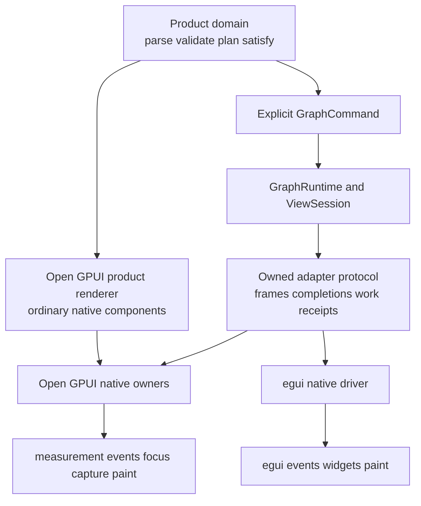
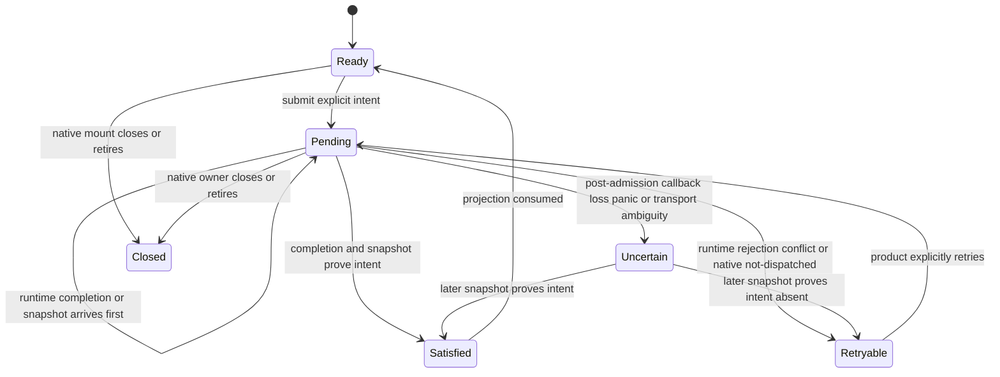
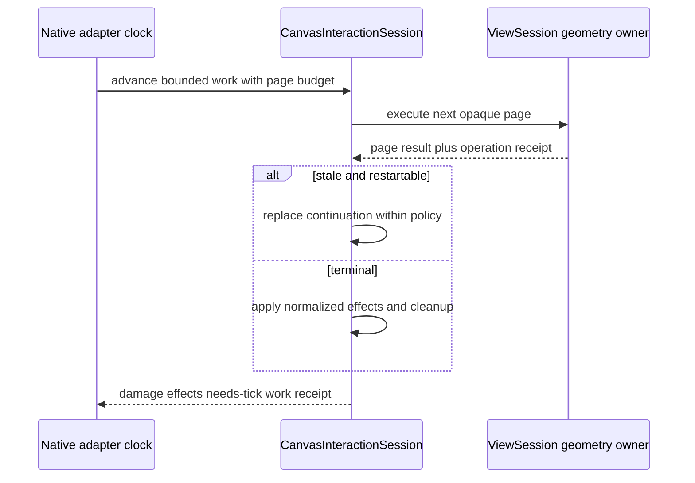
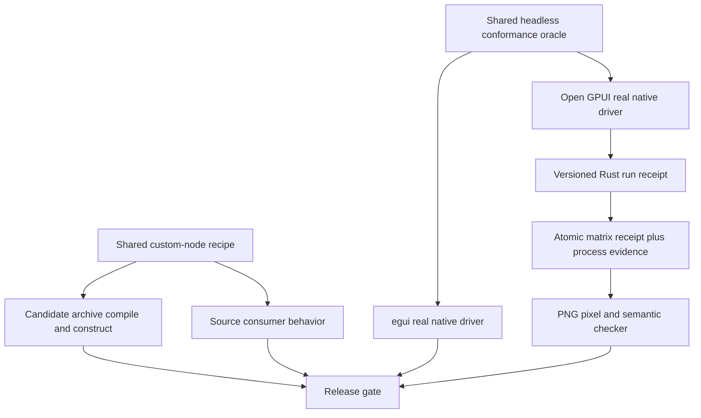
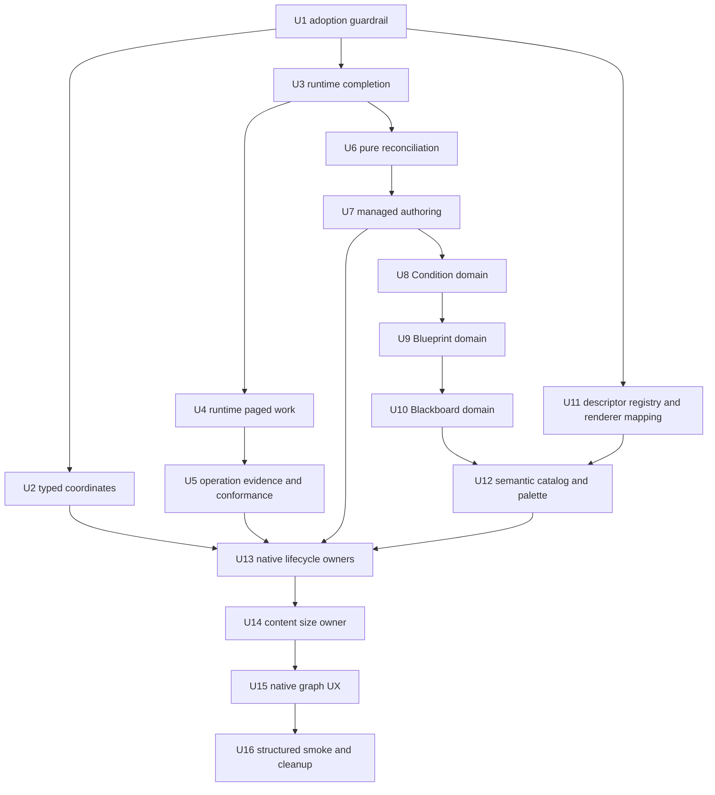

# Fearless Runtime and Native Authoring Ownership - Plan

## Goal Capsule

| Field | Contract |
|---|---|
| Objective | Make Jellyflow's headless runtime and Open GPUI adapter deep enough for Dify- and Unity Shader Graph-class nodes without leaking runtime coordination into product renderers. |
| Authority | The current code and executable tests override historical plans. `CONTEXT.md` and `docs/guides/native-adapter-authoring.md` define the active ownership boundary. |
| Change authority | Public Rust APIs may break. Obsolete compatibility layers, overloads, examples, tests, and coordination code may be deleted instead of deprecated. |
| Execution profile | Land dependency-ordered, behavior-proven units. Keep the source and packaged external-consumer recipe green through every public break. |
| Stop conditions | Stop only if evidence requires product UI or native event types in a headless crate, invalidates independent adapter ownership, or contradicts a session-settled decision. |
| Tail ownership | `ce-work` owns implementation, focused verification, simplification, review, incremental commits, and final repository gates. |

---

## Product Contract

### Summary

Jellyflow will expose a small renderer-neutral graph and interaction protocol while native adapters host ordinary framework components. Open GPUI node authors will compose normal `Render` entities, controls, ports, overlays, and product-owned domain logic without supervising raw command tickets, paged runtime queries, native host retirement, or frame receipt ordering.

The refactor deliberately breaks shallow public surfaces. It replaces positional feedback interpretation, adapter-carried query continuations, product-local mutation state machines, mixed catalog facts, combinatorial registry methods, aggregate-stat performance assertions, and string smoke markers with owners that keep policy and lifecycle together.

### Problem Frame

The previous refactor established the correct architecture: `GraphRuntime` and `ViewSession` own graph and normalized interaction semantics; Open GPUI and egui own native component and event lifecycles. The remaining complexity now appears at the boundaries rather than in the core algorithms.

Open GPUI product nodes still receive raw tickets and reproduce a seven-phase mutation supervisor. Both native adapters transport opaque runtime query payloads back to the same session that created them. Feedback receipts rely on positional pairing, and adapters independently classify the same command outcomes. `NodeKindSpec` mixes graph semantics with product search and Open GPUI renderer selection. Public mega-stats and name-only tests make internal implementation details look contractual while failing to prove real adoption.

The user-visible result is also weaker than the semantic core: port markers can feel visually heavy, selection chrome has previously appeared detached, and a release frame can expose stale size or route geometry. Those are native adapter and evidence problems, not reasons to move DOM-like UI or raw input into the headless crates.

### Actors

- A1. Application node author: builds complex retained nodes from ordinary Open GPUI components and explicit graph commands.
- A2. Native adapter author: maps one framework's events, focus, capture, measurement, and paint lifecycle onto the headless protocol.
- A3. Graph editor user: expects stable drag, selection, connection, reconnection, resize, and embedded-control behavior.
- A4. External crate consumer: adopts released Jellyflow crates without repository-only features or internal modules.
- A5. Maintainer: evolves public contracts with executable evidence instead of compatibility re-exports or symbol inventories.

### Product Key Decisions

- **Breaking replacement over compatibility migration** `(session-settled: user-directed - chosen over compatibility shims: obsolete APIs and examples should be deleted instead of preserving the wrong architecture)`. Governs R2, R3, R26, and R27.
- **Native component trees over a portable UI language** `(session-settled: user-approved - chosen over a cross-framework DSL or universal renderer: each framework should retain its own component, focus, event, and layout model)`. Governs R1, R4, R19, R23, and R25.
- **Independent native drivers over a shared dispatcher** `(session-settled: user-directed - chosen over sharing raw native events: only normalized scenarios and graph semantics are portable)`. Governs R4, R8, R14, and R23.

### Requirements

**Architecture and deletion**

- R1. `jellyflow-core`, `jellyflow-layout`, and `jellyflow-runtime` remain free of Open GPUI, egui, window, focus, IME, popup, and native event dependencies.
- R2. The implementation may break public Rust APIs without deprecation or compatibility forwarding.
- R3. Obsolete coordination code, overloads, re-exports, examples, fixtures, and tests are deleted when their behavior is replaced.
- R4. Jellyflow does not introduce a portable node UI DSL, universal renderer trait, shared native event dispatcher, DOM emulation, or adapter-wide widget abstraction.

**Coordinate and public-contract integrity**

- R5. View-space logical pixels use only `ViewPoint`, `ViewDelta`, `ViewSize`, and `ViewRect`; graph space uses only `CanvasPoint`, `CanvasSize`, and `CanvasRect`.
- R6. Every canvas-to-view and view-to-canvas API is type-closed, rejects non-finite input, and preserves anchor and constraint behavior under pan and zoom.
- R7. Public contracts are protected by external compile behavior and executable traces rather than `size_of` symbol inventories.

**Adoption and conformance**

- R8. Source and candidate `.crate` consumers compile the same real custom-node recipe: retained `Entity<V: Render>`, normal controls, interaction guards, real port wrappers, content measurement, registry sealing, and managed authoring.
- R9. The candidate archive recipe uses production features and never enables Open GPUI or Jellyflow test-support.
- R10. Source mode adds real mount, geometry, dynamic topology, and command behavior on top of the shared recipe.
- R11. Runtime, Open GPUI, and egui conformance share data-only scenarios, graph fixtures, normalized observations, and an oracle while each adapter keeps an independent native event driver.

**Runtime completion and feedback**

- R12. Every submitted frame command has an opaque runtime-owned identity, and feedback correlation is independent of vector position.
- R13. Runtime reuses each command's existing opaque `GraphCommandIdentity` and owns `CommandExecutionCompletion` for applied, noop, rejected, conflict, and associated execution errors while preserving revisions and diagnostics.
- R14. Native authoring combines runtime completion with admission, task, and mount evidence to classify not-dispatched, uncertain, retired, and closed settlement; adapters never reinterpret a runtime semantic outcome.
- R15. Missing, duplicate, foreign, late, and wrong-kind feedback receipts produce deterministic typed results and cannot settle the wrong command.

**Bounded work and performance evidence**

- R16. `CanvasInteractionSession` owns pending geometry query identity, cursor, target lock, stale restart, cancellation, terminal state, and cleanup.
- R17. Native adapters only choose when to advance bounded work and the page budget; they never store or transport opaque query payloads or cursors.
- R18. Query, frame materialization, feedback publication, and reconciliation return operation-scoped work receipts suitable for performance assertions.
- R19. Public aggregate mega-stats are removed or reduced to current resource snapshots; cumulative diagnostic counters remain private unless they are part of an operation receipt.

**Authoring and product domain**

- R20. Runtime owns two separate pure reconciliation modules: mutation reconciliation owns intent identity, completion/snapshot ordering, conflict, uncertain, and satisfied state; field reconciliation owns local value, dirty/composing, remote conflict, and explicit reapply without framework types.
- R21. Open GPUI authoring owns admission, task installation, activity leases, panic/drop cleanup, mount retirement, retry eligibility, native settlement projection, and exact-once layout invalidation without exposing raw tickets.
- R22. Product code constructs explicit `GraphCommand` values, validates domain intent, and chooses whether to retry a retryable or uncertain intent; Jellyflow does not auto-merge or auto-retry.
- R23. Condition, Blueprint, and Blackboard each expose a UI-free product-domain contract for parse, typed observation, validation, command planning, and satisfaction checks.
- R24. Their Open GPUI renderers own only native widgets, drafts, focus, async providers, theme, port handles, layout, and visual projection.

**Catalog, registry, and native ownership**

- R25. The semantic catalog owns kind/version/aliases plus graph-bearing port identity, direction, kind, capacity, data, and defaults; product or adapter presentation owns node title/category/keywords/default creation geometry and port label/side/order/group; each adapter registry owns native renderer mapping, and application composition rejects incompatible creatable palette/spec/descriptor references before creation.
- R26. Open GPUI registration uses one descriptor-driven entry instead of policy/overview/fallibility combination overloads, and its sealed mapping supplies opaque renderer stamps without putting renderer authority back into semantic schema.
- R27. Curated `view`, `interaction`, and adapter authoring modules may remain public facades, but each concept has one import authority and behavior-bearing external proof.
- R28. Open GPUI deep owners separately contain native interaction lifecycle, retained-node lifecycle, and content-size submission while preserving existing deep stores, transactions, caches, bindings, and focus coordination.

**Native graph experience and evidence**

- R29. Selection chrome is a single non-layout-affecting layer exactly aligned to published node bounds, including selected/focused/dragging combinations and overlapping nodes.
- R30. Port marker layout, visible marker, a minimum 22-logical-view-pixel hit diameter, and canvas-space connection acquire/release radii remain independent; visual state uses shape, fill, stroke, and non-color cues without moving the route anchor.
- R31. Node drag and connection projection follow the explicit terminal table: optimistic geometry remains continuous through release, prefix wait, keyed completion, authoritative snapshot, and atomic geometry replacement, while cancel/reject/conflict/uncertain/retire restore the correct prior projection.
- R32. Embedded input, select, button, scroll, and overlay controls isolate canvas gestures, focus, IME, and shortcuts through native Open GPUI guards and the explicit keyboard-precedence table.
- R33. Content-driven size changes use validated convergence controls, coalesce, submit atomically, and preserve the previous complete node/port/route geometry until the new complete publication replaces it; default convergence remains two samples within `0.5` canvas unit and eight attempts per epoch.
- R34. Real-window evidence uses a versioned structured run receipt with contiguous presented-frame identities and explicit view-space tolerances to reject sampling gaps, detached chrome, release snap, missing preview, and one-frame route disappearance.
- R35. The existing atomic matrix results, exact PNG set, pixel validation, manifest hashes, and nine-run matrix remain authoritative and are not replaced by structured state alone.

### Key Flows

- F1. External custom-node adoption
  - **Trigger:** A4 consumes source crates or candidate package archives.
  - **Actors:** A1, A4, A5.
  - **Steps:** Compile the shared component recipe; register it through the public descriptor; seal the registry; source mode mounts and exercises real ports, controls, measurement, and managed mutation.
  - **Outcome:** Both dependency sources prove the same public capability without package test-support.
  - **Covered by:** R7-R10, R26-R27.
- F2. Managed authoring mutation
  - **Trigger:** A1 adds/removes/reorders a dynamic case, pin, symbol, or changes node size.
  - **Actors:** A1, A2.
  - **Steps:** Product domain validates and plans an explicit command; Open GPUI authoring submits it; runtime completion and authoritative snapshots reconcile in either order; the native supervisor projects a small state and invalidates layout once when visible.
  - **Outcome:** Product renderers never see raw tickets, tasks, or seven-phase coordination.
  - **Covered by:** R12-R15, R20-R24.
- F3. Native connection and selection gesture
  - **Trigger:** A3 presses, drags, releases, reconnects, cancels, or selects through the Open GPUI canvas.
  - **Actors:** A2, A3.
  - **Steps:** Native code reports pointer/focus/capture events; runtime owns threshold, target lock, hysteresis, ordering, snap, and terminal semantics; Open GPUI follows the terminal-projection and keyboard-precedence tables while preserving optimistic presentation until authoritative reconciliation.
  - **Outcome:** No release snap, detached selection rectangle, or one-frame missing wire occurs.
  - **Covered by:** R5-R6, R16-R17, R28-R33.
- F4. Bounded query advancement
  - **Trigger:** An interaction needs a paged probe, intersection, alignment, or edge-pick result.
  - **Actors:** A2, A3.
  - **Steps:** Runtime enqueues opaque work; the adapter grants a page budget on native ticks; runtime restarts stale work when allowed, emits operation evidence, and returns damage/effects/needs-tick or a terminal result.
  - **Outcome:** Open GPUI and egui produce the same normalized trace without owning continuation state.
  - **Covered by:** R11, R16-R19.
- F5. Content-size convergence
  - **Trigger:** A native node's rendered content changes intrinsic size.
  - **Actors:** A1, A2, A3.
  - **Steps:** Open GPUI records one measurement epoch, applies validated sample/tolerance/attempt controls, coalesces the latest target, submits an atomic geometry command, and reconciles completion against authoritative geometry.
  - **Outcome:** Node, chrome, ports, and routes switch together without layout feedback loops.
  - **Covered by:** R13-R14, R20-R22, R28, R31, R33.
- F6. Real-window evidence publication
  - **Trigger:** A5 runs the flagship smoke matrix.
  - **Actors:** A3, A5.
  - **Steps:** Rust emits one typed run receipt covering every contiguous presented frame; the runner wraps process evidence into a matrix receipt; the checker validates the Rust contract, frame continuity, captures, pixels, hashes, and cross-frame semantic invariants.
  - **Outcome:** Malformed or contradictory transport/state evidence fails even when the process exits successfully.
  - **Covered by:** R29-R35.

### Acceptance Examples

- AE1. Given a package archive with test-support disabled, when the shared custom-node source is compiled, then a retained node containing input, select, button, scroll, real ports, guards, measurement, and managed mutation links using only public APIs. Covers R8-R10.
- AE2. Given command receipt and snapshot arriving in either order, when both describe the same intent, then the mutation becomes satisfied once and triggers at most one layout invalidation. Covers R12-R15, R20-R22.
- AE3. Given a command was enqueued but the callback is lost or panics, when no authoritative snapshot proves success or failure, then the state is uncertain and no automatic retry occurs. Covers R13-R15, R20-R22.
- AE4. Given a paged connection probe becomes stale, when the adapter grants another bounded page, then runtime either restarts within policy or returns a typed terminal result without exposing a cursor. Covers R16-R18.
- AE5. Given two overlapping nodes and ports, when the recently interacted node is selected, then runtime render order determines both paint and hit precedence and Open GPUI adds no private z-order rule. Covers R11, R28-R30.
- AE6. Given a connected port at zoom `0.5`, `1`, or `2`, when the pointer probes immediately inside or outside the minimum 22-logical-view-pixel hit bounds, then acquisition follows that invariant boundary while marker, layout slot, and route anchor remain unchanged. Covers R5-R6, R30.
- AE7. Given a node drag release awaiting graph completion, when every contiguous presented frame is recorded, then optimistic bounds and every connected route remain continuous within `0.5` logical view pixel until authoritative geometry atomically replaces them. Covers R31, R34-R35.
- AE8. Given a selected node, when focus and dragging states change, then exactly one selection chrome remains aligned to node bounds and no second rectangle appears below the node. Covers R29, R34-R35.
- AE9. Given IME, overlay, editable control, read-only/disabled control, or canvas focus, when Escape, Delete/Backspace, arrows, Tab, clipboard, or undo/redo input arrives, then exactly the keyboard-precedence owner handles it and no second graph action runs. Covers R32.
- AE10. Given intrinsic content size changes twice while one geometry command is in flight, when two samples within `0.5` canvas unit stabilize the latest target, then only that target submits next; old complete geometry remains visible, and the epoch freezes after at most eight attempts. Covers R20-R22, R28, R33.
- AE11. Given a graph contains an unknown renderer mapping but valid semantic nodes, when it is opened, then the graph remains readable and the adapter may use its fallback; a missing semantic kind only rejects new creation. Covers R25-R27.
- AE12. Given a zero exit with malformed, duplicate, unknown-version, or fail-state run receipt, when the matrix runner validates it, then the run fails and no pass result is atomically published. Covers R34-R35.
- AE13. Given one flagship retained Workflow node, when a real user edits it, then the same node exercises native input, select, button, scrolling, asynchronous data, dynamic typed ports, managed mutation, and content-size convergence through public contracts while selection, connection, and resizing remain continuous in a real window. Covers R8-R10, R20-R24, R29-R33.

### Scope Boundaries

**In scope**

- All thirteen architecture-review candidates, resolved into implementation rather than retained as open exploration.
- Public API breaks across runtime, Open GPUI, egui, examples, fixtures, release tools, and documentation.
- Native visual and interaction tuning needed to prove stable selection, ports, wires, drag, controls, and size convergence.

**Outside this product's identity**

- A portable widget tree, style language, layout engine, or renderer-neutral component DSL.
- DOM, CSS, D3, `ResizeObserver`, or document-listener emulation.
- A shared raw native-event dispatcher or framework-independent pointer-capture API.
- Automatic conflict merge or retry that overrides application intent.
- Building a third production adapter in this plan.

**Preserved deep modules**

- `InstalledTransactionImpact`, `DerivedGeometry`, `CanvasInteractionSession`, `RetainedMountStore`, `OpenGpuiFrameTransaction`, `OpenGpuiEdgePathCache`, `OpenGpuiNodeBinding`, and the Open GPUI focus coordinator remain authorities to deepen or consume, not wrappers to replace.

### Success Criteria

- Product renderer code contains no raw command ticket, ticket future, panic/retirement supervisor, or adapter-independent revision reducer.
- Open GPUI and egui contain no opaque interaction-query payload queue or independent runtime outcome mapping.
- A single custom-node recipe builds from source and candidate archives, and source mode exercises a real retained mount.
- `TopologyAttempt`, Open GPUI's pure draft reducer, registry overload combinations, query-related public mega-stats, name-only public-surface tests, and the smoke `key=value` parser are gone.
- Condition, Blueprint, and Blackboard domain tests run without constructing Open GPUI entities or windows.
- One flagship Workflow node satisfies AE13 as an integrated complex-node profile; isolated fixtures cannot substitute for this end-to-end proof.
- Real-window receipts and pixels prove stable release, selection chrome, ports, and routes across the required zoom matrix.

---

## Planning Contract

### Key Technical Decisions

- KTD1. **Establish real external adoption before public breaks.** The source and archive fixtures share one consumer source, but only source mode uses test-support to run native behavior. Archive mode proves the production dependency closure and public compile contract. Governs R7-R10.
- KTD2. **Close coordinate types in one breaking migration.** Canvas-to-view returns `ViewPoint`, view-to-canvas accepts `ViewPoint`, viewport extents use `ViewSize`, and zoom anchors use `ViewPoint`; `ViewportTransform.pan` remains canvas-space. Partial aliases would preserve the defect. Governs R5-R6.
- KTD3. **Runtime completion is the sole execution-outcome authority.** Every command and outcome already carries `GraphCommandIdentity`; feedback reuses it rather than inventing another identity. `CommandExecutionCompletion { identity, result }` encloses every applied, noop, rejected, conflict, and runtime execution error after runtime admission. Native journals alone add admission and mount evidence for not-dispatched, uncertain, retired, and closed settlement. Governs R12-R15.
- KTD4. **Runtime owns pending paged work; adapters own scheduling opportunities.** `CanvasInteractionSession` keeps continuation and stale policy, while an adapter grants a bounded budget and receives damage/effects/needs-tick plus a work receipt. A shared scheduler would incorrectly absorb native clocks. Governs R11, R16-R18.
- KTD5. **Operation receipts replace public cumulative performance deltas.** Existing query receipts are deepened; frame and reconciliation operations gain equivalent evidence. Current resource snapshots may remain public where users need them, while aggregate counters become private diagnostics. Governs R18-R19.
- KTD6. **Extract two reducers and keep their responsibilities disjoint.** The mutation reducer is distilled from `TopologyAttempt`/`AttemptMachine` and owns intent plus completion/snapshot reconciliation. The field reducer is distilled from `RevisionedDraft<T>` and owns dirty/composing/conflict/reapply state. Neither absorbs native tasks, focus, IME, activity, or mounts. Governs R20-R21.
- KTD7. **Open GPUI authoring exposes a managed mutation, not a raw ticket.** The supervisor composes the runtime mutation reducer with native admission, task, activity, panic/drop, and retirement evidence; products still supply explicit commands and satisfaction logic. It projects exact-once invalidation and never becomes a second execution classifier. Governs R20-R24.
- KTD8. **Migrate product domain as three vertical slices.** Condition lands first, then Blueprint validates the repeated topology shape and deletes `TopologyAttempt` after both topology renderers stop using it. Blackboard subsequently proves external-source and retained-draft behavior. This avoids inventing a product DSL before design-it-twice evidence. Governs R22-R24.
- KTD9. **Split catalog ownership three ways.** Runtime semantic catalog excludes search, renderer, node presentation, and port presentation facts. The flagship product palette supplies discovery metadata, initial geometry, port labels, and layout hints; Open GPUI registration maps semantic kinds to renderer stamps and factories. Product composition validates creatable references across the three owners, while existing graphs remain readable without either presentation owner. Governs R25-R27.
- KTD10. **Install descriptor mapping before deleting the old catalog field.** A registration descriptor contains semantic kind/version, opaque renderer stamp, factory, policy, and optional overview. The host first switches frame construction to this mapping and deletes registry overloads; the next unit deletes the now-inert semantic renderer field and old spec-builder arguments. `RendererStamp` remains in adapter frames and retained instance identity. Governs R25-R27.
- KTD11. **Keep curated public facades but reject duplicate authorities.** Runtime `view` and `interaction` remain navigation seams. They are protected by external behavior, not forced to contain all implementation or mirrored through broad root re-exports. Governs R7, R27.
- KTD12. **Deepen three Open GPUI owners around native authority.** The existing native interaction owner retains wake/capture/focus/callback authority. `RetainedNodeOwner` contains the existing `RetainedMountStore` and never mirrors its instance map, epoch, LRU, or retirement state. Content-size submission owns measurement policy and consumes shared mutation settlement rather than classifying commands. Frame transaction, path cache, binding, and focus coordinator remain internal collaborators. Governs R28, R31-R33.
- KTD13. **Tune visual hit and paint independently.** Runtime keeps render order, gesture thresholds, hysteresis, snap, and target lock. Open GPUI profiles tune marker shape/size, invisible hit area, state treatment, wire paint, and one aligned selection chrome. No adapter z-index or gesture semantics are added. Governs R29-R32.
- KTD14. **Replace only the unstructured inner smoke marker.** Rust emits a versioned JSON run receipt covering every contiguous presented frame and exposes the sole machine-readable schema/validation authority through a small contract binary consumed by Python. Python adds process transport evidence and retains the existing atomic matrix receipt, exact PNG checks, pixel oracle, manifest hashes, and nine-run matrix. No handwritten parallel field table, frame-sampling gap, or legacy parser fallback remains. Governs R34-R35.

### High-Level Technical Design

#### Ownership topology



The headless path owns graph facts and normalized state transitions. Product renderers and adapters remain free to use their framework's full component system; they cross the boundary through commands, frames, typed geometry, completions, and bounded-work receipts.

#### Mutation lifecycle



Runtime execution completion and the pure mutation reducer own graph evidence. The Open GPUI supervisor adds admission, task, and mount lifecycle evidence. Layout invalidation occurs only on the first transition that makes the intended topology or size authoritative and visible.

#### Connection terminal projection

| Outcome | Preview and target | Existing reconnect edge | Native ownership and final projection |
|---|---|---|---|
| Cancel, invalid release, or capture loss before admission | Clear preview and target emphasis immediately; submit no command. | Restore the original edge from authoritative frame data. | Release capture once, retain or restore canvas focus, and publish the normalized cancelled or invalid terminal reason. |
| Runtime rejected or conflict completion | Keep optimistic presentation until the keyed completion, then clear it. | Stop suppression so the authoritative original edge is visible again. | Direct gestures return idle with terminal diagnostics; connection search stays open with commit-rejected state and its input focus. |
| Applied or noop completion | Keep preview, target emphasis, and reconnect suppression until an authoritative frame at or beyond the completion revision contains the final route. | Atomically replace the old route with the final route; never show both missing. | Release pointer capture on physical release, clear optimistic projection only after publication, and restore the initiating focus owner. |
| Post-admission uncertainty | Keep optimistic projection and reconnect suppression while later authoritative snapshots reconcile the intent. | Preserve the last complete route state; explicit cancel restores the original projection. | Never hold pointer capture after release; expose uncertain state and require explicit retry or cancel. |
| Host close, mount retire, or owner replacement | Clear all preview, target, and pending visual state without dispatch. | Authoritative graph data remains unchanged. | Release capture, focus, activity, and callbacks exactly once; late events cannot affect a successor. |

#### Native keyboard precedence

| Focus context | Key ownership |
|---|---|
| IME composition active | Composition, text editing, arrows, Delete/Backspace, clipboard, and Escape stay with IME or control; no graph shortcut runs from the same event. |
| Open overlay or popup | Escape closes the top overlay and restores its prior focus owner; navigation, editing, and clipboard keys remain inside the overlay; canvas shortcuts are suppressed. |
| Editable input, select, or control focused | Delete/Backspace, arrows, Tab traversal, clipboard, select-all, and undo/redo remain native control actions. Escape performs the control's cancel or blur contract and restores prior focus without also cancelling a graph gesture. |
| Read-only or disabled control focused | Events do not bubble into graph commands; canvas shortcuts resume only after explicit focus transfer to the canvas. |
| Canvas owns focus with no overlay or IME | Escape cancels the active graph interaction, Delete/Backspace removes graph selection, arrows nudge, and graph clipboard shortcuts may run. |

#### Bounded query advancement



The adapter never handles query identity, cursor, target lock, or stale restart. Its native clock and callback lifetime remain local.

#### Evidence pipeline



State evidence and pixel evidence are complementary. A valid structured receipt cannot compensate for a blank or geometrically inconsistent capture.

#### Implementation dependency graph



### Output Structure

The exact names may adjust during implementation, but ownership should converge on this shape rather than a flat host or product renderer module.

```text
crates/jellyflow-runtime/src/runtime/
  reconciliation/
    mutation.rs
    field.rs
  interaction/
    query_work.rs
crates/jellyflow-open-gpui/src/
  authoring/
    mutation.rs
  host/
    interaction_session.rs
    retained_node_owner.rs
    content_size_submission_owner.rs
examples/canvas-jellyflow/src/
  product_domain/
    condition.rs
    blueprint.rs
    blackboard.rs
  product_catalog.rs
  real_window_smoke/
    receipt.rs
  bin/
    smoke_receipt_contract.rs
tools/fixtures/external-consumer/
  open-gpui-adoption/
```

### Assumptions

- The branch at `40a3f6d` is the implementation baseline; older plans and research are historical evidence.
- The user has authorized the full breaking scope and deletion of obsolete code, products, and examples. No compatibility question remains open.
- `docs` is the artifact root because no active `.compound-engineering` config overrides it.
- Source tests may use framework test-support, but candidate package verification must use the production dependency closure.
- Initial node size is product creation policy supplied with a creation request, not a semantic node-kind fact; persisted graph bounds remain canonical graph data.
- Unknown renderer mappings may use adapter fallback for existing nodes. Missing semantic specs reject only new creation or migration that needs that spec.
- Local code, `repo-ref/xyflow`, and `repo-ref/egui-snarl` provide sufficient prior art. External web research is not load-bearing for this implementation.

### Implementation Constraints

- Do not add UI dependencies to headless manifests.
- Do not create compatibility re-export modules after moving a public type.
- Every public break updates the shared external consumer in the same unit.
- Shared conformance code contains no raw Open GPUI or egui event.
- Preserve renderer order from runtime frames; Open GPUI must not derive a second z-order.
- Preserve complete old geometry until complete replacement geometry is published.
- Use proof-first or characterization-first tests for behavior-bearing changes. Capture receipt-first, snapshot-first, panic, close, stale, and budget baselines before deleting their old implementations.
- Run Cargo verification serially and reuse the repository target directory.

### System-Wide Impact

- **Public API:** Coordinate, feedback, interaction-query, authoring, catalog, registry, and stats imports all break. External fixtures are the migration authority.
- **Data lifecycle:** Graph document persistence remains unchanged. Catalog configuration and adapter registration change, but persisted node/port/bounds facts do not.
- **Failure propagation:** Ambiguous post-dispatch failure becomes uncertain until an authoritative snapshot resolves it. Adapter transport errors can no longer masquerade as semantic conflict or rejection.
- **Performance:** Operation receipts make bounded work directly testable and remove fragile before/after subtraction. Internal diagnostic counters may remain for development without becoming public contracts.
- **Native lifecycle:** Open GPUI root host state shrinks around three deep owners. Pointer capture, focus, IME, activity leases, retained mounting, and window wake remain adapter-local.
- **Release:** Package verification becomes stricter and real-window evidence changes schema without a compatibility parser.
- **Documentation:** README and the native-adapter guide must teach ordinary Open GPUI composition plus semantic port, guard, measurement, and managed mutation contracts.

### Risks and Mitigations

| Risk | Mitigation |
|---|---|
| Completion ownership changes a terminal interaction or size behavior | Characterize every existing outcome mapping first, define a runtime execution matrix and a separate native settlement matrix, and run canonical traces across runtime plus both adapters. |
| Runtime-owned query advancement starves a native frame or loops after stale work | Keep adapter-controlled budgets, return explicit `needs_tick`, cap restarts, and test zero/small/large budgets plus close and supersession. |
| Authoring abstraction hides product policy or retries automatically | Require explicit command and satisfaction callbacks; expose retryable/uncertain state without automatic dispatch. |
| Product-domain extraction becomes a new portable UI DSL | Domain modules contain only typed product facts and command planning; widgets, labels, focus, layout, and visual state remain in renderers. |
| Catalog split makes old graphs unreadable | Graph loading uses persisted facts without requiring a current palette or renderer; test unknown renderer and missing creation spec separately. |
| Content-size ownership creates a measurement feedback loop | Preserve epoch, stable-sample, in-flight, coalescing, prefix, and attempt-bound policies with exact-once diagnostics. |
| Visual tuning improves one zoom while harming another | Keep view/canvas types closed and validate marker/hit/chrome/route geometry at zoom `0.5`, `1`, and `2` with state plus pixel evidence. |
| Structured receipts duplicate schema in Rust and Python again | Rust's receipt contract binary is the one machine authority; Python consumes canonical validation output and owns no parallel field/type table. |
| Large breaking diff obscures dead code | Land one verified unit per commit, run simplification after each architectural cluster, and require deletion audits in U7, U12, and U16. |

### Sources and Research

- `CONTEXT.md` and `docs/guides/native-adapter-authoring.md` define current ownership and validation rules.
- `docs/plans/2026-07-20-001-refactor-fearless-architecture-deepening-plan.md` records the completed deep-module baseline.
- `docs/research/2026-07-11-headless-custom-node-ui-architecture.md` records why portable UI and universal renderer approaches were rejected.
- `docs/research/2026-07-18-xyflow-custom-node-layout.md` records custom-node layout and measurement comparisons.
- `repo-ref/xyflow/packages/system/src/xydrag/XYDrag.ts`, `repo-ref/xyflow/packages/system/src/xyhandle/utils.ts`, and `repo-ref/xyflow/packages/react/src/components/NodeWrapper/index.tsx` ground DOM interaction and selection comparisons.
- `repo-ref/egui-snarl/src/ui.rs` and `repo-ref/egui-snarl/src/ui/state.rs` ground immediate-mode comparison.
- The user-supplied 2026-07-27 architecture review informed candidate discovery only; current repository paths and tests validate every decision carried into this plan.

---

## Implementation Units

### Unit Index

| Unit | Outcome | Primary files | Depends on |
|---|---|---|---|
| U1 | Real source/archive adoption guardrail | `tools/fixtures/external-consumer/`, public behavior tests | None |
| U2 | Type-closed view/canvas coordinates | runtime coordinates and viewport, adapter callers | U1 |
| U3 | Runtime command completion and feedback correlation | runtime feedback/interaction, adapter settlement | U1 |
| U4 | Runtime-owned paged query lifecycle | runtime interaction session, adapter query queues | U3 |
| U5 | Operation receipts, conformance normalization, and stats deletion | runtime operation evidence, adapter conformance/performance tests | U4 |
| U6 | Separate mutation and field reconciliation reducers | runtime reconciliation, existing attempt/draft characterization | U3 |
| U7 | Managed Open GPUI authoring | Open GPUI authoring, command journal, retained field | U6 |
| U8 | Pure Condition domain and thin renderer | flagship Condition modules/tests | U7 |
| U9 | Pure Blueprint domain and topology-attempt deletion | flagship Blueprint modules/tests | U8 |
| U10 | Pure Blackboard domain and thin renderer | flagship Blackboard modules/tests | U9 |
| U11 | Open GPUI descriptor registry and renderer mapping | Open GPUI registry/host, external adoption | U1 |
| U12 | Semantic catalog, product palette, and public API cleanup | runtime catalog, product creation/search | U10, U11 |
| U13 | Native interaction and retained-node lifecycle owners | Open GPUI host lifecycle and interaction tests | U2, U5, U7, U12 |
| U14 | Content-size submission owner | Open GPUI measurement and geometry tests | U13 |
| U15 | Native graph visual and interaction polish | Open GPUI chrome, ports, wires, flagship native tests | U14 |
| U16 | Structured real-window evidence and final deletion | flagship smoke, Python matrix/checker, docs | U15 |

### U1. Establish the real external adoption guardrail

- **Goal:** Make the released public capability executable before any subsequent breaking API change.
- **Requirements:** R7-R10, R26-R27; F1; AE1.
- **Dependencies:** None.
- **Files:**
  - `tools/fixtures/external-consumer/open-gpui-adoption/` (new shared consumer source)
  - `tools/fixtures/external-consumer/open-gpui-source/src/main.rs`
  - `tools/fixtures/external-consumer/package-open-gpui/src/main.rs`
  - `tools/check_external_consumer_smoke.py`
  - `tools/tests/test_check_external_consumer_smoke.py`
  - `crates/jellyflow-open-gpui/tests/public_surface.rs`
  - `crates/jellyflow-runtime/tests/public_surface.rs`
- **Approach:**
  1. Extract one public custom-node consumer source that defines a real retained component tree, stable port wrappers, interaction guards, measurement, registry registration, and the current authoring entry.
  2. Compile that source against path crates and staged candidate archives; keep archive features production-only.
  3. Let source mode add Open GPUI test-support and execute retained mount, geometry, dynamic topology, and command behavior.
  4. Replace Open GPUI name-only public-surface inventory with consumer behavior. Retain runtime facade tests that already exercise behavior and add compile-fail coverage for forbidden import authorities when practical.
- **Execution note:** Establish the current source behavior as a characterization baseline, then make the package fixture fail until the same real recipe compiles from candidate archives.
- **Patterns to follow:** `tools/fixtures/external-consumer/open-gpui-source/src/main.rs`; `crates/jellyflow-runtime/src/runtime/adapter_protocol/conformance.rs`; `tools/check_external_consumer_smoke.py` package checksum and feature checks.
- **Test scenarios:**
  - The shared recipe compiles from path dependencies and registers one real retained node with normal controls and a real port.
  - Candidate archives compile and link the same source without `test-support`; package dependency closure and checksums remain validated.
  - Source mode mounts the node, publishes complete port geometry, performs dynamic topology mutation, and observes authoritative settlement.
  - Registry seal rejects duplicate or invalid registration through a behavioral error assertion rather than symbol presence.
- **Verification:** External source and package consumers pass from a clean staged registry; the archive build proves the production dependency closure while source mode proves behavior; `size_of`-only Open GPUI public tests are gone.

### U2. Close view and canvas coordinate types

- **Goal:** Make invalid coordinate-space mixing unrepresentable across runtime and adapters.
- **Requirements:** R5-R6, R29-R33; F3; AE6.
- **Dependencies:** U1.
- **Files:**
  - `crates/jellyflow-runtime/src/runtime/adapter_protocol/coordinates.rs`
  - `crates/jellyflow-runtime/src/runtime/viewport/transform.rs`
  - `crates/jellyflow-runtime/src/runtime/viewport/state.rs`
  - `crates/jellyflow-runtime/src/runtime/viewport/mod.rs`
  - `crates/jellyflow-runtime/src/runtime/interaction/session.rs`
  - `crates/jellyflow-open-gpui/src/port_handle.rs`
  - `crates/jellyflow-open-gpui/src/host/scene_render.rs`
  - `crates/jellyflow-egui/src/native_host.rs`
  - `examples/canvas-jellyflow/src/real_window_smoke.rs`
  - `crates/jellyflow-runtime/src/runtime/tests/view_session/viewport.rs`
  - `crates/jellyflow-open-gpui/tests/measurement_feedback.rs`
  - `crates/jellyflow-egui/tests/native_frame_host.rs`
- **Approach:** Break the viewport API in one migration: canvas projection returns `ViewPoint`; inverse projection accepts `ViewPoint`; zoom anchors and viewport extents use view types. Remove conversions that temporarily wrap view coordinates in `CanvasPoint`. Let compiler failures identify every caller and update the U1 external recipe in the same unit.
- **Execution note:** Start with round-trip and compile-fail proof that fails against the current signatures.
- **Patterns to follow:** Existing `ViewRect::to_canvas_rect`; finite-value validation in `ViewportTransform`; typed geometry at Open GPUI port measurement boundaries.
- **Test scenarios:**
  - Canvas-to-view-to-canvas round trips across multiple pans and zooms within tolerance.
  - Anchored zoom preserves the canvas coordinate under a `ViewPoint` anchor.
  - Viewport constraints use `ViewSize` and clamp correctly when the viewport is smaller, equal to, or larger than the translate extent.
  - NaN, infinity, non-positive zoom, and invalid view sizes return no transform or projection.
  - Compile-fail coverage rejects passing `CanvasPoint` to a view input and assigning a view projection to `CanvasPoint`.
  - Open GPUI and egui port anchors remain identical in canvas space at zoom `0.5`, `1`, and `2`.
- **Verification:** No viewport or adapter API uses a `Canvas*` type to carry logical view pixels; focused runtime and adapter geometry tests pass; external consumers compile after the break.

### U3. Move command completion and feedback correlation into runtime

- **Goal:** Give adapters one typed completion contract instead of positional receipts and repeated outcome mappings.
- **Requirements:** R12-R15, R20-R22; F2, F5; AE2-AE3.
- **Dependencies:** U1.
- **Files:**
  - `crates/jellyflow-runtime/src/runtime/adapter_protocol/feedback.rs`
  - `crates/jellyflow-runtime/src/runtime/adapter_protocol/frame.rs`
  - `crates/jellyflow-runtime/src/runtime/view_session/protocol.rs`
  - `crates/jellyflow-runtime/src/runtime/interaction/session.rs`
  - `crates/jellyflow-runtime/src/runtime/commands/` (new completion owner as needed)
  - `crates/jellyflow-runtime/src/runtime/tests/view_session/feedback_ordering.rs`
  - `crates/jellyflow-runtime/src/runtime/tests/view_session/protocol.rs`
  - `crates/jellyflow-runtime/src/runtime/interaction/session/tests.rs`
  - `crates/jellyflow-open-gpui/src/command_journal.rs`
  - `crates/jellyflow-open-gpui/src/host/frame_feedback.rs`
  - `crates/jellyflow-open-gpui/src/host/interaction_session.rs`
  - `crates/jellyflow-egui/src/native_host.rs`
  - `crates/jellyflow-egui/src/interaction.rs`
  - `crates/jellyflow-egui/tests/canonical_interaction_trace.rs`
- **Approach:**
  1. Carry each command's existing `GraphCommandIdentity` through every feedback operation, including execution paths that return `Err`; do not allocate a second operation identity.
  2. Define `CommandExecutionCompletion { identity, result }`, where `result` preserves applied/noop/rejected/conflict outcomes or the associated runtime execution error. Change direct `GraphRuntime::execute` to return this envelope rather than an unkeyed outer `Result`.
  3. Make collected frame commands, feedback receipts, and close-drain paths return exactly one keyed completion per runtime-admitted command. Missing/duplicate/foreign/wrong-kind feedback remains a protocol-correlation error outside another command's completion.
  4. Treat whole-frame rejection before command admission as native not-dispatched evidence; treat loss after admission without a completion as native uncertainty. Runtime does not infer either state from event timing.
  5. Expose keyed feedback lookup independent of vector position and make interaction plus later authoring/size consumers use it.
  6. Delete Open GPUI and egui positional pairing and duplicate runtime-outcome matches. Keep not-dispatched, uncertain, retired, and closed out of runtime; U7's native journal derives those only from admission, task, and mount evidence.
- **Execution note:** Characterize every existing outcome branch before replacing it, including the current inconsistent size and interaction transport mappings.
- **Patterns to follow:** Opaque `GraphCommandIdentity`; ordered frame transaction ownership; canonical interaction traces.
- **Test scenarios:**
  - Applied and noop commands correlate by identity even when layout operations are interleaved.
  - Rejected and conflict completions retain their message/version data and project the same terminal semantics in runtime, Open GPUI, and egui.
  - An execution `Err` retains the original command identity and cannot settle a neighboring operation.
  - Direct execution, batched feedback, and close-drain expose the same completion shape and identity rules.
  - A frame rejected before admission yields no fake runtime completion; an admitted command whose callback is lost remains available to native uncertainty reconciliation.
  - Missing, duplicate, foreign, late, and wrong-kind receipts cannot settle another command and return typed diagnostics.
  - Receipt-first and snapshot-first consumers receive equivalent completion evidence.
  - Replayed or stale frames do not emit a second completion.
- **Verification:** Runtime has one execution-completion classifier; adapters contain no duplicate `GraphCommandOutcome` semantic match; feedback tests prove identity correlation independently of position and preserve identity through errors.

### U4. Internalize the paged query lifecycle

- **Goal:** Let runtime own bounded query continuations without simultaneously changing performance evidence.
- **Requirements:** R11, R16-R17; F4; AE4.
- **Dependencies:** U3.
- **Files:**
  - `crates/jellyflow-runtime/src/runtime/interaction/session.rs`
  - `crates/jellyflow-runtime/src/runtime/interaction/query_work.rs` (new)
  - `crates/jellyflow-runtime/src/runtime/view_session/mod.rs`
  - `crates/jellyflow-runtime/src/runtime/view_session/edge_pick.rs`
  - `crates/jellyflow-runtime/src/runtime/view_session/port_geometry.rs`
  - `crates/jellyflow-runtime/src/runtime/view_session/route_geometry.rs`
  - `crates/jellyflow-runtime/src/runtime/graph_runtime/mod.rs`
  - `crates/jellyflow-runtime/src/runtime/tests/view_session/geometry_publication.rs`
  - `crates/jellyflow-open-gpui/src/host/interaction_session.rs`
  - `crates/jellyflow-open-gpui/src/host/scene_render.rs`
  - `crates/jellyflow-egui/src/interaction.rs`
  - `crates/jellyflow-egui/tests/paged_query_budget.rs`
- **Approach:**
  1. Move pending interaction query payload, cursor, target lock, restart, and terminal cleanup behind `CanvasInteractionSession`.
  2. Expose bounded advancement that accepts a page budget and returns normalized update, `needs_tick`, and the existing query receipt.
  3. Delete egui's query deque and Open GPUI queued query payload/token transport while preserving each native wake and callback-lifetime owner.
  4. Keep performance counters and non-query receipt migration unchanged until U5 so query ownership failures remain diagnosable in isolation.
- **Execution note:** Capture existing paged-query traces first, then migrate lifecycle and delete adapter queues in one commit.
- **Patterns to follow:** Existing `InteractionQueryReceiptCore`; visible-route work reports; adapter `needs_tick`/native wake patterns.
- **Test scenarios:**
  - Budgets of zero, one, and many pages make bounded progress and report exact work without exceeding the grant.
  - A restartable stale query restarts within its cap; a non-restartable stale query terminates with no leaked continuation.
  - Superseded late pages are ignored, foreign receipts fail deterministically, and close/retire cleans pending work exactly once.
  - Open GPUI and egui produce the same normalized trace under different page budgets and native tick schedules.
  - Close, cancel, supersession, and terminal completion release the continuation exactly once.
- **Verification:** Adapters expose no query payload/cursor queue; focused runtime and both adapter budget tests pass without requiring the U5 stats migration.

### U5. Replace aggregate evidence and normalize conformance support

- **Goal:** Make performance assertions operation-scoped after query lifecycle ownership is stable, while retaining independent native drivers.
- **Requirements:** R7, R11, R18-R19; F4; AE4.
- **Dependencies:** U4.
- **Files:**
  - `crates/jellyflow-runtime/src/runtime/adapter_protocol/conformance.rs`
  - `crates/jellyflow-runtime/src/runtime/view_session/mod.rs`
  - `crates/jellyflow-runtime/src/runtime/graph_runtime/mod.rs`
  - `crates/jellyflow-runtime/src/runtime/tests/view_session/performance_contract.rs`
  - `crates/jellyflow-runtime/src/runtime/tests/view_session/geometry_publication.rs`
  - `crates/jellyflow-runtime/tests/canonical_interaction_trace.rs`
  - `crates/jellyflow-open-gpui/src/host/diagnostics.rs`
  - `crates/jellyflow-open-gpui/tests/adapter_conformance.rs`
  - `crates/jellyflow-egui/tests/adapter_conformance.rs`
  - `tools/fixtures/external-consumer/adapter-conformance/src/main.rs`
- **Approach:**
  1. Reuse and deepen existing query receipts, then add operation receipts for frame materialization, feedback publication, and reconciliation where tests currently subtract aggregate counters.
  2. Remove public `GraphRuntimeStats` and `ViewSessionStats` mega-stat exports. Retain only current resource snapshots required by users and private cumulative diagnostics.
  3. Extract repeated data-only fixtures, normalized observation construction, and outcome injection into conformance support after the U3/U4 semantic migrations settle.
  4. Keep Open GPUI and egui native event, capture, focus, frame, and scheduling drivers independent; shared code may compare normalized observations but cannot dispatch native input.
- **Execution note:** Migrate one operation family at a time and delete its before/after assertion in the same change. Do not modify query continuation ownership established by U4.
- **Patterns to follow:** Existing `InteractionQueryReceiptCore`; visible-route work reports; canonical interaction traces and shared normalized oracle.
- **Test scenarios:**
  - Edge pick, connection probe, node intersection, and alignment receipts report exact local cells/entries/pages examined.
  - Frame materialization, feedback publication, and reconciliation tests assert their own receipts without before/after global subtraction.
  - Current cache or mount counts remain observable only where they represent a current resource snapshot, not cumulative work.
  - Open GPUI and egui execute the same normalized connect/reconnect/cancel/selection scenarios through different native drivers and match the shared oracle.
  - A deliberately wrong normalized observation reports scenario, phase, and semantic mismatch without exposing native event types.
- **Verification:** Operation receipts replace aggregate-delta assertions; public mega-stats are removed or reduced per R19; both independent adapter conformance suites remain green.

### U6. Separate mutation and field reconciliation reducers

- **Goal:** Move data-only reconciliation into runtime without merging mutation lifecycle and retained-field editing into one state machine.
- **Requirements:** R12-R15, R20-R22; F2; AE2-AE3.
- **Dependencies:** U3.
- **Files:**
  - `crates/jellyflow-runtime/src/runtime/reconciliation/mod.rs` (new)
  - `crates/jellyflow-runtime/src/runtime/reconciliation/mutation.rs` (new)
  - `crates/jellyflow-runtime/src/runtime/reconciliation/field.rs` (new)
  - `crates/jellyflow-runtime/src/runtime/mod.rs`
  - `crates/jellyflow-runtime/src/runtime/tests/reconciliation.rs` (new)
  - `examples/canvas-jellyflow/src/nodes/topology_attempt.rs`
  - `crates/jellyflow-open-gpui/src/draft.rs` (delete after migration)
  - `crates/jellyflow-open-gpui/src/draft_store.rs`
  - `crates/jellyflow-open-gpui/src/lib.rs`
  - `crates/jellyflow-open-gpui/src/retained_field.rs`
  - `crates/jellyflow-open-gpui/tests/draft_reconciliation.rs`
- **Approach:**
  1. Distill `MutationReconciler<I>` from `TopologyAttempt`/`AttemptMachine`: intent identity, runtime completion, authoritative observation, ordering, conflict, uncertain, satisfied, and explicit retry eligibility.
  2. Move `RevisionedDraft<T>` into a separate `FieldReconciler<T>`: local value, dirty/composing, remote conflict, accept-remote, and explicit reapply.
  3. Keep lifecycle-free event/output APIs for both reducers. Neither reducer owns tasks, mount close/retire, focus, IME, activity leases, rendering, or automatic dispatch.
  4. Migrate retained-field and draft-store imports, restore snapshot types, and public module exports to `FieldReconciler<T>`; then delete Open GPUI's pure `draft.rs` implementation without adding a compatibility re-export.
- **Execution note:** Characterize both existing machines first. Use distinct event traces so mutation uncertainty cannot leak into IME draft state and field conflict cannot become a command terminal state.
- **Patterns to follow:** Current `AttemptMachine<I>` transition tests; current `RevisionedDraft<T>` value/conflict tests; U3 `CommandExecutionCompletion`.
- **Test scenarios:**
  - Receipt-first and snapshot-first event orders converge to the same satisfied state and notification count.
  - Runtime rejected/conflict completions remain distinct and a later authoritative observation can resolve satisfaction without replaying the command.
  - A late completion after satisfaction or explicit retry cannot settle a successor intent.
  - Explicit retry allocates a new identity only after the latest authoritative snapshot proves the prior intent unsatisfied.
  - Field composition buffers remote observations, exposes conflict after composition, and preserves local text for explicit reapply.
  - Mutation events cannot be passed to the field reducer and field events cannot settle a mutation.
- **Verification:** Runtime reducer tests have no UI dependencies; the two reducers have distinct public types and state projections; Open GPUI's old pure draft implementation is deleted after retained-field migration.

### U7. Introduce managed Open GPUI authoring

- **Goal:** Hide native mutation supervision and raw tickets while keeping product command and retry policy explicit.
- **Requirements:** R12-R15, R20-R22, R28; F2, F5; AE2-AE3, AE10.
- **Dependencies:** U6.
- **Files:**
  - `crates/jellyflow-open-gpui/src/authoring.rs` or `crates/jellyflow-open-gpui/src/authoring/`
  - `crates/jellyflow-open-gpui/src/command_journal.rs`
  - `crates/jellyflow-open-gpui/src/retained_field.rs`
  - `crates/jellyflow-open-gpui/tests/binding_reconciliation.rs`
  - `crates/jellyflow-open-gpui/tests/mount_capability.rs`
  - `crates/jellyflow-open-gpui/tests/draft_reconciliation.rs`
  - `tools/fixtures/external-consumer/open-gpui-adoption/`
- **Approach:**
  1. Introduce a mount-scoped mutation supervisor that composes U6 `MutationReconciler` with command-journal admission, native task, activity, panic/drop, and mount lifecycle evidence.
  2. Define `MutationSettlement` for ready, pending, retryable, uncertain, satisfied, retired, and closed projections. Derive not-dispatched only before journal admission and uncertain only when post-admission evidence is ambiguous.
  3. Project detailed diagnostics without exposing raw command tickets or making the supervisor a second runtime outcome classifier.
  4. Make raw authoring enqueue/ticket APIs crate-private and migrate retained fields plus the U1 shared external recipe.
  5. Invalidate layout exactly once when an authoritative topology or geometry change first becomes visible. Never retry or merge automatically.
- **Execution note:** Start from native lifecycle traces for pre-admission failure, callback-first, snapshot-first, panic after admission, drop, retire, close, late callback, and explicit retry races.
- **Patterns to follow:** Existing command journal admission evidence; Open GPUI activity leases; retained-field cleanup; U6 mutation reducer.
- **Test scenarios:**
  - Pre-admission failure becomes not-dispatched and retryable; callback loss or panic after admission remains uncertain until an authoritative snapshot resolves it.
  - Receipt-first and snapshot-first orders converge through the runtime reducer and emit at most one native notification/invalidation.
  - A late callback after satisfaction, retry, retirement, close, or owner replacement cannot settle a successor intent.
  - Mount retirement, host close, and dropped tasks release activity and journal resources exactly once.
  - Product-supplied explicit retry obtains a new intent identity only after the latest observation proves the previous intent unsatisfied.
  - External consumers author a real dynamic node without importing a raw ticket type.
- **Verification:** Open GPUI public authoring exposes managed mutation only; `command_journal`, `binding_reconciliation`, and `mount_capability` prove exact-once cleanup; retained-field and external adoption behavior remain green.

### U8. Extract the Condition product domain

- **Goal:** Prove the product-domain/renderer boundary with dynamic workflow cases.
- **Requirements:** R20-R24; F2; AE2-AE3, AE13.
- **Dependencies:** U7.
- **Files:**
  - `examples/canvas-jellyflow/src/product_domain/mod.rs` (new)
  - `examples/canvas-jellyflow/src/product_domain/condition.rs` (new)
  - `examples/canvas-jellyflow/src/nodes/workflow/condition.rs`
  - `examples/canvas-jellyflow/src/nodes/workflow/mod.rs`
  - `examples/canvas-jellyflow/src/lib.rs`
  - `examples/canvas-jellyflow/tests/product_domain.rs` (new)
  - `examples/canvas-jellyflow/tests/native_workflow_host.rs`
- **Approach:** Move case schema, stable identity, parse errors, topology validation, command planning, and intent satisfaction into a UI-free module. Keep case labels as product data where required by the graph; keep selectors, controls, scroll, focus, theme, port handles, layout hints, and state projection in the Open GPUI renderer. Replace renderer-local attempt orchestration with U7 managed authoring.
- **Execution note:** Add pure domain tests before thinning the renderer; keep native behavior tests as integration proof.
- **Patterns to follow:** Existing `plan_condition_case_action`; current real-port creation and atomic topology command; U7 satisfaction callback.
- **Test scenarios:**
  - Valid add/remove/reorder intents preserve stable case and port identities and produce one atomic graph command.
  - Duplicate, missing, malformed, and stale case data returns typed domain errors without mutating the graph.
  - Satisfaction detects equivalent authoritative topology for receipt-first and snapshot-first orders.
  - The renderer displays pending, retryable, uncertain, and satisfied projections without accessing command tickets.
  - Native controls and case scrolling remain gesture-isolated and complete ports remain published.
  - The retained Workflow node combines input, select, button, scroll, an asynchronous provider, dynamic typed ports, managed mutation, and content-size measurement without a second coordination layer.
- **Verification:** Pure Condition tests construct no Open GPUI app/entity/window; native workflow integration retains dynamic cases and ports; renderer mutation ceremony is removed.

### U9. Extract the Blueprint product domain and delete topology supervision

- **Goal:** Validate the repeated domain shape with dynamic shader pins and remove the obsolete shared product supervisor.
- **Requirements:** R20-R24; F2; AE2-AE3.
- **Dependencies:** U8.
- **Files:**
  - `examples/canvas-jellyflow/src/product_domain/blueprint.rs` (new)
  - `examples/canvas-jellyflow/src/nodes/shader/blueprint_call.rs`
  - `examples/canvas-jellyflow/src/nodes/shader/mod.rs`
  - `examples/canvas-jellyflow/src/nodes/topology_attempt.rs` (delete)
  - `examples/canvas-jellyflow/src/nodes/mod.rs`
  - `examples/canvas-jellyflow/tests/product_domain.rs`
  - `examples/canvas-jellyflow/tests/native_shader_host.rs`
- **Approach:** Extract pin schema, parse/validation, stable identity, action planning, atomic topology command, and satisfaction logic. Reuse only the U7 generic mutation supervisor, not a shared Condition/Blueprint product DSL. Delete `TopologyAttempt` after both renderers no longer use it.
- **Execution note:** Compare the resulting Condition and Blueprint contracts before extracting any small shared product helper; duplicate domain vocabulary is acceptable when semantics differ.
- **Patterns to follow:** Existing `plan_blueprint_pin_action`; Blueprint port ordering and scroll behavior; U8 domain boundary.
- **Test scenarios:**
  - Add/remove/reorder preserves pin and port identities and emits one atomic command.
  - Invalid pin payloads, duplicate keys, and stale actions return typed errors without partial topology.
  - Condition and Blueprint use the same managed authoring lifecycle while retaining distinct domain validation.
  - Native Blueprint controls remain usable and port anchors/routes remain stable through pending settlement.
  - Removing `TopologyAttempt` leaves no raw ticket, task, phase, panic, or retirement logic in product nodes.
- **Verification:** Pure Blueprint tests pass without Open GPUI; native shader tests pass; `examples/canvas-jellyflow/src/nodes/topology_attempt.rs` and its seven-phase API are gone.

### U10. Extract the Blackboard product domain

- **Goal:** Prove the headless reducer and domain boundary against async source, stale draft, rollback, and uncertain outcomes.
- **Requirements:** R20-R24; F2; AE3.
- **Dependencies:** U9.
- **Files:**
  - `examples/canvas-jellyflow/src/product_domain/blackboard.rs` (new)
  - `examples/canvas-jellyflow/src/blackboard.rs`
  - `examples/canvas-jellyflow/src/lib.rs`
  - `examples/canvas-jellyflow/tests/product_domain.rs`
  - `examples/canvas-jellyflow/tests/native_blackboard.rs`
- **Approach:** Separate symbol/source snapshot, parse/validation, edit intent, command planning, satisfaction, and stale/uncertain domain projection from Open GPUI controls and async task ownership. Consume the runtime reducer directly. Preserve controlled, fault-injecting, and uncertain source implementations as local-substitutable domain tests.
- **Execution note:** Characterize source failure, rollback, and stale-draft reapply before deleting the renderer-local reducer.
- **Patterns to follow:** Existing Blackboard controlled/fault-injecting sources; retained-field conflict and reapply semantics; U6 field reducer and U7 managed mutation.
- **Test scenarios:**
  - Add/update/remove symbol intents validate names and source revision and produce explicit commands.
  - Source rejection, runtime conflict, transport uncertainty, and later authoritative snapshot project distinct domain states.
  - A stale local draft is preserved for explicit reapply and is never silently merged over remote state.
  - Source callback after close/retire is ignored without leaking activity or changing a successor view.
  - Native input, apply, retry, and conflict controls remain focus/gesture isolated.
- **Verification:** Blackboard domain behavior runs without Open GPUI; the renderer owns only native lifecycle and projection; no second revision reducer remains in the example.

### U11. Make the Open GPUI registry own renderer mapping

- **Goal:** Move semantic-kind-to-renderer resolution into Open GPUI before deleting the old runtime catalog field.
- **Requirements:** R7-R10, R25-R27; F1; AE1, AE11.
- **Dependencies:** U1.
- **Files:**
  - `crates/jellyflow-open-gpui/src/registry.rs`
  - `crates/jellyflow-open-gpui/src/host.rs`
  - `crates/jellyflow-open-gpui/src/lib.rs`
  - `crates/jellyflow-open-gpui/tests/native_registry.rs`
  - `crates/jellyflow-open-gpui/tests/public_surface.rs`
  - `crates/jellyflow-runtime/src/runtime/adapter_protocol/frame.rs`
  - `tools/fixtures/external-consumer/open-gpui-adoption/`
- **Approach:**
  1. Map canonical semantic kind/version to opaque `RendererStamp`, native `Entity<V: Render>` factory, node policy, optional overview, and adapter presentation through one registration descriptor.
  2. Collapse policy/overview/fallibility combination builders to one register operation and a small descriptor construction surface.
  3. Change `OpenGpuiSceneHost` frame-request construction to resolve per-kind stamps from the sealed registry rather than `NodeKindSpec::renderer_key()`; leave the now-unused catalog field for U12's immediate breaking deletion.
  4. Preserve opaque `RendererStamp` in the adapter frame protocol and `NodeInstanceKey`, because it is adapter-supplied retained-mount identity rather than a semantic catalog fact.
  5. Seal against the semantic catalog to reject descriptor kinds/versions that cannot exist. Missing mappings remain deterministic fallback for already persisted nodes.
  6. Update the U1 source/archive recipe in the same breaking change and delete old registration overloads rather than forwarding them.
- **Execution note:** Treat the external recipe as the public behavior specification. This commit must be green while the legacy catalog renderer field is inert but not yet removed; archive mode remains free of test-support.
- **Patterns to follow:** Current immutable sealed registry; `FrameRequest` opaque renderer stamps; `NodeInstanceKey` retained identity; U1 behavior-bearing consumer.
- **Test scenarios:**
  - Descriptor registration covers semantic kind/version, factory, stamp, policy, presentation, and optional overview with deterministic validation errors.
  - Duplicate kind/stamp and registration after seal fail without mutating the sealed registry.
  - Frame requests derive stamps from the sealed registry even when an old catalog renderer value disagrees.
  - Existing unknown mappings use fallback rendering; missing registrations do not make graph data unreadable.
  - Source and archive consumers register a real native component through the sole public path.
  - Removed overloads and duplicate import authorities fail compile checks without compatibility aliases.
- **Verification:** Open GPUI owns kind-to-stamp resolution and exposes the descriptor path only; runtime frame protocol retains only opaque adapter-supplied stamps; behavior tests and both external consumer modes pass.

### U12. Split the semantic catalog from product presentation

- **Goal:** Delete inert renderer/search/presentation facts from headless schema and validate the resulting application composition.
- **Requirements:** R7, R25-R27; F1; AE1, AE11.
- **Dependencies:** U10, U11.
- **Files:**
  - `crates/jellyflow-runtime/src/schema/catalog/spec.rs`
  - `crates/jellyflow-runtime/src/schema/catalog/canonical.rs`
  - `crates/jellyflow-runtime/src/schema/catalog/creation.rs`
  - `crates/jellyflow-runtime/src/schema/tests/catalog.rs`
  - `crates/jellyflow-open-gpui/src/lib.rs`
  - `crates/jellyflow-open-gpui/tests/public_surface.rs`
  - `examples/canvas-jellyflow/src/product_catalog.rs` (new)
  - `examples/canvas-jellyflow/src/connection_search.rs`
  - `examples/canvas-jellyflow/src/demo_fixture.rs`
  - `examples/canvas-jellyflow/src/nodes/mod.rs`
- **Approach:**
  1. Reduce semantic node specs to kind/version/aliases, default graph data, and graph-bearing port identity/direction/kind/capacity/data facts.
  2. Delete `renderer_key`, title, category, keywords, default creation geometry, port label, and `PortPresentationHint { side, order, group }` from runtime schema.
  3. Require product creation to supply initial geometry. Move discovery metadata, node presentation, port labels, and layout hints into the flagship product palette.
  4. Add a product-local composition validator that joins palette entries, semantic specs, and the sealed Open GPUI registry by canonical kind/version and port identity. Invalid or orphaned creatable entries cannot create nodes; existing persisted nodes remain readable and may use fallback rendering.
  5. Remove broad root re-exports and name-only symbol inventory. Keep curated `view`, `interaction`, and authoring facades only where they are the single documented import authority.
  6. Keep opaque adapter-supplied `RendererStamp` in frame and retained-instance contracts; remove only renderer authority from semantic schema.
- **Execution note:** Break semantic catalog and product palette together after U11 already supplies every frame stamp. Do not add a generic cross-framework palette trait or temporary compatibility re-export.
- **Patterns to follow:** Product-owned connection search; U11 sealed registry; existing persisted graph facts; runtime port identity/direction/capacity validation.
- **Test scenarios:**
  - Semantic catalog instantiates graph-bearing ports/data only when product creation supplies valid initial geometry.
  - Product palette filters title/category/keywords and resolves port labels/order/side/group without runtime access to those fields.
  - Composition validation rejects palette/spec/descriptor kind-version mismatch, missing or extra port presentation, and orphaned creatable entries before node creation.
  - Runtime tests for creation, connection capacity, and persistence pass without presentation hints.
  - Existing graph nodes load without a palette or renderer entry; missing semantic specs reject only new creation or migration requiring them.
  - Open GPUI and egui independently project the same semantic ports using adapter/product presentation facts.
- **Verification:** Runtime catalog contains no search, renderer, node presentation, or port presentation authority; adapter frames still carry opaque registry-supplied stamps; product search, composition validation, and graph creation/persistence tests pass.

### U13. Deepen native interaction and retained-node ownership

- **Goal:** Localize native scheduling, capture, focus, mount, activity, and retirement state without replacing existing deep modules.
- **Requirements:** R16-R17, R21, R28, R31-R32; F3; AE5, AE9.
- **Dependencies:** U2, U5, U7, U12.
- **Files:**
  - `crates/jellyflow-open-gpui/src/host.rs`
  - `crates/jellyflow-open-gpui/src/host/interaction_session.rs`
  - `crates/jellyflow-open-gpui/src/host/retained_mount_store.rs`
  - `crates/jellyflow-open-gpui/src/host/node_lifecycle.rs`
  - `crates/jellyflow-open-gpui/src/host/frame_feedback.rs`
  - `crates/jellyflow-open-gpui/src/host/retained_node_owner.rs` (new)
  - `crates/jellyflow-open-gpui/src/interaction.rs`
  - `crates/jellyflow-open-gpui/tests/interactions.rs`
  - `crates/jellyflow-open-gpui/tests/host_lifecycle.rs`
  - `crates/jellyflow-open-gpui/tests/native_draft_input.rs`
- **Approach:**
  1. Deepen the existing `OpenGpuiNativeInteractionOwner` in `interaction_session.rs` after U4 removes query payload ownership. Keep native wake, capture, focus, callback, and window-close lifetimes local.
  2. Introduce `RetainedNodeOwner { store: RetainedMountStore<MountedNode>, ... }` for mount/activity/presentation/cache/incarnation/LOD coordination.
  3. Keep active/parked indexes, instance uniqueness, reconcile epoch, LRU, capacity, and retirement state exclusively inside `RetainedMountStore`; delete any mirror map or duplicate retirement authority in the root host or new owner.
  4. Preserve `OpenGpuiFrameTransaction`, `OpenGpuiEdgePathCache`, `OpenGpuiNodeBinding`, and focus coordinator as collaborators with their existing authority.
  5. Consume U7 managed settlement for pending mutation cleanup; do not add another command classifier or native event dispatcher.
- **Execution note:** Move state one owner at a time behind characterization tests. This unit changes lifecycle organization, not marker styling or size convergence policy.
- **Patterns to follow:** Existing native interaction owner, retained mount store, frame transaction, path cache, binding, focus coordinator.
- **Test scenarios:**
  - Capture loss, outside click, Escape, owner replacement, close, and retire clean native interaction state exactly once.
  - Active/parked transitions preserve one component instance and one authoritative store entry across LOD changes.
  - Activity, focus, IME, overlay, and callback leases cannot outlive their owning mount or affect a successor incarnation.
  - Root host contains no query continuation, mirror mount index, LRU, retirement epoch, or raw mutation task bookkeeping.
  - Native controls remain isolated and runtime frame order remains the only paint/hit order input.
- **Verification:** Focused lifecycle and interaction suites pass; owner invariants prove no mirrored retained state; U1 external consumer remains green.

### U14. Isolate content-size submission

- **Goal:** Make intrinsic native size converge through one owner without creating a second mutation-settlement authority.
- **Requirements:** R20-R22, R28, R31, R33; F5; AE10.
- **Dependencies:** U7, U13.
- **Files:**
  - `crates/jellyflow-open-gpui/src/host.rs`
  - `crates/jellyflow-open-gpui/src/host/frame_feedback.rs`
  - `crates/jellyflow-open-gpui/src/host/scene_render.rs`
  - `crates/jellyflow-open-gpui/src/host/content_size_submission_owner.rs` (new)
  - `crates/jellyflow-open-gpui/src/size_policy.rs`
  - `crates/jellyflow-open-gpui/tests/measurement_feedback.rs`
  - `crates/jellyflow-open-gpui/tests/host_lifecycle.rs`
  - `examples/canvas-jellyflow/tests/draft_overflow_host.rs`
- **Approach:**
  1. Move measurement epoch, stable-sample policy, prefix barrier, ready queue, one in-flight batch, latest-target coalescing, and attempt bounds into `ContentSizeSubmissionOwner`.
  2. Preserve the current validated defaults unless evidence intentionally changes them: two consecutive 1:1 samples within `0.5` canvas unit per axis, and at most eight command attempts per content/environment epoch. Custom policies remain validated and explicit.
  3. Submit explicit atomic multi-node geometry commands through U7 managed authoring and consume its settlement projection. Do not match `GraphCommandOutcome` or own completion classification locally.
  4. Keep old complete node/port/route geometry published until one complete authoritative replacement is visible.
  5. On retirement, close, or owner replacement, cancel pending measurement work and release shared mutation resources exactly once.
  6. At the attempt bound, retain the last complete applied geometry, suppress further submissions until a new content/environment epoch, and emit one diagnostic; never schedule an infinite frame loop.
- **Execution note:** Prove lifecycle and geometry state before changing visuals. The owner may coalesce targets but cannot auto-retry a semantically failed command.
- **Patterns to follow:** Existing size policy, prefix barriers, frame transaction, atomic geometry edit, and U7 settlement.
- **Test scenarios:**
  - Stable samples submit once; repeated equal samples do nothing; invalid/partial samples cannot replace complete geometry.
  - Default convergence requires two consecutive samples within `0.5` canvas unit per axis and freezes after eight attempts in one epoch.
  - Two size changes during one in-flight command submit only the latest stable target next.
  - Prefix waiting preserves the old complete node, ports, and routes without a blank release frame.
  - Retirement, close, and owner replacement discard stale epochs and callbacks exactly once.
  - Alternating sizes stop at the attempt bound and emit one diagnostic.
  - Frozen size keeps the last complete geometry and resumes only after an explicit new content/environment epoch.
  - No content-size module contains a `GraphCommandOutcome` match or private settlement enum.
- **Verification:** Measurement and lifecycle suites pass; root host has no size queue/barrier/in-flight state; size submission consumes the shared managed mutation owner.

### U15. Polish native selection, ports, wires, and gesture continuity

- **Goal:** Make the Open GPUI graph feel coherent at Shader Graph and Dify complexity without moving semantics out of runtime.
- **Requirements:** R29-R32; F3; AE5-AE9.
- **Dependencies:** U14.
- **Files:**
  - `crates/jellyflow-open-gpui/src/host/scene_render.rs`
  - `crates/jellyflow-open-gpui/src/chrome/port.rs`
  - `crates/jellyflow-open-gpui/src/host/edge_layer.rs`
  - `crates/jellyflow-open-gpui/src/interaction.rs`
  - `crates/jellyflow-open-gpui/src/port_handle.rs`
  - `crates/jellyflow-open-gpui/tests/interactions.rs`
  - `crates/jellyflow-open-gpui/tests/measurement_feedback.rs`
  - `examples/canvas-jellyflow/tests/native_shader_host.rs`
  - `examples/canvas-jellyflow/tests/native_workflow_host.rs`
- **Approach:**
  1. Paint exactly one inset selection chrome on published node bounds. Remove any detached child/bounds overlay and let selected/focused/hovered/dragging combinations alter only that chrome.
  2. Obey runtime render order for both paint and hit precedence; do not introduce an Open GPUI z-index policy.
  3. Tune Shader/Blueprint visible markers smaller while preserving a stable layout slot and a minimum 22 logical-view-pixel hit diameter that does not scale with canvas zoom; runtime-owned acquire/release radii remain separate canvas-space semantics.
  4. Make hollow/filled, disabled, valid/invalid, connected, hovered, and focused port states distinguishable through shape/fill/stroke without moving anchors.
  5. Refine round-capped wire hierarchy and previews without changing route geometry or target-lock semantics.
  6. Implement the Connection terminal projection and Native keyboard precedence tables exactly; keep native guard behavior for controls, scroll, and overlays.
- **Execution note:** Add geometry/state assertions before visual tuning, then inspect real windows at zoom `0.5`, `1`, and `2`. Screenshots complement but never replace typed assertions.
- **Patterns to follow:** `OpenGpuiPortMarkerStyle` separate visual/layout/hit diameters; runtime render order; XYFlow handle hit-area separation; egui-snarl immediate feedback comparison.
- **Test scenarios:**
  - Selected, focused, hovered, and dragging combinations produce one chrome exactly aligned to node bounds and never affect layout or port anchors.
  - Overlapping nodes paint and hit in runtime frame order with the recently interacted selected node on top.
  - Marker visual diameter and layout slot remain independent from a hit diameter of at least 22 logical view pixels at zoom `0.5`, `1`, and `2`; probes immediately inside/outside the hit bounds prove the boundary without moving the anchor.
  - Every port state is distinguishable without moving route endpoints.
  - Press/drag/release/reconnect/cancel preserves preview and node/edge geometry until terminal settlement.
  - Cancel, invalid target, rejected, conflict, applied/noop, uncertain, close, and retire each match the terminal projection table, including connection-search focus and original reconnect-edge restoration.
  - Text input, select, button, scroll, and overlay input cannot start node drag, canvas pan, connection, deletion, or graph shortcuts.
  - IME, overlay, editable control, read-only/disabled control, and canvas focus contexts each match the keyboard precedence table for Escape, Delete/Backspace, arrows, Tab, clipboard, select-all, and undo/redo.
- **Verification:** Focused geometry and native interaction tests pass; Shader and Workflow real windows show one aligned selection chrome, lighter endpoints, coherent wires, and no release-frame snap or disappearance.

### U16. Replace smoke markers, delete leftovers, and close the repository

- **Goal:** Make real-window evidence structurally authoritative and finish every migration, deletion, document, and release gate.
- **Requirements:** R1-R4, R7, R29-R35; F6; AE7-AE8, AE12-AE13.
- **Dependencies:** U15.
- **Files:**
  - `examples/canvas-jellyflow/Cargo.toml`
  - `examples/canvas-jellyflow/src/real_window_smoke.rs`
  - `examples/canvas-jellyflow/src/real_window_smoke/receipt.rs` (new)
  - `examples/canvas-jellyflow/src/bin/smoke_receipt_contract.rs` (new)
  - `examples/canvas-jellyflow/src/real_window_smoke/input_probe/evidence.rs`
  - `examples/canvas-jellyflow/src/real_window_smoke/input_probe/planning.rs`
  - `tools/run_real_window_smoke_matrix.py`
  - `tools/check_real_window_smoke_evidence.py`
  - `tools/tests/test_run_real_window_smoke_matrix.py`
  - `tools/tests/test_check_real_window_smoke_evidence.py`
  - `README.md`
  - `CONTEXT.md`
  - `docs/guides/native-adapter-authoring.md`
  - `docs/testing/node-ui-authoring-regression.md`
  - `docs/releasing/CRATES_IO.md`
- **Approach:**
  1. Define versioned `SmokeRunReceiptV1` Rust types plus semantic `validate()` rules for required run/scenario/zoom, interaction and geometry evidence, named captures, revisions, status, and failure codes.
  2. Provide one small Rust contract binary with `schema` and `validate` operations. Python pipes every receipt through it and consumes canonical validated JSON; it does not maintain a parallel field/type table.
  3. Emit exactly one prefixed JSON receipt from the native run. Let the runner create transport-failure envelopes for timeout, nonzero exit, missing/duplicate/malformed receipt, validator failure, and contradictory exit/status.
  4. Embed canonical run receipts into the existing atomic matrix results. Keep PNG, pixel, hash, manifest, and exact matrix validation unchanged.
  5. Delete `marker_value`, giant format strings, `MARKER_FIELDS`, shlex parsing, substring assertions, and compatibility fallback.
  6. From interaction press through authoritative terminal publication, record every presented frame with a contiguous monotonic frame number, phase, node/chrome bounds, preview/target state, route endpoints, and graph revision. Reject gaps and duplicates.
  7. Measure node/chrome alignment and release continuity in logical view space with a `0.5`-pixel tolerance; require preview and complete routes on every applicable pending frame, nondecreasing revisions, and one atomic switch to authoritative geometry.
  8. Sweep for old tickets, query queues, outcome mappings, stats imports, catalog/presentation fields, registry overloads, topology attempts, duplicate reducers, duplicate retained state, and stale docs/examples. Delete instead of forwarding.
- **Execution note:** Treat the receipt migration as a clean break. The Rust contract is the sole schema authority; Python tests may use generated fixtures but cannot infer validity from one golden sample.
- **Patterns to follow:** Existing atomic `results.json` write, exact-key validation, PNG pixel oracle, sorted manifest, and nine-run matrix.
- **Test scenarios:**
  - Rust receipt round-trips, schema output is deterministic, and contract validation accepts all valid variants while rejecting unknown versions, fields, invalid types, invalid cross-field combinations, duplicate/gapped frame numbers, and missing applicable frame facts.
  - Missing/duplicate receipt, malformed JSON, duplicate key, validator failure, zero-exit fail receipt, and nonzero-exit pass receipt fail deterministically.
  - Timeout and nonzero exit create transport-failure matrix entries without pretending a semantic receipt existed.
  - Every presented press/drag/release/settlement frame is accounted for; node/chrome bounds stay within `0.5` logical view pixel, preview/routes stay present while applicable, and authoritative revision is nondecreasing.
  - Selected nodes never produce a detached second border; content-size settlement never produces one blank route frame.
  - Exact PNG names/count, nine matrix runs, three zooms, pixel semantics, hashes, and manifest remain authoritative.
  - Documentation examples use descriptor registration, managed authoring, semantic ports, interaction guards, and content-size measurement without mentioning removed APIs.
  - The AE13 flagship complex-node flow executes in the real-window matrix rather than being inferred from separate unit tests.
- **Verification:** Rust receipt-contract tests, Python tool tests, exact real-window matrix, package/source consumers, documentation contracts, and all workspace gates pass; repository search finds no obsolete surface named by this unit.

---

## Verification Contract

### Focused Gates

| Gate | Applies to | Done signal |
|---|---|---|
| `cargo nextest run -p jellyflow-runtime --locked` | U2-U6, U12 | Runtime coordinate, completion, query, receipts, reducers, catalog, and public behavior pass. |
| `cargo nextest run -p jellyflow-open-gpui --locked` | U1, U3, U5, U7, U11-U15 | Native registry, authoring, lifecycle, interaction, geometry, control, and size behavior pass. |
| `cargo nextest run -p jellyflow-egui --locked` | U2-U5, U12 | Independent egui native driver remains conformant after runtime breaks. |
| `cargo nextest run --manifest-path examples/canvas-jellyflow/Cargo.toml --workspace --locked` | U7-U16 | Product-domain, native flagship integration, and receipt-contract tests pass. |
| `python3 -m unittest discover -s tools/tests -p "test_*.py"` | U1, U16 | Package and evidence tooling reject all malformed/failure cases. |
| `python3 tools/check_external_consumer_smoke.py` | U1-U16 | Path and candidate archive consumers use the same real recipe and pass. |

### Structural Gates

| Gate | Done signal |
|---|---|
| `cargo check --workspace --locked` | Every workspace crate and external public seam compiles after breaking migrations. |
| `cargo test --workspace --doc --locked` | Public documentation examples contain no stale API. |
| `cargo test --manifest-path examples/canvas-jellyflow/Cargo.toml --workspace --doc --locked` | Flagship documentation and product-domain examples compile. |
| `python3 tools/check_no_fret_dependencies.py` | No retired application/facade dependency returns. |
| Manifest/dependency inspection | Headless crates contain no UI or platform dependency; archive fixture contains no test-support. |
| Repository search audit | Removed ticket, topology, query queue, stats, catalog, registry overload, and marker surfaces have no compatibility tombstone. |

### Native Evidence Gates

| Gate | Done signal |
|---|---|
| Shader smoke at zoom `0.5`, `1`, and `2` | Ports, routes, selected chrome, drag release, preview, and size convergence remain geometrically and visually continuous. |
| Workflow smoke at zoom `0.5`, `1`, and `2` | Complex controls, dynamic cases, scrolling, focus, and connections remain native and isolated. |
| Normal-bounds interaction runs | Selection, reconnect, cancel, control islands, and size replacement have no release-frame regression. |
| Directed LOD-threshold run | Retained-node lifecycle and complete geometry stay correct across LOD transitions. |
| Structured receipt checker | Typed receipt, process envelope, PNG pixels, hashes, manifest, and matrix agree; any contradiction fails. |

The sole formal matrix entry is:

```text
cargo build --manifest-path examples/canvas-jellyflow/Cargo.toml -p open-gpui-canvas-jellyflow --bins --locked --features real-window-smoke
python3 tools/run_real_window_smoke_matrix.py --binary examples/canvas-jellyflow/target/debug/open-gpui-canvas-jellyflow --receipt-validator examples/canvas-jellyflow/target/debug/smoke_receipt_contract --capture-root target/real-window-smoke-final --timeout-seconds 60 --capture-dir-output target/real-window-smoke-final.output
python3 tools/check_real_window_smoke_evidence.py --capture-dir-from-output target/real-window-smoke-final.output --receipt-validator examples/canvas-jellyflow/target/debug/smoke_receipt_contract
```

The gate fails on any nonzero command, any missing/duplicate/malformed/contract-invalid or exit-status-contradictory run receipt, any run set other than the exact nine-run matrix, or any PNG, pixel, hash, manifest, capture-name, cross-frame geometry, or semantic mismatch. All artifacts remain under `target/real-window-smoke-final`; the output pointer is `target/real-window-smoke-final.output`.

### Final Quality Gates

Run serially after implementation and review fixes:

```text
cargo fmt --all -- --check
cargo check --workspace --locked
cargo nextest run --workspace --locked --cargo-quiet
cargo test --workspace --doc --locked
cargo clippy --workspace --all-targets --locked -- -D warnings
cargo nextest run --manifest-path examples/canvas-jellyflow/Cargo.toml --workspace --locked --cargo-quiet
cargo test --manifest-path examples/canvas-jellyflow/Cargo.toml --workspace --doc --locked
python3 tools/check_no_fret_dependencies.py
python3 -m unittest discover -s tools/tests -p "test_*.py"
python3 tools/check_external_consumer_smoke.py
git diff --check
```

The formal real-window matrix is additionally required after U15/U16 and before declaring the plan complete. If the local environment cannot open a real window, that is a blocker for final completion rather than a silently skipped gate.

### Failure Policy

- A unit does not commit with failing focused tests or incomplete behavior evidence.
- An unrelated pre-existing failure must be reproduced on the unit's parent commit before it can be documented as unrelated.
- Any new broad compatibility export, adapter query payload, adapter outcome classifier, product ticket state machine, or UI dependency in headless crates fails architecture review even if tests pass.
- Screenshots do not override typed state/geometry failures, and typed receipts do not override blank or inconsistent pixels.

---

## Landing Strategy

- Land U1 before any breaking public migration and update its shared recipe in every later unit.
- Commit each U-ID as a complete conventional commit after focused verification; split only when a unit reveals two independently valuable owners, never as WIP.
- Run simplification after U5, U10, and U15 while preserving session-settled KTDs and named deep modules.
- Run full code review after all units, apply actionable findings, rerun affected focused gates, then run the final serial gate set and real-window matrix.
- Do not mutate this plan to track progress. Git commits and the execution task list are the progress record.

---

## Definition of Done

- Every R-ID is implemented, explicitly proven by its cited U-IDs and verification gates, or blocked by invalidating evidence surfaced to the user.
- U1-U16 are complete in dependency order with focused behavior evidence and canonical commits.
- Source and candidate package consumers exercise one real custom-node recipe using only supported public APIs.
- Runtime owns execution completion, identity-correlated feedback, pending paged work, operation receipts, and separate pure mutation/field reconciliation.
- Open GPUI owns admission and native settlement, tasks, mounts, capture/focus, measurement, size submission, and visual projection through deep internal owners.
- Condition, Blueprint, and Blackboard domain logic has no Open GPUI dependency, and their renderers contain no generic mutation supervisor.
- One real flagship retained node proves the full complex-node profile in a single authoring and editing flow.
- Semantic catalog, product palette, and adapter registry facts have distinct owners; old registry overloads and duplicate import authorities are gone.
- Selection chrome, ports, wires, drag release, controls, and content-size convergence pass geometry, native behavior, structured receipt, and pixel evidence at required zooms.
- The old `TopologyAttempt`, pure Open GPUI draft reducer, adapter query queues, repeated outcome classifiers, public mega-stats, `size_of` inventory, mixed catalog fields, registry combination APIs, and `key=value` smoke parser are deleted without compatibility tombstones.
- Documentation describes the new public adoption and authoring contracts and contains no stale command, registry, catalog, or evidence examples.
- Formatting, check, nextest, doc tests, clippy, dependency checks, Python tests, external consumers, real-window matrix, and `git diff --check` all pass.
- Simplification and full code review have completed, all actionable findings are fixed or recorded through the residual gate, and abandoned experimental code is removed.

---

## Appendix

### Architecture Review Candidate Trace

| Candidate | Resolution |
|---|---|
| C1 Authoring mutation lifecycle | U3, U6-U10 |
| C2 Product domain/renderer separation | U8-U10 |
| C3 Runtime-owned paged geometry query lifecycle | U4 |
| C4 Feedback correlation and command outcome classification | U3 |
| C5 Open GPUI native ownership modules | U13-U15 |
| C6 Headless revision reconciliation reducers | U6, U10 |
| C7 Shared conformance fixture with independent native drivers | U5 |
| C8 Source/archive real custom-node adoption | U1 |
| C9 Operation-scoped performance evidence | U5 |
| C10 Type-closed coordinates | U2 |
| C11 Public owning modules and behavioral surface tests | U1, U11-U12 |
| C12 Graph semantics versus product presentation/search facts | U11-U12 |
| C13 Versioned structured real-window evidence receipt | U16 |
