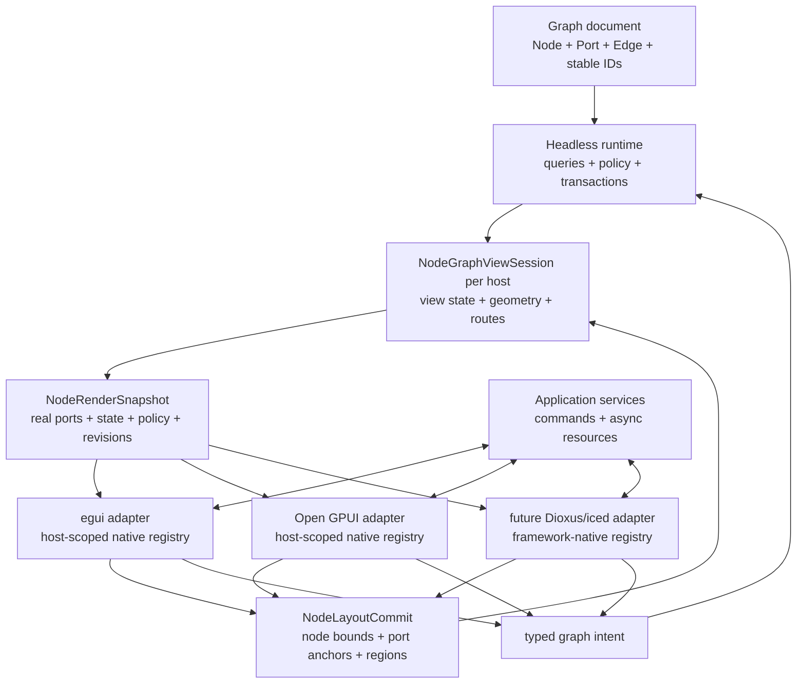

# Headless Custom Node UI Architecture for Jellyflow

Status: architecture research and recommendation

Date: 2026-07-11

Scope: Jellyflow, xyflow, Dify, Unreal Engine GraphEditor, egui, and Open GPUI

Historical scope: the Jellyflow implementation assessment below is pinned to baseline `52788f7`.
The recommendation has since shipped; see the [current architecture](../../CONTEXT.md).

## Executive Finding

Jellyflow should make framework-native components the only node-authoring model in the headless
runtime. Each framework adapter owns a host-scoped `renderer_key -> native component` registry. An
egui renderer receives `&mut egui::Ui`; an Open GPUI renderer returns native elements or retained
views; a future Dioxus renderer returns Dioxus components. The headless crates never name those
types.

Runtime should standardize graph facts and behavior, not widget trees: a compact node render
snapshot, concrete port presentation, semantic graph/editor commands, and a revisioned,
view-scoped layout commit. Adapters own component construction, layout, paint, focus, IME,
accessibility, popups, native event propagation, and component lifecycle.

The existing slots, controls, repeatables, actions, menus, inspectors, blackboards, chrome, fit
budgets, and portable projections should be removed from runtime rather than retained as a second
default path. They implement a cross-framework widget vocabulary without satisfying the actual
Open GPUI integration. If a later product requirement proves a need for server-defined forms,
untrusted plugin UI, or write-once cross-framework node surfaces, that capability should be
designed independently in an optional `jellyflow-portable-ui` crate and consumed as an ordinary
native renderer. It should not shape the graph runtime in advance.

This is the same responsibility boundary visible in all three reference systems:

- xyflow shares node, geometry, and interaction algorithms while React and Svelte register their
  own components and wrappers;
- Dify builds rich product nodes directly from React components inside a shared ReactFlow shell;
- Unreal separates `UEdGraphNode`/`UEdGraphPin`, schema rules, Slate graph widgets, factories, and
  the graph panel host.

The current Jellyflow direction has valuable foundations, especially `renderer_key`, runtime
interaction policy, graph transactions, measurement invalidation, and concrete node/port facts.
The problem is that arbitrary native components and portable semantic node kits have been treated
as one abstraction. Continuing that path turns `NodeSchema` into a cross-framework UI toolkit
while the real Open GPUI component host remains example-local.

## Source Baselines

| Project | Baseline used | Primary evidence |
| --- | --- | --- |
| Jellyflow | `52788f7` | current workspace source and the active refactor plan |
| xyflow | `dd308ab401d49518f73d1e91c43faf254ff5a4c9` | official source, tests, and documentation |
| Dify | `6e5ba18d65e78f7ab04f46c5ba4e4b5011df07f8` | official source mirror at `repo-ref/dify` |
| Unreal Engine | 5.8.0, `7deeb413d3dc1fc034f48d1aacc0861301829d32` | Epic API reference and official engine source |
| egui | 0.34.3 | official crate documentation and source |
| egui-snarl | 0.11.0, `de6140750fcb5d7ccfb74b507e7b88fa1aca14ad` | upstream source |
| Open GPUI | `67f0048d681e0c44dd7c2e70c8d6386f42b3601b` | first-party source mirror at `repo-ref/open-gpui` |

## xyflow Baseline

The local reference is `repo-ref/xyflow`, remote `https://github.com/xyflow/xyflow`.
Local `main` and the official remote `main` both resolved on 2026-07-11 to:

- commit `dd308ab401d49518f73d1e91c43faf254ff5a4c9` (2026-07-06);
- tag `@xyflow/react@12.11.2`;
- tag `@xyflow/svelte@1.6.2`;
- tag `@xyflow/system@0.0.79`.

Official documentation cited below reports "Last updated on July 6, 2026". Source links are
pinned to the commit above; local paths refer to the checked-in mirror.

## xyflow Finding

**Verified fact:** xyflow separates framework-specific component authoring from shared node,
geometry, and interaction concepts. React and Svelte each own their `nodeTypes` registry,
component wrapper, reactive store integration, DOM event wiring, and portals. Both reuse
`@xyflow/system` types and algorithms.

**Verified fact:** `@xyflow/system` is framework-independent, but it is not renderer- or
platform-headless as a whole. Its public/internal types include `HTMLDivElement`, and its
measurement and interaction engines directly use DOM APIs, `window`, `ResizeObserver`, and D3.

**Inference for Jellyflow:** copy the responsibility split, not the DOM implementation. A Rust
core should consume explicit geometry and semantic input snapshots. Each UI adapter should own
component construction, layout measurement, native hit regions, focus, and event arbitration.

## xyflow Verified Facts

### 1. Custom node authoring is an adapter-owned component registry

The shared `NodeBase` contains identity, graph position, arbitrary `data`, a string `type`,
dimensions, optional predeclared handles, and behavior flags. `InternalNodeBase` adds measured
dimensions plus `positionAbsolute`, z-order, cached `handleBounds`, and a reference to the user
node. The split keeps user state separate from renderer-derived facts.

Sources: [system node types](https://github.com/xyflow/xyflow/blob/dd308ab401d49518f73d1e91c43faf254ff5a4c9/packages/system/src/types/nodes.ts#L11-L136),
local `repo-ref/xyflow/packages/system/src/types/nodes.ts:11-136`.

The shared `NodeProps` is a projection of node data and interaction state: `id`, `data`, type,
dimensions, source/target positions, selection/drag/connect flags, z-index, parent, and absolute
position. React aliases this type directly. Svelte extends it only to loosen the component `type`
generic. It does not prescribe the internal widget tree.

Sources: [shared NodeProps](https://github.com/xyflow/xyflow/blob/dd308ab401d49518f73d1e91c43faf254ff5a4c9/packages/system/src/types/nodes.ts#L109-L125),
[React NodeProps](https://github.com/xyflow/xyflow/blob/dd308ab401d49518f73d1e91c43faf254ff5a4c9/packages/react/src/types/nodes.ts#L99-L126),
[Svelte NodeProps](https://github.com/xyflow/xyflow/blob/dd308ab401d49518f73d1e91c43faf254ff5a4c9/packages/svelte/src/lib/types/nodes.ts#L46-L63).

`NodeTypes` is deliberately adapter-specific: React maps strings to `ComponentType`; Svelte maps
strings to Svelte `Component`. Each `NodeWrapper` resolves `node.type`, falls back to a built-in
default, owns the interactive outer container, and invokes the custom component with `NodeProps`.

Sources: [React NodeTypes](https://github.com/xyflow/xyflow/blob/dd308ab401d49518f73d1e91c43faf254ff5a4c9/packages/react/src/types/general.ts#L65-L75),
[React NodeWrapper](https://github.com/xyflow/xyflow/blob/dd308ab401d49518f73d1e91c43faf254ff5a4c9/packages/react/src/components/NodeWrapper/index.tsx#L44-L71),
[Svelte NodeTypes](https://github.com/xyflow/xyflow/blob/dd308ab401d49518f73d1e91c43faf254ff5a4c9/packages/svelte/src/lib/types/nodes.ts#L53-L63),
[Svelte NodeWrapper](https://github.com/xyflow/xyflow/blob/dd308ab401d49518f73d1e91c43faf254ff5a4c9/packages/svelte/src/lib/components/NodeWrapper/NodeWrapper.svelte#L66-L103).
The official [React custom-node guide](https://reactflow.dev/learn/customization/custom-nodes)
and [Svelte guide](https://svelteflow.dev/learn/customization/custom-nodes) describe the same
component-registry model.

### 2. The wrapper, not the custom component, owns graph interaction

React's wrapper applies absolute translation, dimensions, visibility, pointer policy, selection,
dragging, keyboard movement, focus, accessibility, and graph callbacks before rendering the user
component. The Svelte wrapper mirrors this responsibility. The React renderer subscribes mainly
to visible node IDs, while each memoized wrapper subscribes to its own internal node, avoiding a
full node-list rerender on every drag.

Sources: [React wrapper behavior](https://github.com/xyflow/xyflow/blob/dd308ab401d49518f73d1e91c43faf254ff5a4c9/packages/react/src/components/NodeWrapper/index.tsx#L83-L250),
[React renderer split](https://github.com/xyflow/xyflow/blob/dd308ab401d49518f73d1e91c43faf254ff5a4c9/packages/react/src/container/NodeRenderer/index.tsx#L38-L97),
[Svelte wrapper behavior](https://github.com/xyflow/xyflow/blob/dd308ab401d49518f73d1e91c43faf254ff5a4c9/packages/svelte/src/lib/components/NodeWrapper/NodeWrapper.svelte#L174-L310).

Nested controls opt out of graph gestures through DOM conventions. Drag filtering walks ancestors
for `nodrag` or a configured drag-handle selector; keyboard handling recognizes inputs, selects,
textareas, `contenteditable`, and `.nokey`. Official examples put `className="nodrag"` on inputs.

Sources: [XYDrag filter](https://github.com/xyflow/xyflow/blob/dd308ab401d49518f73d1e91c43faf254ff5a4c9/packages/system/src/xydrag/XYDrag.ts#L401-L409),
[selector walk](https://github.com/xyflow/xyflow/blob/dd308ab401d49518f73d1e91c43faf254ff5a4c9/packages/system/src/xydrag/utils.ts#L22-L32),
[input detection](https://github.com/xyflow/xyflow/blob/dd308ab401d49518f73d1e91c43faf254ff5a4c9/packages/system/src/utils/dom.ts#L38-L48),
[official custom-node guide](https://reactflow.dev/learn/customization/custom-nodes).

### 3. Arbitrary UI becomes graph geometry through a measurement feedback loop

React and Svelte each create a `ResizeObserver`. Entries become `{ id, nodeElement, force }` and
are sent to the shared `updateNodeInternals` algorithm. React additionally exposes
`useUpdateNodeInternals`, which finds one or more node elements and schedules a forced update on
`requestAnimationFrame`; the official API requires it after programmatic handle count/position
changes.

Sources: [React observer](https://github.com/xyflow/xyflow/blob/dd308ab401d49518f73d1e91c43faf254ff5a4c9/packages/react/src/container/NodeRenderer/useResizeObserver.ts#L9-L38),
[Svelte observer](https://github.com/xyflow/xyflow/blob/dd308ab401d49518f73d1e91c43faf254ff5a4c9/packages/svelte/src/lib/container/NodeRenderer/NodeRenderer.svelte#L25-L47),
[React update hook](https://github.com/xyflow/xyflow/blob/dd308ab401d49518f73d1e91c43faf254ff5a4c9/packages/react/src/hooks/useUpdateNodeInternals.ts#L51-L68),
[official hook reference](https://reactflow.dev/api-reference/hooks/use-update-node-internals).

The shared update function reads the viewport transform, node `offsetWidth/offsetHeight`, node
bounding rectangle, and every `.source`/`.target` descendant rectangle. Handle positions are
normalized by zoom and stored relative to the node. It writes `measured` and
`internals.handleBounds`, adjusts parent/extent state, and emits dimension/position changes. The
adapter store then refreshes absolute positions, fit-view state, subscriptions, and public node
change callbacks.

Sources: [updateNodeInternals](https://github.com/xyflow/xyflow/blob/dd308ab401d49518f73d1e91c43faf254ff5a4c9/packages/system/src/utils/store.ts#L401-L499),
[DOM handle measurement](https://github.com/xyflow/xyflow/blob/dd308ab401d49518f73d1e91c43faf254ff5a4c9/packages/system/src/utils/dom.ts#L30-L94),
[React store bridge](https://github.com/xyflow/xyflow/blob/dd308ab401d49518f73d1e91c43faf254ff5a4c9/packages/react/src/store/index.ts#L161-L208),
[Svelte store bridge](https://github.com/xyflow/xyflow/blob/dd308ab401d49518f73d1e91c43faf254ff5a4c9/packages/svelte/src/lib/store/index.ts#L70-L126).

The official handles guide warns that hidden handles must retain measurable dimensions
(`visibility: hidden` or `opacity: 0`, not `display: none`). `useNodesInitialized` transitions
after dimensions and handle bounds exist. These are direct consequences of DOM measurement.

Sources: [official handles guide](https://reactflow.dev/learn/customization/handles),
[useNodesInitialized](https://github.com/xyflow/xyflow/blob/dd308ab401d49518f73d1e91c43faf254ff5a4c9/packages/react/src/hooks/useNodesInitialized.ts#L11-L69).

### 4. Handles are a DOM protocol over a shared geometry model

React and Svelte `<Handle>` render adapter DOM with stable data attributes and semantic classes.
They delegate pointer-down and click connection behavior to shared `XYHandle`. During a drag,
`XYHandle` converts client coordinates into renderer coordinates, searches cached handle geometry
within `connectionRadius`, and then uses `elementFromPoint` to prefer the element directly under
the pointer. Validated connection state is written back through adapter callbacks.

Sources: [React Handle](https://github.com/xyflow/xyflow/blob/dd308ab401d49518f73d1e91c43faf254ff5a4c9/packages/react/src/components/Handle/index.tsx#L139-L279),
[Svelte Handle](https://github.com/xyflow/xyflow/blob/dd308ab401d49518f73d1e91c43faf254ff5a4c9/packages/svelte/src/lib/components/Handle/Handle.svelte#L113-L234),
[XYHandle flow](https://github.com/xyflow/xyflow/blob/dd308ab401d49518f73d1e91c43faf254ff5a4c9/packages/system/src/xyhandle/XYHandle.ts#L26-L249),
[hybrid hit test](https://github.com/xyflow/xyflow/blob/dd308ab401d49518f73d1e91c43faf254ff5a4c9/packages/system/src/xyhandle/XYHandle.ts#L252-L320),
[nearest-handle geometry](https://github.com/xyflow/xyflow/blob/dd308ab401d49518f73d1e91c43faf254ff5a4c9/packages/system/src/xyhandle/utils.ts#L28-L76).

### 5. Layout information flows through cached internal geometry

After measurement, the same internal node geometry drives edge endpoints, node dragging and
clamping, box selection/visibility, fit-view, group bounds, and toolbar placement. Pointer events
are converted from screen coordinates to flow coordinates before graph algorithms run. Box
selection is geometry-based; connection targeting adds the DOM-under-pointer tie-break described
above.

Sources: [edge positions](https://github.com/xyflow/xyflow/blob/dd308ab401d49518f73d1e91c43faf254ff5a4c9/packages/system/src/utils/edges/positions.ts#L19-L71),
[node selection geometry](https://github.com/xyflow/xyflow/blob/dd308ab401d49518f73d1e91c43faf254ff5a4c9/packages/system/src/utils/graph.ts#L254-L294),
[drag coordinate flow](https://github.com/xyflow/xyflow/blob/dd308ab401d49518f73d1e91c43faf254ff5a4c9/packages/system/src/xydrag/XYDrag.ts#L286-L362).

### 6. NodeToolbar is an adapter overlay backed by shared transform math

`NodeToolbar` derives a node/group rectangle plus viewport and z-order, uses the shared
`getNodeToolbarTransform`, then portals UI into an unscaled renderer/root overlay. Its position
tracks pan/zoom, but its content does not scale with the viewport. React and Svelte own portal and
component behavior; system owns only coordinate math.

Sources: [React NodeToolbar](https://github.com/xyflow/xyflow/blob/dd308ab401d49518f73d1e91c43faf254ff5a4c9/packages/react/src/additional-components/NodeToolbar/NodeToolbar.tsx#L76-L141),
[React portal](https://github.com/xyflow/xyflow/blob/dd308ab401d49518f73d1e91c43faf254ff5a4c9/packages/react/src/additional-components/NodeToolbar/NodeToolbarPortal.tsx#L7-L16),
[shared transform](https://github.com/xyflow/xyflow/blob/dd308ab401d49518f73d1e91c43faf254ff5a4c9/packages/system/src/utils/node-toolbar.ts#L3-L51),
[Svelte toolbar](https://github.com/xyflow/xyflow/blob/dd308ab401d49518f73d1e91c43faf254ff5a4c9/packages/svelte/src/lib/plugins/NodeToolbar/NodeToolbar.svelte#L22-L83),
[official toolbar reference](https://reactflow.dev/api-reference/components/node-toolbar).

### 7. Framework-independent does not mean DOM-free

Package manifests show the intended dependency direction: React and Svelte depend on
`@xyflow/system`; system has no React or Svelte dependency. React supplies a Zustand store while
Svelte supplies a reactive class/store. However, system's `InternalNodeUpdate` contains an
`HTMLDivElement`; `updateNodeInternals` uses `window`, DOM matrices, selectors, and rectangles;
`XYDrag`, `XYHandle`, `XYPanZoom`, and `XYResizer` accept DOM elements and browser events.

Sources: [system manifest](https://github.com/xyflow/xyflow/blob/dd308ab401d49518f73d1e91c43faf254ff5a4c9/packages/system/package.json#L1-L78),
[React manifest](https://github.com/xyflow/xyflow/blob/dd308ab401d49518f73d1e91c43faf254ff5a4c9/packages/react/package.json#L63-L73),
[Svelte manifest](https://github.com/xyflow/xyflow/blob/dd308ab401d49518f73d1e91c43faf254ff5a4c9/packages/svelte/package.json#L53-L56),
[DOM-bearing type](https://github.com/xyflow/xyflow/blob/dd308ab401d49518f73d1e91c43faf254ff5a4c9/packages/system/src/types/nodes.ts#L132-L136).

### 8. xyflow already supports an explicit, non-measured geometry path

For SSR, official docs require callers to provide node `width`/`height` (or initial dimensions)
because the server cannot measure DOM. To render edges, callers also provide handle `x`, `y`,
side, type, and optional size. `NodeBase.handles` and `parseHandles` turn this into the same
`handleBounds` cache used by measured nodes; edge positioning also falls back to declared handles.
When dimensions and handles are already initialized, wrappers can skip eager measurement.

Sources: [official SSR guide](https://reactflow.dev/learn/advanced-use/ssr-ssg-configuration),
[declared handles field](https://github.com/xyflow/xyflow/blob/dd308ab401d49518f73d1e91c43faf254ff5a4c9/packages/system/src/types/nodes.ts#L75-L79),
[parseHandles](https://github.com/xyflow/xyflow/blob/dd308ab401d49518f73d1e91c43faf254ff5a4c9/packages/system/src/utils/store.ts#L79-L109),
[edge fallback](https://github.com/xyflow/xyflow/blob/dd308ab401d49518f73d1e91c43faf254ff5a4c9/packages/system/src/utils/edges/positions.ts#L19-L35),
[observer initialization gate](https://github.com/xyflow/xyflow/blob/dd308ab401d49518f73d1e91c43faf254ff5a4c9/packages/react/src/components/NodeWrapper/useNodeObserver.ts#L23-L39).

## Dify Verified Facts

Dify demonstrates what a product-level workflow editor does after choosing React Flow. It does not
encode its node interiors in a renderer-neutral schema. Its `NodeComponentMap` maps each business
`BlockEnum` directly to a React component. A single React Flow `CustomNode` selects that component,
wraps it in `BaseNode`, and renders it as ordinary React children.

`BaseNode` owns Dify-specific shared chrome and behavior: selection/running/error borders, plugin
installation overlays, collaboration presence, container sizing, and common handles. Individual
node components still own arbitrary product layout and controls. The If/Else node maps its cases
to rows and places a `NodeSourceHandle` for each stable `case_id`, plus an Else handle. Reordering
cases calls React Flow's `useUpdateNodeInternals` after the data and DOM topology change.

Sources:

- [Dify component map](https://github.com/langgenius/dify/blob/6e5ba18d65e78f7ab04f46c5ba4e4b5011df07f8/web/app/components/workflow/nodes/components.ts#L78-L107)
- [Dify custom node composition](https://github.com/langgenius/dify/blob/6e5ba18d65e78f7ab04f46c5ba4e4b5011df07f8/web/app/components/workflow/nodes/index.tsx#L15-L29)
- [Dify BaseNode](https://github.com/langgenius/dify/blob/6e5ba18d65e78f7ab04f46c5ba4e4b5011df07f8/web/app/components/workflow/nodes/_base/node.tsx#L69-L255)
- [If/Else dynamic handles](https://github.com/langgenius/dify/blob/6e5ba18d65e78f7ab04f46c5ba4e4b5011df07f8/web/app/components/workflow/nodes/if-else/node.tsx#L45-L102)
- [If/Else internals invalidation](https://github.com/langgenius/dify/blob/6e5ba18d65e78f7ab04f46c5ba4e4b5011df07f8/web/app/components/workflow/nodes/if-else/use-config.ts#L88-L100)

The important reuse boundary is therefore `ReactFlow wrapper + Dify BaseNode + specialized React
component`, not a portable field/control DSL. Jellyflow needs the equivalent adapter-local shell
and native component registry if it wants Dify-level expressiveness.

## Unreal Engine Verified Facts

Unreal's GraphEditor provides a second, non-DOM reference for the same separation:

- `UEdGraphNode` owns semantic node identity, position, and `UEdGraphPin` records. The same node can
  be displayed in more than one editor, so a node cannot own a single widget instance.
- `UEdGraphSchema` owns connection and mutation policy. `CanCreateConnection` returns structured
  results such as allow, reject, break an existing side, insert conversion, or promote a type;
  `TryCreateConnection` applies the semantic action.
- `SGraphNode` and `SGraphPin` are Slate UI adapters. `SGraphNode::UpdateGraphNode` builds the widget
  tree and creates pin widgets from model pins. `SGraphPin` delegates connection legality back to
  the schema.
- `FGraphPanelNodeFactory` and `FGraphPanelPinFactory` map model types to native Slate widgets.
  `SGraphPanel` owns viewport, selection, culling, paint layers, pin geometry, wires, and commands.
- Slate layout computes desired size before arrangement. Pin widgets report anchors from their
  allotted geometry, and the panel consumes that geometry for wires and hit testing.

Public API sources:

- [UEdGraphNode](https://dev.epicgames.com/documentation/en-us/unreal-engine/API/Runtime/Engine/UEdGraphNode?application_version=5.8)
- [UEdGraphPin](https://dev.epicgames.com/documentation/en-us/unreal-engine/API/Runtime/Engine/UEdGraphPin?application_version=5.8)
- [UEdGraphSchema](https://dev.epicgames.com/documentation/en-us/unreal-engine/API/Runtime/Engine/UEdGraphSchema?application_version=5.8)
- [SGraphNode](https://dev.epicgames.com/documentation/en-us/unreal-engine/API/Editor/GraphEditor/SGraphNode?application_version=5.8)
- [SGraphPin](https://dev.epicgames.com/documentation/en-us/unreal-engine/API/Editor/GraphEditor/SGraphPin?application_version=5.8)
- [FGraphPanelNodeFactory](https://dev.epicgames.com/documentation/en-us/unreal-engine/API/Editor/UnrealEd/FGraphPanelNodeFactory?application_version=5.8)
- [SGraphPanel](https://dev.epicgames.com/documentation/en-us/unreal-engine/API/Editor/GraphEditor/SGraphPanel?application_version=5.8)

Pinned engine sources include
[schema decisions and mutations](https://github.com/EpicGames/UnrealEngine/blob/7deeb413d3dc1fc034f48d1aacc0861301829d32/Engine/Source/Runtime/Engine/Private/EdGraph/EdGraphSchema.cpp#L474-L528),
[node widget construction](https://github.com/EpicGames/UnrealEngine/blob/7deeb413d3dc1fc034f48d1aacc0861301829d32/Engine/Source/Editor/GraphEditor/Private/SGraphNode.cpp#L847-L1039),
[factory resolution](https://github.com/EpicGames/UnrealEngine/blob/7deeb413d3dc1fc034f48d1aacc0861301829d32/Engine/Source/Editor/GraphEditor/Private/NodeFactory.cpp#L87-L132),
and [panel reconciliation](https://github.com/EpicGames/UnrealEngine/blob/7deeb413d3dc1fc034f48d1aacc0861301829d32/Engine/Source/Editor/GraphEditor/Private/SGraphPanel.cpp#L2322-L2380).
The Epic GitHub repository requires an Epic-linked GitHub account; the public API links above do
not.

Unreal is not itself a framework-neutral UI implementation: its factories return Slate types, and
`UEdGraphNode::CreateVisualWidget` is a UI escape hatch on the model. Jellyflow should copy the
model/schema/widget/host split, not the Slate dependency leak or Unreal's global first-match
factory arrays.

## UI Lifecycle Differences

Arbitrary UI cannot share one renderer trait because the frameworks do not agree on component or
layout lifecycle:

| UI model | When geometry exists | Native interaction ownership | Jellyflow adapter implication |
| --- | --- | --- | --- |
| React/DOM | after React commits and browser layout runs | DOM propagation, focus tree, IME, accessibility | observe/query real DOM, then submit geometry |
| egui immediate mode | while the current UI pass allocates widgets; interaction starts from prior-pass geometry | stable `Id`, `Response`, and per-pass input | collect actual response rectangles; allow a later pass/frame to settle |
| Open GPUI | after `request_layout`, in `prepaint(bounds)` | entity state plus frame hitboxes, listeners, and focus handles | collect bounds in prepaint and defer an atomic commit |

egui's official documentation states that the interface is laid out and painted each frame and
that a widget call returns shapes plus a `Response`, not a stored widget. It also documents
multi-pass layout for cases where a later pass needs dimensions learned by an earlier pass.
Open GPUI's `Element` contract explicitly separates `request_layout`, `prepaint`, and `paint`;
`measured_element` reports final layout-pass bounds during prepaint rather than predicting them.
egui-snarl provides a useful node-graph-specific proof: its viewer receives native `&mut Ui` for
custom node bodies and pins, records pin anchors from the resulting `Response.rect`, and exposes the
final node rectangle after layout.

Sources:

- [egui immediate mode](https://github.com/emilk/egui/blob/65cb282a198d2dd72b6ca2346cc73eba45b7a830/crates/egui/src/lib.rs#L153-L224)
- [egui multi-pass layout](https://github.com/emilk/egui/blob/65cb282a198d2dd72b6ca2346cc73eba45b7a830/crates/egui/src/lib.rs#L207-L226)
- [egui-snarl custom body and pin hooks](https://github.com/zakarumych/egui-snarl/blob/de6140750fcb5d7ccfb74b507e7b88fa1aca14ad/src/ui/viewer.rs#L122-L195)
- [egui-snarl measured pin rectangles](https://github.com/zakarumych/egui-snarl/blob/de6140750fcb5d7ccfb74b507e7b88fa1aca14ad/src/ui.rs#L1473-L1551)
- [Open GPUI element phases](https://github.com/Latias94/open-gpui/blob/67f0048d681e0c44dd7c2e70c8d6386f42b3601b/crates/gpui/src/element.rs#L47-L104)
- [Open GPUI measured element](https://github.com/Latias94/open-gpui/blob/67f0048d681e0c44dd7c2e70c8d6386f42b3601b/crates/gpui/src/elements/measured.rs#L7-L81)
- [Resize Observer processing model](https://drafts.csswg.org/resize-observer/#algorithms)

The shared contract must therefore be `invalidate -> native layout -> layout commit`, where the
commit may occur in the same pass, a later phase, or a later frame. It must not require a
synchronous `render() -> measurement` return value.

## Current Jellyflow Assessment

### Recent refactor trajectory

The recent commit sequence is coherent when read as an experiment, but it has reached a boundary:

- `113281e` and `2bfedf1` established semantic node surfaces and node kits;
- `34292ce` and `0049be6` added measurement, capability, controls, repeatables, actions, menus, and
  inspectors;
- `6fb06ef`, `37b650a`, and `e201f37` established a widget-free Open GPUI adapter/renderer host
  facade;
- `0346506` briefly made character/line fit prediction part of component evidence, while
  `7b82b80` and `1d0d0b0` corrected the direction back toward real layout measurement;
- `1807fa3` through `3a992a3` expanded measured interaction evidence;
- `9bb9c04` introduced atomic scene contracts, and `d6e8b23` moved the real product host into this
  repository's example.

The durable result is headless graph behavior, semantic kind/port facts, transactions, measurement
invalidation, and adapter-local components. The unresolved work is a real native component host,
not another layer of descriptor or evidence types.

### Foundations to preserve

- `NodeSchema::renderer_key` is already the right adapter-neutral lookup identifier. It is data, not a
  component reference ([baseline schema source](https://github.com/Latias94/jellyflow/blob/52788f7/crates/jellyflow-runtime/src/schema/types.rs#L1931)).
- The graph stores stable node, port, and edge facts separately from renderer geometry.
- Runtime resolves node and port interaction policy rather than asking renderers to duplicate
  graph policy ([baseline node policy](https://github.com/Latias94/jellyflow/blob/52788f7/crates/jellyflow-runtime/src/runtime/policy/node.rs),
  [baseline port policy](https://github.com/Latias94/jellyflow/blob/52788f7/crates/jellyflow-runtime/src/runtime/policy/port.rs)).
- `NodeMeasurement`, dirty/fresh status, and `NodeInternalsController` already establish the right
  invalidation/report/query lifecycle
  ([baseline measurement contract](https://github.com/Latias94/jellyflow/blob/52788f7/crates/jellyflow-runtime/src/runtime/measurement.rs#L120)).
- Graph transactions, rendering queries, route facts, controlled patches, and conformance fixtures
  are reusable headless behavior.
- The removed ADR registry correctly kept toolkit widgets out of runtime and required adapter-local
  mapping. Its portable semantic-surface and node-kit direction must be superseded while that
  narrower principle is retained.

### Gaps blocking arbitrary native components

1. **Schema and portable UI are conflated.** `NodeSchema` and `NodeKindViewDescriptor` carry ports,
   slots, controls, repeatables, actions, menus, inspectors, blackboards, chrome, and layout
   budgets. `types.rs` is now 2,734 lines. This is useful as one portable renderer input, but it is
   becoming a universal UI language rather than a compact node-kind/schema contract
   ([baseline fields](https://github.com/Latias94/jellyflow/blob/52788f7/crates/jellyflow-runtime/src/schema/types.rs#L1912),
   [baseline view descriptor](https://github.com/Latias94/jellyflow/blob/52788f7/crates/jellyflow-runtime/src/schema/types.rs#L2435)).
2. **There is no shared per-node render snapshot.** egui and Open GPUI independently assemble
   similar state, yet the Open GPUI context omits concrete graph ports and resolved port policies.
   Its control-edit helper reconstructs a temporary `Node` with empty ports and default policy
   fields ([baseline context](https://github.com/Latias94/jellyflow/blob/52788f7/crates/jellyflow-open-gpui/src/renderer.rs#L483),
   [baseline temporary node](https://github.com/Latias94/jellyflow/blob/52788f7/crates/jellyflow-open-gpui/src/renderer.rs#L674)).
3. **egui predicts layout before drawing real controls.** `RichNodeRenderer` first returns a manual
   `NodeRenderLayout`; a separate `EguiNodeWidgetRenderer` later draws controls inside those
   predicted regions. Actual widget responses are not the single authority for node and port
   measurement ([baseline renderer contracts](https://github.com/Latias94/jellyflow/blob/52788f7/crates/jellyflow-egui/src/renderer.rs#L237),
   [baseline widget pass](https://github.com/Latias94/jellyflow/blob/52788f7/crates/jellyflow-egui/src/ui/canvas.rs#L318)).
4. **The Open GPUI adapter is not yet a native adapter.** `jellyflow-open-gpui` has no Open GPUI
   dependency; it is a widget-free planning and capability facade. Real elements, services,
   measurement wrappers, focus, event shielding, and command wiring live in the 9,076-line
   `canvas-jellyflow` example
   ([baseline manifest](https://github.com/Latias94/jellyflow/blob/52788f7/crates/jellyflow-open-gpui/Cargo.toml),
   [baseline registry seam](https://github.com/Latias94/jellyflow/blob/52788f7/crates/jellyflow-open-gpui/src/renderer.rs#L45),
   [baseline example host](https://github.com/Latias94/jellyflow/blob/52788f7/examples/canvas-jellyflow/src/main.rs#L783)).
5. **Atomic scene ownership is specified but not closed.** The example still renders a base canvas,
   all node widgets, then a tool canvas. The generic canvas `RecordWidget` paint phase is empty, so
   node body/widget/chrome cannot yet interleave as one record-ordered group
   ([baseline three layers](https://github.com/Latias94/jellyflow/blob/52788f7/examples/canvas-jellyflow/src/main.rs#L409),
   [Open GPUI empty phase](https://github.com/Latias94/open-gpui/blob/67f0048d681e0c44dd7c2e70c8d6386f42b3601b/crates/canvas/src/gpui/painter.rs#L150)).
6. **DSL authoring mutation is duplicated in adapters.** JSON binding and control mutation exist
   independently in egui and Open GPUI, with already divergent path behavior
   ([baseline egui binding](https://github.com/Latias94/jellyflow/blob/52788f7/crates/jellyflow-egui/src/bridge.rs#L1200),
   [baseline Open GPUI binding](https://github.com/Latias94/jellyflow/blob/52788f7/crates/jellyflow-open-gpui/src/json_binding.rs#L46),
   [baseline runtime lookup](https://github.com/Latias94/jellyflow/blob/52788f7/crates/jellyflow-runtime/src/schema/types.rs#L2684)). Native widgets should
   dispatch application/domain commands; runtime should own only generic transaction, revision,
   and atomic graph-topology behavior.
7. **Dynamic port topology is diagnostic rather than atomic.** Open GPUI repeatable add can update
   `Node.data` while reporting `MissingGraphPort`. For Dify/Blueprint nodes, adding or deleting a
   branch must atomically update data, real graph ports, incident edges, and measurement
   invalidation ([baseline missing-port classification](https://github.com/Latias94/jellyflow/blob/52788f7/crates/jellyflow-open-gpui/src/repeatable.rs#L328),
   [baseline data-only transaction](https://github.com/Latias94/jellyflow/blob/52788f7/crates/jellyflow-open-gpui/src/repeatable.rs#L530)).
8. **Proof surface exceeds mature product surface.** `jellyflow-open-gpui/src/testing.rs` is 4,869
   lines and the Dioxus path is still shaped-data proof rather than a native adapter. Capability
   claims should describe actual native component, measurement, focus, and interaction coverage.

## Inferences for Jellyflow

### Options considered

| Option | Expressiveness | Cross-framework reuse | Cost and risk | Decision |
| --- | --- | --- | --- | --- |
| Universal semantic UI DSL | limited by the vocabulary | high only for implemented widgets | Jellyflow must recreate layout, focus, IME, accessibility, popups, theming, and every new control | reject and remove from runtime |
| Native components only | unrestricted and framework-native | graph behavior and domain data; UI is adapter-specific | multi-framework products write multiple renderer crates | recommended |
| Native components plus a runtime portable lane | unrestricted primary path plus portable defaults | graph behavior always; UI when a node opts into the portable lane | two contracts, precedence rules, and permanent runtime vocabulary cost | reject for the current scope |

The current product goal is Open GPUI-first with a stable seam for future adapter authors, not
write-once UI. A product that targets multiple frameworks should share a domain/data crate and ship
one native renderer crate per framework. A portable form system can be reconsidered only when a
concrete requirement justifies maintaining a second widget toolkit.

### Design-it-twice comparison

Four independent interface designs converged on deleting the runtime UI DSL and placing the seam
at immutable render facts plus revisioned feedback. They differed in how much policy to expose:

| Design | Depth | Locality | Seam placement | Assessment |
| --- | --- | --- | --- | --- |
| Minimal headless protocol | highest: `frame` and `submit` hide revisions, validation, routing, and state machines | runtime and each native host own their respective complexity | snapshot/feedback data protocol | strongest stable runtime interface |
| Maximum extension surface | lower: exposes services generics, retention policy, overlay anchors, layout tickets, leases, and multiple renderer modes | flexible, but knowledge spreads to callers | protocol plus lifecycle extension points | useful as a design ceiling, too broad to freeze |
| Open GPUI author-first | high for product authors through a registry, retained binding, `PortHandle`, and interaction guard | all GPUI lifecycle, focus, measurement, and layering stay in one host | framework-local native registry | strongest Open GPUI adapter shape |
| Third-party adapter-first | high when `LayoutCollector` hides coordinate conversion, port coverage, and stale arbitration | shared conformance facts stay in runtime tooling; framework behavior stays local | snapshot/layout/intent protocol, no renderer trait | strongest validation of future adapter support |

The recommended hybrid uses the minimal runtime protocol, the Open GPUI-native host, and the
third-party conformance model. The maximum-extension design remains a checklist of capabilities to
consider after real usage proves them; its generic services, public retention policy, render-once
mode, overlay probes, and lease types should not enter the first stable interface.

### Minimal runtime interface

The following is an illustrative target, not a frozen Rust signature:

```rust
pub struct GraphRuntime { /* authoritative graph, history, policy */ }

impl GraphRuntime {
    pub fn dispatch(&self, command: GraphCommand) -> CommandOutcome;

    pub fn attach_view(&self, config: ViewConfig) -> ViewSession;
}

pub struct ViewSession { /* view-local state, geometry, routes */ }

impl ViewSession {
    pub fn frame(&mut self, input: FrameInput) -> RenderFrame;

    pub fn submit(
        &mut self,
        feedback: FrameFeedback,
    ) -> Result<SubmitOutcome, ViewProtocolError>;
}

pub struct RenderFrame {
    pub token: FrameToken,
    pub scene: SceneSnapshot,
    pub nodes: Arc<[NodeRenderSnapshot]>,
    pub edges: Arc<[EdgeRenderSnapshot]>,
    pub retired_instances: Arc<[NodeInstanceId]>,
}

pub struct FrameFeedback {
    pub token: FrameToken,
    pub intents: Vec<EditorIntent>,
    pub commands: Vec<GraphCommand>,
    pub layout: NodeLayoutBatch,
}
```

`FrameToken` is opaque and binds document, view, transform, node incarnation, and layout-request
revisions. `RenderFrame::layout_for(node)` should return a collector preloaded with the expected
real `PortId`s so adapter authors do not manually construct protocol identity or coverage
metadata. `submit` processes queued editor/graph changes before validating layout; any layout made
stale by those changes is ignored and requests a new frame rather than becoming a fatal error.

The required ordering contract is:

1. `frame` produces owned snapshots and an opaque token.
2. The adapter reconciles native instances and performs layout/prepaint without mutating runtime.
3. Native callbacks enqueue intents and graph commands.
4. After the framework render/update stack is released, the adapter submits one deferred batch.
5. Runtime applies commands atomically, validates complete node/port geometry, publishes accepted
   layout atomically, and requests another frame when convergence is needed.

This ordering is part of the interface. `StaleFrame`, `StaleInstance`, and stale layout tickets are
normal retry outcomes. Foreign ports, wrong views, duplicate/missing port coverage, invalid bounds,
and partial graph commands reject their entire node commit or transaction.

### Target boundary



The promise is **one graph model and behavior contract with multiple native views**. Jellyflow
does not promise that one arbitrary egui component will run as an Open GPUI or Dioxus component.

### Shared document, view-scoped sessions

The authoritative graph document and transaction/undo history should be shared. Hover, focus,
zoom, density, culling, measured geometry, and route caches must belong to a per-host
`RenderViewId`/view session. A graph mutation updates the shared document and publishes a patch or
revision to every view session; each session independently derives snapshots and layout facts.

The current `NodeGraphStore` contains both graph and view state. During implementation it may exist
briefly as a private facade while call sites move, but it should not become a public compatibility
layer. The target is one shared `GraphRuntime` plus explicit `ViewSession` objects. Sharing one
node-only measurement cache between two adapters is never valid.

### Shared node render snapshot

Runtime should expose one owned or cheaply cloned snapshot rather than parallel egui and Open GPUI
contexts. The following names are illustrative, not a frozen Rust signature:

```rust
pub struct NodeRenderSnapshot {
    pub view_id: RenderViewId,
    pub node_id: NodeId,
    pub kind: NodeKindKey,
    pub renderer_key: String,
    pub data: Arc<Value>,
    pub state: NodeViewState,
    pub policy: NodeGraphNodeInteractionPolicy,
    pub size: NodeSizeSnapshot,
    pub zoom: f32,
    pub ports: Vec<NodePortView>,
    pub diagnostics: Vec<NodeDiagnosticView>,
    pub revisions: NodeRenderRevisions,
}

pub struct NodePortView {
    pub port_id: PortId,
    pub key: PortKey,
    pub direction: PortDirection,
    pub data_type: Option<String>,
    pub policy: NodeGraphPortInteractionPolicy,
    pub connection_state: PortConnectionState,
    pub presentation: PortPresentation,
}
```

`NodeViewState` should cover selected, hovered, dragging, resizing, disabled, hidden, and
connection-preview/validity state. Adapter-local focus and IME state need not be round-tripped
unless shared editor behavior consumes them. `NodeRenderRevisions` should identify the graph data,
semantic kind, view state, and layout request that produced the snapshot. Retained adapters must
not borrow the store across frames; immutable snapshots or revisioned handles are safer than
exposing a mutable `NodeGraphStore` to components.

The `ports` collection must come from concrete graph `Port` records, not only schema `PortDecl`s.
This lets a component place adapter-native `<Handle>` equivalents by stable `PortId` while runtime
continues to own connection capability and validity.

### Layout commit

Evolve `NodeMeasurement` rather than replacing its useful lifecycle. A node-level commit should
contain:

- node identity and the render/layout request epoch it answers;
- mandatory `RenderViewId` so two hosts can measure the same graph differently;
- measured node size or bounds in an explicit coordinate space;
- one coverage entry for every concrete snapshot `PortId`: rendered, hidden, culled, or unavailable;
- for a rendered port, a connection anchor point plus outward side/normal for routing, and separate
  visual/hit bounds for paint and pointer targeting;
- optional graph-relevant interaction regions such as drag surface, control shield, pass-through
  area, resize handle, and overlay anchor, but only when shared hit arbitration consumes them;
- measurement source (`layout_pass`, `predeclared`, or explicit adapter-provided geometry);
- density/LOD and renderer incarnation when they affect geometry;
- an explicit withdrawal/tombstone form for a renderer instance that is unmounted or replaced.

Commit rules should be strict:

1. Geometry is view-scoped, never a graph-document fact. The view session keys it by
   `(RenderViewId, NodeId)`; during migration, each host uses its own store/geometry cache. An egui
   measurement must never overwrite the Open GPUI view of the same node.
2. One node's bounds, handles, and regions become visible atomically; edge routing must not observe
   a new node size with old handles.
3. Every real port in the render snapshot has an explicit coverage state. Missing entries make the
   commit incomplete; `hidden`/`unavailable` is not inferred from omission. Routing consumes the
   anchor and side/normal, while hit testing consumes hit bounds.
4. A result from an older render request is rejected even if it arrives with a newly allocated
   transport revision. The current revision check only rejects some stale reports after a node is
   dirty; a request epoch should bind a measurement to the snapshot that was actually laid out
   ([baseline apply logic](https://github.com/Latias94/jellyflow/blob/52788f7/crates/jellyflow-runtime/src/runtime/lookups/types/node.rs#L61)).
5. Dirty or missing handle geometry cannot be a connection hit target. A prior node size may remain
   as a visual fallback to avoid disappearance.
6. Renderer-key changes, node removal, and component disposal withdraw the old renderer
   incarnation's hit regions and overlays. Offscreen culling may retain the last fresh routing
   anchor, but that policy is explicit and never leaves a clickable stale handle.
7. Geometry changes use an epsilon and publish layout facts only when materially different. Adapter
   hosts should coalesce reports and bound multi-pass convergence.
8. Predeclared geometry remains supported for tests, headless export, and first-frame/SSR-like use,
   but capability reporting must distinguish it from native layout-pass measurement.

Adapter mechanics then remain natural:

- DOM adapters observe committed elements and query their rectangles;
- egui adapters collect `Response.rect` and the final node `Ui` rect, then report after the component
  pass or a settling pass;
- Open GPUI adapters collect `measured_element` bounds during prepaint and defer a batched commit
  until the current entity/render stack is released.

### Adapter-native host and primitives

Each adapter should provide a host-scoped registry. Avoid a global registry and avoid a
cross-framework `NodeRenderer` trait. The registry's value type is intentionally framework-local:

- egui can register a trait object or closure that receives `&mut egui::Ui` plus an egui host
  context and returns a response;
- Open GPUI can register factories returning `AnyElement`, `RenderOnce` components, or retained
  `Entity<View>` handles with framework-local services;
- a future Dioxus adapter can register component functions and signals without leaking them into
  runtime.

For Open GPUI, the first public authoring path should be a retained view factory returning
`AnyView`. A retained `Entity<V>` correctly owns focus, subscriptions, async tasks, input state,
and disposal; `AnyElement` is only a type-erased element tree for one render pass. The factory can
capture application entities and command sinks directly, avoiding a generic `Services` type across
the adapter interface:

```rust
let mut registry = GpuiNodeRegistry::new();

registry.register_view("workflow.if_else", {
    let catalogs = catalogs.clone();

    move |mount, cx| {
        cx.new(|cx| {
            IfElseNode::new(mount.binding, catalogs.clone(), cx)
        })
        .into()
    }
})?;

let canvas = cx.new(|cx| {
    JellyflowCanvas::new(runtime.attach_view(view_config), registry, cx)
});
```

`mount.binding` is an `Entity<NodeBinding>` containing the latest owned snapshot and adapter-local
command handles. Updating one node updates and notifies only its binding. A node renders ordinary
Open GPUI controls and uses only small semantic wrappers:

```rust
impl Render for IfElseNode {
    fn render(
        &mut self,
        _window: &mut Window,
        cx: &mut Context<Self>,
    ) -> impl IntoElement {
        let props = self.binding.read(cx).snapshot();

        div()
            .flex_col()
            .child(NodeInteractionGuard::new(self.expression_input(cx)))
            .children(props.ports.iter().map(|port| {
                PortHandle::new(self.binding.clone(), port.id)
                    .child(div().size(px(10.0)).rounded_full())
            }))
    }
}
```

`PortHandle`, `NodeInteractionGuard`, and later a resize/overlay helper are not a UI DSL. They
attach graph semantics to arbitrary native elements, like xyflow's `<Handle>` and `nodrag`, while
all visual composition remains ordinary Open GPUI. A `RenderOnce` registration helper may be added
later as sugar for stateless nodes, but it should not complicate the first retained lifecycle
contract.

The host provides framework-local equivalents of xyflow's wrapper and `<Handle>`:

- `NodeHost` owns transform, culling, z-order, selection, drag, resize, generic chrome, and layout
  collection;
- `PortHandle` receives a concrete `PortId`, renders native UI, registers real bounds, and translates
  native gestures into shared connection intents;
- overlay helpers place toolbars, menus, inspectors, and dropped-wire UI from shared anchors while
  retaining native focus and popup behavior;
- stable node/port/control IDs seed egui IDs, Open GPUI element/focus IDs, or DOM attributes.

A native renderer context is the shared immutable snapshot plus host-local services. Dify-level
nodes need application resources such as plugin/model catalogs, async state, entities/signals, and
commands that open panels or execute a node. Those services and component-local state remain
adapter/application-owned; they are neither serialized into `NodeSchema` nor forced through the
graph runtime.

Renderer resolution should be deterministic and diagnosable:

1. use a host-registered native renderer for `renderer_key`;
2. otherwise render an adapter-local minimal unknown-node fallback with real ports;
3. report duplicate registration and missing-renderer diagnostics rather than relying on
   registration order.

### Native component lifecycle and subscriptions

The shared contract must define lifecycle outcomes even though each framework implements them
differently. A native component instance is identified by `(RenderViewId, NodeId, renderer_key,
node_incarnation)`. A renderer-key or node-incarnation change creates a new instance and disposes
the old one; node deletion and view shutdown always dispose it.

Adapters own retention policy under culling. egui may retain only stable ID-keyed memory, while
Open GPUI may keep a bounded/LRU set of node entities or reconstruct them. In every case disposal
cancels adapter-owned async work and subscriptions, releases focus/popups, and submits geometry
withdrawal for the old renderer incarnation. Culling must not silently leak permanent component
instances.

Updates should be per node and revision-selective, following xyflow's wrapper subscription model.
Node data and semantic metadata can be shared through `Arc`/immutable snapshots; changing one
node should not clone every `Value`, rebuild every component, or invalidate every layout. Adapters
may subscribe to finer application state through their local services without moving that state
into the graph snapshot.

### Interaction and semantic commands

Framework event types, focus, IME, accessibility, and popup lifecycle stay in adapters. A text
field should consume its native pointer and keyboard events before the graph host can begin node
drag. Headless interaction roles are useful where a self-drawn canvas needs geometric arbitration,
but they should not emulate an entire framework event system.

Semantic graph edits should move in the opposite direction, but runtime must not become a second
business-UI DSL. Use two mutation levels:

1. runtime owns generic graph primitives, invariant checks, transactions, undo labels, and atomic
   node/port/edge topology helpers;
2. native nodes dispatch commands to an application- or node-kind-registered domain handler,
   which decides business validation and produces graph transactions and/or application effects.
   Runtime never infers Dify-specific meaning from arbitrary `Value` fields.

Graph commands should carry an expected document/node revision and return an applied, rejected, or
conflict result. A successful result defines one undo boundary and any required internals
invalidation; a rejected result changes nothing. Non-graph actions such as executing a workflow
node, loading model choices, or opening a product panel go to the application service sink instead
of expanding Jellyflow into a workflow engine.

Dynamic topology needs an atomic graph helper invoked by a domain handler.
Adding, removing, or reordering a Dify case or a Blueprint pin should update node data,
create/remove/reorder real graph ports, handle incident edges according to explicit policy, and
invalidate layout as one command outcome. A UI-only handle that has no `PortId` must never become
an edge endpoint.

Connection policy can later deepen toward Unreal's structured result model: allow, reject with a
reason, replace existing edges, insert conversion, or promote a type. Renderers visualize the
decision; they do not implement it independently.

### API disposition

| Current surface | Disposition |
| --- | --- |
| graph `Node`/`Port`/`Edge`, stable IDs, transactions, controlled patches | keep |
| `NodeGraphStore` graph plus view ownership | split into authoritative `GraphRuntime` and per-host `ViewSession`; keep only a short-lived private migration facade |
| rendering queries, resolved interaction policy, connection/route facts | keep and expose through the snapshot |
| `renderer_key` and adapter-local registry concept | keep; make registries host-scoped and native |
| `NodeMeasurement` and `NodeInternalsController` | replace the DSL-shaped public surface with a view/request-scoped layout collector and atomic commit; reuse validated implementation where useful |
| node-kit manifests and fixtures | replace broad UI kits with small semantic kind manifests and protocol conformance fixtures |
| slots, controls, repeatables, actions, menus, inspectors, blackboards, chrome, fit budgets | delete from runtime, builders, projections, fixtures, and adapter interfaces |
| adapter-local JSON binding and repeatable mutation planners | delete; native nodes call application/domain handlers, while generic atomic topology helpers stay in runtime |
| `NodeSchema`/`NodeKindViewDescriptor` | replace with a small semantic kind/creation manifest: identity, version, palette metadata, `renderer_key`, defaults, declared initial ports, and minimal presentation hints |
| egui `RichNodeRenderer` plus `EguiNodeWidgetRenderer` | converge around one small native adapter used as the second witness for the shared seam |
| widget-free `jellyflow-open-gpui` facade | rebuild in place as the real Open GPUI adapter; do not layer another compatibility crate above it |
| Open GPUI example-local component kit and command services | move the stable host primitives into the real adapter; keep product renderers application-local |
| character/line fit budgets and one-off public evidence types | delete after native layout/conformance replacements exist |
| headless adapter template string metadata registry | replace with a companion native-adapter example that demonstrates the actual author experience |

The former portable UI direction is removed with the ADR registry. New architecture documentation
must state that graph semantics are portable while node widget trees are adapter-native.

### Migration plan

**P0: Supersede the old direction.** Delete the ADR registry, freeze all UI DSL expansion, inventory
persisted fields that need migration, and keep the new snapshot/layout interface experimental.

**P1: Run a two-adapter vertical tracer.** With internal/experimental types, render the same graph
in egui and Open GPUI using a native node with text input, select, button, and one dynamic port.
Exercise separate zoom/focus state, component mount/dispose, child-event shielding, a rejected
edit, undo, async measurement, port add/remove, and stale geometry withdrawal. Record what the two
real lifecycles require before generalizing the interface.

**P2: Derive and test the headless contracts.** Extract `GraphRuntime` versus `ViewSession`,
`NodeRenderSnapshot`, layout tickets, complete port coverage, revisioned atomic layout commit, and
command outcomes from the tracer. Add generic atomic topology helpers and a node-kind/domain
command extension. Put layout validation, coordinate conversion, stale arbitration, and geometry
withdrawal behind a `LayoutCollector` rather than exposing them to adapter authors.

**P3: Productize the native hosts.** Simplify egui to measure actual widget responses. Create a
genuine Open GPUI adapter integration with native registry, lifecycle cache, node wrapper,
`PortHandle`, measured-element collector, focus/event services, and record-ordered scene
composition. Route measured control regions into the actual pointer owner rather than only
evidence reports.

**P4: Expand native product proofs.** Complete a Dify-style native node with validation and dynamic
branch ports. Add a Blueprint-style node with typed exec/data ports and structured connection
rejection. Run the same semantic graph commands through both adapters and add per-adapter focus,
accessibility, geometry, and screenshot gates.

**P5: Delete the old surface.** Split the 9,076-line example and 4,869-line evidence file, delete
the DSL descriptors, builders, projection/binding/manual-fit glue, old capability matrix, and
temporary store facade after replacements are green. Update templates and public documentation
around native authoring and the snapshot/layout/intent adapter protocol.

### Acceptance gates

- No framework widget, component, event, focus, or lifecycle type enters `jellyflow-core` or
  `jellyflow-runtime`.
- The same authoritative graph and runtime commands render through two real adapters with separate
  view sessions, adapter-native components, and intentionally different zoom/focus/geometry.
- Typing, selecting, scrolling, and opening a popup inside a node never accidentally starts node
  drag or canvas pan.
- Adding/removing/reordering a branch atomically updates concrete ports, anchors, edges, and
  measurement status.
- Graph command conflict/rejection changes nothing; success produces one explicit undo boundary.
- Every snapshot port is rendered, hidden, culled, or unavailable; routing anchors and hit bounds
  are distinct, and renderer disposal withdraws stale hit regions.
- Edges and connection hit targets consume only one fresh, internally consistent, view-scoped
  layout commit.
- An unregistered native renderer falls back to an adapter-local minimal unknown node without
  losing real ports.
- Native component tests cover focus, keyboard/IME where supported, accessibility semantics,
  clipping, overlapping-node z-order, zoom/LOD, mount/dispose cancellation, and stale measurement
  rejection.
- Conformance reports derive independent facts for native component hosting, layout-pass
  measurement, focus/accessibility, interaction ownership, lifecycle, and stale-commit rejection
  from executable tests rather than collapsing them into one self-reported `Full` label.

## Verification Notes

- xyflow's official remote `main` was checked with `git ls-remote` and matched the pinned local
  mirror commit. Dify, egui, egui-snarl, and Open GPUI claims were checked against the pinned source
  versions listed above.
- Unreal facts were checked against the public Epic 5.8 API reference and Epic's official 5.8.0
  source commit. The source repository is access-controlled; public API links are supplied for
  readers without a linked account.
- The official Cypress test `examples/react/cypress/components/reactflow/basic-props.cy.tsx:123-150`
  verifies `nodeTypes` rendering and fallback behavior.
- `examples/react/cypress/components/utils/update-node-internals.cy.ts:16-56` exercises the shared
  DOM-backed update path with real DOM elements and a viewport transform.
- Jellyflow findings were checked against current source, the active refactor plan, recent refactor
  commits, and the actual crate manifests. File sizes in the assessment were measured on `52788f7`.
- No secondary articles, unofficial examples, or inferred web search snippets were used.
